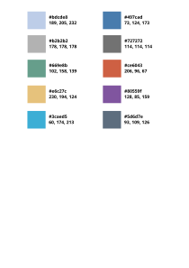

# DESIGN.md — data-workbench 统一视觉设计规范

> **本文档是 data-workbench 全部视觉表现的唯一权威规范**，统一两件事：
>
> 1. **界面（UI）设计规范** —— 面板、按钮、状态指示、自绘图形、内嵌 Web 视图的配色与风格；
> 2. **图标设计规范与色系** —— SVG 图标的画布规格、用色、色彩组合规则、命名、文件结构，以及官方色板。
>
> **色系唯一权威源**：[`docs/assets/PIC/palette.svg`](docs/assets/PIC/palette.svg)（§2.1 图 1）。一切图标与界面用色必须取自该色板；引入任何新色值前，必须先更新色板图并按 §8 变更流程登记。

> **🔴 强制阅读（AI Agent 与开发者）**
>
> - 设计、修改任何界面元素（面板、按钮、状态指示、自绘图形）**之前**，通读 §1~§3；
> - 新增、替换、修改任意 `.svg` 图标（`src/DAGui/icon/`、`src/APP/Icon/`、插件 `icon/` 目录）**之前**，通读 §4、§5，完成后按 §6.1 Checklist 逐项核对；
> - 设计页面/控件完成后，按 §6.2 Checklist 自检。
>
> **适用范围**：`src/DAGui/`、`src/DACommonWidgets/`、`src/APP/` 及插件（`plugins/*/`）的全部可视元素；`src/DAGui/icon/`、`src/APP/Icon/`、插件 `icon/` 目录下的全部 SVG 资源；Agent 会话等内嵌 Web 视图中自绘的部分。
>
> **阅读对象**：AI Agent、UI/图标 contributor、界面开发者。

## 目录

| 章节 | 内容 |
|------|------|
| §1 | 设计定位与原则 |
| §2 | 色系（唯一权威） |
| §3 | UI 设计规范 |
| §4 | 图标设计规范 |
| §5 | 现有图标资源清单（先查再画） |
| §6 | AI 工作流与自检 Checklist |
| §7 | 禁止事项 |
| §8 | 变更流程与维护 |
| §9 | 相关规范 |

---

## 1. 设计定位与原则

data-workbench 的视觉语言围绕「**科研工程工具**」定位展开：精确、克制、信息密度，避免消费级应用的装饰性元素。

### 1.1 设计原则

| # | 原则 | 说明 |
|---|------|------|
| 1 | **扁平化（Flat Design）** | 禁用渐变、阴影、高光、模糊；层次用 `opacity` / `fill-opacity` 表达（如 `expand-all.svg` 用 `fill-opacity="0.7"`） |
| 2 | **几何简洁** | 线条干净、转角方正，不使用手绘感笔触 |
| 3 | **线条 + 填充混合** | 大多数图标采用「中性色轮廓 + 语义色填充」的双层结构 |
| 4 | **语义化配色** | 颜色本身传递含义（绿=确认/添加、红=删除/危险、蓝=主操作/数据、黄=收藏），同一套色板同时约束图标与 UI 控件 |
| 5 | **无文字** | 图标中不嵌入任何文字字符（数据类型图标中的 `I/F/T/O` 等是字形图形化绘制的 `<path>`，不是 `<text>` 元素） |
| 6 | **边缘紧凑** | 图标内容贴近画布边缘，只保留少量间隙，使其在工具栏中尽量占满显示区域。例：`32×32` 画布，绘制区域控制在 `30×30` 或 `28×28` 内，四周留 1~2 的间隙即可 |
| 7 | **复用优先** | 先查现成图标（§5）与现成控件（DACommonWidgets / 统一表单 / 设置面板架构），能复用不新建；不发明新样式（新色值、新圆角、自定义控件外观） |

### 1.2 UI 一致性原则

图标与界面控件共享同一套色板与几何语言：

- 工具栏按钮的图标主色应与该操作的语义色一致（删除按钮的图标用红，确认按钮的图标用绿）。
- 容器型面板的边框、卡片底色与同名图标采用相同的蓝/灰层级（见 §4.2.1）。
- 状态指示（消息级别、数据类型标记）在图标与 UI 文字配色中保持统一语义。

---

## 2. 色系（唯一权威）

> **关键**：每种颜色都承担语义。新增图标或 UI 控件必须按语义从官方色板选色，不要引入新的色值，也不要使用 §2.4 登记的遗留色。

### 2.1 官方色板

官方色板定义在 [`docs/assets/PIC/palette.svg`](docs/assets/PIC/palette.svg)，是本项目一切视觉用色的唯一权威来源：



*图 1：官方色板（`docs/assets/PIC/palette.svg`）。色板图为准，下表为登记与解读；两者不一致时以图为准，并立即修订本表。*

| 色值 | RGB | 名称 | 语义角色 | 图标用途 | UI 用途 |
|------|-----|------|---------|---------|---------|
| `#5280C1` | 82, 128, 193 | **主蓝（Primary Blue）** | 主操作、强调 | 主操作轮廓、强调元素、数据类型卡片边框 | 主操作（执行/确认）按钮、选中态边框 |
| `#497CAD` | 73, 124, 173 | **深蓝（Secondary Blue）** | 单色图标、链接、连线 | iconfont 类单色图标、工作流连线、轴向标记 | 链接文字、连线、次级强调 |
| `#BDCDE8` | 189, 205, 232 | **浅蓝（Light Blue）** | 背景、次级填充 | 容器背景、次级填充、卡片底色 | 列表项 hover/选中底色、图表区域底色 |
| `#727272` | 114, 114, 114 | **中灰（Primary Gray）** | 中性轮廓、分隔 | 图标主轮廓线、中性容器边框、未激活元素 | 普通边框、分隔线 |
| `#B2B2B2` | 178, 178, 178 | **浅灰（Light Gray）** | 次要、禁用 | 次要轮廓、禁用态、副图层 | 禁用态控件 |
| `#5D6D7E` | 93, 109, 126 | **深蓝灰（Slate）** | 深色中性（文字/线） | 深色边框与深色线条 | 正文文字、深色文字 |
| `#669E8B` | 102, 158, 139 | **绿（Success Green）** | 确认、添加、成功 | 对勾、`+` 标记、数据系列色 | 成功状态文字/图标、添加/新增操作 |
| `#CE6043` | 206, 96, 67 | **橙红（Danger Red）** | 删除、取消、危险、错误 | 删除/取消/移除图标、数据系列色 | 删除/危险操作按钮、错误状态文字与图标 |
| `#E6C27C` | 230, 194, 124 | **金黄（Favorite Yellow）** | 收藏、文件夹、标记 | 收藏星标、文件夹主体 | 收藏/标记操作 |
| `#80559F` | 128, 85, 159 | **紫（Series Purple）** | 图表系列分类 | 散点/统计图分类系列 | 图表数据系列 |
| `#3CAED5` | 60, 174, 213 | **青蓝（Series Cyan）** | 图表系列、强调点缀 | 文件类图标点缀、数据系列色 | 图表数据系列 |

基础中性色 **白 `#FFFFFF`** 是色板隐含色（色板图中无独立色块），无需登记即可使用，用于图标内部留白、卡片与面板底色。三级蓝构成主色系梯度：

**深蓝 `#497CAD`（单色/连线）→ 主蓝 `#5280C1`（轮廓/强调）→ 浅蓝 `#BDCDE8`（背景/填充）**

新增任何颜色前必须先更新色板图，见 §8。

### 2.2 色板速查（新增只允许这些色值 + 白色）

| 语义 | 色值 |
|------|------|
| 主蓝 | `#5280C1` |
| 深蓝 | `#497CAD` |
| 浅蓝 | `#BDCDE8` |
| 中灰 | `#727272` |
| 浅灰 | `#B2B2B2` |
| 深蓝灰（深色文字/线） | `#5D6D7E` |
| 绿（成功） | `#669E8B` |
| 橙红（危险/错误） | `#CE6043` |
| 金黄（收藏） | `#E6C27C` |
| 紫（系列分类） | `#80559F` |
| 青蓝（系列/强调） | `#3CAED5` |
| 白 | `#FFFFFF` |

### 2.3 语义色细则

- **`#5280C1` 主蓝**：`data-type/*.svg` 画外框 + 字符、`#FFFFFF` 填充内部；`chart.svg` 绘制曲线；复制类图标中的新对象。
- **`#497CAD` 深蓝**：全图单色的 iconfont 类图标（`setting-link.svg`、`setting-common.svg` 等）、工作流连线、轴向标记。
- **`#727272` 中灰**：中性网格与轮廓（`data-table.svg` 网格线、`copy.svg` 的源对象）；放大镜外圈（`zoomIn`/`zoomOut`）。
- **`#669E8B` 绿**：确认/添加标记 —— `accept.svg` 对勾、`zoomIn.svg` 的「+」、`right-add.svg` 的「+」、`messageTypeInfo.svg` 的 `i` 字、`data-type/datetime.svg` 的绿色分针。
- **`#CE6043` 橙红**：删除/取消/危险 —— `delete.svg`、`cancel.svg`、`left-remove.svg`、`zoomOut.svg` 的「−」、`datetime.svg` 的红色时针。
- **`#E6C27C` 金黄**：`favorite.svg` 五角星、`folder.svg` 文件夹主体。
- **`#80559F` / `#3CAED5`（紫/青蓝）**：只用于**图表系列分类**或**强调点缀**（`chart-scatter.svg` 散点分类、`APP/Icon/file.svg`、`APP/Icon/markdown.svg`），不得替代主蓝用于通用功能图标的轮廓与主体。
- **`#FFFFFF` 白**：几乎所有「容器型」图标（`data-type/*`、`question.svg` 的问号、`messageTypeInfo.svg` 的信息点）都用白色作为内部填充，让主色轮廓更突出。

### 2.4 遗留色（不属于官方色板，仅存量保留）

以下色值存在于现有图标中，但**不属于官方色板**。处理规则：

- **新增图标一律禁止使用**；
- 标注「注册例外」的色块是整体引入的历史成套配色，允许该套图标内部延续使用；
- 其余遗留色在下次修订对应图标时，应收敛到「处理方式」列出的官方色。

| 遗留色 | 现存位置 | 处理方式 |
|--------|---------|---------|
| `#CF3736` | `messageTypeError.svg`（DAGui / APP 两处） | 注册例外（messageType 成套，见 §4.2.5），存量保留 |
| `#FFDE33` / `#FFBC33` | `messageTypeWarning.svg` 黄色三角 | 注册例外（messageType 成套），存量保留 |
| `#495A79` / `#42516D` | `messageTypeWarning.svg` 边框与叹号 | 注册例外（messageType 成套），语义上可由 `#5D6D7E` 替代 |
| `#AD925D` | `folder.svg` 阴影面 | 存量保留，新图标不再引入暗金 |
| `#BFD1EB` | `data.svg`、`workflow.svg`、`question.svg`、`showDataIn*/insertColumn*/insertRow*` 等列表/插入类填充 | 修订时统一为 `#BDCDE8` |
| `#515151` | `data.svg` 表头、`rename-column.svg` 等 | 修订时收敛为 `#5D6D7E` |
| `#BFBFBF` / `#7F7F7F` | `picture.svg` 的禁用/次要轮廓 | 修订时收敛为 `#B2B2B2` / `#727272` |
| `#D1D1D1` / `#000000` | `viewAll.svg` 及部分 APP 图标（`addFigure`、`newWorkflow`、`chart-picker`、`itemLinkageMove`） | 修订时收敛为 `#B2B2B2` / `#727272` |
| `#333333` | iconfont 系（`castToDatetime`、`castToNum`、`castToString`） | 修订时收敛为 `#497CAD` 或 `#727272` |
| `#575869` | `item-set-group.svg`、`item-cancel-group.svg` | 修订时收敛为最接近的官方色 |
| `#64FF6C` / `#C7D0DA` | `itemLinkageMove.svg` | 修订时收敛为 `#669E8B` / `#B2B2B2` |
| `#E4C651` | `file.svg`、`markdown.svg` | 修订时收敛为 `#E6C27C` |
| `#B3B3B3` | `removeRow.svg`、`removeColumn.svg`、`showInfomation.svg` | 修订时收敛为 `#B2B2B2` |
| `#37812E` | `plugins/DataAnalysis/icon/export-to-one-xlsx.svg`（Excel 工作簿主体） | **注册例外**：Office/Excel 品牌绿，仅限该 Excel 导出图标保留，其它图标不得引用 |

---

## 3. UI 设计规范

本节把设计原则与色板落到界面控件上，保证图标与 UI 同源。

### 3.1 配色映射（UI 元素 → 色值）

| UI 元素 | 色值 | 语义来源 |
|---------|------|---------|
| 主操作按钮（执行/确认） | `#5280C1` | 主蓝 |
| 危险操作按钮（删除/移除） | `#CE6043` | 橙红 |
| 成功状态文字/图标 | `#669E8B` | 绿 |
| 错误状态文字/图标 | `#CE6043` | 橙红（存量 `messageTypeError` 的 `#CF3736` 为历史例外） |
| 普通边框 / 分隔线 | `#727272` | 中灰 |
| 正文文字 | `#5D6D7E` | 深蓝灰 |
| 禁用态控件 | `#B2B2B2` | 浅灰 |
| 列表项 hover / 选中底色 | `#BDCDE8` | 浅蓝 |
| 面板 / 卡片底色 | `#FFFFFF` | 白 |
| 收藏 / 标记操作 | `#E6C27C` | 金黄 |

### 3.2 控件风格约定

- **按钮**：扁平化，无渐变/阴影；主操作用主蓝边框或主蓝填充，危险操作用橙红。
- **面板 / 卡片**：白底 + 中灰或主蓝细边框；圆角与现有 `DACommonWidgets` 保持一致，不自行引入新的圆角半径。
- **列表 / 树**：选中项底色用浅蓝（`#BDCDE8`），文字用深蓝灰（`#5D6D7E`）；禁用项用浅灰。
- **状态指示**：与 `messageType/` 图标语义一一对应 —— Info 蓝、Warning 黄、Error 红、Debug 蓝。
- **图标按钮**：图标主色即操作语义色；hover/pressed 态通过 `opacity` 而非新增色值表达。
- **表单与设置面板**：属性表单统一走 `DAPropertyFormWidget` / `DAFormSpec` 机制，面板结构遵循「设置面板三层架构」；不为单个界面自造控件外观或局部样式。结构见 [creating-setting-panel.md](docs/zh/dev-guide/ui/creating-setting-panel.md)、[settingwidget-standard.md](docs/zh/dev-guide/ui/settingwidget-standard.md)。
- **字体**：沿用平台默认与所在控件的既有设置，不为单个界面引入自定义字体族。
- **自绘元素**（表格角标、选择框、条件格式、光标高亮、选中框……）：同样只从官方色板取色，见 §3.3 先例。

### 3.3 已落地的取色先例（新增自绘元素时对照）

| 位置 | 用色 | 语义 |
|------|------|------|
| 表头多列规格角标（`src/DAGui/DADataHeaderView.cpp`） | 主蓝 `#5280C1` 圆底 + 白字 | 主操作/强调 |
| 条件格式色阶与数据条（`src/DAGui/DATableConditionalFormatRule.h`） | 色阶低端 `#BDCDE8` → 高端 `#5280C1`；数据条 `#BDCDE8` | 浅蓝底 → 主蓝强调 |
| 图表指针框选（`src/DAFigure/DAFigurePointerSelectorOverlay.cpp`） | 橙红 `#CE6043` | 危险/删除指向 |
| Markdown 高亮（`src/DAUtils/DAMarkdownHighlighter.cpp`） | 标题/链接 `#5280C1`、列表 `#497CAD` | 主蓝强调 / 深蓝次级 |
| 设置页状态提示（`src/APP/SettingPages/DASettingPageShortcuts.cpp` 等） | 错误 `#CE6043`、正文 `#5D6D7E`；连接成功 `#669E8B` | 语义色直用 |

### 3.4 内嵌 Web 视图（Agent 会话等）

Agent 会话（`src/DAGui/Agent/resources/chat.css`）等内嵌 Web 界面的自绘部分，同样以官方色板为基准：强调/可点击入口用主蓝 `#5280C1`，危险/错误用 `#CE6043`。存量第三方语义色（bootstrap 系状态色等）不扩散到新元素。

### 3.5 主题兼容

应用支持多套 SARibbon 主题（Ribbon 外观下拉、设置 → 通用；含 Office 2016/2021 Dark、Dark、Dark 2 等深色主题），而图标资源是一套、不随主题切换。因此新增图标与自绘元素必须保证在深色背景下仍可辨识：**白色只用于图标内部留白与面板底色，不作为对外轮廓的主要颜色**；主要线条用中灰 `#727272`、深蓝灰 `#5D6D7E` 或语义色。

### 3.6 图标与控件的语义对应

新增 UI 控件时，若该控件带图标，图标配色必须遵循 §2 语义色板，并与控件本身的语义色（按钮色、状态色）一致：

- 「删除行」按钮：按钮边框/文字用 `#CE6043`，配套 `delete.svg` 同色系。
- 「确认」对话框按钮：用 `#5280C1`，配套 `accept.svg` 的对勾用 `#669E8B`。

---

## 4. 图标设计规范

### 4.1 画布规格（viewBox）

项目图标混用了多种画布尺寸，按场景选择：

| 场景 | viewBox | 示例 |
|------|---------|------|
| 通用功能图标（200×200） | `0 0 200 200` | `chart.svg`、`setting.svg`、`copy.svg`、`cut.svg` |
| 图表类型图标（64×64） | `0 0 64 64` | `chart-type/*.svg`（DAGui 与 APP 目录）、`axisLeftBottom.svg` |
| 状态/消息图标（32×32） | `0 0 32 32` | `messageType/*`、`accept.svg`、`cancel.svg` |
| iconfont 系图标（1024×1024） | `0 0 1024 1024` | `delete.svg`、`favorite.svg`、`select-all.svg`、`setting-common.svg`（存量） |
| 数据类型图标（200×200） | `0 0 200 200` | `data-type/*.svg` |

**新增图标规则**：

- 通用功能图标统一采用 **200×200**（与现有大多数图标一致）
- 图表类小图标采用 **64×64**（`chart-type/` 子目录**强制** 64×64）
- 消息状态类采用 **32×32**
- **不要再引入新的画布尺寸规格**（历史遗留的 `chart-spectrocurve.svg` 为 `66.125×64`，仅作现状保留，新增图标不得沿用）

即使 `viewBox` 不同，`width`/`height` 属性通常设为 `200` 或 `64`（显示尺寸），由 Qt 渲染时按 `viewBox` 等比缩放。新增图标保留 `width="200" height="200"` 即可。

### 4.2 色彩组合规则

#### 4.2.1 容器型图标（卡片 / 面板 / 窗口）

```
外框轮廓：#5280C1（主蓝） 或 #727272（中灰）
内部填充：#FFFFFF（白）
次级元素：#BDCDE8（浅蓝）
```

示例：`data-type/int.svg`、`data.svg`、`question.svg`

> 对应 UI：卡片型面板（数据预览、属性面板）遵循相同的「主蓝/中灰边框 + 白底 + 浅蓝次级块」结构。

#### 4.2.2 功能操作图标（复制 / 粘贴 / 剪切等）

```
源对象/中性结构：#727272（中灰）
目标对象/主操作：#5280C1（主蓝）
正向结果标记：#669E8B（绿）
负向结果标记：#CE6043（橙红）
```

示例：`copy.svg`（灰源 + 蓝目标 + 绿加号）、`left-remove.svg`（红箭头 + 金叉）

#### 4.2.3 图表类型图标（`chart-type/`）

```
数据系列取色池（按优先顺序）：
  #CE6043（橙红）→ #497CAD（深蓝）→ #669E8B（绿）
  → #80559F（紫）→ #E6C27C（金黄）→ #3CAED5（青蓝）
轴线/边框：#727272（中灰）
```

- 图表类型图标的**唯一存放位置**是 `DAGui/icon/chart-type/`（23 个 = 14 个 `chart-*` + 9 个 `stats-*`），资源前缀 `:/DAGui/ChartType/`。APP 层经该前缀引用（APP → DAGui 方向合法），不得在 `APP/Icon/` 下再建副本。
- `DAFigure/icon/` 保留 10 个与 `chart-type/` 同名同内容的图标（`chart-bar`/`chart-curve`/`chart-OHLC`/`chart-multibar`/`chart-scatter`/`chart-histogram`/`chart-intervalcurve`/`chart-spectrocurve`/`chart-spectrogram`/`chart-vectorfield`）：`DAChartUtil::plotItemIcon()` 属于 L2 功能层，不能反向依赖 L3 的 DAGui 资源，因此这份副本是层级约束下的必要重复，修改时两处同步。
- 以 `chart-bar`/`chart-bar3d` 为代表的前 3 色（橙红/深蓝/绿）与 3D 图表是一类范本；`chart-scatter`（散点分类）、`chart-spectrocurve`（光谱曲线）按分类需要扩展使用紫/金。
- **图表系列色必须从官方色板取色，不得引入新色**。

#### 4.2.4 数据类型图标（`data-type/`）

```
卡片外框：#5280C1（主蓝，宽边框）
卡片背景：#FFFFFF（白）
类型字符：#5280C1（主蓝）
```

所有 `data-type/*.svg`（dataframe/int/float/str/obj/datetime）都遵循这一统一模板，仅中心字符不同。`datetime.svg` 额外用 `#CE6043`（红时针）+ `#669E8B`（绿分针）表达「时间」语义。

#### 4.2.5 消息类型图标（`messageType/`）

```
Info：    #497CAD（蓝圆圈） + #669E8B（绿 i 字）
Error：   #CF3736（红圆圈） + 白色 X（镂空）
Warning： #FFDE33/#FFBC33（黄三角） + #495A79（深蓝边框/叹号）
Debug：   #497CAD（蓝虫子，单色）
```

> 这套配色来自 iconfont 第三方图标库，是本项目唯一的「官方色板外注册例外」（见 §2.4）。新增同系列消息图标沿用此套色系；其他场景不得引用这些色值。UI 消息队列中 Info/Warning/Error 的文字配色应对齐 §3.1 的官方语义色。

### 4.3 图表系列取色（与绘图区一致）

图表绘制区的曲线/柱状默认按 §4.2.3 的系列池顺序取色，保证**图标预览与实际渲染一致**。新增图表类型图标时，先确认绘图区的系列色，再按同一顺序取色。

### 4.4 命名规范

- **文件名**：小驼峰（`camelCase`），如 `axisLeftBottom.svg`、`insertColumnRight.svg`、`zoomIn.svg`
- **子目录**：小写连字符（`kebab-case`），如 `chart-type/`、`data-type/`（注：`messageType` 未采用连字符，是历史遗留，新增子目录用 `kebab-case`）
- **语义前缀**：
  - `axis*`：坐标轴方位
  - `chart*` / `chart-type/chart-*`：图表类型与图表工具
  - `stats-*`：统计图表类型（`APP/Icon/chart-type/stats-*`）
  - `view-*-marker`：视图标记（十字线、水平线、垂直线）
  - `setting-*`：各类设置入口
  - `left/right/top/bottomSide*`：方向性操作
  - `showDataIn*`：数据展示方式
  - `session-*`：会话管理

> 注：`node-settting.svg` 为历史拼写错误的文件名，因资源已被代码引用而保留，新增图标不得沿用此类拼写。

### 4.5 SVG 文件结构要求

新增 SVG 图标应满足以下结构约束，以保证 Qt 渲染兼容与可维护性：

- 根 `<svg>` 必须含 `xmlns="http://www.w3.org/2000/svg"`、`viewBox`、`width`、`height`。
- 颜色优先用 `fill="#XXXXXX"` 内联属性，避免 `<style>` + class（除非复用 Illustrator 的 `stN` 模式）。
- 不引用 `@font-face`、外部图片、`xlink:href`；所有图形用 `<path>`/`<rect>`/`<circle>` 等原生元素绘制。
- 字形（`I/F/T/O` 等）用 `<path>` 绘制，禁止 `<text>` 元素。
- 文件保持静态，不含 `<animate>`、`<animateTransform>` 等动画。
- 内部填充用 `#FFFFFF` 实体填充（不要留空/透明），保证容器型图标在任何背景上轮廓完整。

### 4.6 图标来源与风格特征

项目图标有三个来源，文件特征略有差异：

**Adobe Illustrator 导出（主体，新增推荐）**

- 文件头：`<!-- Generator: Adobe Illustrator 16.0.0/21.0.0, SVG Export Plug-In -->`
- 颜色采用 `fill="#XXXXXX"` 内联属性；部分使用 `<style>` + `class="stN"` 模式（如 `data.svg`、`workflow.svg`、`question.svg`、`showDataInList.svg`）
- `id="图层_1"` 中文图层名
- 新增图标推荐用此风格，颜色直接用 `fill="#XXXXXX"` 属性形式，便于检索与修改

**iconfont 图标库（少量）**

- 文件头含 `class="icon"` 与 `t="时间戳"` 属性，`viewBox` 多为 `0 0 1024 1024`，含 `p-id="数字"` 属性
- 代表性文件：`delete.svg`、`favorite.svg`、`node.svg`、`setting-common.svg`、`setting-link.svg`、`setting-node.svg`、`setting-item.svg`、`select-all.svg`、`view-*-marker.svg`、`messageTypeError.svg`、`messageTypeWarning.svg`、`picture.svg`、`node-settting.svg`、`renameColumns.svg`

**Inkscape 导出（极少量）**

- 文件含 `xmlns:inkscape`、`xmlns:sodipodi`、`<sodipodi:namedview>` 等命名空间
- 代表：`zoomIn.svg`、`zoomOut.svg`

---

## 5. 现有图标资源清单（先查再画）

> 新增图标前**先查本节与目录**：能复用现有图标就复用，能沿用现有模板（如 `data-type/` 蓝框白底）就沿用。
> 以下清单核对于 2026-10-17；**目录为准**，调整图标后同步更新本节。

### 5.1 `src/DAGui/icon/` 根目录（84 个功能性图标）

| 类别 | 文件 |
|------|------|
| 操作类 | `accept.svg`、`cancel.svg`、`copy.svg`、`cut.svg`、`paste.svg`、`delete.svg`、`delete-column.svg`、`delete-all-columns.svg`、`insertColumnRight.svg`、`rename-column.svg`、`renameColumns.svg`、`replace.svg`、`find.svg`、`refresh.svg`、`refresh-all.svg` |
| 条件格式 | `conditional-format.svg` |
| 视图缩放 | `zoomIn.svg`、`zoomOut.svg`、`viewAll.svg`、`gotoMax.svg`、`gotoMin.svg` |
| 展开/折叠、列显隐 | `expand-all.svg`、`collapse.svg`、`show-column.svg`、`show-all-columns.svg`、`hide-column.svg`、`hide-all-columns.svg` |
| 选择 | `select-all.svg`、`showDataInList.svg`、`showDataInTree.svg` |
| 数据 | `data.svg`、`data-table.svg`、`favorite.svg`、`removeFavorite.svg`、`folder.svg`、`picture.svg` |
| 图表/绘图 | `chart.svg`、`figure-setting.svg`、`plot-setting.svg`、`plot-item-setting.svg`、`data-picker-setting.svg` |
| 节点/工作流 | `node.svg`、`workflow.svg`、`node-settting.svg`、`setting-node.svg` |
| 设置类 | `setting.svg`、`setting-common.svg`、`setting-item.svg`、`setting-link.svg`、`setting-advanced.svg`、`setting-agent.svg`、`setting-log.svg`、`setting-python.svg`、`setting-shortcuts.svg` |
| 会话 | `session.svg`、`session-manager.svg`、`session-new.svg`、`session-running.svg`、`session-waiting.svg`、`session-error.svg` |
| 坐标轴 | `axisLeftBottom.svg`、`axisLeftTop.svg`、`axisRightBottom.svg`、`axisRightTop.svg`、`axisXBottom.svg`、`axisXTop.svg`、`axisYLeft.svg`、`axisYRight.svg` |
| 方向性 | `leftSideIn.svg`、`leftSideOut.svg`、`rightSideIn.svg`、`rightSideOut.svg`、`topSideIn.svg`、`topSideOut.svg`、`bottomSideIn.svg`、`bottomSideOut.svg`、`right-add.svg`、`left-remove.svg` |
| 标记 | `view-corss-marker.svg`、`view-hline-marker.svg`、`view-vline-marker.svg`、`view-none-marker.svg` |
| 其他 | `clear-message.svg`、`question.svg` |

### 5.2 `src/DAGui/icon/` 子目录

| 子目录 | 内容 |
|--------|------|
| `chart-type/` | 23 个图表类型图标（14 个 `chart-*`：柱/曲/直方/区间曲/多柱/OHLC/散点/二维散点/光谱曲/光谱图/矢量场/3D 柱/3D 曲/3D 曲面；9 个 `stats-*`：barplot/boxplot/ecdfplot/heatmap/histplot/kdeplot/kdeplot-2d/regplot/scatterplot），统一 64×64。**全项目唯一存放位置** |
| `data-type/` | 6 个数据类型图标（DataFrame/DateTime/Float/Int/Obj/Str），统一 200×200 蓝框白底 |
| `messageType/` | 4 个消息级别图标（Debug/Info/Warning/Error），统一 32×32 |

### 5.3 `src/APP/Icon/`

- **根目录（117 个应用级图标）**：图表工具（`chart-*`）、数据转换（`castTo*`）、缩放（`zoomIn`/`zoomOut`）、导入导出、工作流/项目管理、消息级别图标等；配色与画布同样受本规范约束。
- 图表类型图标统一放在 `DAGui/icon/chart-type/`（见 §5.2），本目录不再保留 `chart-type/` 副本。
- `settingpages/`：Ribbon 样式预览 SVG（设置页用），非图标资源；4 个文件统一 `240×96` 画布，按标准/紧凑 × 两行/三行画出面板与按钮排布。

### 5.4 插件图标

`plugins/*/PyScripts/*/icon/` 下的节点图标（如 `plugins/DASystemNodes/PyScripts/DASystemNodes/icon/`、`plugins/DataAnalysis/PyScripts/DADataAnalysisNodes/icon/`）：统一 200×200 SVG，配色同样遵循本规范（例：`delay.svg` 红色指针表示延时、`outlierIqr.svg` 蓝色须线 + 红色离群点）。

---

## 6. AI 工作流与自检 Checklist

### 6.1 生成 / 修改图标

**步骤**：

1. **查现有**：在 §5 清单与目标目录里找可复用图标；能复用不新建。新建前先找同类模板（如 `data-type/`、`chart-type/` 的参考范本）。
2. **定语义**：这个图标表达什么操作/状态（主操作？删除？收藏？系列分类？），据此从 §2.2 速查表选色。
3. **选画布**：通用 200×200、图表类 64×64、消息状态 32×32（§4.1）。
4. **按结构写 SVG**：参照同类现有文件（推荐 Illustrator 导出风格的 `fill="#XXXXXX"` 内联属性）。
5. **跑校验**：执行 §6.3 校验命令。
6. **逐项核对 Checklist**（下）。

**Checklist**：

- [ ] **色系权威源**：色值全部取自 §2.1 官方色板（含白色），未引入新色值，未使用 §2.4 遗留色
- [ ] **画布**：通用图标 `viewBox="0 0 200 200"`，图表小图标 `0 0 64 64`，消息状态 `0 0 32 32`；`width`/`height` 与显示尺寸一致
- [ ] **扁平化**：无 `<linearGradient>`、`<radialGradient>`、`<filter>`（阴影/模糊）
- [ ] **语义选色**：
  - 主操作/数据轮廓 → `#5280C1`，单色图标/连线 → `#497CAD`
  - 确认/添加/正向 → `#669E8B`
  - 删除/取消/危险/错误 → `#CE6043`
  - 收藏/文件夹 → `#E6C27C`
  - 中性轮廓 → `#727272`，深色文字/线 → `#5D6D7E`
  - 图表系列分类 → `#80559F` / `#3CAED5`（仅限系列分类场景）
- [ ] **内部留白**：容器型图标用 `#FFFFFF` 填充内部，不要留空（透明）
- [ ] **无文字**：不使用 `<text>` 元素，字形用 `<path>` 绘制
- [ ] **颜色属性形式**：优先用 `fill="#XXXXXX"` 内联属性，避免 `<style>` + class
- [ ] **无外部依赖**：不引用 `@font-face`、外部图片、`xlink:href`
- [ ] **无动画**：不含 `<animate>`、`<animateTransform>`
- [ ] **文件名**：`camelCase`，语义清晰；未沿用历史拼写错误
- [ ] **深色主题可辨识**：不依赖白色背景衬托，主要线条/色块本身与深底可区分
- [ ] **配套一致**：若该图标配套某个 UI 控件，图标主色与该控件语义色一致

### 6.2 设计页面 / 控件

**步骤**：

1. **先查复用**：现有组件（`src/DACommonWidgets/`、`src/DAGui/`）能满足就不自造；属性表单走 `DAPropertyFormWidget`/`DAFormSpec`，设置面板沿用三层架构。
2. **配色**：按 §3.1 映射表取色；自绘元素对照 §3.3 先例。
3. **图标**：按 §6.1 选择或新做，语义与控件一致。
4. **自检 Checklist**（下）。

**Checklist**：

- [ ] 新增配色全部来自官方色板，未硬编码色板外 hex（`#CE6043`、`#669E8B`、`#5D6D7E` 等语义色用得恰到好处）
- [ ] 颜色语义正确：主操作蓝 / 危险红 / 成功绿 / 正文深蓝灰 / 禁用浅灰 / 列表选中浅蓝
- [ ] 未引入新圆角半径、自定义字体族、渐变/阴影
- [ ] 配套图标的语义色与控件一致（删除按钮配红色图标，确认按钮配绿色对勾）
- [ ] 自绘元素（角标、选择框、条件格式、光标高亮）从色板取色
- [ ] 状态指示与 `messageType/` 语义一一对应
- [ ] 深色主题下仍可辨识（不依赖浅色底）
- [ ] 界面文字遵循 [i18n.md](docs/zh/dev-guide/general/i18n.md) 的 `tr("English") //cn:中文` 模式

### 6.3 校验命令

```bash
# 1) 列出某个 SVG 用到的全部色值，对照 §2.2 速查表
grep -o "#[0-9A-Fa-f]\{6\}" 图标.svg | tr 'a-f' 'A-F' | sort -u

# 2) 扫描目录：列出不在官方色板内的色值（结果应只命中 §2.4 存量遗留色）
grep -roh "#[0-9A-Fa-f]\{6\}" src/DAGui/icon --include="*.svg" | tr 'a-f' 'A-F' | sort -u \
  | grep -viE "#(5280C1|497CAD|BDCDE8|727272|B2B2B2|5D6D7E|669E8B|CE6043|E6C27C|80559F|3CAED5|FFFFFF)$"

# 3) 检查禁用元素（应无输出）
grep -nE "<text|Gradient|<filter|<animate|xlink:href|@font-face" 图标.svg
```

---

## 7. 禁止事项

**色系与图标**

- 引入官方色板（`docs/assets/PIC/palette.svg`）之外的新色值（如确有必要，先按 §8 变更流程登记）
- 新增图标使用 §2.4 登记的遗留色
- 引入渐变、阴影、发光效果
- 使用 `<text>` 元素表达图标内容
- 在 `chart-type/` 子目录引入非 64×64 画布
- 在 `data-type/` 子目录改变「蓝框白底」的统一容器样式
- 修改 `messageType/` 的语义色（蓝/红/黄/蓝是稳定的用户认知）
- 引入动画（`<animate>`、`<animateTransform>` 等），所有图标均为静态
- 在插件中引入与主程序图标风格、色系不一致的自制图标

**UI**

- UI 控件配色与配套图标语义色不一致（如删除按钮用蓝色图标）
- 为单个界面引入新色值、新圆角、自定义字体族或自造控件外观
- 用 `#80559F` / `#3CAED5` 替代主蓝，去做通用功能图标的轮廓与主体
- 白色被用作对外轮廓的主要颜色（深色主题下会失效）

---

## 8. 变更流程与维护

修改本规范时：

1. 任何新增色值必须**先由项目负责人确认并更新官方色板图 `docs/assets/PIC/palette.svg`**（Inkscape 打开，按现有色块样式追加），再在本文件 §2.1 登记语义角色，最后才能用于图标或 UI。
2. 画布规格、语义映射的变更须同步更新本文件 §4.1 / §3。
3. **规范只在本文档维护**（仓库根目录 `DESIGN.md`）。文档站入口页 `docs/zh/dev-guide/general/icon-ui-design-guide.md` 只做指引，不复制正文；源码目录下不放目录级指引，避免同一件事出现两份说法。
4. 批量改色或新增图标后，同步更新 §5 文件清单与 §4.2 组合规则中的示例；存量遗留色（§2.4）清理后，从表中移除对应记录。
5. 本文件被 `AGENTS.md` 引用，是 AI Agent 做界面与图标设计时的必读依据，修订后无需改动 `AGENTS.md` 正文。

---

## 9. 相关规范

| 规范 | 说明 |
|------|------|
| [coding-standard.md](docs/zh/dev-guide/general/coding-standard.md) | 代码命名、注释与风格（本文件约束视觉表现） |
| [creating-setting-panel.md](docs/zh/dev-guide/ui/creating-setting-panel.md) | 属性设置面板的创建（结构） |
| [settingwidget-standard.md](docs/zh/dev-guide/ui/settingwidget-standard.md) | 设置类窗口 6 函数生命周期 |
| [i18n.md](docs/zh/dev-guide/general/i18n.md) / [python-i18n.md](docs/zh/dev-guide/general/python-i18n.md) | 界面文案国际化 |
| [module-dependency.md](docs/zh/dev-guide/architecture/module-dependency.md) | 图标资源归属：通用 SVG 放 `src/DAGui/icon/`（L3 界面层），应用级放 `src/APP/Icon/`（L5 应用层） |
| [doc-writing-guide.md](docs/doc-writing-guide.md) | 文档撰写规范（Markdown 语法约定） |
