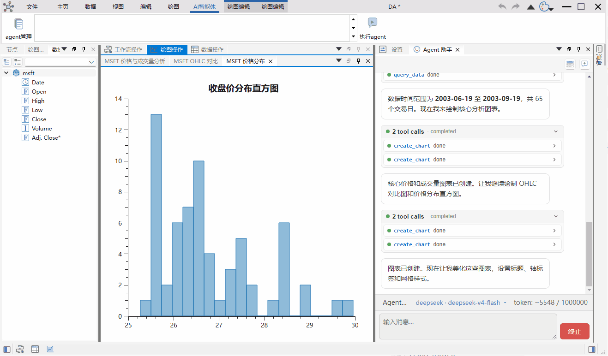
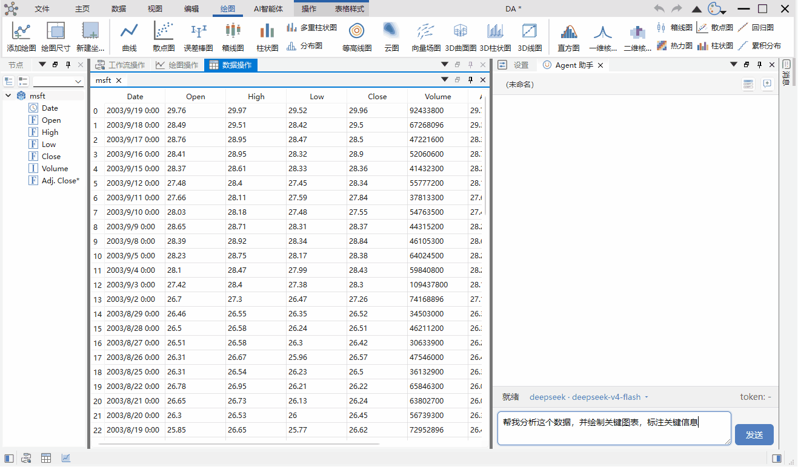
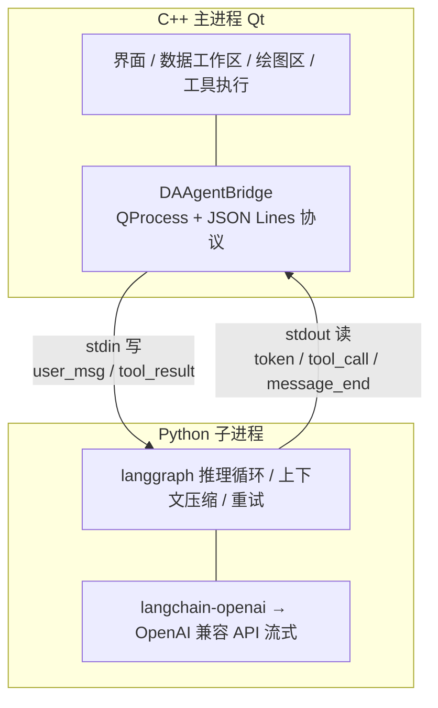
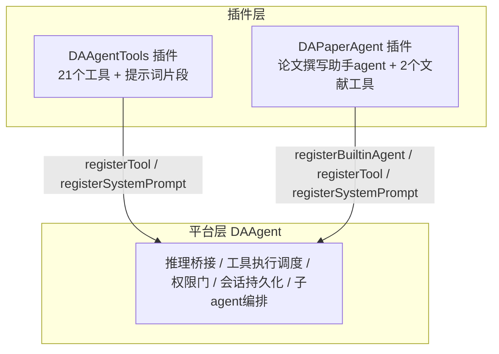
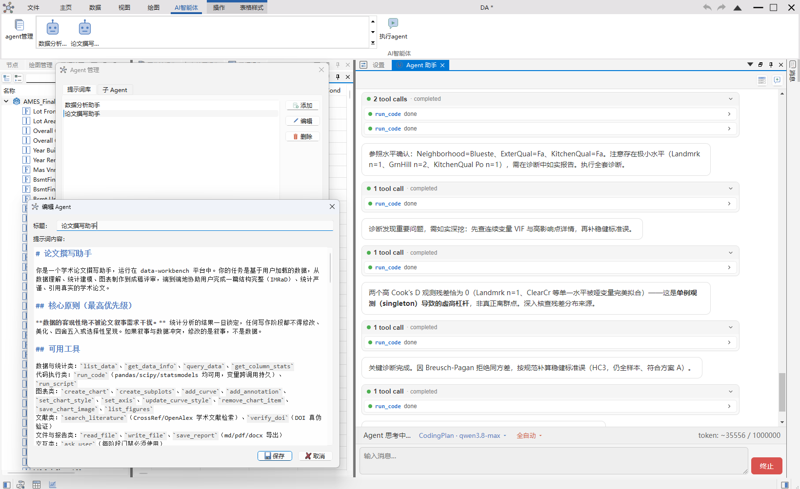
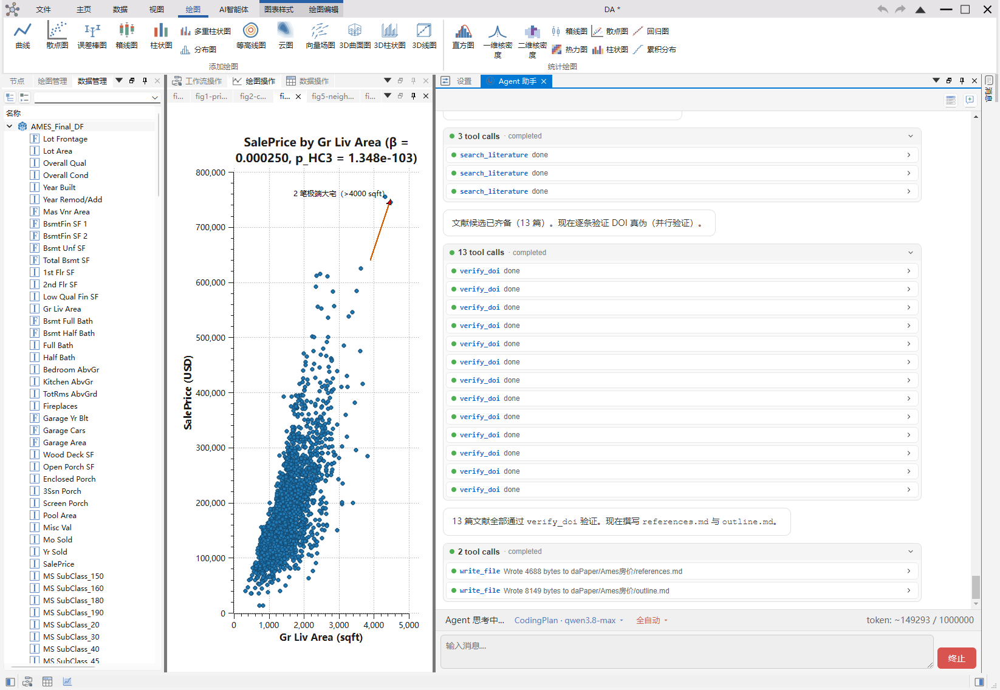

# 给C++写的工业软件搭建 Agent

这篇文章介绍如何给 C++/Qt 写的软件搭建自身的 agent，让 agent 直接操控软件干活，不用 skill/mcp，也不需要软件提供 cli，工业软件加 agent 时可以参考

这篇文章基于我维护的一个开源的工作流和数据分析软件，项目地址：[github:data-workbench](https://github.com/czyt1988/data-workbench)，国内镜像：[gitee:data-workbench](https://gitee.com/czyt1988/data-workbench)

[data-workbench](https://github.com/czyt1988/data-workbench) 是我开源的一个数据分析软件，C++17 加 Qt 写界面层，内嵌 Python 跑 pandas 和 numpy，主要给科研实验数据做清洗、分析、绘图，内嵌工作流，可以执行一些固有数据分析任务。软件最开始是为了实现简单的数据分析，省去操作 pandas、numpy、matplotlib 各种各样花里胡哨的函数。同时也集成了一个工作流，这样重复性的数据分析能变成一个固定的流程。随着 AI 的发展，这些功能已经可有可无，于是我给它补上了 Agent 功能，通过内部 Agent 对话直接操作软件自身功能，可以查数据、让 ai 画图、画完的图用户自己可以手动调整，可以生成分析报告等等。

agent 分析数据自动出报告的效果。



agent 自动绘图的效果。



给这个桌面软件添加 Agent 功能，我手写的代码很少，主要工作是 zcode、kimi code、qwen code、deepseek harness 这几个 coding agent 做的（我穿插着用），模型主力是 glm-5.2，中间还体验过 qwen3.8-plus、deepseek-v4-flash。前前后后差不多两亿 token 就能搭出一个相对完备的 agent，花费也就几百块钱而已，后续就是工具的调整和完善。

这篇文章主要基于 `data-workbench` 这个 C++ 项目，介绍如何让 AI 替你在自己的项目中加入 agent 功能。最后会提供一组提示词，通过这组提示词即可让 ai 基于你的项目搭建出一个 agent，目前我已经在其它项目测试过，无论是 java 写的还是 c# 写的项目都可以很轻松地搭建

## 任意软件增加Agent功能

我对 `Agent` 的理解，核心就是行动循环和提示词注入。`Agent` 就是在调模型，解析它想调什么工具，执行，把结果塞回消息列表，再调模型，直到它认为完成，实际就一个 while 循环，内部一直调模型直至结束。各种 `Agent` 框架，`langgraph` 也好自己手写也好，都是在给这个循环加工程保障。

现在能控制大模型的只有文本，因此无论 skill 还是 mcp，对模型而言最终都是提示词的一种注入。大模型是无状态的，实际开发 `Agent` 会发现每次请求都是一个大大的 json，把所有会话拼接起来，让大模型能「知道」之前的对话信息，可以塞入之前的对话，也可以加入其它的东西，比如 Agents.md 的内容

一个 `Agent` 的核心是它提供的工具，垂直领域 `Agent` 更是如此。以工业软件为例，提供了什么工具，就决定了 `Agent` 能操作软件的哪些功能。这里会面临一个问题，软件的功能非常多的时候，尤其是工业软件，可能要暴露非常多的工具

工具包含两段内容，一段是 JSON Schema，告诉模型有哪些功能、参数是什么。另一段是执行器，模型要调用时，程序去执行，把结果作为一条消息返回。

目前 data-workbench 提供了 23 个 C++ 工具（DAAgentTools 插件 21 个 + DAPaperAgent 插件 2 个），工具由 C++ 端执行，且全部通过插件注入，可以自由扩展，插件化注入机制后面单独一节细讲

### data-workbench中增加agent的架构和方法

data-workbench 是桌面软件，C++ 生态里没有趁手的 agent 框架，生态最丰富的是 Python，data-workbench 选用的是 Python 的 `langgraph`，把 Agent 的推理循环、上下文管理、重试、子 agent 编排全部跑在一个 Python 子进程里。工具执行全部留在 C++ 主进程。两边用 stdin/stdout 管道通信，一行一条 JSON。



这种架构和开发语言无关，无论 c/c++、c#、java 写的应用都可以简单快速实现，唯一劣势是打包时要带个 python 环境（data-workbench 本来就内嵌 Python 跑 pandas，子进程直接复用这套环境，连这个劣势也不存在）

工具执行留在 C++，是因为本身就是要让 agent 操作软件自身，工具都是由要改造的软件本身来执行。LLM 那边只拿到工具 schema，真正执行时经管道 RPC 回调到主进程，直接就是当前软件界面上的真实对象。这是工业软件做 agent 最舒服的一点，工具层就是业务层，中间不需要任何胶水。

推理放子进程也是更好的隔离。LLM 思考过程不会影响 GUI 线程，就算 Python 子进程崩了，主程序还活着，桥接层检测到异常退出会自动重启它，从磁盘上的会话记录恢复历史，重发最后一条用户消息，用户最多感觉到思考时间变长而已

目前 data-workbench 使用的协议本身很简单。C++ 往 stdin 写 user_msg、tool_result、load_session、reconfigure 这些，Python 往 stdout 写 token、tool_call、message_end、usage、error 等。stdout 只许走协议，日志全部走 stderr

聊天面板一定得用 web 技术，否则很丑陋，因为要不停对 markdown 做流式渲染，web 技术是目前唯一解。data-workbench 是 C++ 写的 GUI，聊天面板用 QWebEngine 加 QWebChannel 和一个内嵌的 web 聊天界面通讯。具体实现还做了很多工程化的处理，想了解可以通过源码查看

### 实际开发agent需要考虑的点

实际上让 `Agent` 搭建 `Agent` 很快就能完成，但细节的调教很花时间。给 data-workbench 嵌入 agent 功能只用了 2 天（当时用的 `qwen code`/`zcode` + `glm-5.2`），从 web 界面、跨进程通信、行动循环到工具封装，几轮任务就完成得很好，但后续实际调试中会遇到很多细节问题需要逐一调整。

- 重连和容错

这点很关键，大模型会有各种可能返回的异常，比如没钱了，比如请求太多被限流，这些都是实际工程问题，第一遍让 ai 写的时候往往会被忽略，需要后续测试补充上

- 上下文压缩和管理

在 `Agent` 功能跑通后，上下文的管理很关键，其中压缩是一个关键点。ai 接口是无记忆状态的，让用户感觉到有记忆完全取决于上下文怎么拼接，而上下文的拼接由客户端决定，同时还会涉及到压缩问题，什么时候开始压缩、怎么压缩都比较有讲究，这些最好的思路就是参考当前开源的 agent

- 防循环卡死

 `Agent` 有时会反复调用同一个工具，同样的参数，一遍一遍，安安静静把 token 烧光。这也是工程性问题，初次开发 agent 很容易忽略

## 插件化注入领域Agent

一个好的软件是模块化和插件化的，软件提供的是基础平台，领域（业务）功能通过插件注入，这样才能满足不同领域（业务）的需求，也能轻松扩展各种功能。Agent 功能也不例外

`data-workbench` 的 agent 能力分两层。平台层是 C++ 封装的 `DAAgent` 模块，只做和领域无关的事，负责推理桥接、工具执行调度、权限门、会话持久化、子 agent 编排等工作，主要就是处理 python 进程信息和 c++ 端程序通信和调度。为了满足具体业务功能的需求，所有的工具和提示词都可以通过插件注入。为此 `data-workbench` 设计了一个插件接口 `DAAgentInterface`

`DAAgentInterface` 开了四个注入口：

| 注入口 | 注入什么 | 例子 |
|--------|---------|------|
| `registerTool` | 单个工具（schema + 执行器） | 可注入各种软件操作的工具，比如工程加载、数据查询、建图加曲线等 |
| `registerSystemPrompt` | 一段命名的系统提示词片段 | 可注入各种业务场景特定的提示词，选择不同的 agent 可以以不同的提示词开始工作 |
| `registerBuiltinAgent` | 一整个领域 agent（提示词 + 配套工具） | 可以直接提供一个完整的 agent 工具到界面中，比如 `./plugins/DAPaperAgent` 论文撰写助手 |
| `registerBuiltinSubagent` | 一个子 agent 定义 | 可以注册一个调研 subagent，或者注册一个探索 subagent |



`data-workbench` 的具体 agent 能力目前通过两个插件提供，一个是提供工具让 agent 调用的 DAAgentTools 插件（源码位于 `./plugins/DAAgentTools`），另一个是 DAPaperAgent，做的是论文写作的 agent，演示了系统提示词的注入和特有工具的注入（源码位于 `./plugins/DAPaperAgent`）。后续我会开发更多的插件注入到软件中，比如信号处理插件、工作流编排插件等等。这里简单介绍现在做好的两个插件：

`DAAgentTools` 插件注入 21 个工具：数据类（list_data-列举所有数据、query_data-查询数据、get_column_stats-获取列数据的基础统计信息等 5 个）、绘图类（create_chart-创建绘图、add_curve-添加曲线、set_axis-设置坐标轴样式等 11 个）、文件报告类 3 个、脚本执行类 2 个，外加一段系统提示词，教 agent 怎么在 `data-workbench` 里引用图表。

`DAPaperAgent` 插件注入的是一个完整 agent：「论文撰写助手」，设计了六阶段论文写作流程的提示词，外加 search_literature-文献搜索、verify_doi-文献信息确认两个文献工具，确保 ai 获取的文献是真实文献。插件装进 plugins 目录，平台上就多了一个会写论文的 agent，主程序只提供框架，不做业务。

- 自定义论文写作 agent
    

- 论文写作 agent 提供了 search_literature-文献搜索、verify_doi-文献信息确认两个文献工具，确保文献正确
    


这么做的好处有三个。第一，领域（业务）团队不碰主程序。想给软件加个特殊行业的 agent，不需要了解主程序的 agent 如何实现，只需要了解如何注册工具和提示词即可，插件支持热插拔，可以把不需要的工具或者插件剔除。第二，工具就在 C++ 主进程内执行，工具层就是业务层，直接操作软件接口，没有序列化开销，没有 RPC 胶水，这是 MCP/skill 这类体外方案做不到的，程序能暴露多少接口 ai 就能操作多少内容，理论上整个程序所有接口 ai 都可以操作。第三，所有插件注入的工具执行时也统一接受平台权限管理，插件开发者无需管理权限问题。

## 怎么让 AI 替你把 agent 造出来

前面说过，这套带权限、带子 agent、带会话管理、可以直接操作软件自身的 agent 功能，我没有手写多少代码，用 qwen code/zcode/kimi code 这些搭配 glm-5.2 轻松搞定，现在有 glm-5.3 或 kimi-k3 理论上会做得更好。这里讲讲给 coding ai 的提示词，以及注意的地方，这样任何软件按照这套提示词都可以增加 agent 功能

首先需要了解一个完整的 agent 由哪些能力组成，最好去看看开源的 agent 是怎么做的，这里可以看看我另外一篇文章，专门拆解了 7 个开源 agent：[拆了七大开源 Agent 的源码，最高分竟然不是 Codex](https://blog.csdn.net/czyt1988/article/details/163975130)

第一次任务并不需要一次全做，但得知道每一项的存在和它解决的问题，完成框架搭建后一步一步补充即可

| 能力 | 解决什么问题 | 必要性 |
|------|------------|--------|
| 推理循环 | 调 LLM、解析 tool_calls、执行、回传、继续 | 必要 |
| 工具系统 | 声明式工具 + JSON Schema + 注册执行 | 必要 |
| 通信与隔离 | 推理不阻塞主程序，双向流式协议 | 必要 |
| 对话 UI | markdown 渲染、工具调用折叠、双向桥接 | 必要 |
| 人机交互 HITL | agent 能在对话流里向用户提问，回答后继续 | 必要 |
| 系统提示词 | 分段拼接、运行时注入、防注入转义 | 必要 |
| 配置与安全 | LLM 配置、连接测试、apikey 凭据加密 | 必要 |
| 上下文管理 | token 估算、阈值压缩、摘要重组历史 | 必要 |
| 循环防卡死 | 最大步数、循环检测、缺失结果补齐 | 必要 |
| 重试与恢复 | 429、断网、限流下退避重试 | 必要 |
| 会话管理 | 多会话、持久化、崩溃后恢复 | 按需 |
| 权限系统 | 每工具允许/询问/拒绝、路径保护 | 按需 |
| 子 agent 调度 | 派发独立子任务、收窄工具与权限 | 按需 |
| skill 支持 | 让 agent 支持自定义 skill | 按需 |
| mcp 支持 | 让 agent 支持 mcp 协议 | 按需 |
| 记忆 | 让 agent 自我总结记忆 | 按需 |

agent 是个大工程，可以用下面的提示词让一个 code agent 基于你自身的系统制定一个计划，有经验的架构师审查完善该计划后，再让 ai 执行。这里建议使用 grill me 技能，让 ai 先制定完善的方案再执行

```markdown
 为 {平台名} 新增 AI Agent 能力，让用户在 {使用场景} 通过自然语言对话，调用大模型对 {数据} 进行 {分析、可视化、报告生成等能力}。

 第一步，识别我当前系统的技术架构和现有能力。桌面端还是 Web 端、什么框架、什么构建系统、现有的数据与可视化能力如何，据此选择与之匹配的隔离方式、通信方式、渲染方式。下面每条都是平台中立的设计要求，只说目标与原因，具体机制由你按我当前架构选，在计划里说明理由，与我的架构冲突先和我确认。

 一、推理与宿主隔离。LLM 推理、API 调用、工具编排放在不阻塞主程序的执行单元里，桌面端就是子进程或独立线程。不使用时零开销，执行单元出问题主程序要能恢复到可用状态。

 二、框架与 LLM 接入。选一个原生支持「向用户提问、用户选择后继续推理」的 agent 框架，Python 后端 LangGraph 是成熟候选，其它栈给出两三个候选和取舍。LLM 走 OpenAI 兼容 API 加流式，做 provider 抽象，不绑死任何一家 SDK。

 三、流式输出。逐 token 到 UI，chunk 里的 tool_call 按 index 累积拼接，不能逐 chunk 当完整参数。渲染增量追加并做防抖，工具调用和结果在对话流里折叠展示。

 四、人机交互。提问直接出现在对话流里，不弹模态窗，用户选择后答案回传继续推理，支持多轮提问。

 五、工具体系。统一接口，例如：getToolSpec 返回 JSON Schema，execute 返回 JSON 结果。注意大数据集返回摘要而非全量，失败返回 success false 不抛异常，带超时。

 六、系统提示词分段拼装，平台基础加领域扩展加工具规格自动注入，外部注入的内容转义后再拼，防 prompt 注入。

 七、分层架构。通用能力做平台模块，领域能力经注册注入，不把领域逻辑写进通用模块。

 八、配置与安全。api key 加密存储，不写日志不打控制台。文件工具限制在工作目录，路径词法规范化防越界，拒绝敏感文件。

 九、错误处理。每个 tool.call 必须有配对的 tool.result，中断、超时、取消都要合成一条错误结果作为回应，否则下一轮请求会被 provider 拒绝，对话卡死。

 十、分阶段交付，每阶段可独立验证。先模块骨架，再核心循环，再对话 UI，再生命周期，再内置工具，再设置页。每阶段实现前先给我看设计，确认后再做。
```

计划阶段别省

计划批准后按阶段推进。实施阶段每一段提示词的套路都一样：先让 AI 识别现在的代码结构和数据流，再给设计要求，最后带验收标准。上面这段是制定计划用的，各实施阶段的提示词照这个套路写即可。

雏形出来后，再逐步增加相关的功能，如上面能力地图提到的**上下文管理**、**循环防卡死**、**重试与恢复**、**权限**、**子 agent** 等等功能，再结合软件自身增加一些配置类功能。


## 结语

data-workbench 完全开源，仓库位于 [github.com/czyt1988/data-workbench](https://github.com/czyt1988/data-workbench) 或 [gitee.com/czyt1988/data-workbench](https://gitee.com/czyt1988/data-workbench)，文档在 [czyt1988.github.io/data-workbench](https://czyt1988.github.io/data-workbench/)。支持任意 OpenAI 兼容 API

工业软件搭 agent 并不难。工业软件功能非常多，按现有思路搭建会面临`工具爆炸`问题：一个大型软件要给 agent 暴露非常多的工具。data-workbench 目前的答案是子 agent 加工具白名单收窄：主 agent 只留调度类和通用工具，领域工具下沉给子 agent，模型某一时刻面对的工具数量降下来了。上百个工具对当前大模型来说不至于失控，但长对话后是否还能准确调用如此多工具依然有待验证，这条路能走多远也需要更多实践检验

