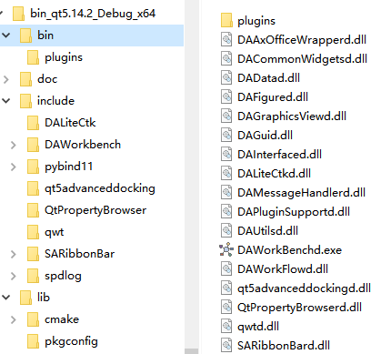
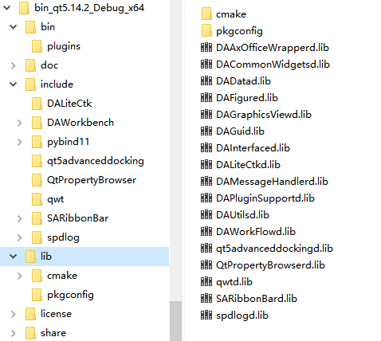
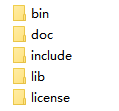

# 基于 cmake 的大型工程组织和构建

本文档介绍如何用 cmake 组织和构建大型 C++ 工程，实现一键编译安装和第三方开发者集成。

在大型 C++ 项目中，一个成熟的工程除应用程序本身外，还包括为其核心功能抽象出的库。这些库一方面服务于项目自身的模块化解耦，另一方面也可能作为插件化开发的基础库提供给第三方开发者。工程还依赖众多第三方库。

大型工程由以下几部分组成：

-   **第三方库**：如 `OCCT`、`VTK`、`Qt` 等。
-   **自定义库**：项目自身抽象出的功能模块。
-   **可执行程序**：如图形界面程序、命令行工具等。
-   **静态资源**：脚本、图片、配置文件等。

大型工程用简单的构建工具很难做到一键编译一键安装，比如 `qmake` 缺少安装和依赖管理功能，Qt6 因此弃用它转向 `cmake`。在 C++ 领域，`cmake` 虽然缺点很多，仍是构建管理的事实标准。

通过 `cmake` 可以做到：

-   高效组织庞大且复杂的工程结构。
-   自动化编译第三方依赖库。
-   按依赖关系自动构建项目所有组件。
-   一键式安装部署整个项目。
-   生成便于第三方集成的插件开发环境。

本文介绍实际项目里用 `cmake` 组织大型工程、生成第三方可直接引入的开发环境，以及用 `git submodule` 管理第三方库的做法。

## 工程的目录结构

工程的顶层文件夹包含以下几项：

- src 文件夹，放所有源代码
- docs 文件夹，放所有文档
- 3rdparty 文件夹，放所有第三方库，可以放在 src 文件夹里面，也可以放在外层目录
- 针对整个工程的 `CMakeLists.txt` 文档
- cmake 文件夹，放封装好的 cmake 文件，方便集成

上面的这些文件夹和文件是一个工程比较通用的组织结构

工程顶层目录下还会放 `.clang-format` 用于规范编码，`.clang-tidy` 和 `.clazy` 用于代码检查；这些按需提供，开源项目建议提供。

因此一个相对标准的源码目录如下所示：

```
MyProject/
├── .clang-format          # 代码格式化配置 (强烈建议有)
├── .clang-tidy            # 静态代码检查配置 (可选)
├── .clazy                 # Clang代码检查配置 (可选)
├── CMakeLists.txt         # 顶层CMake构建文件
├── 3rdparty/              # 第三方库源码 (也可置于 src 下)
├── cmake/                 # 项目自定义的 CMake 模块和工具脚本
├── docs/                  # 项目文档
└── src/                   # 项目自身源代码
    ├── CMakeLists.txt
    ├── LibA/              # 自定义库 A
    ├── LibB/              # 自定义库 B
    ├── App/               # 主应用程序
    └── ...
```

## 第三方库的管理

`3rdparty` 文件夹放第三方库的源代码。第三方库源码不要直接下载放进 `3rdparty` 文件夹，而是通过 git 的 `submodule` 添加：submodule 方式添加的源码可以随时更新到远程仓库的最新版本，也可以固定在某个分支或某个 tag 上。

### 添加 submodule

下面的示例展示了如何使用 git submodule 添加第三方库：

比如要用 ribbon 界面，添加 SARibbon 作为第三方库：

```shell
git submodule add https://github.com/czyt1988/SARibbon.git ./src/3rdparty/SARibbon
# 或者放在 ./3rdparty/SARibbon
```

上述命令会将 SARibbon 库作为子模块添加到项目的 3rdparty 目录下。

> **📝 首次拉取项目**
>
> 对于使用 `submodule` 管理第三方库的方式，首次拉取项目之后，需要执行：
>
> ```shell
> git submodule update --init --recursive
> ```
>
> 把所有库拉取下来。也可以 clone 的时候使用 `--recursive` 参数：
>
> ```shell
> git clone --recursive
> ```

大部分第三方库都提供了 `cmake`；没有提供时会 fork 一份并补上 `cmake` 版本，比如 [qwt 库](https://github.com/czyt1988/QWT) 和 [QtPropertyBroswer 库](https://github.com/czyt1988/QtPropertyBrowser)。`3rdparty` 文件夹下的 `cmake` 文件用来集中编译所有第三方库，其中指定安装目录与主程序的安装目录一致。这样程序交给其他人二次开发时，程序自身的库和第三方库处在同一个安装环境里，第三方库与程序库之间的依赖问题随之解决；使用者不需要在编译程序之前先逐个编译第三方库，一次统一编译就能把所有第三方库安装到固定目录下，install 后形成一个完整的开发环境。


连同第三方库一起发布的开发环境 bin 目录



连同第三方库一起发布的开发环境 lib 目录


这个完整开发环境里面包含了所有的库，第三方开发者只需知道安装目录，就可以加载所有的依赖

下面介绍如何通过 cmake 组织这种大型工程。

## 大型工程的cmake写法

这里不介绍如何写 cmake，只讲大型工程的 cmake 要注意的事项。工程顶层有一个 `CMakeLists.txt` 文件，定义整个工程的信息、可选项、总体的安装步骤等；顶层 `CMakeLists.txt` 通过 `add_subdirectory` 添加子目录，一般会添加 src 目录。下面以 [仿真集成平台 data-workbench](https://github.com/czyt1988/data-workbench) 为例，介绍如何通过 cmake 组织大型工程。

> 上述的仿真集成平台不提供业务逻辑，所有业务逻辑都是通过插件实现，插件的开发就需要依赖此集成平台和所有第三方库

组织大型工程的构建，关键是掌握 `cmake` 的 `install` 命令。

`install` 命令的主要功能：
1.  复制文件/目录到指定位置。
2.  导出目标，生成 `{库名}Targets.cmake` 文件，供其他 `cmake` 项目 `find_package`。
3.  为当前项目的其他模块提供依赖支持。

`cmake` 通过 `$<BUILD_INTERFACE:` 和 `$<INSTALL_INTERFACE:` 生成器表达式区分**构建环境**（源代码目录）和**安装环境**（安装目录），确保头文件路径和依赖关系在不同场景下都能正确工作。

`cmake` 的 `install` 用法比较固定，照着一个例子或者模板就能完成自己的安装和部署。大型系统需要多组件的安装，类似 Qt 的包引入：按模块划分，不需要把整个 Qt 的所有库一起引进工程，自己的大型系统也应该实现类似的引入。下面着重介绍如何进行模块化的 `install`。

### 规范的安装路径

规范的安装路径让工程的库以及第三方库安装在同一个目录下，工程很容易被第三方使用者拿去做二次开发，因此安装路径尽量规范化，不要过于自由地定制。常见的规范化安装路径如下：

-   `bin/`: 存放可执行文件和 Windows 下的 DLL 文件。
-   `lib/`: 存放静态库（.a, .lib）和动态库的导入库（.lib）。
-   `lib/cmake/<ProjectName>/`: 存放项目的 CMake 配置文件（如 `*Config.cmake`, `*Targets.cmake`）。
-   `include/<ProjectName>/`: 存放项目的公共头文件。

不建议在 cmake 里硬编码上述路径，可以用 `GNUInstallDirs` 模块定义的标准路径。

使用 `include(GNUInstallDirs)` 后，可以用 `CMAKE_INSTALL_BINDIR`、`CMAKE_INSTALL_LIBDIR`、`CMAKE_INSTALL_INCLUDEDIR` 等变量，确保路径的规范性。

下面是常见的 cmake 安装后的文件夹



大部分第三方库都是按照这个目录结构进行安装。工程包含大量第三方库以及自身的库时，所有 dll 都安装在 `bin` 目录下，所有库文件安装在 `lib` 目录下，所有头文件在 `include` 文件夹下面对应的自身库名的文件夹下面，所有 `cmake` 需要用的文件都在 `lib/cmake` 文件夹下对应的自身库名的文件夹下面。

按这种标准化的形式构建，第三方开发者可以很方便地使用这个工程。

比如库名叫 `SARibbonBar`，它安装后在 windows 系统下应该生成如下结构

```
bin
  |-SARibbonBar.dll
include
  |-SARibbonBar
     |-SARibbonBar.h
     |-...所有头文件都在此文件夹下
lib
  |-SARibbonBar.lib
  |-cmake
    |-SARibbonBar
       |-SARibbonBarConfig.cmake
       |-SARibbonBarConfigVersion.cmake
       |-SARibbonBarTargets.cmake
       |-SARibbonBarTargets-debug.cmake
```

### 单模块库的 `install` 标准写法

库只有一个模块时，install 写法相对固定，基本步骤如下：

#### 1. 定义库名和版本

首先定义库的基本信息，后续的步骤可使用这些变量。

下面的 CMake 示例展示了库信息的定义：

```cmake
set(LIB_NAME MyLib)              # 库名称变量
set(LIB_VERSION_MAJOR 1)         # 主版本号
set(LIB_VERSION_MINOR 0)         # 次版本号
set(LIB_VERSION_PATCH 0)         # 补丁版本号
set(LIB_VERSION "${LIB_VERSION_MAJOR}.${LIB_VERSION_MINOR}.${LIB_VERSION_PATCH}")  # 完整版本号
```

#### 2. 配置目标属性（关键！）

使用 `target_include_directories` 并利用生成器表达式区分构建和安装环境，这是 cmake 的核心功能。

下面的 CMake 示例展示了目标属性配置：

```cmake
add_library(${LIB_NAME} ...)      # 创建库目标
target_include_directories(${LIB_NAME} PUBLIC
    $<BUILD_INTERFACE:${CMAKE_CURRENT_SOURCE_DIR}/include>  # 构建时：源码中的 include 目录
    $<INSTALL_INTERFACE:include/${LIB_NAME}>                # 安装后：相对于安装前缀的 include/MyLib 目录
)
target_compile_definitions(${LIB_NAME} PUBLIC ...) # 如果有公共宏定义，也用 target_ 形式
```

`target_include_directories` 和 `target_compile_definitions` 是 cmake 的核心函数，它告诉 cmake 这个目标有哪些头文件和哪些预定义宏，并把信息传递给使用库的人。

#### 3. 安装公共头文件

通过 install 可以复制任意内容，把要提供的头文件、甚至脚本、资源都放到指定安装目录下。

下面的 CMake 示例展示了头文件安装配置：

```cmake
set(PUBLIC_HEADERS ...) # 列出所有公共头文件
install(FILES ${PUBLIC_HEADERS}
    DESTINATION ${CMAKE_INSTALL_INCLUDEDIR}/${LIB_NAME} # 安装到 include/MyLib
)
```

#### 4. 安装目标并导出（关键！）

`EXPORT` 关键字将目标的信息保存到一个名为 `${LIB_NAME}Targets` 的导出集中，这是实现 find_package 的关键。

下面的 CMake 示例展示了目标导出配置：

```cmake
install(TARGETS ${LIB_NAME}
    EXPORT ${LIB_NAME}Targets
    RUNTIME DESTINATION ${CMAKE_INSTALL_BINDIR} # bin目录，主要为 DLL 文件
    LIBRARY DESTINATION ${CMAKE_INSTALL_LIBDIR} # lib目录，主要为共享库 (.so, .dylib)
    ARCHIVE DESTINATION ${CMAKE_INSTALL_LIBDIR}
    INCLUDES DESTINATION ${CMAKE_INSTALL_INCLUDEDIR}/${LIB_NAME}
)
```

> **📝 cmake install 功能**
>
> install 命令功能较多，包含复制文件、导出目标等，理解需要一定的学习成本。

#### 5. 生成 `Config.cmake` 文件

这一步用到 `write_basic_package_version_file` 和 `configure_package_config_file` 两个函数，生成 find_package 所必须的 Config.cmake 文件。

首先，创建一个模板文件 `${LIB_NAME}Config.cmake.in`，内容如下：

```cmake
@PACKAGE_INIT@

include("${CMAKE_CURRENT_LIST_DIR}/@LIB_NAME@Targets.cmake")

set_and_check(@LIB_NAME@_INCLUDE_DIR "${PACKAGE_PREFIX_DIR}/@CMAKE_INSTALL_INCLUDEDIR@/@LIB_NAME@")
set_and_check(@LIB_NAME@_LIBRARY_DIR "${PACKAGE_PREFIX_DIR}/@CMAKE_INSTALL_LIBDIR@")

check_required_components(@LIB_NAME@)
```

上述 `${LIB_NAME}Config.cmake.in` 是用于生成 Config.cmake 文件的模板，其中的变量会在 cmake 配置时被替换。

然后，在主 `CMakeLists.txt` 中使用 `CMakePackageConfigHelpers` 模块生成最终文件：

```cmake
include(CMakePackageConfigHelpers)
configure_package_config_file(
    "${CMAKE_CURRENT_SOURCE_DIR}/${LIB_NAME}Config.cmake.in"
    "${CMAKE_CURRENT_BINARY_DIR}/${LIB_NAME}Config.cmake"
    INSTALL_DESTINATION ${CMAKE_INSTALL_LIBDIR}/cmake/${LIB_NAME}
    PATH_VARS CMAKE_INSTALL_INCLUDEDIR  # 传递路径变量供 set_and_check 使用
)
write_basic_package_version_file(
    "${CMAKE_CURRENT_BINARY_DIR}/${LIB_NAME}ConfigVersion.cmake"
    VERSION ${LIB_VERSION}
    COMPATIBILITY SameMajorVersion
)
```

#### 6. 安装生成的 CMake 文件

上述文件会在编译过程生成在 `${CMAKE_CURRENT_BINARY_DIR}` 目录下面，安装时把这些文件复制到 `lib/cmake/<库名>` 的配置目录下。

下面的 CMake 示例展示了 cmake 文件安装：

```cmake
install(FILES
    "${CMAKE_CURRENT_BINARY_DIR}/MyLibConfig.cmake"
    "${CMAKE_CURRENT_BINARY_DIR}/MyLibConfigVersion.cmake"
    DESTINATION ${CMAKE_INSTALL_LIBDIR}/cmake/${LIB_NAME}
)
install(EXPORT ${LIB_NAME}Targets
    FILE ${LIB_NAME}Targets.cmake
    NAMESPACE ${LIB_NAME}::                     # 可选，添加命名空间
    DESTINATION ${CMAKE_INSTALL_LIBDIR}/cmake/${LIB_NAME}
)
```

----

完成以上步骤后，其他项目就可以通过简单的 `find_package(MyLib)` 来使用这个库了。

使用这个库只需以下步骤：

```cmake
set(${YOUR_LIB_NAME}_DIR "your-lib-install-dir/lib/cmake")
find_package(${YOUR_LIB_NAME})
```

### 多模块的install写法

一个项目包含多个库（如 Qt 的 Core、Gui、Widgets）时，需要将所有模块的导出信息合并到一个总的导出目标中，并提供一个顶层的 `Config.cmake` 文件。

Qt 就是一个多模块的例子，Qt 模块的引入是这样写的：

```cmake
find_package(QT NAMES Qt6 Qt5 COMPONENTS 
    Core
    Gui
    Widgets
)
```

多模块和单模块的区别就是导出这一步(`install(TARGETS xx EXPORT xxx ...)`)，多模块在每个模块的安装导出需要导出到同一个目标中，每个模块不需要再调用`write_basic_package_version_file`和`configure_package_config_file`

多模块的文件组织示例如下

```
root
├CMakeLists.txt
├src
│├─CMakeLists.txt
│├─module-1
││ └─CMakeLists.txt
│├─module-2
││ └─CMakeLists.txt
│...
│└─module-n
│   └─CMakeLists.txt
└cmake
 └─{MyPackageName}Config.cmake.in
```

大型项目会在项目的根目录下创建一个 cmake 文件夹，常用的 cmake 文件统一放在此目录下。

多模块的 install 写法有如下步骤：

#### 1.顶层`CMakeLists.txt`写法

顶层 `CMakeLists.txt` 负责安装导出目标，主要处理如下事情：

-   定义总包名 `MyPackage` 和总导出目标名 `MyPackageTargets`。
-   负责生成和安装顶层的 `MyPackageConfig.cmake` 和 `MyPackageConfigVersion.cmake` 文件。
-   **不安装任何具体的目标**，只导出所有子模块累积到 `MyPackageTargets` 中的信息。

模块化的 cmake 首先要有个总的进入文件，以 MyPackage 命名，像 Qt5 就叫 Qt5Config.cmake，自己模块就叫 {MyPackageName}Config.cmake。

和单一模块类似，{MyPackageName}Config.cmake 通过 {MyPackageName}Config.cmake.in 模板生成，一个相对通用的写法如下：

```cmake
@PACKAGE_INIT@

include("${CMAKE_CURRENT_LIST_DIR}/{MyPackageName}Targets.cmake")

set_and_check({MyPackageName}_INCLUDE_DIR "${PACKAGE_PREFIX_DIR}/@CMAKE_INSTALL_INCLUDEDIR@")
set_and_check({MyPackageName}_LIBRARY_DIR "${PACKAGE_PREFIX_DIR}/@CMAKE_INSTALL_LIBDIR@")

check_required_components({MyPackageName})
```

上面的 {MyPackageName} 需要替换为实际的包名。

顶层 `CMakeLists.txt` 的安装写法如下

```cmake
set(MY_PACKAGE_PROJECT_NAME "MyPackageName")
# 这是所有模块的总targets，所有模块都向这个target导出
set(MY_PACKAGE_TARGET_NAME "MyPackageNameTargets")

# ... 添加子目录 add_subdirectory(src) ...
...

include(CMakePackageConfigHelpers)
include(GNUInstallDirs)
write_basic_package_version_file(
    "${CMAKE_CURRENT_BINARY_DIR}/${MY_PACKAGE_PROJECT_NAME}ConfigVersion.cmake"
    VERSION ${DA_VERSION}
    COMPATIBILITY AnyNewerVersion
)
configure_package_config_file(
    "${CMAKE_CURRENT_SOURCE_DIR}/cmake/{MyPackageName}Config.cmake.in"
    "${CMAKE_CURRENT_BINARY_DIR}/${MY_PACKAGE_PROJECT_NAME}Config.cmake"
    INSTALL_DESTINATION ${CMAKE_INSTALL_LIBDIR}/cmake/${MY_PACKAGE_PROJECT_NAME}
)
#Unified export of all module targets
install(EXPORT ${DA_TARGET_NAME}
    FILE ${MY_PACKAGE_TARGET_NAME}.cmake
    NAMESPACE ${MY_PACKAGE_PROJECT_NAME}::
    DESTINATION ${CMAKE_INSTALL_LIBDIR}/cmake/${MY_PACKAGE_PROJECT_NAME}
)
```

顶层 `CMakeLists.txt` 负责导出 Config 文件，后续所有模块的安装都往这个目标添加

#### 2.子模块`CMakeLists.txt`写法

子模块安装时不需要生成 config 文件，只需要将自己的目标**追加**到顶层定义的总导出集中（上例的导出集名为 MY_PACKAGE_TARGET_NAME）。

多模块的子模块安装示例

```
# src/ModuleA/CMakeLists.txt
add_library(ModuleA ...)
add_library(${MyPackageName}::ModuleA ALIAS ModuleA) # 推荐使用${MyPackageName}::ModuleA别名，这个别名可以在模块内部间方便调用

# 安装目标到总导出集 MY_PACKAGE_TARGET_NAME
install(TARGETS ${子模块名字}    # 这里是你这个库库的名字
        EXPORT ${MY_PACKAGE_TARGET_NAME}   # 注意：这里是顶层的导出集名称
        ARCHIVE DESTINATION ${CMAKE_INSTALL_LIBDIR}
        LIBRARY DESTINATION ${CMAKE_INSTALL_LIBDIR}
        RUNTIME DESTINATION ${CMAKE_INSTALL_BINDIR}
    )
```

MY_PACKAGE_TARGET_NAME 是在顶层 cmake 定义的总的导出集，子模块的安装都导出到此导出集即可，这样就能像 Qt 一样，通过 `find_package(MyPackageName COMPONENTS ModuleA ModuleB)` 找到对应的库

## 工程的组织

单模块和多模块的安装介绍完了，大型工程的组织和安装就是这两者的组合。

工程各个模块和第三方库安装到固定目录下，最终形成一个完整的开发环境。

实际例子源码位于：

[github:https://github.com/czyt1988/data-workbench](https://github.com/czyt1988/data-workbench)

[gitee 镜像:https://gitee.com/czyt1988/data-workbench](https://gitee.com/czyt1988/data-workbench)

源码目录结构（为便于显示，文件夹用 `[]` 括起）：

```
[root]
├[src]
│ ├─[3rdparty]
│ │ ├─[spdlog]
│ │ ...
│ │ ├─[SARibbon]
│ │ └─CMakeLists.txt(用于构建和安装第三方库)
│ ├─[DAUtils]
│ │ └─CMakeLists.txt
│ ├─[DAGui]
│ │ └─CMakeLists.txt
│ ...
│ ├─[DAAgent]
│ │ └─CMakeLists.txt
│ ├─[APP]
│ │  └─CMakeLists.txt
│ └─CMakeLists.txt
├─CMakeLists.txt
└─[cmake]
     └─DAWorkbenchConfig.cmake.in(用于生成总包的Config.cmake文件)
```

1. 指定统一的安装目录

这一步使第三方库和工程的安装位置一致。Linux 有比较规范的安装路径，Windows 不一样，默认装在 `C:\Program Files\xxx` 这样的位置，没有统一放 lib 的地方；因此 Windows 下通常在工程自身目录下建一个安装目录，以 bin_{Debug/Release}_{x32/x64} 的方式命名，如果有 `Qt`，再加上 `Qt` 的版本以作区分，如下所示：

```cmake
# 获取qt版本
find_package(QT NAMES Qt6 Qt5 COMPONENTS Core REQUIRED)
# 平台判断
if("${CMAKE_SIZEOF_VOID_P}" STREQUAL "4")
    set(my_platform_name "x86")
else()
    set(my_platform_name "x64")
endif()
# 生成安装目录名称
set(my_install_dir_name bin_qt${QT_VERSION}_${CMAKE_BUILD_TYPE}_${my_platform_name})
# 设置固定的安装目录路径，具体位置具体设置，这里设置为当前cmake文件所在目录
set(CMAKE_INSTALL_PREFIX "${CMAKE_CURRENT_LIST_DIR}/${my_install_dir_name}")
```

> **💡 提示**
>
> 这样操作对库开发还有个好处，可以有效区分不同版本 Qt、不同编译器的结果

2. 第三方库

如前文所述，第三方库都在 `src/3rdparty` 下面，首先要做的是编译第三方库。`3rdparty` 有个 `CMakeLists.txt` 文件用于编译安装所有第三方库；它不纳入顶层工程的 `subdirectory` 中，因为不保证所有第三方库的 cmake 写得都正常。第三方库的 `CMakeLists.txt` 指定了 `CMAKE_INSTALL_PREFIX` 和顶层工程一致，确保安装路径一致。

3. 组织顶层工程

顶层工程 `CMakeLists` 主要负责做以下事情：

- 定义 `option`
- 定义工程名称
- 做全局的编译设置，如 c++ 版本要求，编译环境的 POSTFIX 设置
- 通过 `add_subdirectory` 完成整个工程的组织
- 工程模块化的安装（见多模块的 install 写法）
- 工程的完整安装

## 第三方用户引入的方式

第三方插件开发者 clone 工程后，先编译并安装（install）第三方库，再编译并安装工程，就得到了一个完整的开发环境。


## 工程封装的 CMake 声明式构建 API

项目在 `cmake/` 目录下封装了一组声明式构建函数（全部为 CMake `function`，无 `macro`），
模块与插件的 `CMakeLists.txt` 通过单次调用完成 target 创建、依赖链接、属性设置、安装导出。

### da_add_library：DA 库模块

一次调用完成：`add_library(SHARED)` + `DAWorkbench::` 别名 + 构建宏定义 + AUTOMOC/UIC/RCC +
Qt 组件查找链接 + DA 模块链接 + 第三方库导入 + Windows rc 版本资源 + `install(TARGETS EXPORT ...)` +
头文件安装。`VERSION` 缺省继承根 CMakeLists 的 `DA_VERSION`（版本统一）。

```cmake
da_add_library(
    NAME DAUtils                        # 模块名（target 名）
    BUILD_DEFINE DAUTILS_BUILD          # 编译 DLL 的私有宏（C++ 源码 #ifdef 依赖，逐字一致）
    DESCRIPTION "DA Utils Lib"
    SOURCES ${HEADERS} ${SOURCES}       # 文件清单（模块自行 GLOB 或显式列举）
    QT_PUBLIC Core Gui Widgets Xml      # 自动 find_package + PUBLIC 链接 Qt::组件
    LINK_PUBLIC DAShared                # PUBLIC 链接 DAWorkbench::<mod>
    THIRDPARTY spdlog                   # 经 da_link_3rdparty 导入
    HEADERS_DIRS .                      # GLOB 收集 *.h/*.hpp 安装到 include/DAWorkbench/<name>
)
```

### da_add_executable：主程序

合并原 app 三段式宏与手写块（rc 资源/子系统切换/第三方 DLL 部署等）。

### da_add_plugin：插件

一次调用完成插件的 target 创建、属性设置（输出到 `bin/plugins`）与安装：

```cmake
da_add_plugin(
    NAME DataAnalysis
    BUILD_DEFINE DATAANALYSIS_PLUGIN_BUILD
    SOURCES ${HEADERS} ${SOURCES}
    QT_PRIVATE Core Gui Widgets
    LINK_PRIVATE DAUtils DAGui          # 自动 DAWorkbench:: 前缀
    THIRDPARTY SARibbonBar qwt python   # 自动以 INSTALL_DIR=DAWorkbench 安装目录导入
)
```

### da_plugin_bootstrap：单插件工程引导

插件脱离主工程独立构建时（`cmake -S plugins/<name> -B build`），在 CMakeLists 顶部调用：

```cmake
if(CMAKE_SOURCE_DIR STREQUAL CMAKE_CURRENT_SOURCE_DIR)
    include(${CMAKE_CURRENT_LIST_DIR}/../../cmake/daworkbench_plugin_utils.cmake)
    da_plugin_bootstrap("MyPlugin" "My plugin description")
endif()
```

该函数完成 `project()` 先行、安装目录名计算（`bin_<Config>_qt<X>_<Compiler>_<Arch>`）、
`CMAKE_PREFIX_PATH`/`CMAKE_INSTALL_PREFIX` 设置、DAWorkbench 与全部第三方包预查找、
C++17/DEBUG_POSTFIX/MSVC `/utf-8` 设置。

### da_plugin_env_setup：多插件宿主工程环境设置

宿主工程有自己的 `project(带 VERSION)` 且包含多个插件子目录时（如 GreeDataWorkbench：
根 project 的 VERSION 被 updater 使用，不能被插件 project() 覆盖），在根 CMakeLists 中调用：

```cmake
project(MyHost VERSION 1.0.0 LANGUAGES CXX)
set(DAWorkbench_INSTALL_PATH "<DAWorkbench 安装目录>")   # 非默认布局时必须显式指定
include(${DAWorkbench_INSTALL_PATH}/lib/cmake/DAWorkbench/daworkbench_plugin_utils.cmake)
da_plugin_env_setup()
add_subdirectory(插件目录)
```

与 `da_plugin_bootstrap` 的区别：不含 `project()`，其余环境设置（安装目录/预查找/C++17）
完全一致；`da_add_plugin` 在此环境上增加 `OUTPUT_TO_INSTALL` 选项可使 DLL 直接输出到
安装目录 `bin/plugins`（构建完即可被主程序加载）。

### da_link_3rdparty：第三方库导入

```cmake
da_link_3rdparty(<target>
    LIBS <SARibbonBar|DALiteCtk|DAWidgets|ads|qwt|spdlog|quazip|python|pybind11|orderedmap ...>
    [INSTALL_DIR <dir>]      # 插件 standalone 构建时传 DAWorkbench 安装目录
    [SCOPE <PUBLIC|PRIVATE>] # 默认 PRIVATE（pybind11/orderedmap 为 PUBLIC）
)
```

查找策略：`find_package(CONFIG QUIET)` → 安装目录 glob 版本回退 → `FATAL_ERROR`；
ADS/QuaZip 自动处理 Qt5/Qt6 新旧包名。

### 部署函数（保留）

- `dafun_set_bin_name(_var)`：计算平台相关安装目录名
- `dafun_deploy_3rdparty_dlls(<target> [PLUGIN_DIR <dir>])`：构建期复制第三方 DLL 到输出目录
- `dafun_install_deploy_qt_runtime(<target> SCAN_TARGETS ... PLUGIN_DIR ...)`：安装期 windeployqt 部署完整 Qt 运行时

> 历史上的 `damacro_lib_setting` / `damacro_set_lib_properties` / `damacro_lib_install` /
> `damacro_app_setting` / `damacro_plugin_setting` / `damacro_import_*` 等三段式宏已删除，
> 由上述声明式 API 取代。
