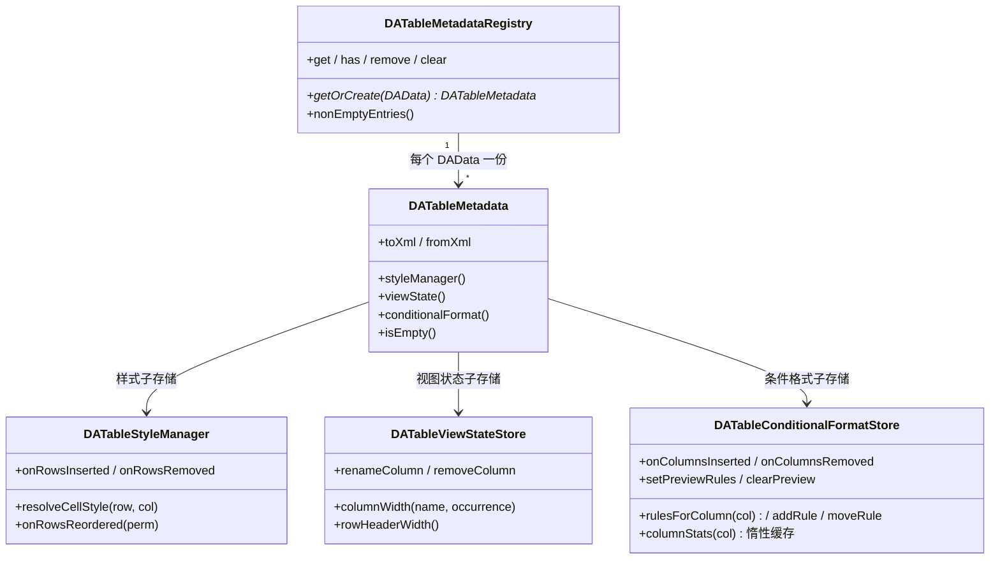

# 表格元数据架构（DATableMetadataRegistry）

表格元数据是「按数据集存在、随工程保存、不属于数据本体」的一切附加信息的统称：静态样式、视图状态（列宽/行头宽）、条件格式规则（T1.5），以及后续的批注、校验规则、计算列定义。它们统一由 `src/DAGui` 的会话级注册表 `DATableMetadataRegistry` 治理，序列化进工程文件 `table-metadata.xml`。本页是这套基础设施（T1.3–T1.5）的架构说明。

## 注册表 / 元数据束 / 子存储

三层结构，职责各管一段：



- **注册表**（`DATableMetadataRegistry`，由 `DATableStyleRegistry` 泛化而来）：会话级、按 `DAData` 键控，挂在 `DADataOperateWidget` 上（`metadataRegistry()`）。数据移除时**保留**条目以支持撤销，`datasCleared` 时统一清空。
- **元数据束**（`DATableMetadata`）：一个数据集一份，聚合各子存储并提供 `toXml/fromXml` 聚合序列化。当前含样式、视图状态与条件格式（T1.5，003）三个子存储；批注/校验/计算列由后续任务各自往束里加成员与 XML 段，**不提前加空成员**。
- **子存储**：只负责自己那类数据的增删查改 + XML 段读写。

**渲染类 vs 语义类**（归属分层，D3）：渲染类子存储（样式、条件格式，后续批注）只服务界面，留在 DAGui；语义类（后续校验规则、计算列定义）的**定义类**放 `src/DAData/`（纯数据、无 GUI 依赖，将来可被工作流节点/agent 直接复用），v1 的存储与序列化仍走本注册表。

## table-metadata.xml 与旧文件兼容

工程文件统一为 `table-metadata.xml`（R18：**保存只写新文件，不双写**；加载时新文件不存在则回退读旧 `table-styles.xml`）：

```xml
<table-metadata version="1">
  <project version="...">
    <table data-id="..." data-name="...">
      <column-style col="..."/>   <!-- 内层样式标签与旧文件完全一致 -->
      <row-style row="..."/>
      <cell row="..." col="..."/>
      <col-format index="..."/>
      <view-state row-header-width="60">   <!-- 视图状态兄弟段 -->
        <column-width name="value" occurrence="0" width="120"/>
      </view-state>
      <conditional-format>                 <!-- 条件格式兄弟段（003 T1.5，按列索引组织） -->
        <column col="2">
          <rule type="cell" cond="greater" v1="100">
            <background brushstyle="1" color="#ffce6043"/>
          </rule>
          <rule type="color-scale" three="0" cmin="#ffbdcde8" cmid="#ffffffff" cmax="#ff5280c1"/>
          <rule type="data-bar" color="#ffbdcde8"/>
        </column>
      </conditional-format>
    </table>
  </project>
</table-metadata>
```

匹配主键是 `data-id`（跨会话稳定，持久化于 data-manager.xml），`data-name` 作人类可读与旧工程回退。加载由 `DAAppProject::loadedTableMetadata`（新）/`loadedTableStyles`（旧回退）完成，两者共用 `applyLoadedTableElement` 回填路径。

## 列引用约定（R20）

所有表元数据按语义分两类引用列，**混用会产出两种最难排查的 bug**（插一列样式全错位、改个名公式全失效）：

- **装饰类**（静态样式、条件格式，后续批注）：用**位置键（列索引）**，随列插删走 `onColumnsInserted/onColumnsRemoved` 重映射，列改名不需要迁移。
- **语义类**（列宽、后续计算列/校验规则）：用**列名**引用，重名时以「第 n 个同名列」（occurrence，从 0 计）消歧——pandas 允许重名列且 `da_insert_column` 不做重名检查，键必须是 `(列名, occurrence)` 二元组；列改名命令负责调用 `renameColumn` 迁移。

## 位置键重映射与置换语义

`DATableKeyRemap`（纯头文件模板，元数据束层共享）为一切「行位置键」元数据提供统一重映射：

> **⚠️ 置换语义（钉死）**
>
> `perm[i] = 新表第 i 行在旧表中的行号`（**新→旧**，与 `df.iloc[perm]` / `numpy.take` 一致）；
> 逆置换 `inv[旧行号] = 新位置`（旧→新）供 undo 使用。
> 两个方向命名必须区分：正置换一律叫 `perm`，逆置换一律叫 `inv`，禁止都叫 `perm`/`index`。

- 入口按维度参数化：行键 `QHash<int,T>` 一个，单元格键 `QHash<QPair<int,int>,T>` 一个（`Dimension::Row/Column` 指定重映射哪一维）。复杂度 O(存储条目数)，不扫全表。
- 列插删的「一批索引」位移工具（003 补）：`shiftKeysOnInserted/shiftKeysOnRemoved(QHash<int,T>, QList<int>)`，降序位移语义与 `DATableStyleManager::onColumnsInserted/onColumnsRemoved` 一致，`DATableConditionalFormatStore` 的列桶重映射用同一实现。
- `DATableStyleManager::onRowsReordered(perm)` 已接入（重映射 `mCellStyles` 行维与 `mRowStyles`，完成发 `styleReset()`），与既有 `onRowsInserted/onRowsRemoved` 并列。
- **列维度重排**（T1.8 列视图）用同一工具按 `Dimension::Column` 扩展——刻意不提供空的 `onColumnsReordered` 占位方法（避免死代码）。

## delegate 五层绘制管线（D2）

`DATableStyleItemDelegate::paint()` 是唯一绘制口，层序钉死（旧 `paintConditionalFormat` 虚钩子已删除，不保留两套口子）：

| 层 | 内容 | 状态 |
|----|------|------|
| ① 静态样式 | `DATableStyleManager` 三层 merge（列→行→单元格）后叠加 bg/fg/font | 已实现 |
| ② 持久装饰 | 条件格式规则求值 → 背景/前景（`DATableConditionalFormatStore::evaluate` 静态纯函数） | 已实现（003） |
| ③ 瞬态装饰 | `DATableHighlightOverlay` 查找命中/校验违规，语义色半透明覆盖背景 | 已实现 |
| ④ 数据条 | 背景之上、文字之下按列 min/max 归一化画条（`fillRect`，2px 内边距） | 已实现（003） |
| ⑤ 文字 | 基类 `QStyle::drawControl(CE_ItemViewItem)`；批注角标在其后 | 已实现（角标 005） |

瞬态高亮层 `DATableHighlightOverlay`：两来源（Find/Validation）× 五级别，两级索引 + 打包键 `(row<<32)|col`，O(1) 查询；`levelAt` 固定优先级 `CurrentHit > Hit > ViolationError > ViolationWarning`，**同格命中+违规时以查找为准**（查找是用户当前操作焦点，单测钉住此语义）。不序列化、不进撤销栈。样式与高亮查询一律用 actualRow（滑动窗偏移后的数据源绝对行）。无装饰快速路径保留：样式、条件格式、高亮都空时直接走父类 paint（10 万行滚动性能保障）。

## 条件格式子存储（DATableConditionalFormatStore，003 T1.5）

渲染类子存储，规则**按列索引分桶**（`QHash<int, QVector<Rule>>`，装饰类位置键 R20），三类规则：单元格规则（7 操作符 → `DATableCellStyle` 输出）、色阶（双/三色插值背景）、数据条（归一化条长）。要点：

- **求值只在 delegate ②层**（不进 model/data()），取值 `Qt::EditRole`；每格只查本列规则桶（分桶即「每列规则列表缓存」），求值逻辑是静态纯函数（`evaluate`），单测直接覆盖。
- **优先级 = 列表顺序**，同列自上而下求值、后命中覆盖先命中（Excel 语义）；对话框上移/下移即调整顺序。
- **列统计缓存**：色阶/数据条的 `{min,max,median}` 经 `StatsProvider`（widget 注入，内部走 Python `da_column_stats` 全表 O(n) 归约）惰性计算一次并缓存，失败也缓存（不每格重试）；失效挂点在 widget 侧——单元格编辑走模型 `cellValueChanged` 精确信号、插删行保守全失效、替换/置nan/粘贴按变更列失效、**排序不失效**（列值集合不变，性能决策）。
- **预览规则集**：对话框编辑期间 `setPreviewRules` 整体叠加（`rulesForColumn` 预览优先，不落库不入栈），确定后按结果与现值差异生成增/删/改/移/清命令入页撤销栈，取消 `clearPreview` 还原。
- **惰性/只读源限制**：`isLazyLoaded()` 或 `!isTableEditable()` 的数据源无法全量列统计 → 对话框内色阶/数据条置灰并给出说明文案，单元格规则正常。
- 入口：Ribbon「Table Style」的「Conditional」面板 + 表体右键菜单「Conditional Format...」（列头菜单不放，R16），作用于当前选区覆盖的列集合。

## 右键菜单与快捷键的落位约定

- **菜单内容单点定义在 DAGui，执行在 APP**：列头菜单在 `DADataHeaderView::buildColumnContextMenu`（6 项 4 组），表体菜单在 `DADataTableView::buildContextMenu`（剪切/复制/粘贴 ‖ 查找/替换 ‖ 条件格式）。QAction 由 DAGui 自建，**不共享 APP 的 `QAction` 对象**（右键项按列/选区上下文启用、Ribbon 按钮按页能力启用，共享会互相污染 enabled）；点击后发表意信号（`columnActionRequested` / `contextMenu*Requested`），APP 侧只做接线（先选中列/复用既有槽）。图标一律取 `:/DAGui/icon/...`，禁止依赖 APP 的 qrc（插件链 `DAInterface → DAGui`，插件运行时没有 APP 资源）。
- **快捷键集中挂点**：表格快捷键一律在 `DADataTableView::keyPressEvent` 处理（后续查找 Ctrl+F、填充 Ctrl+D 等在此追加），不散落各处。
- **表头**：`DADataHeaderView` 水平/垂直共用一个类；`clickedWithModifiers`（带修饰键点击）供排序交互（002）消费，图表「选择序列」拾取仍走既有 `sectionClicked` 链路；行头宽在 vertical 实例右缘 8px 热区拖拽，`setFixedWidth` 落地（Qt 纵向表头宽度 = `clamp(qMax(minimumWidth, sizeHint), maximumWidth)`，min=max=w 恒为 w），释放后经 `rowHeaderWidthChanged` 写入视图状态。
- **列宽持久化纪律**（R6）：按列名 + occurrence 存 `<view-state>`，**禁止 `QHeaderView::saveState()`**——滑动窗下段号=窗口行号，状态会随滚动互相污染。

## 相关文件

| 文件 | 说明 |
|------|------|
| `src/DAGui/DATableMetadataRegistry.h/.cpp` | 会话级注册表（按 DAData 键控） |
| `src/DAGui/DATableMetadata.h/.cpp` | 元数据束（聚合子存储 + 统一序列化） |
| `src/DAGui/DATableViewStateStore.h/.cpp` | 视图状态子存储（列宽/行头宽） |
| `src/DAGui/DATableConditionalFormatRule.h/.cpp` | 条件格式规则（纯数据类 + 求值/插值/归一化纯函数） |
| `src/DAGui/DATableConditionalFormatStore.h/.cpp` | 条件格式子存储（列桶/统计缓存/预览/`<conditional-format>` 段） |
| `src/DAGui/DATableKeyRemap.h` | 位置键重映射模板工具（置换 + 列插删位移） |
| `src/DAGui/DATableHighlightOverlay.h/.cpp` | 瞬态高亮层 |
| `src/DAGui/DATableStyleItemDelegate.h/.cpp` | 五层绘制管线 delegate |
| `src/DAGui/Dialog/DADialogConditionalFormat.h/.cpp/.ui` | 条件格式规则编辑对话框（两栏 + 实时预览） |
| `src/DAGui/Commands/DACommandsConditionalFormat.h/.cpp` | 规则增/删/改/移/清列撤销命令 |
| `src/DAGui/DADataHeaderView.h/.cpp` | 数据表格头（列头菜单/修饰键点击/行头宽拖拽） |
| `src/DAGui/DADataTableView.h/.cpp` | 表体右键菜单与快捷键挂点 |
| `src/PyScripts/DAWorkbench/DAPyBase/dataframe.py` | `da_column_stats` 列统计算子（`DAPyScriptsDataFrame::columnStats` 封装） |
| `src/APP/DAAppProject.cpp` | `table-metadata.xml` 保存/加载（含旧文件回退） |
