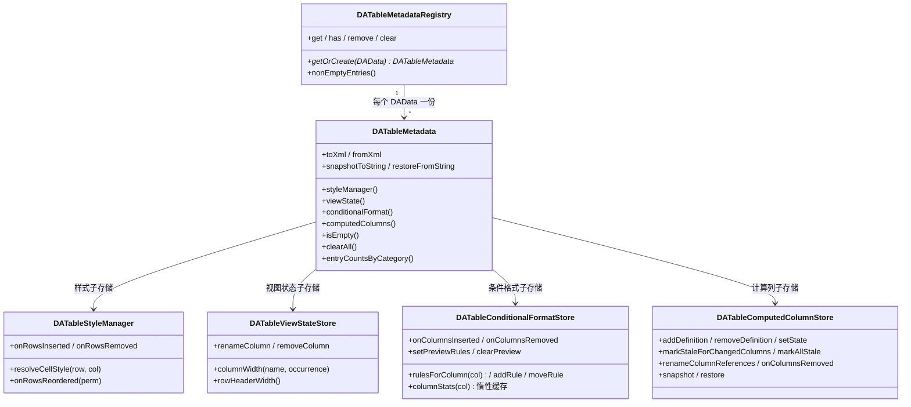

# 表格元数据架构（DATableMetadataRegistry）

表格元数据是「按数据集存在、随工程保存、不属于数据本体」的一切附加信息的统称：静态样式、视图状态（列宽/行头宽）、条件格式规则（T1.5）、计算列定义（T1.23），以及后续的批注、校验规则。它们统一由 `src/DAGui` 的会话级注册表 `DATableMetadataRegistry` 治理，序列化进工程文件 `table-metadata.xml`。本页是这套基础设施（T1.3–T1.5、T1.23）的架构说明。

## 注册表 / 元数据束 / 子存储

三层结构，职责各管一段：



- **注册表**（`DATableMetadataRegistry`，由 `DATableStyleRegistry` 泛化而来）：会话级、按 `DAData` 键控，挂在 `DADataOperateWidget` 上（`metadataRegistry()`）。数据移除时**保留**条目以支持撤销，`datasCleared` 时统一清空。
- **元数据束**（`DATableMetadata`）：一个数据集一份，聚合各子存储并提供 `toXml/fromXml` 聚合序列化。当前含样式、视图状态、条件格式（T1.5，003）与计算列（T1.23，004）四个子存储；批注/校验由后续任务各自往束里加成员与 XML 段，**不提前加空成员**。束另提供三个整束级入口（004 T1.27 就地形状变换用）：`clearAll`（整束清除）、`snapshotToString/restoreFromString`（XML 快照，与数据替换同一撤销单元）、`entryCountsByCategory`（就地替换确认框的「将被清除类别与条目数」统计）。
- **子存储**：只负责自己那类数据的增删查改 + XML 段读写。

**渲染类 vs 语义类**（归属分层，D3）：渲染类子存储（样式、条件格式，后续批注）只服务界面，留在 DAGui；语义类（计算列已落地，后续校验规则）的**定义类**放 `src/DAData/`（纯数据、无 GUI 依赖，将来可被工作流节点/agent 直接复用），v1 的存储与序列化仍走本注册表——`DAComputedColumn`（定义）在 DAData、`DATableComputedColumnStore`（集合+三态+调度）在 DAGui 即此分层的第一个实例。

## table-metadata.xml 与旧文件兼容

工程文件统一为 `table-metadata.xml`（R18：**保存只写新文件，不双写**；加载时新文件不存在则回退读旧 `table-styles.xml`）：

```xml
<table-metadata version="1">
  <project version="...">
    <table data-id="..." data-name="...">
      <column-style col="..."/>   <!-- 内层样式标签与旧文件完全一致 -->
      <row-style row="..."/>
      <cell row="..." col="..."/>
      <col-format index="..."/>
      <view-state row-header-width="60">   <!-- 视图状态兄弟段 -->
        <column-width name="value" occurrence="0" width="120"/>
        <column-order>                      <!-- 列序（006，列名有序表） -->
          <column name="s" occurrence="0"/>
          <column name="value" occurrence="0"/>
        </column-order>
        <column name="f" occurrence="0" hidden="1"/>   <!-- 隐藏集合（006，每项一条） -->
        <freeze columns="2"/>              <!-- 冻结列数（006，视图顺序前 m 个可见列） -->
      </view-state>
      <conditional-format>                 <!-- 条件格式兄弟段（003 T1.5，按列索引组织） -->
        <column col="2">
          <rule type="cell" cond="greater" v1="100">
            <background brushstyle="1" color="#ffce6043"/>
          </rule>
          <rule type="color-scale" three="0" cmin="#ffbdcde8" cmid="#ffffffff" cmax="#ff5280c1"/>
          <rule type="data-bar" color="#ffbdcde8"/>
        </column>
      </conditional-format>
      <computed-column>                    <!-- 计算列兄弟段（004 T1.23，磁盘契约 R10：expr+engine+version+state） -->
        <column target="C" engine="pandas.eval" version="1" state="valid" enabled="1">
          <expr><![CDATA[A + `my col`]]></expr>
          <dep name="A"/>
          <dep name="my col"/>
        </column>
      </computed-column>
    </table>
  </project>
</table-metadata>
```

匹配主键是 `data-id`（跨会话稳定，持久化于 data-manager.xml），`data-name` 作人类可读与旧工程回退。加载由 `DAAppProject::loadedTableMetadata`（新）/`loadedTableStyles`（旧回退）完成，两者共用 `applyLoadedTableElement` 回填路径。

## 列引用约定（R20）

所有表元数据按语义分两类引用列，**混用会产出两种最难排查的 bug**（插一列样式全错位、改个名公式全失效）：

- **装饰类**（静态样式、条件格式，后续批注）：用**位置键（列索引）**，随列插删走 `onColumnsInserted/onColumnsRemoved` 重映射，列改名不需要迁移。
- **语义类**（列宽、计算列已落地，后续校验规则）：用**列名**引用，重名时以「第 n 个同名列」（occurrence，从 0 计）消歧——pandas 允许重名列且 `da_insert_column` 不做重名检查，列宽键必须是 `(列名, occurrence)` 二元组；列改名命令负责调用 `renameColumn` 迁移。计算列的目标列名由对话框强制唯一（禁止自覆盖天然排除与现有列重名），依赖列按纯列名引用，改名经 `renameColumnReferences` 批量迁移（与改名命令同一撤销单元）。

## 位置键重映射与置换语义

`DATableKeyRemap`（纯头文件模板，元数据束层共享）为一切「行位置键」元数据提供统一重映射：

> **⚠️ 置换语义（钉死）**
>
> `perm[i] = 新表第 i 行在旧表中的行号`（**新→旧**，与 `df.iloc[perm]` / `numpy.take` 一致）；
> 逆置换 `inv[旧行号] = 新位置`（旧→新）供 undo 使用。
> 两个方向命名必须区分：正置换一律叫 `perm`，逆置换一律叫 `inv`，禁止都叫 `perm`/`index`。

- 入口按维度参数化：行键 `QHash<int,T>` 一个，单元格键 `QHash<QPair<int,int>,T>` 一个（`Dimension::Row/Column` 指定重映射哪一维）。复杂度 O(存储条目数)，不扫全表。
- 列插删的「一批索引」位移工具（003 补）：`shiftKeysOnInserted/shiftKeysOnRemoved(QHash<int,T>, QList<int>)`，降序位移语义与 `DATableStyleManager::onColumnsInserted/onColumnsRemoved` 一致，`DATableConditionalFormatStore` 的列桶重映射用同一实现。
- `DATableStyleManager::onRowsReordered(perm)` 已接入（重映射 `mCellStyles` 行维与 `mRowStyles`，完成发 `styleReset()`），与既有 `onRowsInserted/onRowsRemoved` 并列。
- **列维度重排**（T1.8 列视图）用同一工具按 `Dimension::Column` 扩展——刻意不提供空的 `onColumnsReordered` 占位方法（避免死代码）。

## delegate 五层绘制管线（D2）

`DATableStyleItemDelegate::paint()` 是唯一绘制口，层序钉死（旧 `paintConditionalFormat` 虚钩子已删除，不保留两套口子）：

| 层 | 内容 | 状态 |
|----|------|------|
| ① 静态样式 | `DATableStyleManager` 三层 merge（列→行→单元格）后叠加 bg/fg/font | 已实现 |
| ② 持久装饰 | 条件格式规则求值 → 背景/前景（`DATableConditionalFormatStore::evaluate` 静态纯函数） | 已实现（003） |
| ③ 瞬态装饰 | `DATableHighlightOverlay` 查找命中/校验违规，语义色半透明覆盖背景 | 已实现 |
| ④ 数据条 | 背景之上、文字之下按列 min/max 归一化画条（`fillRect`，2px 内边距） | 已实现（003） |
| ⑤ 文字 | 基类 `QStyle::drawControl(CE_ItemViewItem)`；批注角标在其后 | 已实现（角标 005） |

瞬态高亮层 `DATableHighlightOverlay`：两来源（Find/Validation）× 五级别，两级索引 + 打包键 `(row<<32)|col`，O(1) 查询；`levelAt` 固定优先级 `CurrentHit > Hit > ViolationError > ViolationWarning`，**同格命中+违规时以查找为准**（查找是用户当前操作焦点，单测钉住此语义）。不序列化、不进撤销栈。样式与高亮查询一律用 actualRow（滑动窗偏移后的数据源绝对行）。无装饰快速路径保留：样式、条件格式、高亮都空时直接走父类 paint（10 万行滚动性能保障）。

## 条件格式子存储（DATableConditionalFormatStore，003 T1.5）

渲染类子存储，规则**按列索引分桶**（`QHash<int, QVector<Rule>>`，装饰类位置键 R20），三类规则：单元格规则（7 操作符 → `DATableCellStyle` 输出）、色阶（双/三色插值背景）、数据条（归一化条长）。要点：

- **求值只在 delegate ②层**（不进 model/data()），取值 `Qt::EditRole`；每格只查本列规则桶（分桶即「每列规则列表缓存」），求值逻辑是静态纯函数（`evaluate`），单测直接覆盖。
- **优先级 = 列表顺序**，同列自上而下求值、后命中覆盖先命中（Excel 语义）；对话框上移/下移即调整顺序。
- **列统计缓存**：色阶/数据条的 `{min,max,median}` 经 `StatsProvider`（widget 注入，内部走 Python `da_column_stats` 全表 O(n) 归约）惰性计算一次并缓存，失败也缓存（不每格重试）；失效挂点在 widget 侧——单元格编辑走模型 `cellValueChanged` 精确信号、插删行保守全失效、替换/置nan/粘贴按变更列失效、**排序不失效**（列值集合不变，性能决策）。
- **预览规则集**：对话框编辑期间 `setPreviewRules` 整体叠加（`rulesForColumn` 预览优先，不落库不入栈），确定后按结果与现值差异生成增/删/改/移/清命令入页撤销栈，取消 `clearPreview` 还原。
- **惰性/只读源限制**：`isLazyLoaded()` 或 `!isTableEditable()` 的数据源无法全量列统计 → 对话框内色阶/数据条置灰并给出说明文案，单元格规则正常。
- 入口：Ribbon「Table Style」的「Conditional」面板 + 表体右键菜单「Conditional Format...」（列头菜单不放，R16），作用于当前选区覆盖的列集合。

## 计算列子存储（DATableComputedColumnStore，004 T1.23）

语义类子存储：定义集合（`DAComputedColumn`，定义类在 `src/DAData`，无 GUI 依赖）+ **三态状态机**（`Valid` 有效 / `Stale` 待重算 / `Invalid` 失效）+ 重算调度。要点：

- **物化列 + 手动重算**（R7/R8）：求值结果写进真实 DataFrame 列（`da_eval_column`：RHS 求值 + 按列名赋值，规避 pandas 3.x 反引号赋值 LHS 的损坏列名缺陷），公式只是元数据。数据变更只**标状态**不求值——单元格编辑走模型 `cellValueChanged` 精确挂点按变更列比对依赖集合，整表操作（插删行/列转索引）保守全标，**排序不标**（R13 行序不影响列值）；用户点「重新计算」（单列）/「全部重算」（宏命令=一个撤销单元）才求值。
- **一切写操作入栈**（D4）：创建/重算走 `DACommandDataFrame_evalColumn`（列级记录：首次 exec 捕获旧列快照，undo 还原旧列或删除新建列，内存=一列）；定义与状态的增删改**不入栈**，由命令的 directional 回调联动（创建 undo 移除定义、重算 undo 回原状态），与数据同一撤销单元；「移除公式（保留数据）」是纯元数据命令 `DACommandComputedColumn_removeDefinition`。
- **禁止自覆盖**（R7）：目标列必须是新列名且表达式不得引用目标列（对话框 + 存储双重校验）；「删公式、留数据」的退路永远成立。
- **打开工程不重算**（R7）：`<computed-column>` 段持久化 expr+engine+version+state（磁盘契约 R10），加载只恢复定义与状态、零求值；引擎/语法不兼容的最坏结果 = 普通列 + 标失效 + 提示，不损坏数据。
- **列联动**（R20 列名引用）：改名 → `renameColumnReferences` 批量迁移（依赖与目标自身，改名前提示「有 N 个计算列引用它」）；删列 → `onColumnsRemoved`（目标被删=定义移除、依赖被删=置失效不静默清空）；`snapshot/restore` 整店快照供删列/合并命令的 undo 恢复。
- **表头三态标识**（R9）：浅蓝 `#BDCDE8` 底色经**模型** `actualHeaderData(BackgroundRole)` 提供（`QHeaderView::paintSection` 原生消费）、公式+状态 tooltip 经 `ToolTipRole`；`DADataHeaderView::paintSection` 只叠加左侧前导 `ƒx` 角标（状态色：主蓝/金黄/橙红，有多列排序序号角标时移到左下避让）。**单元格区域不染色**（D2 管线没有"公式列底纹"层）。
- 入口：Ribbon「Data Tools」面板（计算列/全部重算）+ 表体右键「Computed Column...」+ 计算列列头右键三项（编辑公式/重新计算/移除公式）。

## 右键菜单与快捷键的落位约定

- **菜单内容单点定义在 DAGui，执行在 APP**：列头菜单在 `DADataHeaderView::buildColumnContextMenu`（6 项 4 组；计算列追加第 5 组「编辑公式/重新计算/移除公式（保留数据）」），表体菜单在 `DADataTableView::buildContextMenu`（剪切/复制/粘贴 ‖ 查找/替换 ‖ 条件格式 ‖ 004 数据工具组：计算列/分列/合并列/分组聚合/转置/宽转长，启用规则按选区列数与数据源能力）。QAction 由 DAGui 自建，**不共享 APP 的 `QAction` 对象**（右键项按列/选区上下文启用、Ribbon 按钮按页能力启用，共享会互相污染 enabled）；点击后发表意信号（`columnActionRequested` / `contextMenu*Requested` / `*Requested`），APP 侧只做接线（先选中列/复用既有槽）。图标一律取 `:/DAGui/icon/...`，禁止依赖 APP 的 qrc（插件链 `DAInterface → DAGui`，插件运行时没有 APP 资源）。
- **快捷键集中挂点**：表格快捷键一律在 `DADataTableView::keyPressEvent` 处理（后续查找 Ctrl+F、填充 Ctrl+D 等在此追加），不散落各处。
- **表头**：`DADataHeaderView` 水平/垂直共用一个类；`clickedWithModifiers`（带修饰键点击）供排序交互（002）消费，图表「选择序列」拾取仍走既有 `sectionClicked` 链路；行头宽在 vertical 实例右缘 8px 热区拖拽，`setFixedWidth` 落地（Qt 纵向表头宽度 = `clamp(qMax(minimumWidth, sizeHint), maximumWidth)`，min=max=w 恒为 w），释放后经 `rowHeaderWidthChanged` 写入视图状态。
- **列宽持久化纪律**（R6）：按列名 + occurrence 存 `<view-state>`，**禁止 `QHeaderView::saveState()`**——滑动窗下段号=窗口行号，状态会随滚动互相污染。
- **列视图状态（006）**：`<view-state>` 在列宽之外新增三个子元素——`<column-order>`（列名有序表，空 = 未记录 = 数据列序）、`<column hidden="1"/>`（隐藏集合，每项一条）、`<freeze columns="N"/>`（冻结列数）。列序/隐藏的键同样是「列名 + occurrence」（重名列消歧，R20）；加载后页面做**一次性收敛**（`normalizeToColumns`：孤儿条目剪除 + 新列按实际顺序追加列序末尾，有丢弃时提示一次）；冻结计数只在投影期夹紧到当前可见列数、**不写回**（列数临时变少时用户设置不丢）。
- **列状态真源与投影**：列序/隐藏/冻结的唯一真源是 `DATableViewStateStore`，视图层不自行改列状态；页面 `applyViewStateFromStore()` 统一投影到列轴窗格容器（`DATablePaneContainer`，冻结窗格与主窗格并排、行头归冻结窗格），任何入口（命令 redo/undo、直接 API、拖动落库）都走这一条路径。

> **⚠️ 列视图命令语义**
> 列序/隐藏/冻结列数入页撤销栈（`DACommandsTableColumnView` 族：`Reorder columns` / `Hide column "%1"` / `Show all columns` / `Freeze columns to %1` / `Unfreeze columns`）；列宽拖动不入栈但立即持久化；列视图对话框的"隐藏 + 冻结"确定合成一个撤销单元（批量父命令）。

## 相关文件

| 文件 | 说明 |
|------|------|
| `src/DAGui/DATableMetadataRegistry.h/.cpp` | 会话级注册表（按 DAData 键控） |
| `src/DAGui/DATableMetadata.h/.cpp` | 元数据束（聚合子存储 + 统一序列化） |
| `src/DAGui/DATableViewStateStore.h/.cpp` | 视图状态子存储（列宽/行头宽/列序/隐藏/冻结列数） |
| `src/DAGui/DATablePaneContainer.h/.cpp` | 列轴窗格容器（主窗格 + 冻结窗格投影，006） |
| `src/DAGui/DATableConditionalFormatRule.h/.cpp` | 条件格式规则（纯数据类 + 求值/插值/归一化纯函数） |
| `src/DAGui/DATableConditionalFormatStore.h/.cpp` | 条件格式子存储（列桶/统计缓存/预览/`<conditional-format>` 段） |
| `src/DAData/DAComputedColumn.h/.cpp` | 计算列定义（纯数据类，无 GUI 依赖，004 T1.23） |
| `src/DAGui/DATableComputedColumnStore.h/.cpp` | 计算列子存储（三态状态机/依赖联动/`<computed-column>` 段） |
| `src/DAGui/Dialog/DADialogComputedColumn.h/.cpp` | 计算列对话框（表达式编辑 + 列名点选 + 头部实时预览） |
| `src/DAGui/Dialog/DADialogSplitColumn.h/.cpp`、`DADialogMergeColumns.h/.cpp` | 分列/合并列对话框（预览与执行同一算子，004 T1.9） |
| `src/DAGui/Dialog/DADialogGroupBy.h/.cpp` | 分组聚合对话框（全表预览 + 分组数，004 T1.22） |
| `src/DAGui/Dialog/DADialogReshape.h/.cpp` | 转置/宽转长对话框（melt 规模守卫 + 就地勾选，004 T1.27） |
| `src/DAGui/DATableKeyRemap.h` | 位置键重映射模板工具（置换 + 列插删位移） |
| `src/DAGui/DATableHighlightOverlay.h/.cpp` | 瞬态高亮层 |
| `src/DAGui/DATableStyleItemDelegate.h/.cpp` | 五层绘制管线 delegate |
| `src/DAGui/Dialog/DADialogConditionalFormat.h/.cpp/.ui` | 条件格式规则编辑对话框（两栏 + 实时预览） |
| `src/DAGui/Commands/DACommandsConditionalFormat.h/.cpp` | 规则增/删/改/移/清列撤销命令 |
| `src/DAGui/Commands/DACommandsDataFrame.h/.cpp` | 计算列求值/移除公式、分列/合并列命令（列级记录撤销，004） |
| `src/DAGui/DADataHeaderView.h/.cpp` | 数据表格头（列头菜单/修饰键点击/行头宽拖拽） |
| `src/DAGui/DADataTableView.h/.cpp` | 表体右键菜单与快捷键挂点 |
| `src/PyScripts/DAWorkbench/DAPyBase/dataframe.py` | `da_column_stats` 列统计、`da_eval_column`/`da_expr_depends`/`da_needs_backtick` 计算列、`da_split_column`/`da_merge_columns` 分列合列、`da_groupby_aggregate`/`da_group_count` 分组聚合、`da_transpose`/`da_melt` 形状变换、`da_head_copy`/`da_get_column_copy`/`da_set_column` 辅助算子（`DAPyScriptsDataFrame` 封装） |
| `src/APP/DAAppProject.cpp` | `table-metadata.xml` 保存/加载（含旧文件回退） |
