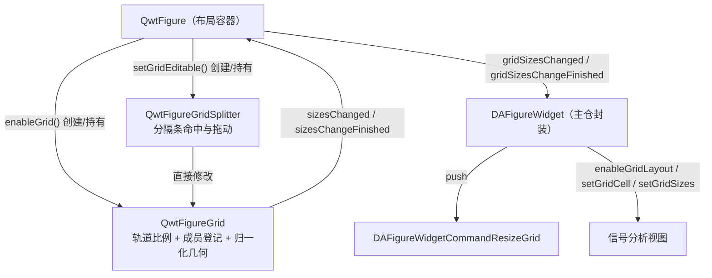

# 绘图窗口网格布局（保留式轨道）

`QwtFigure` 支持两种子图摆放方式：按归一化坐标自由摆放（原有方式），以及按行列轨道摆放的**保留式网格**。保留式网格把行列比例和成员位置作为唯一真源，窗口缩放或用户拖动分隔条时，子图按轨道比例重新排版，而不是记住某一时刻的像素矩形。信号分析窗口的 2×2 布局（波形 / 频谱 / 时频图或三维瀑布）就建立在这套能力上。

本文说明网格模型、主仓封装、XML 持久化、撤销与交互约定，以及改造时不能破坏的旧语义。

## 设计目标与约束

- 轨道比例（`rowSizes` / `columnSizes`）和成员登记（`row, col, rowSpan, colSpan`）由网格模型持有，几何按需计算。
- 网格成员与自由布局成员可以共存：网格成员走轨道换算，其它成员仍走原来的归一化矩形。
- 只做**新增** API。`addGridAxes()` 等既有接口的行为保持不变，避免影响并行开发与已有工程。
- 分隔条交互只在显式启用后安装，鼠标不在分隔带内时事件原样放行，不破坏缩放、平移、拾取、三维旋转。
- 一期只在信号分析窗口启用网格，绘图区仍是自由布局，不开放网格入口。

## 模型与分层



qwt 层只依赖 Qt（`QObject` / `QWidget`），不引用 `QwtFigure` / `QwtFigureLayout`，几何计算可以单独测试。主仓层 `DAFigureWidget` 负责撤销栈、XML 和与设置面板/图元树的联动。

## QwtFigureGrid（qwt 网格模型）

`src/3rdparty/qwt/src/plot/qwt_figure_grid.h`。

| 方法 | 说明 |
|------|------|
| `setup(rowCount, columnCount)` | 启用并重建网格，轨道等分，丢弃旧成员登记 |
| `isEnabled()` / `rowCount()` / `columnCount()` | 状态与轨道数 |
| `rowSizes()` / `columnSizes()` | 归一化轨道比例，和约为 1 |
| `setRowSizes(sizes)` / `setColumnSizes(sizes)` | 设置比例，内部归一化 |
| `setSpacing(wspace, hspace)` / `wspace()` / `hspace()` | 轨道间距（归一化单位）的写/读；间距需满足 `(轨道数 − 1) × 间距 < 1`，否则整条请求被拒绝并告警 |
| `setMinimumTrackPixels(px)` / `minimumTrackPixels()` | 拖动时单条轨道的最小像素，默认 40 |
| `addItem(w, row, col, rowSpan, colSpan)` | 登记成员，位置或跨度越界返回 false |
| `removeItem(w)` / `items()` / `gridPosition(w, ...)` | 注销、枚举、查询成员 |
| `normRectFor(row, col, rowSpan, colSpan)` | 按当前轨道比例计算单元格的归一化矩形 |
| `dividers()` | 当前分隔条列表（方向、左侧/上方轨道索引、归一化位置） |
| `finishChange()` | 结束一次交互，发出 `sizesChangeFinished()` |

信号：

| 信号 | 触发时机 |
|------|----------|
| `sizesChanged()` | 轨道比例或间距变化，拖动过程中会连续发出 |
| `sizesChangeFinished()` | 一次交互结束（分隔条松手时由 splitter 调 `finishChange()`），每次拖动只发一次 |

归一化矩形按下面的公式计算，行列方向规则相同：

```
left  = Σ columnSizes[0 .. col-1] + col × wspace
width = Σ columnSizes[col .. col+colSpan-1] + (colSpan − 1) × wspace
top   = Σ rowSizes[0 .. row-1] + row × hspace
height= Σ rowSizes[row .. row+rowSpan-1] + (rowSpan − 1) × hspace
```

## QwtFigure 的网格入口

`src/3rdparty/qwt/src/plot/qwt_figure.h`。

| 方法 | 说明 |
|------|------|
| `enableGrid(rowCount, columnCount)` | 创建或重建网格并等分轨道；参数非法返回 false |
| `grid()` / `isGridEnabled()` | 网格模型指针与启用状态 |
| `addAxes(plot, row, col, rowSpan, colSpan)` | 把 `QwtPlot` 登记为网格成员；发 `axesAdded` 后再发 `currentAxesChanged` |
| `addGridItem(widget, row, col, rowSpan, colSpan)` | 把非 `QwtPlot` 控件（如三维图）登记为网格成员，不发 axes 信号 |
| `removeWidget(widget)` | 从 figure 移除成员但不删除对象：`QwtPlot` 走 `takeAxes()`，其它控件注销布局与网格后 `setParent(nullptr)` |
| `setGridEditable(bool)` / `isGridEditable()` | 启用/禁用分隔条拖动；首次启用时创建 `QwtFigureGridSplitter`，之后由 figure 持有 |
| `gridSizesChanged()` / `gridSizesChangeFinished()` | 转发网格模型的 `sizesChanged` / `sizesChangeFinished` |

> **⚠️ 不要给 `addWidget` 加 5 参数重载**
>
> 非 `QwtPlot` 的网格成员走 `addGridItem()`，而不是 `addWidget(widget, row, col, rowSpan, colSpan)`。旧的 `addWidget(widget, rowCnt, colCnt, row, col)` 仍然存在，再加一个 5 参数重载会产生调用歧义。

旧接口 `addGridAxes(plot, rowCnt, colCnt, row, col, rowSpan, colSpan, wspace, hspace)` 保留原行为：把网格坐标**一次性**换算成归一化矩形，之后不再随轨道比例变化。新代码一律用 `enableGrid()` + `addAxes(plot, row, col, ...)`，不要混用两套入口。

## QwtFigureGridSplitter（分隔条交互）

`src/3rdparty/qwt/src/plot/qwt_figure_grid_splitter.h`。

| 方法 | 说明 |
|------|------|
| `QwtFigureGridSplitter(QwtFigure*)` | 由 `QwtFigure::setGridEditable(true)` 创建，父对象是 figure，默认禁用 |
| `setEnabled(bool)` / `isEnabled()` | 启用时在 figure 和覆盖网格单元格的控件上安装事件过滤器并开启鼠标跟踪；已启用时再次调用会重扫成员 |
| `setHitWidth(px)` / `hitWidth()` | 分隔带半宽（像素），默认 4 |
| `isDragging()` | 是否正在拖动 |
| `hoverChanged(Qt::CursorShape)` | 进入/离开命中带时发出 `SplitHCursor` / `SplitVCursor`，离开时发 `ArrowCursor` |

行为：

- 只有落在分隔条 ±`hitWidth` 像素带内的鼠标事件会被消费，带外事件原样放行。
- 拖动只改相邻两条轨道，把两条轨道的比例之和重新分配；`minimumTrackPixels()` 把每条轨道夹在最小宽度之上，轨道不会塌陷或重叠。
- 拖动期间受影响子图暂停重绘，松手后恢复并重绘；比例真的变化时才发一次 `finishChange()`。
- 拖动中按 Esc 取消：恢复拖动前的比例，不发 `sizesChangeFinished()`。
- `QOpenGLWidget`（三维图）从不安装事件过滤器，所以三维单元格的边界由相邻的二维子图侧负责命中；不要依赖三维控件自己响应分隔条。

## DAFigureWidget 封装（主仓）

`src/DAFigure/DAFigureWidget.h`。

| 方法 | 说明 |
|------|------|
| `enableGridLayout(rows, cols)` | 启用网格布局。行列数不变时幂等；会退出自由缩放的子图编辑器、只在 figure 的最小/最大尺寸约束确实塌陷时复位（`maximum<=0` 或 `minimum>maximum`，复位后发 `figureSizeConstraintsChanged` 让设置面板刷新）；重建网格会清空旧登记 |
| `isGridLayoutEnabled()` | 是否处于网格布局 |
| `grid()` | 底层 `QwtFigureGrid*`，未启用时为 nullptr |
| `setGridCell(widget, row, col, rowSpan, colSpan)` | 登记或移动成员。2D 子图、三维子图、普通控件都支持；越界返回 false 且保留原登记 |
| `gridRowSizes()` / `gridColumnSizes()` | 当前轨道比例，`QList<qreal>` |
| `setGridSizes(rows, cols)` | 程序化设置比例（XML 恢复、撤销/重做用），不压撤销栈，成功后同步撤销基线 |

创建信号分析图的典型写法：

```cpp
// 1) 先启用网格，再设置默认比例（这一步不产生撤销记录）
DA::DAFigureWidget* figure = new DA::DAFigureWidget(parent);
figure->enableGridLayout(2, 2);
figure->setGridSizes({ 0.56, 0.44 }, { 0.50, 0.50 });

// 2) 创建子图并登记到单元格：波形占满第一行，频谱与热图在第二行
DA::DAChartWidget* wave     = figure->createChart();
DA::DAChartWidget* spectrum = figure->createChart();
DA::DAChartWidget* heatmap  = figure->createChart();
DA::DAChart3DWidget* waterfall = figure->create3DChart();

figure->setGridCell(wave, 0, 0, 1, 2);  // 第 0 行第 0 列，跨 2 列
figure->setGridCell(spectrum, 1, 0);
figure->setGridCell(heatmap, 1, 1);
figure->setGridCell(waterfall, 1, 1);   // 与热图同格，按瀑布模式切换显隐
```

`createChart()` / `create3DChart()` 只负责创建对象，位置由随后的 `setGridCell()` 决定。已经在 figure 里的控件再次 `setGridCell()` 只更新网格登记并重排布局，不会重建 layout item。

## XML 持久化

`src/DAGui/Archive/DAXmlHelper.cpp` 的 `saveGridElement()` / `loadGridElement()` 负责网格，`writeGridCellAttributes()` / `readGridCellAttributes()` 负责成员坐标。

保存时，figure 元素下会多出一个 `<grid>` 节点，只有启用网格布局时才写：

```xml
<figure id="sig-示例信号">
  <grid rows="2" cols="2" rowSizes="0.56,0.44" colSizes="0.5,0.5"
        wspace="0" hspace="0"/>
  <charts>
    <chart id="..." grid-row="0" grid-col="0" grid-rowspan="1" grid-colspan="2"
           x="0" y="0" w="1" h="0.56">...</chart>
    <chart id="..." grid-row="1" grid-col="0" grid-rowspan="1" grid-colspan="1">...</chart>
    <chart id="..." grid-row="1" grid-col="1" grid-rowspan="1" grid-colspan="1">...</chart>
  </charts>
  <chart3d id="..." grid-row="1" grid-col="1" grid-rowspan="1" grid-colspan="1">...</chart3d>
</figure>
```

读取顺序（`loadElement(DAFigureWidget*, ...)`）：

1. 先读 `<grid>`：调 `enableGridLayout(rows, cols)`，若节点带 `wspace` / `hspace` 就先 `setSpacing()`，再 `setGridSizes()` 恢复比例。没有 `<grid>` 走原来的自由布局路径。
2. 逐个读 `<chart>`：有 `grid-row` / `grid-col` 时用 `setGridCell()` 登记；登记失败或没有网格坐标时回退原来的 `addChart(pos)`（旧工程兼容）。
3. 逐个读 `<chart3d>`：规则同上，回退到 `add3DChart(pos)`。
4. 最后恢复坐标轴绑定与轴对齐信息。

写侧仍会写 `x` / `y` / `w` / `h`，供旧版本或降级路径使用；读侧优先网格坐标。

> **📝 间距（wspace/hspace）的持久化**
>
> 网格间距由 `QwtFigureGrid::wspace()` / `hspace()` 读出，保存端始终写出这两个属性（12 位有效数字）；旧工程没有这两个属性时按 0 处理，等分轨道不受影响。`setSpacing()` 会按 `(轨道数 − 1) × 间距 < 1` 校验上界，恢复时若间距非法整条请求被拒（只发告警、保持原值），不会让最后一个单元格塌陷。

## 撤销与重做

拖动分隔条只产生**一条**撤销命令，程序化恢复不产生命令：

| 时机 | 行为 |
|------|------|
| 一次拖动中第一次 `sizesChanged` | `DAFigureWidget` 记下上一次提交的比例作为撤销基线 |
| 拖动过程 | 只更新比例与几何，不入栈 |
| 松手且比例确实变化 | `onGridSizesChangeFinished()` 压入一条 `DAFigureWidgetCommandResizeGrid` |
| 撤销/重做 | 命令通过 `DAFigureWidget::setGridSizes()` 写回旧/新比例 |
| `setGridSizes()` 程序化调用 | 内部置 `mSuppressGridUndo`，不入栈，并同步撤销基线 |

`DAFigureWidgetCommandResizeGrid`（`src/DAFigure/DAFigureWidgetCommands.h`）保存调整前后的行列比例；首帧比例已经由拖动应用，命令的第一次 `redo()` 直接跳过，避免重复设置。命令文本为「调整网格比例」。

### 增删/移动子图的命令感知网格

网格 figure 上，`DAFigureWidgetCommandCreateChart` / `Create3DChart` / `RemoveChart` / `Remove3DChart` / `ResizeWidget` 都带一份 `DAFigureGridCellSnapshot`（是否为网格成员 + row/col/rowSpan/colSpan）：

- 网格成员走 `DAFigureWidget::setGridCell()` 恢复，否则 redo/undo 会按自由归一化矩形把子图加回去，与网格成员叠压；
- 自由成员路径完全没有改动（`addChart` / `add3DChart` / `setWidgetNormPos` 照旧）；
- undo 会经 removeChart 摘掉 layout item，所以恢复网格成员要先补回成员（`hasPlot`/`has3DChart` 判断）再按单元格登记；
- 网格 figure 上首次创建子图会登记到第一个空闲单元格（网格已满时退回 (0,0)，同格共存是允许的）；
- 网格 figure 上「新建坐标系」「调整子图大小」入口在 Ribbon 侧置灰（`updateFigureAboutRibbon`），避免交互路径制造自由成员。

一个 figure 一个撤销栈（`DAFigureWidget::getUndoStack()`）。信号分析页的 provider 激活成功后，注册表会把这个栈设为 active，保证功能区撤销/重做按钮作用于当前信号的图。

## 交互约定

### 点击激活当前子图

`QwtFigure::eventFilter()` 在子图上监听鼠标按下：命中 `QwtPlot` 时把宿主图（寄生轴映射到宿主）设为当前坐标轴，事件不消费，缩放、平移、拾取、图元编辑器都不受影响。三维子图不在这条路径里，由 `DAFigureWidget::eventFilter()` 的 `getUnderCursor3DChart()` → `setCurrent3DChart()` 处理。

当前子图变化后，`DAFigureWidget` 发出 `currentChartChanged` / `current3DChartChanged`，信号分析视图再聚合成 `currentSubChartChanged`，设置上下文提供者据此切换 2D/3D 设置页（见 [设置上下文提供者](../ui/setting-context-provider.md)）。

> **📝 波形画布的点击**
>
> 波形画布上的 QwtPicker 会消费点击，qwt 的 `QwtFigure` 收不到传播。信号分析视图在画布事件过滤器里显式调用 `setCurrentChart()`，保证点哪个子图就切哪个。

### 网格模式下的编辑限制

- 网格模式下子图几何由轨道比例决定，自由调整子图大小（Resize Chart）不可用：`beginChartEditor(SubChartEditor)` 直接返回，功能区对应动作按 `isGridLayoutEnabled()` 置灰。
- 启用网格时会结束正在进行的子图编辑器，避免两种几何来源同时生效。
- 网格成员显隐由控件自身可见性驱动，布局会跳过不可见成员。同一单元格可以登记互斥显示的成员（信号分析的热图与三维瀑布都登记在 `(1, 1)`，按瀑布模式切 `setVisible`），不需要反复登记/注销。

### Qt5 / Qt6 兼容

- 鼠标与悬停事件的位置统一用 `qwt::compat::eventPos()`（`src/3rdparty/qwt/src/core/qwt_qt5qt6_compat.hpp`），Qt5 取 `pos()`，Qt6 取 `position().toPoint()`。
- 悬停事件按 `QHoverEvent` 处理，鼠标事件按 `QMouseEvent` 处理，不要混用类型转换。
- 依赖 `QWidget::isVisibleTo(parent)` 判断成员是否参与布局，Qt5/Qt6 行为一致。

## 使用约束

- 不要修改 `addGridAxes()`、`addWidget()` 的既有语义；新增能力走新接口。
- 不要绕过 `DAFigureWidget::setGridSizes()` 直接调 `QwtFigureGrid::setRowSizes()`：撤销基线与交互标记都在 `DAFigureWidget` 一侧同步，绕过会让下一次拖动把错误的比例当成基线。
- 恢复顺序固定为「启用网格 → 设置间距/比例 → 成员登记」，顺序颠倒会丢掉比例或成员。
- `setGridCell()` 对越界单元返回 false 且不改变已有登记；调用方应处理失败回退，不要假定成功。
- 三维单元格的分隔条边界由相邻二维子图命中，不要把三维控件当作边界命中的唯一来源。
- 本期不为绘图区开放网格入口；新增入口前先确认导出、图元树、撤销等链路都已适配。

## 涉及文件

| 文件 | 说明 |
|------|------|
| `src/3rdparty/qwt/src/plot/qwt_figure_grid.h/.cpp` | 网格模型：轨道比例、成员登记、归一化几何、分隔条列表 |
| `src/3rdparty/qwt/src/plot/qwt_figure_grid_splitter.h/.cpp` | 分隔条交互：命中、拖动、Esc 取消、光标 |
| `src/3rdparty/qwt/src/plot/qwt_figure.h/.cpp` | 网格入口、成员增删、点击激活、信号转发 |
| `src/3rdparty/qwt/src/plot/qwt_figure_layout.cpp` | 布局：网格成员按轨道矩形，其它成员按归一化矩形，跳过不可见成员 |
| `src/DAFigure/DAFigureWidget.h/.cpp` | 主仓封装、撤销接线、子图编辑器限制 |
| `src/DAFigure/DAFigureWidgetCommands.h/.cpp` | `DAFigureWidgetCommandResizeGrid` |
| `src/DAGui/Archive/DAXmlHelper.cpp` | `<grid>` 与 `grid-*` 属性的读写 |
| `src/APP/Ribbon/DAAppRibbonAreaChart.cpp` | 网格模式下置灰 Resize Chart |
| `plugins/DASignalAnalysis/Page/DASignalAnalysisView.cpp` | 参考用法：2×2 网格、2D/3D 同格显隐切换 |

## 测试与参考

- `src/tst/DAFigureGridTest/`：网格数学、成员登记、分隔条命中/拖动/最小轨道、撤销命令。
- `src/tst/DAChartSerializeTest/`：`<grid>` 与 `grid-*` 的保存/加载往返。
- `src/tst/DASignalAnalysisTest/`：2×2 成员坐标、瀑布模式显隐、点击切换当前子图。
- 运行：`.\scripts\test.ps1 -Suite chart`、`.\scripts\test.ps1 -Suite data`。

相关文档：

- [绘图模块概述](./figure-abstract.md)：`DAFigureWidget` / `DAChartWidget` 的基础能力。
- [绘图窗口停靠布局](./chart-dock-nesting.md)：figure 作为停靠窗口的布局与序列化。
- [Qwt 序列化指南](./qwt-serialization-guide.md)：图元、坐标轴等其它 Figure 内容的序列化。
- [设置上下文提供者](../ui/setting-context-provider.md)：当前子图变化如何驱动设置面板切页。
