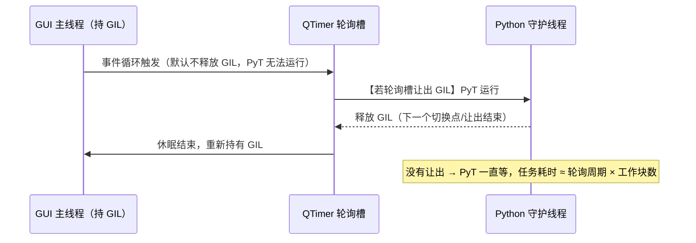

# 内嵌 Python 的 GIL 架构约束

DAWorkBench 把 CPython 以**库**的形式嵌入进程（不是独立进程、也不是子解释器），解释器由 GUI 主线程初始化，并且**主线程从此一直持有 GIL**。因此凡是需要「后台跑一段 Python 计算」的功能，都不能按普通多线程程序去理解：后台 Python 线程能跑多快，不由 CPU 核数决定，而由「主线程多久进入一次 Python、每次让出 GIL 多久」决定。

本文是这条架构约束的权威说明。新增任何「C++ 驱动 Python 长任务」的功能（数据分析、信号分析、导入导出、批量处理等）之前，先读完本文。

> **ℹ️ 适用范围**
>
> 所有在 C++ 进程中调用 Python、且 Python 侧单次计算可能超过约 100 ms 的代码。纯 Python 脚本内部的小函数调用不受影响。

## 架构事实

| 事实 | 说明 | 代码位置 |
|------|------|----------|
| Python 是嵌入式库 | 解释器与主程序同进程，由 GUI 线程初始化 | `src/DAPyBindQt/DAPyInterpreter.cpp` |
| 初始化后 GIL 不释放 | pybind11 的 `initialize_interpreter()` 只调用 `Py_InitializeFromConfig()`，**不会**调用 `PyEval_SaveThread()`，所以调用线程（GUI 主线程）持续持有 GIL | `src/3rdparty/pybind11/include/pybind11/embed.h` |
| 事件循环期间没有统一释放 | `main.cpp` 从初始化解释器到 `app.exec()` 返回，没有 `PyEval_SaveThread()`；也没有「每个 C++→Python 调用点自行 `gil_scoped_acquire`」的约定 | `src/APP/main.cpp` |
| 只有显式让出才有 GIL 窗口 | 主线程执行 `pybind11::gil_scoped_release`（内部 `PyEval_SaveThread`）期间，其它 Python 线程才能运行；主线程阻塞在 C++ 事件循环里时不会主动让出 | `src/DAPyBindQt/DAPyGILGuard.h`（`DAPyGILRelease`） |
| 进度由轮询驱动 | Python 守护线程的启动、进度回读、结果取走都发生在主线程调用 Python 的瞬间（QTimer 轮询槽） | `src/PyScripts/DAWorkbench/DAPyBase/thread_status_manager.py` |

> **⚠️ 一句话结论**
>
> **主线程持有 GIL；后台 Python 线程只能在主线程「进入 Python 并让出 GIL」的窗口里推进。只查状态不让出 GIL 的轮询，会让后台计算慢几十倍到上千倍，表现为「任务像卡死」。**



## 典型症状与判定方法

如果出现下面任意一条，优先怀疑 GIL 饥饿，而不是算法慢：

- 后台 Python 任务的耗时 ≈ **工作块数 × 轮询间隔**（例如每帧约 100 ms，而轮询正好是 100 ms）；
- 同一段计算抽成独立 Python 进程只要几秒，嵌入进程里却要几分钟甚至几十分钟；
- 任务「有进度但不推进」、日志严重迟到、界面 CPU 占用不高但任务就是不结束；
- 没有任何轮询/界面操作的时段，后台 Python 线程完全不动；
- 加日志发现 Python 函数调用之间的间隔被拉长到轮询周期量级。

**判定步骤**

1. **对照计时**：把同一段计算写成独立 Python 脚本（同解释器、同数据）计时。嵌入进程慢一个数量级以上即可疑。
2. **算指纹**：预估工作块数（帧数、分块数、行数/批大小），乘以轮询间隔；与实测耗时的偏差在一倍以内，基本可判定为 GIL 供给不足。
3. **探针验证**：临时在进程内起一个 Python 守护线程（每 0.25 s 写一行时间戳 + 自增计数），让应用保持空闲；若计数长时间不增长，即确认主线程没有让出 GIL。
4. **看等待点**：慢在 Python 侧分块循环里的「每块/每帧」，而不是某个 pandas/numpy 单次调用，基本就是轮询窗口太窄。

## 强制约定

### 1. GUI 主线程不做长 Python

- 单次 C++→Python 调用应短于约 100 ms；大计算（pandas/numpy 的 O(N) 处理）必须交给后台。
- **禁止**在 GUI 线程用 `for` 循环逐块/逐帧调用 Python：那是 O(N) 次跨语言调用，主线程会被拖死，且没有 GIL 让出窗口。

### 2. 长任务用「Python 守护线程 + `thread_status_manager` + C++ QTimer 轮询」

- Python 端：`threading.Thread(daemon=True)` 执行计算，进度/状态写 `thread_status_manager`，结果放模块级结果表，由 C++ 用 `take_result()` 取走（大数组不要塞进状态字典）。
- C++ 端：QTimer 非阻塞轮询，**不要**在主线程用 `QThread::sleep(1s)` 这类阻塞式等待做轮询（早期 `GreeDataWorkBench` 的写法已废弃：虽然能让出 GIL，但界面会冻结 1 秒）。
- 分块循环里检查取消标志，保证「取消计算」能真正生效。

### 3. 轮询槽必须让出 GIL

这是整条链路的关键：轮询槽在**处理完结果、发完进度信号之后**，若仍有任务在跑，释放 GIL 并短暂休眠，让 Python 守护线程连续计算。

```cpp
void DASignalAnalysisWorker::poll()
{
    // 1) 持 GIL 处理已完成任务、发进度信号
    //    （槽可能同步发起新任务，所以让出要放在最后）
    ...
    // 2) 仍有任务：释放 GIL + 短暂休眠，把 GIL 让给 Python 守护线程
    if (!mTasks.isEmpty()) {
        pybind11::gil_scoped_release release;                       // GUI 线程当前持有 GIL
        QThread::msleep(static_cast<unsigned long>(cGilYieldMs));   // 参考值 12 ms
    }
    updateTimer();
}
```

参数取值与权衡（参考 `plugins/DASignalAnalysis/Analysis/DASignalAnalysisWorker.cpp`）：

| 参数 | 参考值 | 说明 |
|------|--------|------|
| 轮询间隔 | 20 ms | 决定结果回填延迟与轮询自身的 Python 调用频率；太大会拖慢进度显示 |
| 每轮让出 GIL | 12 ms | Python 线程约获得 60% 时间片；GUI 线程每 20 ms 只阻塞 12 ms，取消/重绘仍可响应 |
| 生效条件 | 仅当仍有任务 | 任务清空后正常停表，不再休眠占界面线程 |

> **⚠️ 让出作用域里只做 sleep**
>
> `gil_scoped_release` 构造时要求当前线程持有 GIL（当前架构下 GUI 线程一直持有）；进入作用域后不要碰任何 Python 对象，也不要触发 Qt 绘制/信号槽，只做 `msleep`。让出时间不要取 1 秒级（界面会卡），也不要为 0（后台会饿死）。

### 4. 同一份 O(N) 任务必须去重

视图首次显示、外部连接完成、resize 防抖（典型 200 ms）、多个入口点击，都会重复请求同一份分析。重复提交会把同一份 O(N) 计算跑多遍，叠加 GIL 竞争后出图成倍变慢。

- 提交前按业务键去重：**任务类型 + 信号/数据对象 + 通道 + 参数版本 + 请求尺寸/区段**；
- 命中正在跑的同键任务时直接复用（返回「已受理」），不要重复起线程；
- 参考实现：`DASignalAnalysisWorker::dedupeKey` / `hasRunningTask()`。

### 5. 主线程与后台线程的 Python 调用规则

| 调用方 | 规则 |
|--------|------|
| GUI 主线程 | 已持有 GIL，直接调用 Python 即可；**不要**额外 `gil_scoped_acquire`（当前架构下无必要，反而容易掩盖问题） |
| 非 GUI 线程（QThread、Python 回调等） | 访问任何 Python 对象前必须 `DA::DAPyGILGuard`（`gil_scoped_acquire`）；等待其它 Python 线程时释放 GIL 或让出时间片 |
| 任意线程的异常处理 | `pybind11::error_already_set` 必须在 GIL 作用域内捕获并消费，否则析构时取 GIL 会死锁 |

## 禁止事项

- ❌ 在 GUI 线程里跑 O(N) 的 Python/pandas/numpy 循环；
- ❌ 只写 QTimer 轮询查状态、轮询槽不释放 GIL（后台线程被拖几十倍以上）；
- ❌ 在轮询槽里用 `QThread::sleep(1000)` 之类阻塞 1 秒的写法（界面冻结，已废弃）；
- ❌ 在 Python 守护线程里直接操作 Qt 控件（必须经 `callInMainThread` / 信号槽切回主线程）；
- ❌ 未持 GIL 的线程直接访问 pybind11 对象（崩溃）；
- ❌ 同一份 O(N) 分析被 showEvent / 连接 / resize 防抖重复提交；
- ❌ 用「后台线程会自己跑」的心智模型评估性能（在嵌入式 Python 里不成立）。

## 能否根治？

理论上可以：在 `app.exec()` 之前 `PyEval_SaveThread()` 释放 GIL，然后要求**每一个** C++→Python 入口都 `gil_scoped_acquire`。但当前项目里主线程直接调用 Python 的位置大量分布在绑定层、数据管理、插件和 UI 代码中，一次性改造影响面极大，需要专项评审 + 全量回归（并要覆盖「主线程 Python 调用期间不得再进入事件循环」等约束）。

> **📌 当前口径**
>
> 在完成上述专项改造之前，所有需要后台 Python 计算的功能**一律按本文的「轮询驱动 + 轮询让出 GIL + 任务去重」约定实现**。不要假设「起了 Python 线程就会并行跑」。

## 排查案例：900 万点信号首次导入频谱要 20 分钟

- **现象**：导入 900 万点数据帧后波形正常，频谱/时频/峰值表长时间空白，日志中频谱计算完成时间比导入晚 20 分钟；小数据帧 4~5 秒就能出图。
- **定位**：9M 点 @32kHz、10 Hz 分辨率 → 5624 帧，幅度谱 + PSD 两遍共约 11248 帧；实测 1205 s ≈ **107 ms/帧**，与 100 ms 的轮询间隔吻合。单独用 Python 跑同一计算约 2 秒。
- **根因**：轮询槽只 `get_task_status()`、不让出 GIL，Python 守护线程每帧只能等到一次轮询窗口；另外视图首次显示/连接/resize 防抖重复提交了包络与热图任务（各 3 次）。
- **修复**：轮询槽让出 GIL（20 ms 间隔 / 12 ms 让出）+ 任务按 `dedupeKey` 去重，同一数据出图从 20 分钟降到约 6 秒。详见 [信号分析插件开发指南](../../../../plugins/DASignalAnalysis/AGENTS.md) 的 v1.5 修正要点。

## 相关代码位置

| 内容 | 位置 |
|------|------|
| 解释器初始化 | `src/DAPyBindQt/DAPyInterpreter.cpp` |
| 主线程与应用主循环 | `src/APP/main.cpp` |
| GIL RAII 守卫（`DAPyGILGuard` / `DAPyGILRelease`） | `src/DAPyBindQt/DAPyGILGuard.h` |
| Python 任务状态管理器 | `src/PyScripts/DAWorkbench/DAPyBase/thread_status_manager.py` |
| 轮询让出 GIL 的参考实现 | `plugins/DASignalAnalysis/Analysis/DASignalAnalysisWorker.cpp` |
| 后台等待让出 GIL 的旧参考 | `plugins/DataAnalysis/DataframeIOWorker.cpp`（`updatePythonThreadStatus`） |
| 慢日志（排查耗时） | `src/DAMessageHandler/DASlowLog.h`、`docs/zh/dev-guide/general/logging.md` |

## 开发检查清单

- [ ] GUI 主线程没有超过约 100 ms 的 Python 计算，也没有 O(N) 次跨语言循环调用；
- [ ] 长任务走「Python 守护线程 + `thread_status_manager` + QTimer 轮询」，不是主线程直接跑；
- [ ] 轮询槽在仍有任务时释放 GIL 并短暂休眠（20 ms 级间隔、10 ms 级让出），没有 1 秒级阻塞；
- [ ] 让出作用域内没有 Python 对象访问、没有 Qt 绘制或信号发射；
- [ ] 同一份 O(N) 任务按业务键去重，重复请求直接复用；
- [ ] 任务分块检查取消标志，取消后不写结果表；
- [ ] 结果只经信号槽回主线程，后台线程不直接操作 UI；
- [ ] 新增入口在评审时对照本文，并确认 GUI 线程与后台线程的 GIL 规则。

## 参考

- [Python 多线程与异步任务](./python-multi-threading.md)——5 层异步模式与历史示例；
- [C++ 调用 Python 的 GIL 管理](./cpp-calling-python.md#gil安全全局解释器锁管理)——GIL 基础概念与 RAII 写法；
- [故障排除与最佳实践](./troubleshooting-and-best-practices.md)——症状到原因的诊断路径；
- [信号分析插件开发指南](../../../../plugins/DASignalAnalysis/AGENTS.md)——轮询让出 GIL 与任务去重的落地实现；
- [pybind11 官方文档：Embedding the interpreter](https://pybind11.readthedocs.io/en/stable/advanced/embedding.html)。
