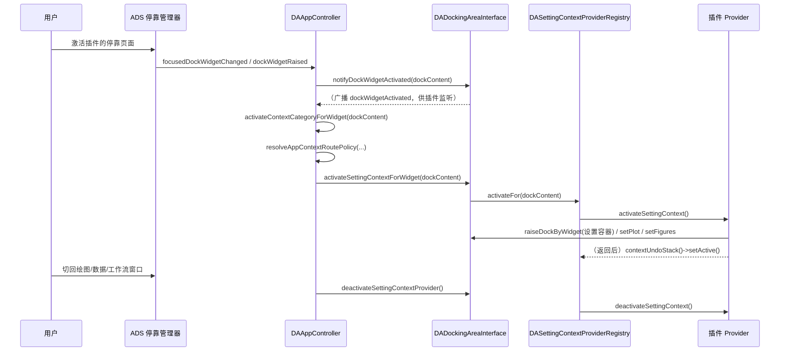

# 设置上下文提供者（插件接管设置面板与 Ribbon 上下文）

主程序里，右侧设置面板、图表管理树、Ribbon 上下文标签默认跟着三个固定操作窗口（数据、工作流、绘图）切换。插件自己的停靠页面也想复用这套设置界面时，实现 `DASettingContextProvider` 并注册到宿主即可：该页面被激活时由插件决定设置面板的编辑目标、图表管理树的内容、Ribbon 上下文标签与附属工具栏；切走时再还原给宿主。

本文说明这套机制的接口、注册表、APP 路由、生命周期约定，以及写一个新 provider 的步骤。参考实现是信号分析插件的 `DASignalAnalysisSettingContext`。

## 机制总览



关键点：

- 路由判定由 APP 完成，provider 只负责「激活时把哪些界面拨到自己这边」，不参与路由决策。
- 命中 provider 时 APP **不执行** `hideContextCategory(All)`，这是本机制要绕开的历史陷阱（见下文）。
- 激活与失活都可能被重复调用，实现方必须幂等。

## 接口

`src/DAInterface/DASettingContextProvider.h`：

```cpp
namespace DA {
class DASettingContextProvider
{
public:
    virtual ~DASettingContextProvider() = default;
    // 该 dock 内容成为激活页时调用：显示/切换设置面板与 ribbon 上下文
    virtual void activateSettingContext() = 0;
    // 失活时调用：隐藏本上下文的 ribbon 页、还原只在激活期出现的 UI
    virtual void deactivateSettingContext() = 0;
    // 本上下文的撤销栈（可为空，由宿主负责 setActive）
    virtual QUndoStack* contextUndoStack() const { return nullptr; }
};
}
```

| 成员 | 调用方 | 职责 |
|------|--------|------|
| `activateSettingContext()` | 注册表，在 dock 内容被激活且命中时 | 接管设置面板目标、图表管理树、Ribbon 上下文标签与附属工具栏 |
| `deactivateSettingContext()` | 注册表，在切换到其它上下文时 | 隐藏本上下文的 UI，把设置面板与图表管理树还原给宿主 |
| `contextUndoStack()` | 注册表，激活成功后 | 返回当前文档的撤销栈；返回 nullptr 表示本上下文没有撤销需求，宿主保持原栈 |

接口是纯抽象类（没有 out-of-line 成员、没有静态数据），不加导出宏，派生类和跨库虚调用不需要额外处理，注册表逻辑也可以被单元测试直接编译覆盖。

生命周期约定：实现方必须保证 provider 在注册期内有效，并在自身销毁前调用 `DADockingAreaInterface::unregisterSettingContextProvider()`。注册表不接管所有权。

## 注册表 DASettingContextProviderRegistry

`src/DAInterface/DASettingContextProviderRegistry.h/.cpp`，由 `DADockingAreaInterface` 持有，与具体 dock 管理器解耦。

| 方法 | 说明 |
|------|------|
| `registerProvider(dockContent, provider)` | 注册；同一内容重复注册以最后一次为准；换 provider 时若旧的是当前项会先失活 |
| `unregisterProvider(dockContent)` | 注销；若该内容正是当前项会先失活 |
| `isRegistered(dockContent)` / `providerFor(dockContent)` | 查询；dock 内容已销毁时惰性清理条目并返回 nullptr |
| `activateFor(dockContent)` | 命中返回 true 并接管；未命中返回 false 且**不改变当前状态** |
| `deactivateCurrent()` | 失活当前提供者；没有当前项时无操作 |
| `currentProvider()` / `currentDockContent()` | 当前提供者与对应 dock 内容 |
| `providerCount()` | 有效条目数（顺带清理内容已销毁的条目） |

行为约定：

- **当前项由「内容 + 提供者」共同判定**。同一个 provider 可以注册给多个 dock 内容，只比较 provider 指针会把非当前条目的清理误判成当前项。
- **重入保护**。`activateFor()` 内部用 `mActivating` 标记：provider 在 `activateSettingContext()` 里程序化 raise 自己或其它已注册 dock 时会再次经过 APP 路由，重入调用直接返回「已注册」，不会重复激活。
- **重复激活仍会回调**。同一内容再次调用 `activateFor()` 时，注册表不会跳过 `activateSettingContext()`（只跳过失活），因此实现方要保证激活逻辑幂等。
- **失活时机由调用方决定**。`activateFor()` 未命中时不动当前状态；APP 只在焦点回到固定操作窗口或离开全部 dock 时调用 `deactivateCurrent()`。这样工具 dock（设置、日志、图表管理）激活时不会误清插件上下文。
- **内容销毁时不回调**。注册表用 `QPointer` 跟踪 dock 内容；内容先于 provider 销毁时只清指针与条目，不调用 `deactivateSettingContext()`（此时 provider 可能已经失效）。因此 provider 自身的清理要自己保证。
- **撤销栈**。激活成功后若 `contextUndoStack()` 非空且不是 active，注册表调用 `setActive()`。撤销/重做按钮因此跟随当前插件文档。

## DADockingAreaInterface 与 dockWidgetActivated

`src/DAInterface/DADockingAreaInterface.h` 暴露给插件的入口：

| 方法/信号 | 说明 |
|-----------|------|
| `registerSettingContextProvider(dockContent, provider)` | 注册 dock 内容的设置上下文 |
| `unregisterSettingContextProvider(dockContent)` | 注销（注册方在内容销毁前调用） |
| `activateSettingContextForWidget(dockContent)` | 激活对应 provider；未命中返回 false |
| `deactivateSettingContextProvider()` | 失活当前 provider |
| `settingContextProviderFor(dockContent)` | 查询 provider |
| `dockWidgetActivated(QWidget* dockContent)` | 任意 dock 内容被激活时广播，参数是 dock 内部维护的内容窗口 |
| `raiseDockByWidget(QWidget*)` | 唤起某个控件对应的 dock（provider 激活时唤起右侧设置面板用） |

`dockWidgetActivated` 与 `dockWidgetRaised` 的区别：

- `dockWidgetRaised` 只在程序化 raise 时发出。
- `dockWidgetActivated` 覆盖焦点变化与程序化 raise 两条路径，在上下文路由**之前**发出；焦点离开全部 dock 时参数为 nullptr。插件可以监听它同步自身状态，但不要在这里做路由决策，也不要自己调用 `notifyDockWidgetActivated()`（那是 APP 的内部入口）。

## APP 上下文路由

路由判定抽成了纯函数，便于单元测试：`src/APP/Controller/DAAppContextRoutePolicy.h/.cpp`。

```cpp
enum class DAAppContextRoutePolicy
{
    SettingContextProvider,  // 插件注册的设置上下文提供者接管（不执行 hide-all）
    DataOperate,             // 数据操作窗口
    WorkFlowOperate,         // 工作流操作窗口
    ChartOperate,            // 绘图操作窗口
    DataManage,              // 数据管理窗口
    UtilityDock              // 其它工具 dock（设置/日志/图元树等）：不切换上下文
};

DAAppContextRoutePolicy resolveAppContextRoutePolicy(QWidget* widget,
                                                     bool hasSettingContextProvider,
                                                     QWidget* dataOperateWidget,
                                                     QWidget* workFlowOperateWidget,
                                                     QWidget* chartOperateWidget,
                                                     QWidget* dataManageWidget);
```

判定顺序：provider 优先，其次依次比较数据、工作流、绘图操作窗口与数据管理窗口，其余归 `UtilityDock`。

`DAAppController::activateContextCategoryForWidget()`（`src/APP/Controller/DAAppControllerCore.cpp`）的分支：

```cpp
if (nullptr == widget) {
    // 焦点离开全部 dock 内容：先失活插件上下文，再清空固定上下文标签
    mDock->deactivateSettingContextProvider();
    mRibbon->hideContextCategory(AllContextCategory);
    return;
}
const DAAppContextRoutePolicy route = resolveAppContextRoutePolicy(...);
if (SettingContextProvider == route) {
    // provider 接管：由它显示设置页/上下文标签，不执行 hide-all
    mDock->activateSettingContextForWidget(widget);
    return;
}
// 只有回到三个固定操作窗口时才失活插件上下文；工具 dock 保持插件上下文
if (route == DataOperate || route == WorkFlowOperate || route == ChartOperate) {
    mDock->deactivateSettingContextProvider();
}
switch (route) {
case DataOperate:  /* 显示 Data 上下文标签 + 数据窗口撤销栈 */ break;
case WorkFlowOperate: /* 显示 Workflow 上下文标签 + 工作流设置页 */ break;
case ChartOperate: /* 显示 Chart 上下文标签 + 绘图设置页 */ break;
case DataManage: /* 只切换数据管理撤销栈 */ break;
default: break;    // UtilityDock：不改上下文
}
```

### hide-all 陷阱

旧实现里，`activateContextCategoryForWidget()` 遇到未识别的 widget 会 `hideContextCategory(All)`。插件 provider 在 `activateSettingContext()` 里 `raiseDockByWidget(设置容器)` 会触发一次新的 dock 激活，旧逻辑把这个「设置 dock」当作未知窗口处理，把刚显示出来的 Chart/插件上下文标签全部清掉。

现在的做法有两层：

- 已注册 provider 的 dock 内容在路由里优先命中，走 provider 分支，不执行 hide-all。
- 未识别的 dock 归 `UtilityDock`，只 `break`，不切换也不清空上下文。工具 dock（设置、日志、图表管理）因此不会把插件上下文顶掉。

改造路由时不要恢复「未识别就 hide-all」的行为，也不要把 `UtilityDock` 合并进 `nullptr` 分支。

## 激活 / 失活的生命周期与幂等

### activateSettingContext()

典型顺序（以信号分析为例）：

1. 页面未创建、dock 不可用时直接返回并记一条开发日志（不要假设一定处于可用状态）。
2. `raiseDockByWidget(设置容器)` 唤起右侧设置 dock。
3. 按当前子图类型切设置页并设置 target：2D 调 `showChartSettingWidget()` + `getChartSettingWidget()->setPlot(chart)`；3D 调 `showChart3DSettingWidget()` + `getChart3DSettingWidget()->setPlot3D(plot3D)`。
4. 图表管理树接管：`getChartManageWidget()->setFigures(本插件的 figure 列表, 当前 figure)`。
5. 显示插件专属 UI：Ribbon 上下文标签（`showContextCategory(objectName)`，一般同时把该上下文页设为当前页）与窗口底部工具栏。
6. 绑定页面/视图的变化信号（先 disconnect 再 connect），保证重复激活只有一条连接。
7. 置 `mActive = true`。

幂等要求：

- 宿主可能因嵌套焦点变化对同一个 provider 连续调用激活，因此重复执行只能刷新 target，不能重复创建控件、重复连接信号或反复 raise 造成闪烁。
- 激活过程中会触发程序化 raise，再次进入 APP 路由与注册表；注册表的重入保护只保证不重复激活，provider 自己的逻辑仍要能承受重入（不要在回调里做递归调用链）。

### deactivateSettingContext()

1. 未激活（`mActive == false`）直接返回，不触碰界面。
2. 隐藏插件上下文标签与附属工具栏。
3. 图表管理树还原：`getChartManageWidget()->setChartOperateWidget(宿主绘图操作窗口)`（内部模式会清空并按宿主 figure 列表重建）。
4. 设置面板还原：`showChartSettingWidget()`，target 设为宿主当前 figure 的当前 2D 子图；取不到时 `setPlot(nullptr)`，避免继续编辑插件文档。
5. 断开页面/视图信号，置 `mActive = false`。

不要在 `deactivateSettingContext()` 里调用会再次触发路由的重操作（例如 raise 别的 dock）；失活只做还原。

### 撤销栈

- `contextUndoStack()` 返回当前文档 figure 的 `QUndoStack`；页面/视图/figure 不存在时返回 nullptr，宿主会保持原栈。
- 宿主在 provider 激活成功后 `setActive()`。切换插件内部文档（信号标签页）时注册表不会再次回调，`DAFigureWidget::push()` 在自己栈非 active 时会 `setActive()`，所以下一次编辑会自动切到正确栈。
- 撤销/重做命令本身由 `DAFigureWidget` 管理，provider 不参与命令入栈。

## 图表管理树的目标抽象

`DAChartManageWidget`（`src/DAGui/Chart/DAChartManageWidget.h`）原来只认宿主 `DAChartOperateWidget`，现在增加了外部模式：

| 方法 | 说明 |
|------|------|
| `setChartOperateWidget(cow)` | 内部模式：监听绘图操作窗口的 figure 增删与当前 figure 变化，清空后按当前 figure 列表重建 |
| `setFigures(figures, current)` | 外部模式：按给定列表重建管理树，不依赖绘图操作窗口；`current` 为空或不在列表里时取列表首项 |
| `setCurrentFigure(figure)` | 只切换管理树的当前 figure，不改变宿主绘图区的当前 figure |
| `figures()` | 当前管理树里的 figure 列表，按 combobox 顺序 |

外部模式的要点：

- `setFigures()` 会断开与 `DAChartOperateWidget` 的信号连接但保留指针，`setChartOperateWidget()` 才能切回内部模式。
- 管理树不拥有 figure；figure 销毁时管理项由 `DAChartManageWidget` 的清理逻辑移除，但 provider 应保证只传入活着的 figure。
- 失活时必须用 `setChartOperateWidget(宿主)` 还原，否则管理树会继续显示插件 figure。
- 每次切子图都调 `setFigures()` 会重建树，可能复位展开状态。功能正确；若体验需要优化，可只在 figure 列表或当前 figure 真正变化时重建。

## 参考实现：DASignalAnalysisSettingContext

`plugins/DASignalAnalysis/Page/DASignalAnalysisSettingContext.h/.cpp` 完整实现了本文描述的流程：

- `QObject` + `DASettingContextProvider` 多重继承，用 `QPointer` 持有插件 UI 与当前视图。
- 激活时显示设置 dock、按 2D/3D 切设置页、`setFigures()` 接管管理树、显示 `ContextCategorySignalAnalysis` 与底部播放工具栏、绑定 `currentSignalChanged` 与 `currentSubChartChanged`。
- 失活时隐藏插件 UI、`setChartOperateWidget` 还原管理树、把设置面板还给宿主当前子图。
- `contextUndoStack()` 返回当前信号 figure 的撤销栈。
- 注册/注销在 `DASignalAnalysisUI` 的页面创建与 `finalize()` 中完成（见下节）。

## 写一个新 provider 的步骤

**1. 定义类**

```cpp
// MySettingContext.h
#include <QObject>
#include <QPointer>
#include "DASettingContextProvider.h"

namespace DA {
class MyPluginUI;
class MySettingContext : public QObject, public DASettingContextProvider
{
    Q_OBJECT
public:
    explicit MySettingContext(MyPluginUI* ui, QObject* parent = nullptr);
    void activateSettingContext() override;
    void deactivateSettingContext() override;
    QUndoStack* contextUndoStack() const override;

private:
    QPointer< MyPluginUI > mUI;
    bool mActive { false };
};
}
```

**2. 选对注册的 dock 内容**

注册的参数是 dock 管理器里保存的**内容窗口**（插件页面 widget 本身），不是外层 `CDockWidget` 或容器。信号分析插件注册的是 `DASignalAnalysisPage*`，即 `dockContent`。

**3. 在页面创建后注册**

```cpp
// DASignalAnalysisUI.cpp（页面创建路径）
mSettingContext = new DASignalAnalysisSettingContext(this);
dockingArea->registerSettingContextProvider(mPage, mSettingContext);
```

**4. 在销毁前注销**

```cpp
// finalize()：必须在页面 dock 移除之前，且先注销再 delete
dockingArea->unregisterSettingContextProvider(mPage);
delete mSettingContext;
mSettingContext = nullptr;
```

顺序不能反：注销会触发 `deactivateSettingContext()`，此时页面与 dock 还必须可用。

**5. 实现 `activateSettingContext()`**

按「唤起设置 dock → 切设置页/设 target → 接管管理树 → 显示上下文标签与工具栏 → 绑定信号 → 置激活标志」的顺序写，并保证重复调用只刷新、不重复创建。用 `QPointer` 保存页面/视图指针，页面惰性创建时要容忍「未创建」。

**6. 实现 `deactivateSettingContext()`**

只做还原：隐藏插件 UI、管理树交给宿主、设置面板交给宿主当前子图、断开信号、清激活标志。未激活直接返回。

**7. 实现 `contextUndoStack()`**

返回当前文档 figure 的撤销栈；没有文档时返回 nullptr，不要返回宿主别的栈。

**8. 转接内部变化刷新 target**

页面切文档、切换 2D/3D 子图时调用自己的 `refreshTarget()` 重新 setPlot/setPlot3D 并刷新管理树。信号连接先断后连，避免重复连接。

**9. 自测**

- `src/tst/APPRefactorTest/`：注册表当前项判定、重入、注销失活、路由纯函数。
- `src/tst/DAChartContextTest/`：`setFigures()` / `setCurrentFigure()` / 子图导出。
- GUI 冒烟：打开插件页面 → 设置标签页出现且 target 正确；切子图 → 设置页跟着切；切到绘图区 → 上下文标签互斥、管理树与设置面板恢复；关闭插件页面/停用插件 → 无悬空回调。

## 反模式

- 销毁 provider 前不注销：注册表后续回调会解引用已销毁对象。
- 失活时不清 target：设置面板或管理树会继续编辑插件文档。
- 在 `activateSettingContext()` 里重复创建工具栏/重复 connect：重复激活后出现多份控件与重复槽调用。
- 为了显示自己的上下文而调用 `hideContextCategory(All)`：会把固定操作窗口的上下文标签一起清掉。
- 在 `dockWidgetActivated` 信号里做上下文路由：路由是 APP 的职责，重复路由会造成互相覆盖。
- 把未识别的工具 dock 当固定操作窗口处理：设置、日志、图表管理激活时不应让插件上下文失活，也不应 hide-all。
- 用裸指针缓存宿主窗口：宿主可能先销毁，统一用 `QPointer`。

## 涉及文件

| 文件 | 说明 |
|------|------|
| `src/DAInterface/DASettingContextProvider.h` | 提供者接口 |
| `src/DAInterface/DASettingContextProviderRegistry.h/.cpp` | 注册表：当前项、重入保护、激活/失活、撤销栈 |
| `src/DAInterface/DADockingAreaInterface.h/.cpp` | 注册/注销/激活入口，`dockWidgetActivated` 广播 |
| `src/APP/Controller/DAAppContextRoutePolicy.h/.cpp` | 路由判定纯函数 |
| `src/APP/Controller/DAAppControllerCore.cpp` | `activateContextCategoryForWidget()`：命中/未命中分支与失活时机 |
| `src/DAGui/Chart/DAChartManageWidget.h/.cpp` | 管理树内部/外部模式与目标还原 |
| `src/DAGui/Common/Settings/DASettingContainerWidget.h` | 设置页 getter 与 `show*()` 切换方法 |
| `plugins/DASignalAnalysis/Page/DASignalAnalysisSettingContext.h/.cpp` | 参考实现 |
| `plugins/DASignalAnalysis/DASignalAnalysisUI.cpp` | 注册/注销时机、上下文标签与底部工具栏显隐 |

## 参考资料

- [绘图窗口网格布局](../graphics/figure-grid-layout.md)：当前子图切换与网格布局的配合。
- [绘图模块概述](../graphics/figure-abstract.md)：`DAFigureWidget` / `DAChartWidget` 基础能力。
- [创建设置面板](./creating-setting-panel.md)：属性面板的创建与刷新模式。
- [绘图窗口停靠布局](../graphics/chart-dock-nesting.md)：figure 的停靠与序列化。
