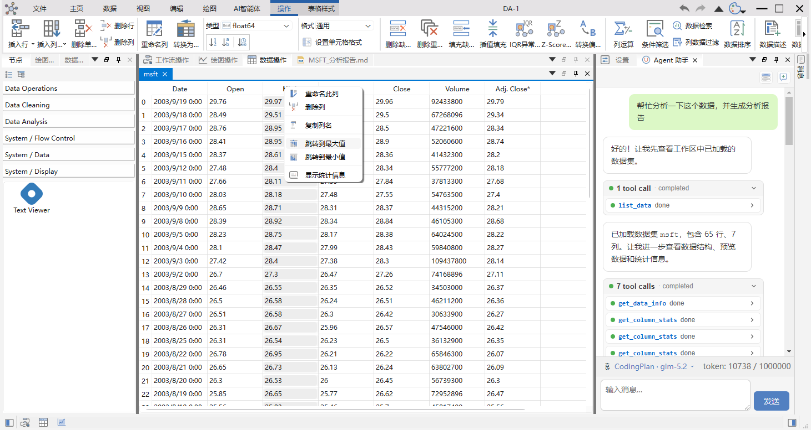

# 快速上手指南

这一页给出从源码构建并运行 DAWorkBench 的最短路径。构建只在这一台机器上做一次，之后直接运行可执行文件。

## 前置要求

| 要求 | 版本 | 说明 |
|------|------|------|
| Qt | 5.14+ 或 6.x | 界面框架 |
| Python | 3.7+，推荐 3.11 | 数据处理，以嵌入式方式集成 |
| CMake | 3.16+ | 构建系统 |
| Ninja | 推荐 | 构建速度快 |
| 编译器 | 支持 C++17 | MSVC、GCC 或 Clang |

## 获取源码

```bash
# 克隆仓库
git clone https://github.com/czyt1988/data-workbench.git

# 进入项目目录
cd data-workbench

# 拉取第三方库
git submodule update --init --recursive
```

第三方库以 submodule 方式管理，所以必须用 `git clone` 获取源码，直接下载 zip 包拿不到它们。漏掉最后一条命令的话，配置阶段会报找不到第三方库。

## 构建步骤

构建必须指定 Qt 的工具链文件 `qt.toolchain.cmake`，否则会出现 Windows SDK 头文件找不到的问题。

### 一次配好并构建

```powershell
# Windows PowerShell，使用 Qt 6 工具链文件
cmake -S . -B build -G Ninja `
    -DCMAKE_BUILD_TYPE=Release `
    -DCMAKE_TOOLCHAIN_FILE="D:\Qt\6.7.3\msvc2019_64\lib\cmake\Qt6\qt.toolchain.cmake"

cmake --build build --config Release --parallel
cmake --build build --config Release --target install
```

`CMAKE_TOOLCHAIN_FILE` 要按本机 Qt 的实际安装路径填。三条命令依次完成配置、编译和安装。

### 分步构建

第三方库的编译顺序、各模块的单独构建办法见[构建说明](build/build-instructions.md)和[第三方库构建](build/third-party-build.md)。

构建完成后所有文件安装到 `bin_{构建类型}_qt{Qt 版本}_{编译器}_{架构}` 目录。

## 运行程序

安装目录的命名格式是 `bin_{BuildType}_qt{QtVersion}_{Compiler}_{Arch}`，例如 Qt 6.7.3、Release、MSVC 对应的目录是 `bin_Release_qt6.7.3_MSVC_x64`。

Windows 上：

```powershell
.\bin_Release_qt6.7.3_MSVC_x64\DAWorkbench.exe
```

Linux 上：

```bash
./bin_Release_qt6.7.3_GNU_x64/DAWorkbench
```

## 验证安装

程序启动后，界面上应该能看到这几块：

1. Ribbon 工具栏，在窗口顶部。
2. 节点面板，在左侧，列出可以拖进工作流的节点。
3. 数据管理面板，列出当前工程里的数据集。
4. 绘图操作区，在中央，用于放图表。



## 常见构建问题

### 找不到第三方库

原因是没执行 `git submodule update`。在仓库根目录补跑：

```bash
git submodule update --init --recursive
```

### Python 环境问题

原因是没配置 Python 路径。可以设置环境变量，也可以用 CMake 选项让构建过程顺带安装依赖：

```bash
cmake -DDA_ENABLE_AUTO_INSTALL_PYTHON_ENV=ON ...
```

### Qt 工具链文件找不到

原因是 `CMAKE_TOOLCHAIN_FILE` 的路径写错了。工具链文件按 Qt 主版本放在不同位置：

```powershell
# Qt 6
-D CMAKE_TOOLCHAIN_FILE="D:\Qt\6.7.3\msvc2019_64\lib\cmake\Qt6\qt.toolchain.cmake"

# Qt 5
-D CMAKE_TOOLCHAIN_FILE="C:\Qt\5.15.2\msvc2019_64\lib\cmake\Qt5\qt.toolchain.cmake"
```

更多构建错误见[构建常见错误](build/common-build-errors.md)。

## 下一步

- [项目概览](index.md)：软件能做什么。
- [项目结构](structure/project-structure.md)：源码目录怎么组织。
- [安装与首次启动](use-guide/getting-started/install.md)：装好之后的第一次启动要做哪些设置。
- [使用指南](use-guide/index.md)：按功能分章的完整手册。
- [插件开发](plugin/plugin-development.md)：写一个新插件。
