# DAWorkBench 功能全景与演进路线图

> 一份写给项目作者的功能规划参考：先把「现在有什么」画清楚，再谈「值得做什么」。

> **📝 文档定位**
>
> 本文是一份**规划讨论稿**，不是使用指南，也不是开发规范。它用功能分区图盘点了 DAWorkBench 当前的能力边界，从「类 Excel 数据处理」「工作流引擎」「科研级可视化」「AI 智能体」「插件生态」五个角度列出缺口，给出多期演进路线、插件候选清单和创新方向。
> 文中所有「已实现 / 部分实现 / 未实现」的判断，均以当前 `dev` 分支代码与文档为准；标为**建议**的条目可做但尚未排期。

**阅读方式**：若只想看结论，直接跳到 [第四部分演进路线](#第四部分-演进路线多期规划) 与 [第八部分行动建议](#第八部分-行动建议)。若想评估插件方向，重点看 [第五部分插件化机会地图](#第五部分-插件化机会地图)。

---

## 目录

- [第一部分 现状盘点：功能全景图](#第一部分-现状盘点功能全景图)
- [第二部分 缺口分析：四个对照视角](#第二部分-缺口分析四个对照视角)
- [第三部分 用户视角：谁在用、怎么用](#第三部分-用户视角谁在用怎么用)
- [第四部分 演进路线：多期规划](#第四部分-演进路线多期规划)
- [第五部分 插件化机会地图](#第五部分-插件化机会地图)
- [第六部分 创新方向畅想](#第六部分-创新方向畅想)
- [第七部分 平台架构完善建议](#第七部分-平台架构完善建议)
- [第八部分 行动建议](#第八部分-行动建议)
- [附录 A 能力成熟度评估表](#附录-a-能力成熟度评估表)
- [附录 B 竞品对照](#附录-b-竞品对照)
- [附录 C 术语表](#附录-c-术语表)
- [附录 D 任务提示词列表](#附录-d-任务提示词列表)

---

## 第一部分 现状盘点：功能全景图

### 1.1 这个软件到底是什么

从代码与文档出发，DAWorkBench 的定位可以这样一句话概括：

> **一个「工作流驱动 + AI 可操作」的桌面数据分析工作台**：底层是 pandas/DataFrame，中层是有向图工作流引擎，上层是交互式科研级图表，右侧常驻一个能直接操作上述一切的 AI 智能体，全部能力通过插件对外开放。

它同时是四个东西的叠加，这也是理解后续规划的关键：

| 身份 | 同类软件 | 用户印象 |
|------|--------|----------|
| **DataFrame 编辑器** | Excel / WPS | "像操作表格一样操作 pandas" |
| **可视化编程环境** | KNIME / Alteryx / ComfyUI | "把重复的数据处理流程固化成图" |
| **科研绘图工具** | Origin / GraphPad / matplotlib | "鼠标拖动就能出论文级矢量图" |
| **AI 数据分析师** | ChatGPT Code Interpreter / Julius | "说人话就能分析数据、出图、写报告" |

大多数竞品只占其中一格。DAWorkBench 的独特性在于**四者可互相操作**：工作流能产出图表，Agent 能搭工作流，图表能反向驱动报告，这个「互通」是最值得继续加固的护城河。

### 1.2 五大能力域全景图

下图是当前功能的区域划分。颜色语义：<span style="color:#669E8B">**绿 = 已实现且可用**</span>、<span style="color:#E6C27C">**黄 = 部分实现/有雏形**</span>、<span style="color:#CE6043">**红 = 明显缺口**</span>、<span style="color:#5280C1">**蓝 = 平台底座**</span>。

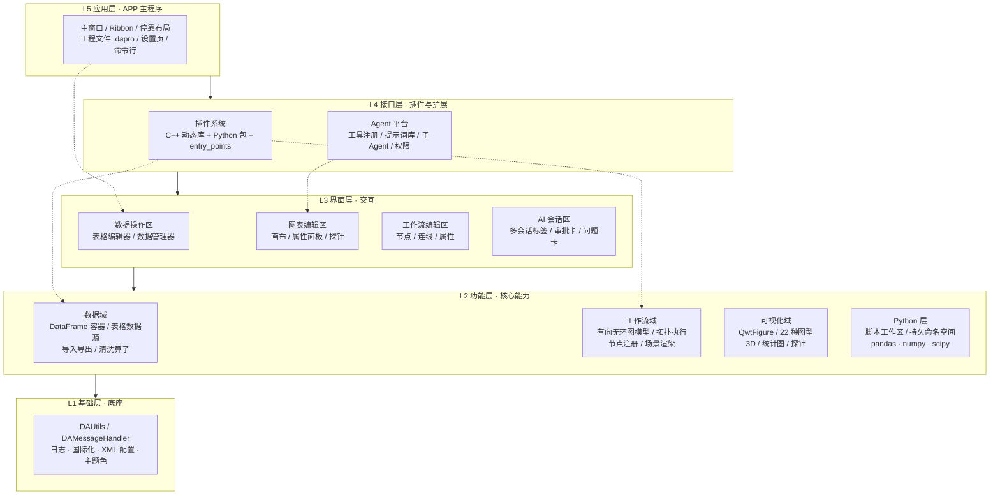

各域当前完成度速览（满分 5 分，评的是「面向目标用户可用」，不看代码量）：

| 能力域 | 完成度 | 一句话评价 |
|--------|--------|-----------|
| 插件系统与扩展点 | 5/5 | 接口成熟、热插拔、三种发现机制齐全，是本项目最扎实的部分 |
| AI Agent 平台 | 5/5 | 多会话、子 Agent、权限门、崩溃自愈都做了，深度超过多数同类软件 |
| 工作流引擎（骨架） | 4/5 | DAG 模型、节点插件、执行回调完整；缺控制流与调试能力 |
| 可视化（绘制与交互） | 4/5 | 22 种图型 + 拖动微调是强项；缺模板化与矢量导出界面 |
| 数据域（读写与清洗） | 3/5 | 算子齐全，但表格编辑器相比 Excel 仍缺一批高频操作 |
| 数据接入（外部数据源） | 2/5 | 只有文件；数据库/接口/仪器接入尚未产品化 |
| 可复现与协作 | 1/5 | 工程文件可保存流程，但无血缘、无版本、无执行历史 |

### 1.3 数据域：像 Excel 一样操作 DataFrame

已实现的能力（均已可用）：

- **数据容器与管理**：`DAData` 值语义句柄 + `DADataManager` 统一注册、唯一命名、正则查找、描述文本
- **表格数据源抽象层**：`DATableDataSource` / `DATableDataBlock` 支持惰性取数与块级加载（默认 512 行），`DADataTableModel` 按滚动驱动取块，**这是通向数据库接入的关键地基**
- **引用式持久化**：`DADataFactory` 注册表 + 工程内 `<ref>` 存 payload，重开工程自动重建
- **导入**：csv / txt（chardet 自动探测编码，带参数对话框）/ xls / xlsx / parquet / pickle
- **导出**：csv / excel / pickle / parquet，支持多数据集合并导出到一个 Excel 工作簿
- **表格编辑**：单元格编辑、插入/删除行列、置 NaN、复制粘贴剪切、重命名列、设为 index、类型转换（数值/日期）
- **撤销重做**：十余条 `QUndoCommand`（iat/drop/rename/astype/setnan/paste/eval/cast…）+ 快照式数据撤销
- **显示样式**：行/列/单元格三级样式、列显示格式，可随工程序列化
- **清洗算子**：dropna / fillna / interpolate / drop_duplicates / 异常值剔除，以及排序、筛选、query、查找、表达式求值、透视表（含对应对话框与工作流节点）
- **Office 互通**：Windows 下 Excel / Word COM（组件对象模型）封装（`DAAxOfficeWrapper`）

部分实现或明显缺口（详见 [2.1 节](#21-视角一当作-dataframe-编辑器还缺什么)）：条件格式仅有空扩展点、无表头点击排序、无冻结行列、无多表 join/merge、无表内查找替换对话框、无数据校验规则、无血缘。

### 1.4 工作流域：把流程固化成图

架构是**双层**的：逻辑层在 Python（`DAWorkFlowPy`：DAG 模型、Kahn 拓扑排序、执行器、信号管理器、`@NodeDef` 节点注册表），渲染层在 C++（`src/DAPyWorkFlow/`：节点图元、场景、工厂、执行桥接）。这个分工的好处是节点开发门槛极低：写个 Python 类就是节点，且能稳定兼容 Qt5/Qt6。

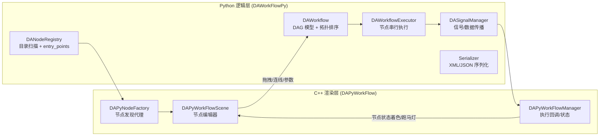

已实现：

- **节点生态**：系统节点 7 个（Start / End / If-Else / Delay / Constant / 输出到数据管理器 / 文本查看）+ 数据分析节点 21 个（数据源、导出、绘图、筛选、阈值过滤、query、查找、排序、表达式求值、透视表、描述统计、缺失值删除/填充、插值、去重、值替换、异常值剔除…）
- **编辑器**：拖拽建节点、端口连线、分组/解组、矩形与文本注释、复制粘贴（XML 剪贴板）、撤销重做、缩放、网格、执行状态着色、跑马灯连线、双击参数对话框
- **节点参数面板**：`DAFormSpec` + `DAPropertyFormWidget` 统一表单驱动，含 visible/enabled/required 声明式联动
- **执行控制**：整图后台线程执行、暂停/恢复/终止（节点边界生效）、节点级错误捕获后继续执行、执行完成信号

缺口（详见 [2.2 节](#22-视角二当作-workflow-引擎还缺什么)）：无循环/迭代、无子工作流、无运行时参数化、无执行缓存与增量重跑、无断点调试、无定时调度、无执行历史、端口无类型校验、执行路径未强制 DAG 校验（存在环路导致递归的隐患）。

### 1.5 可视化域：交互式科研绘图

这块是「手感」最强的部分：绘制能力与手工微调能力都做到了少见的水准。

- **容器**：`DAFigureWidget`（可滚动画布）内可放多个子图，2D 与 3D 混排、归一化网格布局、每个 Figure 独立 Undo 栈
- **22 种图型**：曲线、散点、柱状、多序列柱、箱线、直方、误差棒、谱图、谱曲线、交易曲线、向量场、等值线，统计类（核密度估计 1D/2D、经验累积分布图、回归、热力图、箱线、散点、柱状），3D（曲面、柱状、折线）
- **交互编辑**：拖动/缩放/框选缩放、十字光标、文本原地编辑、数据探针（捕获/插值）、区域选择（矩形/椭圆/多边形）、箭头与标注、元素拖动与删除、剪贴板复制、全量撤销重做
- **属性面板**：21 类图元各有专属设置面板（曲线、标记、网格、图例、坐标轴、画布、3D 轴/色标…）
- **辅助系统**：29 种内置颜色主题 + 用户自定义、轴范围绑定 API、多子图探针联动、数据联动表（探针数据成表，可改名/隐藏/刷新）
- **脚本与 Agent 绘图**：`da_pyplot` / `da_figure` 提供 Python 侧绘图句柄；Agent 有 11 个绘图工具可直接操作真实图表

缺口（详见 [2.3 节](#23-视角三当作-科研绘图工具还缺什么)）：C++ 侧无矢量导出界面（只有位图剪贴板；应用层未使用渲染器，PDF/SVG 目前只能走 Python `savefig` 与 Agent 工具；所维护的 qwt 分支里 `QwtPlotRenderer` 本就支持 PDF/SVG 输出，所以这是「接线」问题，能力本身并不缺）、无图表模板/样式保存复用、无多图刷选联动、无实时/流式刷新、图表与数据源为一次性绑定（数据变更不自动更新）、无报告嵌入与批量出图。

### 1.6 Agent 域：AI 直接操作软件

这是近几轮迭代投入最重的部分，工程化程度相当高：

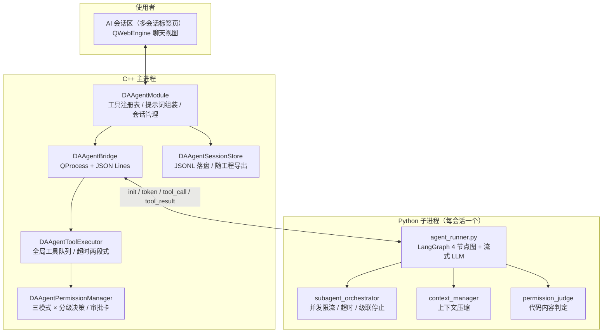

- **25 个内置工具**：`DAAgentTools` 插件 21 个（数据 5 + 绘图 11 + 文件报告 3 + 代码执行 2）+ `DAPaperAgent` 插件 2 个（文献检索 / DOI 验证）+ 平台注入 2 个（`ask_user`、`dispatch_subagents`）
- **工具真实执行在主进程**：Agent 操作的是工作区里真实的数据集与图表部件，画完的图人能接着改
- **权限引擎**：yolo / auto / manual 三模式 × read / inapp_mutate / file_write / code_exec 分级，路径规则、审批卡、按会话记忆；代码内容静态判定由 Python 侧前置完成
- **子 Agent**：Markdown 定义库 + 结构化编辑对话框，主 Agent 可并行委派调研并汇总结论，进度可视化、任务终态自动撤卡
- **提示词库**：一个 agent 一个 Markdown 文件，管理/编辑对话框带语法高亮；插件可注入领域 agent（`DAPaperAgent` 是范例）
- **会话可靠性**：JSONL 落盘、随工程保存/恢复、token 统计、上下文自动压缩、指数退避重试、子进程崩溃自愈、看门狗防死循环、多会话后台并行运行
- **脚本工作区**：工程内 `workspace/` 目录随工程打包，脚本在持久命名空间执行并直接访问内存数据（类似 Jupyter kernel），`run_code` / `run_script` 共享变量
- **报告流程**：`save_report` 写 Markdown → 内置 Markdown 查看器（`DAGui/MarkdownView`）→ 统一导出引擎导出 HTML/PDF/Word（图片内嵌）

缺口（详见 [2.4 节](#24-视角四当作-ai-分析助手还缺什么)）：无 MCP（模型上下文协议）支持、无本地知识库/RAG（检索增强生成）、无跨会话长期记忆、Agent 不能生成新节点/新插件、无定时与事件触发、无工具市场。

> **ℹ️ 正在推进的方向**
>
> 仓库内已有一份完整方案（`docs/方案/`）：把 Agent 运行时从 Python `langgraph` 替换为 C++ 原生图库 **NeoGraph**，消除每会话一个 Python 子进程的冷启动（当前 import langchain 约 16 秒），实现状态常驻内存与线程池并发推理。若落地，Agent 域的能力上限会显著提高，本路线图中「Agent 原生」相关设想都建立在这个前提之上。

### 1.7 平台域：插件、工程与底座

| 能力 | 现状 |
|------|------|
| 插件基类 | `DAAbstractPlugin`：IID/名称/版本/描述、`initialize`/`finalize` 热卸载、设置页、工程存取任务 |
| 节点插件 | `DAAbstractNodePlugin`：`createNodeFactory` / `afterLoadedNodes`，C++ 与 Python 节点统一 |
| 生命周期 | `DAPluginManager`：扫描/加载/卸载、`.pluginignore` 持久化启停 |
| Agent 扩展 | `DAAgentInterface`：`registerTool` / `registerSystemPrompt` / `registerBuiltinAgent` / `registerBuiltinSubagent` |
| 界面扩展 | `DAUIInterface`、`DARibbonAreaInterface`、`DADockingAreaInterface`、`DAActionsInterface`、`DACommandInterface`、`DADataManagerInterface`、`DAProjectInterface` |
| 发现机制 | C++ 动态库（`QPluginLoader`）× Python 包目录（`pyplugins/*`）× Python entry_points（`data_workbench.plugin`） |
| 工程文件 | `.dapro` = ZIP：工作流配置 + 数据文件 + 图表 XML + 脚本工作区 + Agent 会话 |
| 已有插件 | `DASystemNodes`、`DataAnalysis`、`DAAgentTools`、`DAPaperAgent`、`plugin-template`（脚手架） |
| 底座 | 日志（`da*` 进界面 / `q*` 只落盘）、国际化（C++ `.ts` + Python `.po`）、崩溃转储、XML 配置、颜色主题、表单引擎 |

一句话评价：**插件系统是这个项目最有杠杆的资产**。已有 5 个插件验证了「节点 / 工具 / 提示词 / 设置页 / Ribbon 按钮 / 停靠面板」这几条主要扩展路径，剩下的想象力空间在 [第五部分](#第五部分-插件化机会地图) 展开。

### 1.8 现有能力速查卡

把上面五节压缩成一张卡：看一眼就知道「今天这个软件能做什么」。

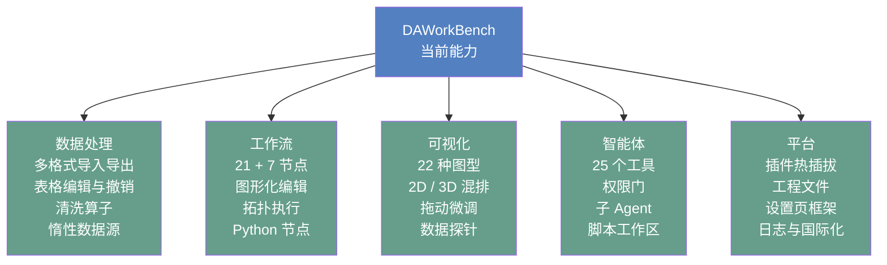

---

## 第二部分 缺口分析：四个对照视角

同一个软件，放在不同标尺下会量出不同缺口。下面四节分别把 DAWorkBench 放到 Excel、KNIME、Origin、通用 AI 助手的位置上做差集。优先级标记：**P0 = 影响现有功能的可用性**，**P1 = 明显提升竞争力**，**P2 = 锦上添花**。

### 2.1 视角一：当作 DataFrame 编辑器，还缺什么

一句话结论：**算子层已经够用，但「表格编辑器」这一层距离 Excel 的手感还差一截**：差距主要在「高频小操作」和「多表关系」，不在算法。

#### A. 查看与导航

| #   | 缺口                    | 现状                    | 优先级    | 备注                     |
| --- | --------------------- | --------------------- | ------ | ---------------------- |
| 1   | 表头点击排序 / 多列排序         | 排序在插件对话框与工作流节点里，表头无交互 | **P0** | Excel 用户的第一反射动作        |
| 2   | 冻结行列 / 分屏             | 无                     | P1     | 大表横向滚动必需的锚             |
| 3   | 列视图管理（列序、列宽、隐藏集合可保存）  | 有单元格样式与列显示格式，无「视图」概念  | P1     | 与样式系统同源，可复用序列化         |
| 4   | 定位跳转 / 跳到最后一行、行号跳转    | 无                     | P1     | 百万行表没有导航等于不可用          |
| 5   | 状态栏列统计（选中列显示求和/均值/计数） | 无                     | P1     | Excel 用户最常用的「随手看一眼」    |
| 6   | 表内快速图表预览（选中列一键迷你图）    | 需走图表向导                | P2     | 与现有 `ChartAddItem` 可对接 |

#### B. 编辑与清洗

| #   | 缺口                       | 现状                                | 优先级    | 备注             |
| --- | ------------------------ | --------------------------------- | ------ | -------------- |
| 7   | 查找 / 替换对话框（全表、支持正则）      | 替换只作为工作流节点存在                      | **P0** | 手动清洗的最高频操作     |
| 8   | 条件格式（色阶、数据条、规则高亮）        | `DATableStyleItemDelegate` 仅有空扩展点 | **P0** | 空实现已埋好钩子，性价比极高 |
| 9   | 分组聚合界面（groupby + 折叠显示）   | 有透视表对话框，无分组视图                     | P1     | 透视表的下沉形态       |
| 10  | 计算列 / 列公式（写表达式生成新列并记录依赖） | 有 `eval` 命令与表达式节点，但没有「列级公式」这一层抽象  | P1     | 是「活文档」设想的基础    |
| 11  | 文本分列 / 列拆分合并             | 无                                 | P1     | 原始实验数据常见       |
| 12  | 填充（向下填充、序列填充）            | 无                                 | P2     |                |
| 13  | 数据校验规则（取值范围、枚举下拉、唯一性）    | 无                                 | P2     | 与「可复现」诉求相关     |
| 14  | 单元格批注 / 备注               | 无                                 | P2     |                |
| 15  | 转置、melt/pivot 形状变换       | 有透视表，无 melt（宽转长）                  | P1     | 图表前的常见整理动作     |
| 16  | 撤销粒度与撤销列表可视化             | 有 Undo/Redo，快照式（pickle 临时文件）      | P2     | 超大表下快照成本需关注    |

#### C. 多表关系（当前最大的结构性缺口）

| #   | 缺口                           | 现状                  | 优先级    | 备注                               |
| --- | ---------------------------- | ------------------- | ------ | -------------------------------- |
| 17  | 表关联 join / merge 界面（内、左、外连接） | 全仓无 `pd.merge/join` | **P0** | 多源数据对齐的第一道门                      |
| 18  | 跨表取值（类 VLOOKUP）              | 无                   | P1     | join 的轻量表亲版本                     |
| 19  | 表间联动（选中行 → 过滤其它表 / 图表）       | 无                   | P1     | "交叉筛选"，是仪表盘式分析的地基                |
| 20  | 多表对比视图（两个 DataFrame 差异 diff） | 无                   | P1     | 仿真-试验对比、版本对比都要用                  |
| 21  | 表的血缘关系图（这张表从哪来、被谁用）          | 无任何 lineage 代码      | P1     | 见 [第六部分](#第六部分-创新方向畅想) 「可复现研究单元」 |

#### D. 交付与互操作

| #   | 缺口                            | 现状           | 优先级    | 备注                    |
| --- | ----------------------------- | ------------ | ------ | --------------------- |
| 22  | 复制/导出为 Markdown、LaTeX、HTML 表格 | 无            | **P0** | 与已有 Markdown 导出引擎天然衔接 |
| 23  | 导出 Excel 保留样式（表头色、数字格式、列宽）    | 仅导出数据        | P1     | 汇报场景刚需                |
| 24  | 表格 → 图一步直达（选中列右键出图）           | 需走 Ribbon/向导 | P2     |                       |
| 25  | 打印 / 页面设置 / 分页预览              | 无            | P2     |                       |

#### E. 数据理解（Excel 没有、但本软件该有）

| #   | 缺口                      | 现状        | 优先级 | 备注                  |
| --- | ----------------------- | --------- | --- | ------------------- |
| 26  | 一键数据画像报告（分布、缺失、异常、类型推断） | 无         | P1  | 与 Agent 结合可做成「自动体检」 |
| 27  | 缺失值可视化（缺失矩阵 / 热度条）      | 只有清洗算子    | P1  | 科研数据质量第一眼           |
| 28  | 列类型推断与纠错建议              | 有类型转换，无建议 | P2  | 与 Agent 结合          |

### 2.2 视角二：当作 Workflow 引擎，还缺什么

一句话结论：**能把线性流程跑对，但「带分支、带循环、要调参、要重跑」的真实项目流程还撑不住**。

| 类别 | 缺口 | 现状与影响 | 优先级 |
|------|------|-----------|--------|
| **控制流** | 循环 / 迭代（For-Each 遍历多个数据集、列、文件） | 完全没有。批量处理 N 组数据只能手工复制 N 份流程 | **P0** |
| | While / 条件循环 | 无 | P1 |
| | 子工作流（流程封装复用、多输入多输出） | 无。复杂流程只能铺一张大图 | **P0** |
| | 分支汇聚语义 | If/Else 靠 `None` 不传播实现，未选中分支的下游会永久等待，多输入汇聚节点会挂起 | **P0**（正确性缺陷） |
| | 错误处理策略（失败继续/重试/错误端口） | 仅「记录错误继续跑」，无重试、无错误分支 | P1 |
| **参数与变量** | 运行时参数化（跑前填参数：文件路径、阈值） | 只有持久化参数，无运行时输入。这是「工作流交付给别人用」的前提 | **P0** |
| | 全局变量 / 流程变量跨节点传递 | 无 | P1 |
| **调试诊断** | 端口级结果窥视（连线上看中间数据） | 无。流程错了只能靠猜 | **P0** |
| | 断点 / 单步执行 / 只跑选中节点 | 无 | P1 |
| | 执行日志与历史记录（可回溯、可复现） | 有日志面板，无结构化执行历史 | P1 |
| **性能** | 节点级结果缓存 / 增量重跑 | 无。改一个参数要全图重算 | **P0**（大流程致命） |
| | 无依赖节点的并行调度 | 整图串行，且受 GIL 限制 | P1 |
| | 大数据集的内存与流式传输策略 | 节点间传 DataFrame 引用，缺显式的「落盘/直通」策略 | P2 |
| **运行时** | 定时调度 / 文件监听触发 | 无 | P1 |
| | 无头执行（命令行批量跑工作流、接入持续集成） | 无 | P1 |
| | 工作流级 DAG 校验强制化 | 执行路径未调用 `is_valid_dag()`，环路会递归 | **P0**（安全缺陷） |
| **编辑器** | 节点搜索框 / 对齐工具 / 缩略图 | 节点面板无搜索；有网格但吸附默认关闭且无界面；无缩略图 | P1 |
| | 端口类型系统与连线合法性预检 | 仅查重 4 元组，无类型校验 | P1 |
| **生态** | 工作流模板 / 分享 / 市场 | 无 | P2 |
| | 工作流版本对比（diff 两张图） | 无 | P2 |

### 2.3 视角三：当作 科研绘图工具，还缺什么

一句话结论：**单张图的「画」和「调」已经很强，缺的是「批量」和"交付"**：科研用户要画 30 张同一模板的图，再拼成 6 个 panel 投稿。

| 缺口 | 现状与影响 | 优先级 |
|------|-----------|--------|
| 图表模板 / 样式主题（一次调好，批量套用） | 只有颜色主题，无「图表模板」（轴样式+线型+字体+尺寸整套） | **P0** |
| 批量出图（按分组变量一次生成 N 张图） | 无。这是科研出图最痛的点 | **P0** |
| 矢量导出界面（PNG/PDF/SVG 一键） | C++ 侧只有位图剪贴板；PDF/SVG 走 Python `savefig` 或 Agent 工具。qwt 分支的 `QwtPlotRenderer` 已支持 PDF/SVG，应用层未使用 | **P0** |
| 多图拼版 / panel 合成（含 A/B/C 标号） | 无。投稿要求拼版 | **P0** |
| 图表模板 ↔ 数据映射（模板 + 新数据 = 新图） | 无 | P1 |
| 数据源活绑定（数据更新 → 图自动更新） | 图表创建时一次性取数，之后不联动 | P1 |
| 多图刷选联动（brush-and-link） | 区域选择器已有但 `finishSelection` 无消费者 | P1 |
| 曲线拟合 / 峰分析（线性/非线性拟合、多峰拟合、基线扣除） | 只有统计回归图（regplot 类），无交互式拟合工具 | P1 |
| 统计显著性标注（p 值条、星号） | 无 | P1 |
| 期刊预设（单栏 8.5cm、双栏 17cm、字号、DPI、字体） | 无 | P1 |
| 样式复制粘贴（Copy style / Paste style） | 无 | P2 |
| 实时 / 流式绘图（滚动窗口、动态刷新） | 无（无定时器驱动刷新） | P2 |
| 动画导出（GIF/MP4） | 无 | P2 |
| 图表与报告交叉引用（点报告里的图跳到图表区） | Agent 聊天里有链接（`da-figure:`），报告文档内没有 | P2 |
| 3D 交互增强（剖切、旋转动画、点选） | 3D 已有绘制与属性面板 | P2 |

### 2.4 视角四：当作 AI 分析助手，还缺什么

一句话结论：**Agent 的「手脚」（工具）已经很齐全，「记忆」和「外联」还是空白**。

| 缺口 | 现状与影响 | 优先级 |
|------|-----------|--------|
| MCP 协议（既作为 MCP Client 连外部工具，也作为 MCP Server 被 Claude/Cursor 调用） | 无任何相关代码。这是当前 Agent 生态的事实标准，缺失等于自绝于整个工具生态 | **P0** |
| 本地知识库 / RAG（文献、实验记录、历史报告） | 无。已有 `search_literature` 只连 CrossRef/OpenAlex 联网检索 | P1 |
| 跨会话长期记忆（用户偏好、项目常识、字段口径） | 会话内记忆有；跨会话无（权限记忆也不跨重启） | P1 |
| Agent 生成节点 / 生成插件（对话式扩展软件本体） | 无。`run_code` 只执行、不落盘成可复用资产 | P1（高创新度） |
| 会话 → 工作流 / 脚本的资产固化（把 Agent 干过的事变成可复跑流程） | 无 | **P0**（高创新度） |
| 定时 / 事件触发（「每周一早跑一遍流程并出报告」） | 无调度器 | P1 |
| 数据质量巡检 Agent（无人值守巡检 + 异常告警） | 无 | P1 |
| 多模态输入（贴一张论文图，让 Agent 反推数据/复刻样式） | 无（聊天区有图片能力未知，但无对应工具） | P2 |
| 工具 / 提示词 / 子 Agent 市场 | 无（插件文档里提过「便于构建插件市场」的愿景） | P2 |
| Agent 行为审计与成本看板（token/耗时/工具调用统计） | 有 token 累计与会话管理；无跨会话统计视图 | P2 |

### 2.5 小结：三块最短的木板


- **数据接入单一**：只能吃文件，且没有数据库/接口/仪器通道，决定了软件的场景天花板。
- **工作流缺控制流与调试**：决定了流程的复杂度天花板：超过 20 个节点的真实项目会很难维护。
- **可复现与交付缺环**：模板、批量、血缘、执行历史缺失，决定了成果能否积累的上限，而科研与工业用户愿意付费的正是这部分。

---

## 第三部分 用户视角：谁在用、怎么用

### 3.1 八类用户画像与诉求

| 用户 | 典型诉求 | 当前满足度 | 关键缺口 | 该给他什么 |
|------|---------|-----------|---------|-----------|
| **科研人员**（硕博、研究员） | 实验数据处理、论文级插图、可复现 | 中等 | 批量出图、模板、拟合、拼版、矢量导出界面 | 「论文一条龙」：模板化出图 + 拟合工具 + LaTeX 导出 |
| **实验/测试工程师** | 批次数据批量清洗、统一报告 | 中等 | 循环节点、调度、报告模板、通知 | 「批量产线」：For-Each + 参数化 + 定时报告 |
| **数据分析师 / 业务** | 类 Excel 操作、汇总、看板 | 中等 | 排序/替换/条件格式/join、仪表盘 | 「表格编辑器补完」+ 交叉筛选联动 |
| **工艺 / 质量工程师** | SPC、异常追溯、趋势预警 | 偏低 | SPC 工具、控制图、异常告警、台账 | SPC 插件 + 巡检 Agent + 台账 |
| **算法 / 建模工程师** | 特征工程、模型训练、预测 | 偏低 | ML 节点、模型管理、预测回写 | 机器学习插件 + 工作流化建模 |
| **插件开发者 / 生态伙伴** | 插件开发包（SDK）、文档、调试、分发 | 较高 | 插件市场、文档补全、示例库 | 开发者门户 + 插件市场基建 |
| **团队负责人 / 实验室管理者** | 资产积累、共享、权限、审计 | 偏低 | 工程版本化、模板库、审计日志、协作 | 团队资产库 + 版本化 + 权限 |
| **教师 / 学生** | 教学演示、学 pandas、复现实验 | 中等 | 步骤回放、讲解模式、示例工程集 | 教学包：示例工程 + 工作流回放 |

### 3.2 四个场景走查：现状能走到哪一步，卡在哪

#### 场景 A：从实验数据到论文插图


**主要障碍**：批量出图、拼版、导出界面三个断点都在最后交付段，单图质量已经够，交付效率不够。
**可复用资产**：`DAFigureWidget` 的 Undo 栈 + XML 序列化已经支持「图表即配置」，做模板化只需把「配置」抽象成模板并参数化数据映射。

#### 场景 B：工业质检日报（批次数据 → 报告）

现状：导入、清洗、统计、出图都能做；**卡在「每天自动跑一遍」和"结果自动送到人面前"**：无调度、无通知、无报告模板。用 Agent 可以人肉触发一次完整流程，但无法无人值守。
**最小可行路径**：`For-Each 节点（遍历目录）` + `工作流参数化（日期）` + `调度器` + `报告模板` + `通知插件`。

#### 场景 C：仿真数据与试验数据对比

现状：两个数据集可以各自导入、各自出图，但**"对齐比较"这一步缺工具**：无 join/merge、无插值对齐、无差异视图、无对比图模板。
**这个场景是本项目 README 明确提到的目标（一维仿真建模）**，建议单独做一组「对比分析节点」：时间轴对齐、误差指标（RMSE/相对误差）、Bland-Altman 图、残差图、包络图。

#### 场景 D：数据库取数分析（类 Navicat 设想）

现状：**完全空白**，但地基已经具备（见 [5.3 节](#53-重点畅想navicat-类数据库插件)）。这是本路线图中**投入产出比最高的新增方向之一**：接入数据库后，软件从「文件分析工具」升级为「数据平台前端」。

---

## 第四部分 演进路线：多期规划

### 4.1 路线总览


### 4.2 第 1 期（v0.2）「磨平毛刺」：让已有流程真正跑通

> **📋 本期定位**
>
> 不加新概念，只把现有四大板块里「差最后一步」的地方补齐。目标是让一个科研用户从导入数据到导出论文图，全程不需要离开软件、不需要写 Python、不需要猜测。

| 关键特性                           | 为什么现在做                                                         | 涉及模块                                                | 验收标准                     |
| ------------------------------ | -------------------------------------------------------------- | --------------------------------------------------- | ------------------------ |
| 表头排序、查找替换、条件格式                 | 表格编辑器的三个最高频动作，且条件格式已有空扩展点                                      | `DAData/`、`DAGui/Models`、`DATableStyleItemDelegate` | 无需开对话框即可完成排序/查找/高亮       |
| 矢量导出界面（PNG/PDF/SVG 带 DPI/尺寸选项） | 现有能力只暴露给 Python/Agent，普通用户拿不到；渲染层可直接复用 qwt 的 `QwtPlotRenderer` | `DAFigure/`、`DAGui/Chart`、`src/3rdparty/qwt`        | 图表区一键导出 300dpi PDF/SVG   |
| 图表模板与批量套用                      | 科研用户真正的出图方式                                                    | `DAFigure/`（配置抽象）+ `DAGui/ChartSetting`             | 存模板 → 换数据集一键出图           |
| 表格复制为 Markdown/LaTeX           | 与已有 Markdown 导出引擎衔接，成本极低                                       | `DAGui/` + `DAMarkdownExporter`                     | 选中区域右键复制为 Markdown 表     |
| 工作流执行安全：强制 DAG 校验 + 汇聚语义修正     | 当前环路会递归、分支汇聚会挂起，属正确性缺陷                                         | `DAWorkFlowPy/executor.py`、`workflow.py`            | 非法图拒绝执行并给出可读提示；分支汇聚不再挂起  |
| 文档与实现对齐（矢量导出、探针表导出等已存在的差异）     | 文档承诺的功能找不到入口会伤害信任                                              | `docs/zh/use-guide/`                                | 文档所述功能均可在界面找到，或标注「仅脚本可用」 |

**风险**：条件格式与样式系统耦合较深，需先确认 `DATableStyleManager` 的序列化扩展点。
**本期刻意不做**：控制流、数据库、MCP，先把地基夯实，避免半成品概念堆积。

### 4.3 第 2 期（v0.3）「工作流 2.0」：从「能跑」到「敢用」

> **📋 本期定位**
>
> 把工作流从「线性脚本可视化」升级为「能表达真实项目流程」的引擎。这一期的成果会直接放大后续所有能力（批量出图、定时报告、数据接入）的价值。

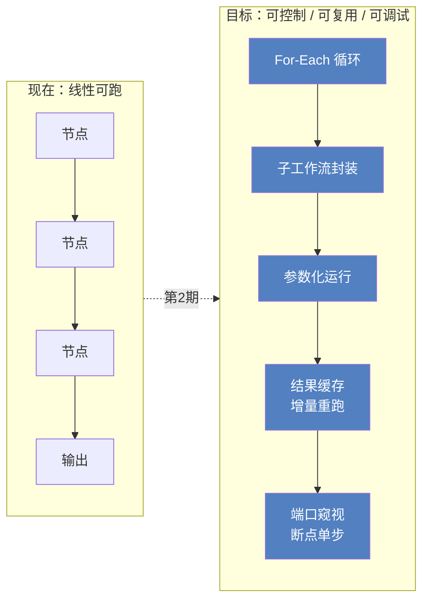

| 关键特性 | 设计要点 | 涉及模块 |
|---------|---------|---------|
| **For-Each / While 循环节点** | 循环体建议实现为「子工作流引用」，避免在单图内画循环体导致图形爆炸 | `DAWorkFlowPy`（执行器/模型）+ `DAPyWorkFlow`（图元渲染） |
| **子工作流节点（Meta Node）** | 工作流可被引用为节点，端口映射 + 参数映射；这是复用的核心 | `DAWorkFlowPy`、`DAPyNodeFactory` |
| **运行时参数化运行** | 跑前弹参数对话框（文件路径、阈值、日期…），支持「用上次值/存为预设」 | `DAGui/NodeSetting` 表单引擎可复用 |
| **节点级缓存与增量重跑** | 以「节点内容哈希 + 上游哈希」为键缓存输出，改一个参数只重算受影响子图 | 新增缓存层（建议放 L2 功能层） |
| **调试能力** | 端口数据窥视浮窗、单步、只跑选中子图 | `DAWorkFlowPy` + `DAPyWorkFlow` |
| **错误策略** | 节点级 fail-fast / 继续 / 重试 N 次 / 错误端口输出 | `executor.py` |
| **编辑器体验** | 节点搜索、对齐吸附开关、缩略图、连线类型校验 | `DAGraphicsView`、`DAPyWorkFlow` |

**验收标准**：一个 50 节点的流程，改中间一个参数后只重算下游、并在 3 秒内看到端口数据。
**风险**：缓存键的正确性（哈希要覆盖参数、代码版本、上游数据），建议第一版只缓存显式标记的节点。

### 4.4 第 3 期（v0.4）「数据接入」：从文件工具到数据平台

> **📋 本期定位**
>
> 数据接入是本项目最大的空白。表格数据源抽象层（惰性 + 块级取数 + 引用式持久化）已经把地基打好，且有 SQLite 惰性表的技术样板，缺的只是产品化。

| 关键特性 | 设计要点 |
|---------|---------|
| **数据库连接器插件**（SQLite / DuckDB / PostgreSQL / MySQL / SQL Server / ODBC） | 见 [5.3 节](#53-重点畅想navicat-类数据库插件) 完整设计 |
| **连接器 SDK 与数据源节点** | 把「数据源」抽象出插件接口：`listTables / schemaOf / query / lazyTable`，工作流节点与数据管理器共用 |
| **通用 HTTP / REST 数据源** | 支持 JSON/CSV 接口轮询拉取 |
| **仪器与实时数据通道** | 串口 / Modbus / OPC UA 采集卡接入（工业场景），落地为「流式数据源」 |
| **SQL 节点** | 在工作流里写 SQL 取数 → DataFrame → 后续分析 |
| **凭据安全** | 复用已有 DPAPI 加密思路（参考 LLM API key 落盘方案） |

**验收标准**：用户在数据管理器里新增一个 PostgreSQL 连接，浏览表结构，把一张百万行表以惰性方式拖进工作区，绘图与工作流全部可用，且工程文件里只保存连接引用而不保存全量数据。
**风险**：数据库驱动分发与许可（部分驱动 GPL）、跨平台驱动可用性；建议优先 DuckDB（本地列式，零运维）+ SQLite，再扩 JDBC/ODBC 通用通道。

### 4.5 第 4 期（v0.5）「可复现与交付」：让成果可复用

> **📋 本期定位**
>
> 这一期直接对应科研与工业用户付费意愿最强的部分：**可复现、可追溯、可交付**。

| 关键特性 | 说明 |
|---------|------|
| **数据血缘与影响分析** | 记录「表 ← 节点 ← 表 / 图 ← 数据」的引用图；改一列能查出哪些图与报告受影响 |
| **执行历史与复现** | 每次工作流运行记录：输入哈希、参数、节点耗时、产物指针；可一键复现历史某次结果 |
| **活文档 / 活报告** | 报告中的图表为动态引用而非静态截图，数据变化后报告可一键刷新（与 Markdown 导出引擎衔接） |
| **批量出图与拼版** | 模板 × 分组变量 → N 张图；多图拼版为多 panel 的 PDF |
| **工作流与应用打包导出** | 把工程导出为「可执行分析包」（含参数表单），交付给不会用软件的人也敢用 |
| **工程版本化** | 与 Git 集成或内置快照：流程 + 图表配置 + 报告可 diff |

**验收标准**：产出一份可交互的 HTML 报告，包含实时数据摘要与图表，数据更新后可一键重生成。

### 4.6 第 5 期（v0.6）「智能体原生」：Agent 成为第一入口

> **📋 本期定位**
>
> 现在 Agent 是「辅助功能」：用户从 Ribbon 找按钮，Agent 帮忙。目标是反转：**用户先说需求，Agent 搭好流程与图表，人再接管微调**。

| 关键特性 | 说明 |
|---------|------|
| **MCP 双向** | 作为 Client 连接外部 MCP 工具（文件系统、数据库、内部系统）；作为 Server 暴露本平台能力，让 Claude/Cursor 等直接操作工程 |
| **本地知识库 / RAG** | 索引文献、实验记录、历史报告与数据字典，让分析有「上下文」 |
| **会话转资产** | 把一次成功的分析对话，一键转为可复跑的工作流或脚本节点（trace → workflow） |
| **Agent 生成节点** | 对话生成 Python 节点包并安装进工作区（含国际化、NodeDef 声明、测试）。**这是「软件自我扩展」的起点** |
| **调度与事件触发** | 定时 / 文件落地 / 数据更新触发 Agent 任务；结合巡检 Agent 实现无人值守 |
| **跨会话长期记忆** | 项目偏好、字段口径、命名习惯保存到工程或用户级记忆 |
| **成本与审计看板** | token、耗时、工具调用分布、审批记录 |

### 4.7 v1.0「平台化与生态」

- **插件市场**：插件元数据、版本、依赖、签名、一键安装，配合评分与评论
- **工作流即服务**：把工作流发布为 REST/gRPC 端点或定时任务，供外部系统调用
- **团队协作**：工程共享、评论批注、审阅流程、权限分级
- **行业解决方案包**：把「提示词 + 工作流模板 + 插件 + 示例数据」打包成行业方案（材料、新能源、生物、汽车测试…）
- **云端/多端**：工程与资产云同步（可选自托管），移动端看报告

---

## 第五部分 插件化机会地图

### 5.1 一个插件能挂在哪里

插件系统是本项目**最有杠杆的资产**：它把「该做什么功能」这个问题，变成了「别人能帮我做什么功能」。当前一个插件可以做的六件事，已经有对应范例验证：

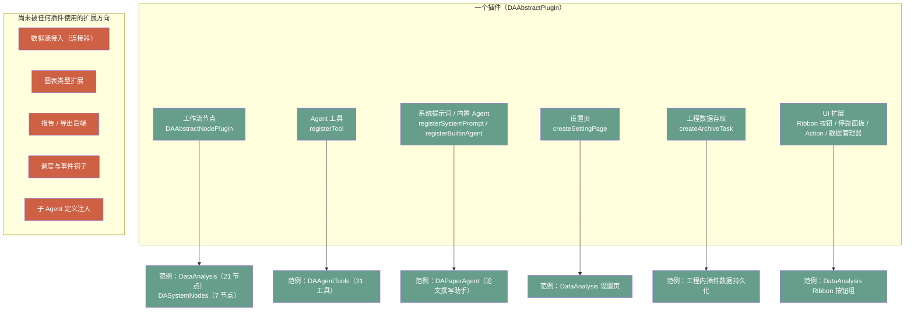

**结论**：M1～M5 这五个「尚无插件占用」的扩展方向，正是下一批插件最有价值的位置，尤其 **M1 数据源接入**，因为它同时补齐了[第二部分](#第二部分-缺口分析四个对照视角)里最短的一块木板。

### 5.2 插件候选清单

下表按主题分组，给出**目标用户 / 价值 / 依赖的底层能力 / 难度 / 优先级**。价值与难度都按 5 分制：难度 1/5 表示改一个插件模板即可，5/5 表示需要先补平台能力。

#### A. 数据接入类（价值最高、当前最空）

| 插件 | 目标用户 | 价值 | 依赖底层能力 | 难度 | 优先级 |
|------|---------|------|-------------|------|--------|
| **数据库连接器（类 Navicat）** | 全部 | 5/5 打开企业数据场景 | 表格数据源抽象层（已有）+ 连接管理界面 | 4/5 | **P0** |
| **DuckDB / 列式分析引擎** | 分析师、科研 | 5/5 零运维本地 SQL，百万行秒级 | DuckDB 库 + 同上 | 2/5 | **P0** |
| **通用 HTTP / REST 数据源** | 工程师 | 4/5 对接内部接口/云服务 | 网络请求 + JSON→DataFrame | 2/5 | P1 |
| **仪器与实时通道**（串口 / Modbus / OPC UA） | 工业、实验 | 5/5 直连数据源头 | 流式数据源抽象（需新增） | 4/5 | P1 |
| **Excel 深度互通**（保留格式双向同步、多 sheet 映射） | 业务用户 | 4/5 Excel 是现实世界的通用交换格式 | `DAAxOfficeWrapper`（已有） | 3/5 | P1 |
| **时序数据库**（InfluxDB / TDengine） | 工业 | 3/5 时序数据专门优化 | 同数据库连接器 | 3/5 | P2 |
| **文件批量导入向导**（目录扫描 + 命名规则解析 + 合并） | 全部 | 4/5 实验数据常见形态 | 导入器 + For-Each 节点 | 2/5 | P1 |

#### B. 分析与算法类

| 插件 | 目标用户 | 价值 | 依赖底层能力 | 难度 | 优先级 |
|------|---------|------|-------------|------|--------|
| **机器学习**（scikit-learn 节点：建模/训练/评估/预测回写） | 算法、科研 | 5/5 从描述分析到预测分析 | Python 节点（已有）+ 模型存储 | 3/5 | **P0** |
| **信号处理**（FFT、滤波、小波、包络、阶次分析） | 工程、振动 | 5/5 工程数据分析刚需 | scipy + 节点 | 2/5 | P1 |
| **统计过程控制 SPC**（控制图、能力指数、MSA） | 质量工程师 | 5/5 制造业付费意愿强 | 统计计算 + 图表 | 3/5 | P1 |
| **曲线拟合与峰分析**（非线性拟合、多峰、基线） | 科研 | 5/5 与可视化域联动 | scipy.optimize + DAFigure 交互 | 4/5 | P1 |
| **试验设计 DOE / 优化求解** | 研发 | 4/5 研发流程上游 | scipy + 统计 | 4/5 | P2 |
| **图像分析**（OpenCV：尺寸测量、缺陷检测、批量图像特征） | 材料、制造 | 4/5 图像类实验数据 | opencv-python | 3/5 | P2 |
| **地理信息 / 地图可视化** | 地学、环境 | 3/5 垂直场景 | 地图控件 + 渲染器 | 4/5 | P2 |
| **生信 / 化学 / 材料领域包** | 垂直科研 | 4/5 垂直领域护城河 | 领域库（Biopython、RDKit…） | 4/5 | P2 |

#### C. 可视化增强类

| 插件 | 价值 | 依赖底层能力 | 难度 | 优先级 |
|------|------|-------------|------|--------|
| **期刊出图套件**（模板库 + 尺寸/字体预设 + 拼版 + panel 标号） | 5/5 覆盖论文交付全流程 | 图表模板系统（需先做） | 3/5 | **P0** |
| **图表模板商店**（配色 + 样式预设社区分享） | 3/5 | 模板序列化格式 | 2/5 | P2 |
| **高级图型包**（桑基图、旭日图、小提琴图、树图、网络图） | 3/5 | 新图元渲染 | 3/5 | P2 |
| **动画与实时可视化**（动态曲线、批量 GIF/MP4） | 3/5 | 定时刷新 + 帧导出 | 3/5 | P2 |
| **报告级看板**（多图 + 指标卡，自动刷新） | 4/5 | 报告引擎（第 4 期） | 4/5 | P1 |

#### D. 报告与交付类

| 插件 | 价值 | 依赖底层能力 | 难度 | 优先级 |
|------|------|-------------|------|--------|
| **LaTeX / 论文导出**（图表编号、交叉引用、bib 支持） | 5/5 科研刚需 | Markdown 导出引擎（已有）+ 模板 | 2/5 | P1 |
| **PPT 汇报包**（一页一图 + 结论模板） | 4/5 企业汇报 | 已有导出引擎 + 模板 | 2/5 | P1 |
| **通知与告警**（邮件 / 企业微信 / 钉钉 / Webhook） | 4/5 支撑无人值守运行 | 调度器（需先做） | 2/5 | P1 |
| **数据脱敏与合规导出** | 3/5 企业 | 列级规则 | 2/5 | P2 |

#### E. 工程与协作类

| 插件 | 价值 | 依赖底层能力 | 难度 | 优先级 |
|------|------|-------------|------|--------|
| **工程版本化 / Git 集成**（流程、图表、报告 diff） | 4/5 | 工程文件已 ZIP 化，易 diff | 3/5 | P1 |
| **任务中心与调度**（定时、依赖、重试、失败告警） | 5/5 实现自动化运行 | 需平台调度器 | 4/5 | P1 |
| **团队资产库**（模板、提示词、工作流、插件包共享） | 4/5 | 市场基建 | 4/5 | P2 |
| **审计与操作日志**（谁改了哪个数据/流程） | 4/5 受监管行业 | 事件总线 | 3/5 | P2 |

#### F. Agent 能力类

| 插件 | 价值 | 依赖底层能力 | 难度 | 优先级 |
|------|------|-------------|------|--------|
| **MCP 桥**（Client + Server 双向） | 5/5 接入整个 Agent 生态 | Agent 接口（已有） | 3/5 | **P0** |
| **本地知识库 / RAG**（文献、记录、口径文档） | 4/5 专业分析需要上下文 | 向量库 + 嵌入模型 | 4/5 | P1 |
| **代码生成器**（对话生成 Python 节点包并安装） | 5/5 软件自我扩展 | 脚本工作区 + 插件目录写入 | 4/5 | P1 |
| **领域 Agent 包**（行业提示词 + 工具组合，如「电池测试分析助手」） | 5/5 低成本高感知 | `registerBuiltinAgent`（已有） | 2/5 | **P0** |
| **Agent 评测台**（提示词 A/B、工具调用回放评分） | 3/5 质量保障 | 会话存储（已有） | 3/5 | P2 |

### 5.3 重点畅想：Navicat 类数据库插件

这是文档中提到的想法。判断是：**值得做，而且比「做一个 Navicat」更有价值。产品定位是「数据库直连的数据分析软件」，数据库管理本身交给 Navicat 这类工具**。Navicat 管数据，DAWorkBench 用数据；两者结合处正是竞品的空白。

#### 5.3.1 为什么在这个项目里成立

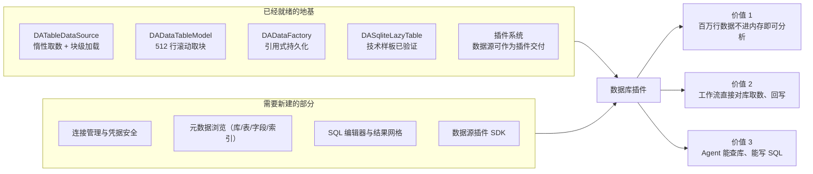

关键事实（来自代码调研）：
- 表格数据源抽象层**已完成并测试**：`DATableDataSource` / `DATableDataBlock` 支持惰性取数与块级加载，`DADataTableModel` 已按滚动驱动取块（默认 512 行）
- **引用式持久化已落地**：工程文件里只存引用 payload，重开工程自动重建（`DAAppProject.cpp` 的 `<ref>` 机制）
- **已有 SQLite 惰性表的技术样板**（测试模块中的 `DASqliteLazyTable`，用 QtSql 实现 `COUNT(*)` + `LIMIT/OFFSET` 只读惰性表）
- 生产代码中**没有任何数据库连接、驱动、连接管理界面**（建议补齐），产品化是从 0 到 1，但起点不是 0

#### 5.3.2 分四级功能（建议按级交付）

| 级别 | 能力 | 说明 | 难度 |
|------|------|------|------|
| **L1 只读接入** | 连接管理 + 表浏览 + 拖表进工作区（惰性）+ 建图 | 一上来就解决「百万行数据」的核心痛点；连接信息加密存储 | 3/5 |
| **L2 查询分析** | SQL 编辑器（语法高亮、补全、执行计划）+ 结果网格 + 结果送数据分析/工作流 | 补全可复用 `DAMarkdownHighlighter` 的同类思路；结果网格复用现有表格组件 | 3/5 |
| **L3 工作流集成** | SQL 查询节点、SQL 写入节点、库表作为工作流数据源 | 让「取数 → 清洗 → 出图 → 报告」成为一条可复用流程 | 2/5 |
| **L4 管理能力** | 表结构设计、DDL 生成、索引、数据同步/迁移、ER 图 | 到这里才与 Navicat 的管理面相当，建议作为远期，不做主线 | 4/5 |

#### 5.3.3 与 Navicat 的差异化定位

| 维度 | Navicat | 本插件应走的路 |
|------|---------|---------------|
| 核心场景 | 库的日常管理（建表、改数据、权限） | **取数 → 分析 → 出图 → 报告** 的端到端 |
| 数据处理 | 简单过滤排序 | 完整 DataFrame 算子 + 工作流 + Agent |
| 输出 | 导出文件 | 论文级图表、可交互报告、可复跑流程 |
| 大数据 | 分页浏览 | 惰性块取数 + 列式引擎（DuckDB）下推计算 |
| AI | 少量 SQL 生成辅助 | **Agent 直接查库、解释数据、生成分析流程** |

#### 5.3.4 工程要点与风险

- **驱动选型**：优先 **DuckDB**（本地列式、零运维、Apache 许可）+ **SQLite**（QtSql 已内建）+ **PostgreSQL**（libpq，许可友好）+ **通用 ODBC**（一份代码覆盖 SQL Server / Oracle / 达梦等）。MySQL 驱动注意 GPL 传染性（可用 MariaDB Connector/C 规避）。
- **凭据安全**：复用已有的 Windows DPAPI 加密落盘方案（LLM API key 的先例），跨平台备用方案用系统密钥环。
- **工程文件策略**：数据库数据集**只存连接引用与查询语句**，绝不存数据副本；这与已有的引用式持久化设计完美契合。
- **计算下推**：筛选、聚合尽量下推到 SQL（`WHERE` / `GROUP BY`），只把结果拉进 DataFrame，这是「数据库直连分析」相对「导出 CSV 再分析」的根本优势。
- **不做什么**：不建议做数据库运维（备份、主从、用户授权），那是 DBA 工具的领域，投入大且偏离主线。
- **与 Agent 的天然结合**：加 3 个工具（`list_db_connections` / `describe_table` / `run_query`）就能让 Agent 具备「自己取数分析」的能力，这是**插件系统、Agent 平台、数据源抽象层三者交汇的最佳演示**。

### 5.4 插件优先级矩阵

> **📝 关于下图的语言**
>
> mermaid 的 `quadrantChart` 词法分析器不接受中文出现在坐标轴标签、象限标题与数据点名称里（只有图标题可以中文），因此下图用英文标签，中文对照见其后表格。若将来 mermaid 修复该限制，可直接替换回中文。

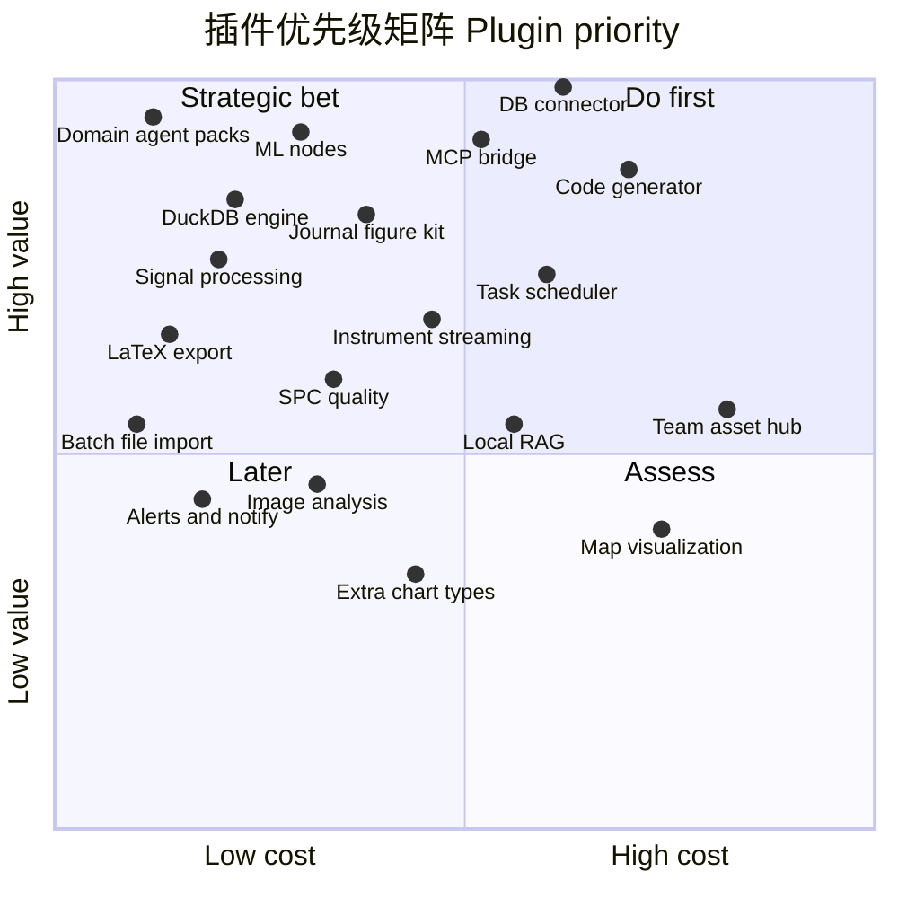

| 图中标签 | 对应插件 | 图中标签 | 对应插件 |
|---------|---------|---------|---------|
| Domain agent packs | 领域 Agent 包 | Instrument streaming | 仪器实时通道 |
| DuckDB engine | DuckDB 列式引擎 | Code generator | 代码生成器 |
| DB connector | 数据库连接器 | Local RAG | 本地知识库 |
| MCP bridge | MCP 桥 | Task scheduler | 任务中心与调度 |
| ML nodes | 机器学习节点 | Image analysis | 图像分析 |
| Journal figure kit | 期刊出图套件 | Map visualization | 地图可视化 |
| LaTeX export | LaTeX 导出 | Extra chart types | 高级图型包 |
| Signal processing | 信号处理 | Team asset hub | 团队资产库 |
| SPC quality | SPC 质量控制 | Alerts and notify | 通知与告警 |
| Batch file import | 文件批量导入 | | |

---

## 第六部分 创新方向畅想

前面是「补课」，这一部分是「超车」。以下 13 个方向，按**这个项目独有的优势**筛选过，只有那些「因为有工作流 + 可视化 + Agent + 插件四件套才成立」的想法才列入。


### ① 可复现研究单元（Research Bundle）（创新度 4/5，难度 3/5）

**概念**：把「数据 + 工作流 + 图表配置 + 报告 + 运行环境指纹」打成一个可复现包，任何人打开都能一键重跑出同样结果，并可对比两次运行的结果差异。

**为什么在本项目成立**：工程文件 `.dapro` 已经是 ZIP 且已包含数据、流程、图表、脚本工作区、Agent 会话，是天然的复现包载体；缺的只是**执行记录与校验**（输入指纹、参数、代码版本、产物哈希）。

**最小可行**：工作流运行后写一条结构化记录（时间、参数、输入哈希、输出摘要、耗时），在工程里展示「运行履历」，并支持「用这份履历重跑」。

### ② 工作流即 API / 无头执行（创新度 4/5，难度 3/5）

**概念**：一个工作流可以被「发布」为一组参数化入口：命令行、HTTP 端点、或定时任务。别人不必打开软件，就能用上这套分析流程。

**为什么成立**：工作流逻辑层本就在 Python，脱离图形界面执行障碍很小；缺的是运行时参数化（第 2 期）与无头入口。

**最小可行**：`DAWorkBench --run-workflow project.dapro --workflow main --param date=2026-01-01 --out result/`，先支持 CLI，再考虑 HTTP。

### ③ 活文档 / 活报告（创新度 5/5，难度 4/5）

**概念**：报告里的图和数字都是**引用**（不是截图）。数据更新后，报告一键刷新；点击报告里的图，直接跳转到图表区对应的图并高亮。

**为什么成立**：已有 Markdown 查看器 + 统一导出引擎（HTML/PDF/Word，图片内嵌）+ Agent 聊天里的 `da-figure:` / `da-data:` 链接机制，把链接能力从聊天搬到报告是自然的延伸。

**最小可行**：报告 Markdown 支持 `` 语法，导出时实时渲染图表快照并建立双向跳转。

### ④ 对话即资产：把 Agent 的探索固化为流程（创新度 5/5，难度 4/5）

**概念**：Agent 做成一次分析之后，**这次的步骤可以一键转成工作流或脚本节点**，下次换数据直接跑。这是从「探索」到「生产」的关键一步，也是通用 AI 助手做不到的事。

**为什么成立**：Agent 的工具调用已经结构化（`tool_call` / `tool_result` 成对落盘），把 tool 序列映射成节点序列在技术上完全可行；`run_code` 的代码也可提升为脚本节点。

**最小可行**：会话管理里加「从本次会话生成工作流」，做工具→节点的映射表，无法映射的步骤降级为一个 `run_code` 节点并保留代码。

### ⑤ 数据血缘与影响分析（创新度 4/5，难度 3/5）

**概念**：改一列，先给出影响面：「会影响哪 3 张图、2 份报告、1 个工作流」；反过来，任何一张图都能追溯「它是从哪张表、哪次运行来的」。

**为什么成立**：数据、图表、工作流都已在同一进程内统一管理（`DADataManager` / `DAAgentTools` / 工作流模型），只需在数据引用处记录边。这也是「可复现」的必备基础设施。

### ⑥ AI 数据管家（常驻巡检）（创新度 5/5，难度 4/5）

**概念**：一个平时安静、但会主动汇报的 Agent：每天巡检工作区数据（缺失率突增、异常值、分布漂移、文件更新），生成一份「数据健康简报」；发现异常时可自动跑一段诊断工作流。

**为什么成立**：已有子 Agent 编排、权限门、会话持久化、报告导出；缺的只是调度触发（第 5 期）。

### ⑦ 图表工厂（创新度 4/5，难度 3/5）

**概念**：定义一次「图表配方」（模板 + 分组变量 + 命名规则），把 20 组数据一次性生成风格完全一致的 20 张图，并自动拼版成多 panel 图。

**为什么成立**：图表已是可序列化配置（XML 存进工程），把「配置」参数化成「模板 + 数据映射」即可；这是科研出图的真实工作方式。

### ⑧ 跨软件桥（MCP Server 模式）（创新度 4/5，难度 2/5）

**概念**：让 Claude / Cursor / 公司内部 Agent 反过来调用本平台的工具，比如：「帮我用 DAWorkBench 打开那个工程，画一张 X 对 Y 的图」。

**为什么成立**：`DAAgentInterface` 的工具注册表已经是中立的 JSON schema，暴露为 MCP Server 几乎是配置工作；MCP Client 方向则能瞬间获得海量外部工具。

### ⑨ 仿真与试验衔接（创新度 4/5，难度 3/5）

**概念**：面向「一维仿真 vs 台架试验」的专用对比族：时间轴对齐、误差指标（RMSE/峰值误差/相位差）、Bland-Altman、残差趋势、包络图，并自动生成对比结论草稿。

**为什么成立**：README 明确的原始目标之一；`join`/对比视图缺口一旦补上，这组节点就是水到渠成的组合拳，且竞品少有覆盖。

### ⑩ 实时数据流分析（创新度 4/5，难度 4/5）

**概念**：串口/DAQ/OPC UA 的数据流实时进图：滚动窗口、实时指标、超限告警；同一张图既做实时监视，又能冻结下来做离线分析。

**为什么成立**：图表与数据处理都在同一进程，实时数据只是「多了一个持续追加的 DataFrame 源」；这是工业现场最愿意买单的形态。

### ⑪ 插件市场与节点生态（创新度 3/5，难度 4/5）

**概念**：插件/节点/提示词/模板都是可分享资产，带元数据、版本、依赖与评分；用户能一键安装「某实验室出品的电池测试分析包」。

**为什么成立**：三种插件发现机制已经齐备（动态库、pyplugins、entry_points），市场只是分发层；难点在生态运营，不在技术。

### ⑫ 教学与演示模式（创新度 4/5，难度 2/5）

**概念**：工作流可「回放」：按执行顺序逐步高亮节点、展示每个节点前后数据的变化，配文字讲解；适合课堂教学与团队内训。

**为什么成立**：节点状态着色与跑马灯连线已实现，回放只是把「已发生的事件序列」重演一遍；而「数据怎么一步步变干净」正是教学最难讲清的部分。

### ⑬ 实验室数字台账（ELN 融合）（创新度 4/5，难度 4/5）

**概念**：把每次工作流运行登记为一条台账（谁、何时、用了哪批数据、参数、产物、结论），可检索、可追溯到原始数据文件，成为实验室的电子实验记录。

**为什么成立**：这是「运行履历 + 血缘 + 报告」三者合并后的产品形态，直接切入科研合规（原始记录可追溯）的刚性需求，也是把个人工具升级为团队工具的关键一步。

---

## 第七部分 平台架构完善建议

### 7.1 八项需要补齐的平台底座

这些属于底层支撑，让上面所有功能都能低成本实现。**建议的落位遵循项目五层架构铁律**（下层不得依赖上层）。

| # | 底座 | 解决什么 | 建议落位 | 最小接口 |
|---|------|---------|---------|---------|
| 1 | **任务与调度中心** | 定时运行、依赖编排、失败重试、进度与取消 | L2 功能层新建 `DATaskScheduler`（无图形界面依赖）+ APP 层提供界面 | `schedule(task, cron \| trigger)`、`cancel(id)`、`stateChanged` 信号 |
| 2 | **节点结果缓存层** | 增量重跑、大流程可维护 | L2（DAPyWorkFlow 侧或独立缓存服务） | `key = hash(nodeDef + params + upstreamHashes)`、`get/put/invalidate` |
| 3 | **端口类型系统 / 数据契约** | 连线合法性校验、节点自描述、错误前置 | Python 逻辑层（`node_def.py`）声明 + C++ 渲染层消费 | `Input/Output(type=...)`、类型兼容表 |
| 4 | **事件总线与通知中心** | 插件解耦（谁都可以订阅「数据变更/流程完成」）、告警外发 | L1/L2（`DAMessageHandler` 旁） | `subscribe(topic)`、`publish(event)` |
| 5 | **血缘与元数据服务** | 影响分析、可复现、台账 | L2（与 `DADataManager` 同级） | `recordEdge(from, to, kind)`、`queryUpstream(id)` |
| 6 | **数据源插件 SDK** | 数据库/接口/仪器统一的接入抽象 | L2（扩展 `DATableDataSource`）+ 插件头文件 | `IDataSourcePlugin`：`listTables/schema/query/lazyTable` |
| 7 | **插件市场基建** | 分发、版本、依赖、签名、评分 | L4（DAPluginSupport）+ 远端服务 | 插件元数据 Schema、安装/更新 API |
| 8 | **测试与金标准数据** | 让重构敢做、让算法可信 | `src/tst/` 扩展 | 每个算子一组 golden case；工作流端到端用例工程 |

### 7.2 新增模块的落位图

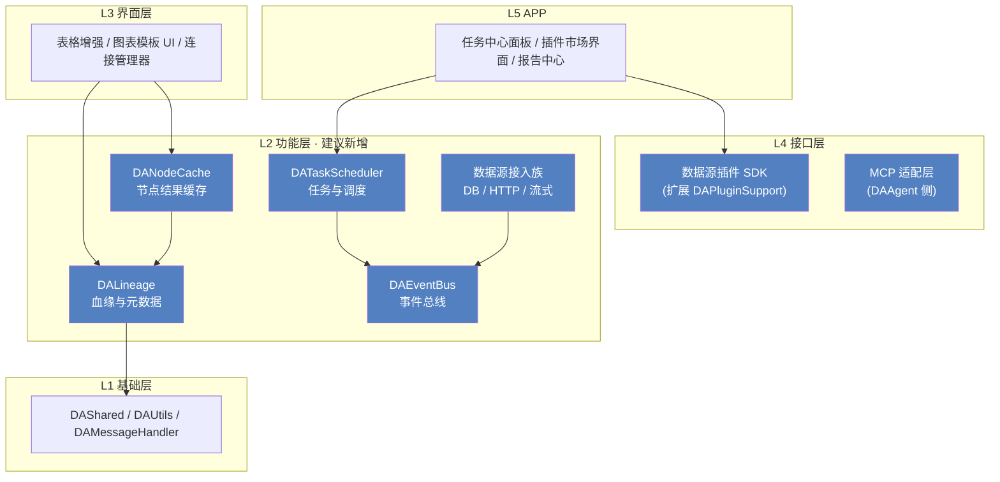

### 7.3 建议优先处理的技术债

| 债务 | 影响 | 建议 |
|------|------|------|
| 工作流执行未强制 DAG 校验（`is_valid_dag()` 未接入执行路径） | 环路会递归，可能挂死 | 第 1 期立刻做，成本极低 |
| If/Else 分支未选中时下游永久等待、多输入汇聚挂起 | 复杂流程图不可用 | 引入显式的「空值传播」语义或分支汇聚节点 |
| 图表与数据一次性绑定（创建后不联动） | 数据修正后图仍是旧值，易误导 | 引入数据源句柄 + 主动刷新；也是「活文档」的前置条件 |
| 矢量导出、探针表导出等能力只在 Python/Agent 侧，界面无入口 | 文档与实现不符，用户找不到；导出渲染器其实已具备（qwt `QwtPlotRenderer` 支持 PDF/SVG） | 第 1 期补界面，或文档明确标注「仅脚本可用」 |
| 快照式撤销（pickle 全量）在大数据集下的成本 | 大表编辑可能变卡 | 评估增量撤销或分块快照；必要时限制快照粒度 |
| 文档中提到的 `CrewAIAdapter` 插件实际不存在 | 期望管理 | 文档修正或补实现 |
| 节点串行执行 + GIL | 大流程慢 | 第 2 期随缓存与并行调度一起解 |

---

## 第八部分 行动建议

### 8.1 价值 × 成本矩阵（平台级功能）

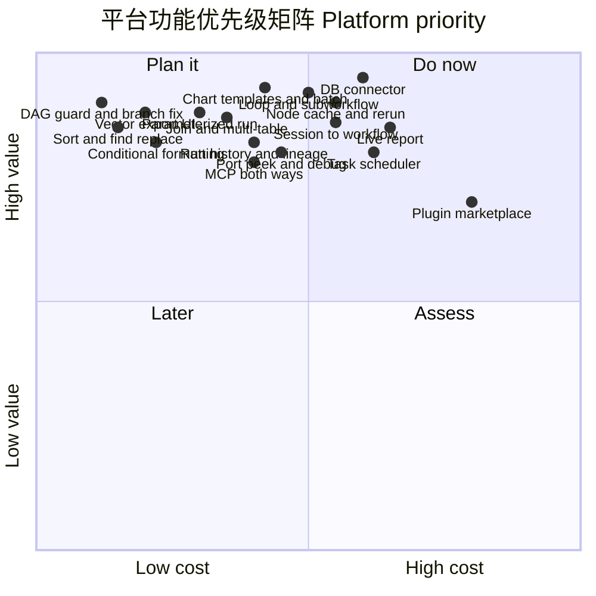

| 图中标签 | 对应功能 | 图中标签 | 对应功能 |
|---------|---------|---------|---------|
| Sort and find replace | 表头排序与表内查找替换 | DB connector | 数据库连接器 |
| Conditional formatting | 条件格式 | Run history and lineage | 运行履历与血缘 |
| DAG guard and branch fix | DAG 校验与分支语义修复 | Live report | 活报告 |
| Vector export 界面 | 矢量导出界面 | Session to workflow | 会话转工作流 |
| Chart templates and batch | 图表模板与批量出图 | Task scheduler | 任务中心与调度 |
| Join and multi-table | join 与多表关系 | MCP both ways | MCP 双向 |
| Loop and subworkflow | 循环与子工作流 | Plugin marketplace | 插件市场 |
| Parameterized run | 参数化运行 | Node cache and rerun | 节点缓存与增量重跑 |
| Port peek and debug | 端口窥视与断点 | | |

### 8.2 未来两周就能落地的 5 件事

1. **工作流安全校验**：执行前调用 `is_valid_dag()`，非法图给出可读提示并拒绝执行（半天，消除一个会挂死的缺陷）。
2. **表头排序 + 表内查找替换**：表格编辑器的两个最高频动作（复用已有命令体系，2～3 天）。
3. **条件格式落地**：`paintConditionalFormat` 空钩子已存在，先做「大于/小于/区间高亮 + 色阶」（3～5 天）。
4. **矢量导出界面**：把 qwt 的 `QwtPlotRenderer`（PDF/SVG）或 Python 侧 `savefig` 接到图表区导出按钮，带 DPI/尺寸选项（2 天，直接兑现已有文档承诺）。
5. **领域 Agent 包**：用 `registerBuiltinAgent`（`DAPaperAgent` 已验证）做一个面向自己实验数据的 agent，成本最低、感知最强，且能立刻验证「提示词 → 工具 → 报告」这条流程。

### 8.3 需要拍板的五个问题

| 问题 | 选项与影响 |
|------|-----------|
| **① 主线定位** | A. 深耕科研（出图/拟合/可复现/论文交付） B. 转向工业数据分析（仪器接入/SPC/实时） C. 做通用平台（都做但都浅）。**影响**：第 3 期之后的路线分叉。建议 A 为基本盘，B 作为插件生态承接。 |
| **② 数据库插件是核心功能还是示例插件** | 核心 → 进主仓、跟随版本、享受首等公民待遇；示例插件 → 放到 `plugins/` 独立演进，也顺便验证插件 SDK 是否够用。**建议：先独立插件形态，验证后再考虑提升。** |
| **③ Agent 是否作为第一入口** | 若「是」，界面与文档的重心要从「按钮菜单」转向「对话 + 模板」，第 5 期优先级提前。**建议：并行入口**，保留完整手动路径，因为专业用户对可控性要求高。 |
| **④ 生态策略** | 是否要做插件市场与社区？做则需先定插件元数据规范、版本兼容策略与签名机制。**建议：先内部模板库（团队资产库），市场留到 v1.0。** |
| **⑤ 开源与商业边界** | 核心 LGPL 开源 + 行业解决方案/插件包商业模式；或纯开源。**影响**：插件市场、云同步、协作功能的设计取向。 |

---

## 附录 A 能力成熟度评估表

评分口径：0 = 无，1 = 雏形，2 = 可用但有明显缺口，3 = 可用，4 = 完善，5 = 领先。

| 维度 | 得分 | 说明 |
|------|------|------|
| 插件架构 | 5 | 三种发现机制 + 六类扩展点 + 热插拔 |
| Agent 工程化 | 5 | 权限、会话、子 Agent、崩溃自愈、上下文压缩 |
| Agent 工具覆盖 | 4 | 25 个工具，缺 MCP 与知识库 |
| 图表绘制能力 | 4 | 22 种图型、2D/3D 混排 |
| 图表交互编辑 | 5 | 拖动微调、探针、撤销栈是同类少见 |
| 图表交付能力 | 1 | 模板/批量/拼版/矢量导出界面全缺 |
| 数据读写 | 4 | 格式覆盖广，含 Office COM |
| 表格编辑体验 | 2 | 缺排序/替换/条件格式/冻结/join |
| 数据接入广度 | 1 | 仅文件；数据库/接口/仪器全空 |
| 数据源抽象层 | 4 | 惰性 + 块取数 + 引用持久化已就绪 |
| 工作流编辑体验 | 4 | 分组、复制粘贴、撤销、参数表单完备 |
| 工作流控制流 | 1 | 无循环、无子流程、分支语义有缺陷 |
| 工作流运维能力 | 1 | 无调度、无历史、无缓存、无无头执行 |
| 可复现与血缘 | 1 | 仅工程文件保存流程 |
| 交付与报告 | 3 | Markdown 查看器 + HTML/PDF/Word 导出引擎 |
| 协作与共享 | 0 | 无 |
| 国际化与文档 | 4 | 中英双语 + 完整文档站（个别处与实现有偏差） |
| 测试基建 | 3 | 有 Qt Test 模块与 CI，覆盖率未系统化 |

**读法**：得分 ≤ 2 的维度就是「最快能带来体感提升」的投入方向：交付能力、表格编辑、数据接入、控制流、运维能力、可复现。

## 附录 B 竞品对照

| 能力 | Excel | KNIME / Alteryx | Origin / GraphPad | Jupyter | 通用 AI 助手 | **DAWorkBench 现状** |
|------|-------|-----------------|-------------------|---------|-------------|---------------------|
| 表格编辑手感 | 标杆 | 弱 | 中 | 无 | 无 | 中（缺高频操作） |
| 大数据量 | 差 | 强 | 中 | 中 | 中 | 强（亿行级） |
| 工作流自动化 | 宏/VBA | 标杆 | 弱 | 需编程 | 无 | 中（缺控制流/调试） |
| 论文级出图 | 差 | 中 | 标杆 | 需编程（matplotlib） | 中 | 强（单图）/ 弱（批量交付） |
| 图表手工微调 | 中 | 弱 | 强 | 无 | 无 | 强 |
| AI 直接操作软件 | 中（Copilot） | 弱 | 弱 | 中 | 强（但只能产出文件） | **强（操作真实对象）** |
| 数据接入广度 | 中 | 强 | 中 | 强（靠库） | 中 | **弱（仅文件）** |
| 插件化扩展 | 中 | 强 | 中 | 强 | 弱 | 强 |
| 可复现性 | 弱 | 中 | 弱 | 中 | 弱 | **弱** |
| 数据库直连分析 | 弱 | 中 | 弱 | 中 | 弱 | **无** |

**差异化机会**：把「AI 直接操作软件对象」与「可交互微调」结合，是当前市场少有的组合；补上数据接入与可复现后，会形成竞品难以复制的完整体验。

## 附录 C 术语表

| 术语 | 含义 |
|------|------|
| **节点（Node）** | 工作流中的一个处理步骤，由 `@NodeDef` 声明端口与参数 |
| **端口（Port）** | 节点间的数据连接点，分输入/输出，当前无类型校验 |
| **For-Each / 子工作流** | 本文建议的新概念：循环节点与可被引用为节点的工作流（Meta Node） |
| **惰性表（Lazy Table）** | 只在可见区域取数的数据源，避免全部载入内存 |
| **引用式持久化** | 工程文件不存数据副本，只存引用，打开时重建 |
| **血缘（Lineage）** | 数据从哪来、被谁使用的引用图 |
| **活文档（Live Doc）** | 内嵌动态引用而非静态截图的报告 |
| **图表配方 / 模板** | 可参数化复用的图表样式配置 |
| **MCP** | Model Context Protocol，Agent 与外部工具互操作的事实标准 |
| **RAG** | 检索增强生成，给 Agent 提供本地知识上下文 |
| **Trace → Workflow** | 把 Agent 的工具调用轨迹固化为可复跑工作流 |

---

> **💡 这份文档怎么用**
>
> 建议把它当成**待办池**，不要当成**计划书**：每完成一项就在对应表格里改状态；每个版本发布前重读一遍「附录 A 成熟度表」，用得分变化检验方向是否正确。文档中的判断基于 2026-10 的 `dev` 分支状态，若实现有推进，应同步修订，避免规划与代码脱节。

---

## 附录 D 任务提示词列表

> 把前面所有规划（第一部分到第六部分）拆成**可以直接投喂给 AI Agent 的任务**：每个任务一个工作树、一次提交、一次合并，做完就能用。

### D.1 这份清单怎么用

**答案先给出来：全部实现需要约 121 个任务**，分布如下（含 3 个可选任务；不含「畅想级」研究性探索）。

| 线 | 任务数 | 说明 |
|----|-------|------|
| 第 1 期磨平毛刺 | 21 | 让现有四大板块的能力补完整，最高优先级 |
| 第 2 期工作流 2.0 | 16 | 控制流、复用、缓存、调试；决定流程复杂度天花板 |
| 第 3 期数据接入 | 13 | 数据库/接口/仪器；决定场景天花板 |
| 第 4 期可复现与交付 | 12 | 血缘、履历、活文档、模板与交付物 |
| 第 5 期智能体原生 | 12 | MCP、RAG、会话转资产、节点生成、调度触发 |
| 第 6 期平台化与生态 | 8 | 插件市场、工作流即服务、协作、方案包 |
| 平台底座线（贯穿） | 7 | 调度、缓存、血缘、事件总线、测试、性能、沙箱 |
| 插件线 | 20 | 一个插件一个任务，可按需插队、可并行 |
| 创新线 | 12 | 差异化功能，建议在前面几期稳定后再启动 |
| **合计** | **121** | 其中 118 个必做、3 个可选（任务名中已标「可选」） |

**使用节奏（建议）**

1. **一次只投喂一个任务**。任务按「一个工作树任务」的规模设计，做完立刻提交并合并回 `dev`，再开始下一个，这样每个任务都基于最新代码，冲突面最小。
2. **拼接方式**：`公共前缀（D.3） + 任务提示词（表格第三列）`。公共前缀负责所有项目铁律与工作方式，任务提示词只讲这个任务本身。
3. **任务编号即分支名**：用任务名起分支，如 T1.3 用 `feat/table-header-sort`，便于追溯。
4. **允许并行**：插件线（TP.*）与创新线（TI.*）几乎全部可与其他任务并行；同一期内的任务若落在不同模块（表格 / 图表 / 工作流）也可并行。有依赖的任务见下面的依赖图。
5. **验收习惯**：每个任务结束时让 Agent 跑一遍 `.\scripts\build.ps1 -Target <模块> -Test`；每期结束跑一次全量构建与全部测试。

### D.2 任务依赖关系

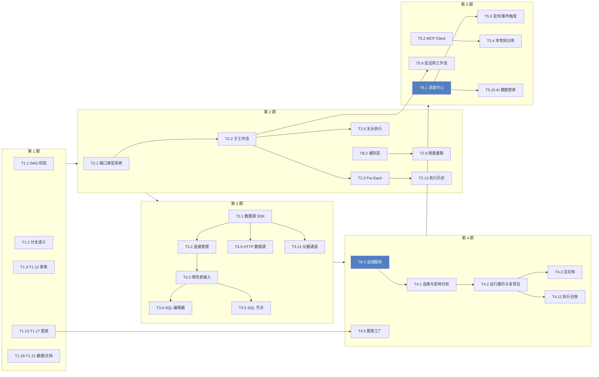

**读法**：没有箭头相连的模块之间可并行；`TB.*`（平台底座）是投资型任务，谁先谁后不影响功能推进，但 TB.1/TB.2/TB.3 分别是第 5 期调度、第 2 期缓存、第 4 期血缘的前置。第 1 期与第 2 期之间没有硬依赖，若痛点主要在流程复杂度而不是表格手感，可以直接从第 2 期开始。

### D.3 公共提示词前缀（每个任务都要拼在前面）

```text
你正在 DAWorkBench 仓库（C:\src\Qt\data-workbench）中进行开发。开工前先做两件事：
1) 读仓库根目录的 AGENTS.md 与 build.md，按其中的铁律与构建说明执行；
2) 按任务涉及模块，补读 docs/zh/dev-guide/ 下对应文档（架构 module-dependency、coding-standard、
   i18n、logging、plugin/、agent/、workflow/、python-binding/ 等）。

工作方式（强制）：
- 在 .worktree/ 下开工作树开发：bash scripts/worktree-add.sh <分支名>（不要在 dev 上直接改）；
- 小步提交，提交信息用 Conventional Commits、中文描述；只提交本任务相关文件，禁止 git add -A；
- 任务完成的定义：构建通过 + 相关测试通过（.\scripts\build.ps1 -Target <模块> -Test）、
  docs/zh/ 相关文档同步更新、合并回 dev（按 AGENTS.md「合并回 dev」章节按实时状态选路径）、
  删除工作树与分支。

硬约束（违反即返工）：
- 类名与文件名统一 DA 前缀并放入 DA 命名空间；QObject 子类必须加 Q_OBJECT；
  PIMPL 使用 src/DAGlobals.h 的 DA_DECLARE_PRIVATE / DA_D / DA_DC / DA_PIMPL_CONSTRUCT；
- 所有用户可见字符串用英文源文本 + //cn:中文行内注释（tr("English") //cn:中文）；
  进 UI 消息队列的 da* 日志必须翻译，开发诊断用 q* 且保持英文；
- 类成员函数的 Doxygen 注释写在 .cpp（头文件只留单行中文简述，类/信号/枚举除外）；
- 遵守五层架构依赖方向，下层不得依赖上层；新建类前先对照 module-dependency.md 确认模块归属；
- 禁止对非 const Qt 容器直接使用范围迭代（用 const 声明或 std::as_const 包裹）；
- 任何把 Qt 类型传给 Python 的 .cpp 必须 #include "DAPybind11QtCaster.hpp"（否则运行时静默失败）；
- 同时兼容 Qt 5.14 与 Qt 6，差异用 Qt5Qt6Compat_* 系列宏处理。

交付要求：改动摘要（文件级 + 关键类）、构建与测试命令及实际结果、遗留风险与后续建议。
```

> **💡 拼好的提示词长什么样**
>
> 以 T1.3 为例，实际投喂的内容 = D.3 整段 + 下面这行：
> 「目标：给数据表格加表头点击排序与多列排序；落位：`src/DAGui/Models/DADataTableModel` 与 `DAGui/DATableTableView`，排序命令走 `DAGui/Commands/DACommandsDataFrame.h` 的既有模式；要点：排序要产生可撤销命令、支持多列优先级、视图排序需与惰性取数（`DATableDataSource` 分块）兼容，不能一次性把整表拉进内存；验收：对 10 万行数据集点表头排序可在 300ms 内出结果且 Ctrl+Z 可还原。」

### D.4 第 1 期（v0.2）任务：磨平毛刺

> **📋 本期的任务原则**
>
> 只补「已有能力的最后一步」，不引入新概念。做完这一期，一个科研用户应当能从导入数据一路走到导出论文图，全程不离开软件、不写 Python。

| 任务名称 | 任务描述 | 任务提示词 |
|---------|---------|-----------|
| **T1.1 工作流执行 DAG 安全校验** | 执行前校验工作流是合法 DAG，环路/自环直接拒绝并给出可读定位，消除递归挂死隐患。 | 目标：在执行入口加入 DAG 合法性校验并给出可读错误；落位：`src/PyScripts/DAWorkbench/DAWorkFlowPy/executor.py` 的 `execute/execute_async`（已有 `workflow.py::is_valid_dag()` 但执行路径未调用）；要点：校验失败时不启动线程、通过既有信号回传错误、界面侧用 `daWarning` + tr() 提示并高亮涉环节点；验收：构造含环流程执行时 1 秒内被拒绝且日志给出环路径，正常流程行为不变；补一个 pytest 或 Qt Test 用例覆盖环检测。 |
| **T1.2 分支与汇聚语义修复** | 修复 If/Else 未选中分支导致下游永久等待、多输入汇聚节点挂起的问题。 | 目标：明确「未选中分支」的传播语义，让下游节点能正确判定「不会再有数据」；落位：`executor.py` 的 `_propagate_and_transmit` / `send_output` / `is_node_ready`（当前靠 None 不传播实现分支）；要点：建议引入显式的「分支停用」信号（如 disabled 标记）而非依赖 None，多输入节点在「所有上游已终态（含停用）」时即可就绪；验收：If 分支流程两条路径都能正常跑完、汇聚节点不再挂起，且行为有测试覆盖；注意不要破坏现有条件节点 `plugins/DASystemNodes` 的兼容性。 |
| **T1.3 表格：表头多列排序** | 数据表格支持点击表头排序、Shift 多列排序、稳定排序与可撤销。 | 目标：给数据表格加表头点击排序与多列排序；落位：`src/DAGui/Models/DADataTableModel`、`DAGui/DATableTableView`，命令走 `DAGui/Commands/DACommandsDataFrame.h` 既有模式；要点：排序产生可撤销命令、支持多列优先级与升降序指示、排序后保持行样式与选择状态，且必须与惰性分块取数（`src/DAData/DATableDataSource.h`）兼容，禁止一次性全量载入；验收：10 万行数据点表头排序 300ms 内出结果、Ctrl+Z 可还原、样式不错位。 |
| **T1.4 表格：查找替换对话框** | 新增表内查找/替换对话框，支持全表或选区、正则、区分大小写、替换全部。 | 目标：实现数据表内的查找替换；落位：`src/DAGui/` 下新增 `DADialogFindReplace`（参照 `DAGui/Dialog/` 现有对话框风格），执行动作走 `DACommandsDataFrame` 的命令模式；要点：查找要高亮命中并支持下一个/上一个、替换支持「替换/全部替换」且整体作为一个撤销单元、支持正则与大小写开关，处理 NaN/非字符串列的类型安全；验收：对含 10 万行表执行正则替换后 Ctrl+Z 一次即完全还原。 |
| **T1.5 表格：条件格式** | 落地条件格式：单元格规则高亮（大于/小于/区间/包含）、色阶、数据条，可保存进工程。 | 目标：实现条件格式；落位：`src/DAGui/DATableStyleItemDelegate.h` 已预留 `paintConditionalFormat`（空实现），样式数据挂到 `DATableStyleManager` 并随工程序列化；要点：第一版做规则高亮 + 双色/三色色阶 + 数据条三类，规则编辑器以 Ribbon 的 Table Style 面板为主 + 表体右键菜单同入口（列头菜单不放），性能上只对可见单元格计算，避免全表遍历；验收：设置规则后滚动千行无卡顿、保存重开工程规则仍在、与既有行/列/单元格样式不冲突。 |
| **T1.6 表格：导出为 Markdown / LaTeX / HTML 表** | 支持把选中区域或整表复制/导出为 Markdown、LaTeX、HTML 三表格文本。 | 目标：新增表格文本化导出；落位：`src/DAGui/`（数据表右键菜单与导出动作）+ 复用 `src/DAGui/MarkdownView/DAMarkdownExporter` 的导出约定；要点：三种格式各带对齐与转义规则（LaTeX 需转义 & % _ #、Markdown 需转义竖线与换行）、支持「复制到剪贴板」与「另存为文件」、大表提示并默认只导可见/选中范围；验收：导出的 LaTeX 可直接粘进论文编译通过，Markdown 在项目内置查看器中渲染正确。 |
| **T1.7 表格：列统计状态栏与快速定位** | 选中列时状态栏显示计数/求和/均值/最值；支持跳转到指定行、首尾行、指定列。 | 目标：补表格的「随手看一眼」和导航能力；落位：`src/DAGui/DATableTableView` + 主窗口状态栏（APP 层只做桥接，逻辑下沉到 DAGui）；要点：统计只对选中区域并用现有分块数据源按需聚合（避免全量扫描导致大表卡顿）、支持数值/日期/文本三类列的差异化显示、提供 Go-To 对话框（行号/列名/首尾）；验收：亿行级数据集选中一列后统计在 500ms 内返回。 |
| **T1.8 表格：冻结行列与列视图** | 支持冻结首行/首列与自定义冻结分隔，列序/列宽/隐藏状态可作为「视图」保存。 | 目标：实现冻结与列视图；落位：`DAGui/DATableTableView`（冻结通过多视图或 header 固定实现）+ `DATableStyleManager` 增加视图段以随工程保存；要点：冻结需与排序、滚动、行样式联动正确；列视图可命名保存并一键套用（不改变底层数据）；验收：冻结后横向滚动表头与冻结列不错位，重开工程视图保持。 |
| **T1.9 表格：文本分列与列合并** | 按分隔符/固定宽度把一列拆成多列，或把多列合并为一列，带预览与撤销。 | 目标：实现分列/合列；落位：新增 `DADialogSplitColumn`（`src/DAGui/Dialog/`）+ 命令加入 `DACommandsDataFrame.h`；要点：分列支持分隔符（含正则）与固定宽度、带预览表格与列名/类型推断、合列可选分隔符与跳过空值、操作整体可撤销；验收：对典型「仪器导出单列拼接数据」能一键拆成多列并正确推断数值类型。 |
| **T1.10 表格：多表 join / merge** | 提供表关联对话框，支持内/左/右/外连接与多键关联，产出新数据集。 | 目标：实现多表关联；落位：新增 `DADialogJoinData`（`src/DAGui/Dialog/`）+ 数据处理层封装 pandas merge（参照 `src/DAData/DADataPyDataFrame.h` 的封装方式），同时提供对应工作流节点（`plugins/DataAnalysis/PyScripts/` 下新增 `data_join` 节点）；要点：支持多键、后缀命名冲突策略、结果行数变化提示、关联键类型不一致时给出警告或强制转换选项；验收：两表按多键左连接结果与 pandas 直接调用一致，节点与对话框两条路径都能用。 |
| **T1.11 表格：跨表取值（类 VLOOKUP）** | 用一个表的键去另一表取对应值填充为列，支持「最近匹配/精确匹配」。 | 目标：实现跨表取值；落位：工作流节点 + 对话框两条入口（与 T1.10 共用底层封装）；要点：支持精确匹配与最近邻匹配（数值/时间轴模糊对齐，用于仿真-试验对照）、未命中策略（留空/报错/填充默认值）、记录未命中行数并提示；验收：对仿真时间轴与试验采样点不等间隔的场景能按最近邻正确取值。 |
| **T1.12 表格：表间联动（交叉筛选）** | 选中一个数据集的若干行，联动过滤其他数据集与图表，形成轻量仪表盘。 | 目标：实现表间/表图联动；落位：`src/DAData/` 增加联动选择模型（记录「当前筛选上下文」）+ `src/DAFigure/` 与数据表订阅该上下文；要点：联动范围可控（默认同工程全部、可勾选参与对象）、图表通过既有轴/数据接口重新取数（注意数据源一次性绑定的现状，必要时引入刷新回调）、清空筛选要完全恢复；验收：选中表 A 的 3 行后，表 B 与图 C 的数据同步收敛到对应行，清空后完全复原。 |
| **T1.13 图表：矢量导出界面** | 图表区新增导出对话框：PNG / PDF / SVG，可选 DPI、尺寸、透明背景。 | 目标：把矢量导出接到界面；落位：`src/DAFigure/`（渲染，推荐直接用 qwt 的 `QwtPlotRenderer`，本项目维护的 qwt 分支已支持 PDF/SVG）+ `src/DAGui/ChartAddItem`/图表区工具栏；要点：批量导出当前 Figure 内全部子图、按物理尺寸（cm/inch）+ DPI 计算像素、导出前不动画不闪烁（避免截图式实现）；验收：导出 300dpi PDF 用矢量工具打开文字可选中、尺寸与设置一致。 |
| **T1.14 图表：模板系统** | 把一张图的样式（轴、字体、线型、配色、图例、尺寸）存为模板，一键套用到其他图。 | 目标：实现图表模板；落位：`src/DAFigure/` 抽象「样式快照」（复用现有 XML 序列化的 item 属性）+ `src/DAGui/ChartSetting/` 提供模板管理入口（保存/重命名/删除/导入导出）；要点：模板只含样式不含数据、套用时可选择部分维度（如仅轴样式）、模板文件放到用户配置目录并允许导出为文件分享；验收：把图 A 样式存为模板后套用到图 B，B 的轴/字体/配色与 A 一致而数据不变。 |
| **T1.15 图表：模板批量套用** | 用同一模板对多组数据批量生成风格一致的图（基础版，矩阵批量留给 T4.5）。 | 目标：实现「模板 × 多个数据集/列组合」的批量出图；落位：新增 `DADialogBatchPlot`（`src/DAGui/ChartAddItem/` 或新目录）+ 复用 T1.14 模板；要点：可在对话框里勾选多个数据集并指定 X/Y 列映射、命名规则（如 `{dataset}_{ycol}`）、输出目录与格式（走 T1.13 导出），执行时显示进度与可取消；验收：选 5 个数据集与同一模板，一次生成 5 张风格一致的图并落盘。 |
| **T1.16 图表：期刊预设** | 内置常见期刊/论文的图幅尺寸、字号、字体、线宽、DPI 预设，一键应用。 | 目标：提供期刊规范预设；落位：`src/DAFigure/`（尺寸与字体应用）+ `src/DAGui/ChartSetting/`（预设选择界面）+ 预设数据可仿照 `src/DAUtils/DAColorTheme` 的组织方式；要点：至少覆盖单栏 8.5cm/双栏 17cm 等常见规格、字号 7/8/9pt、Times/Helvetica 等价字体映射（Qt 字体族回退）、应用后图内所有文字与线宽同步缩放；验收：应用「双栏 17cm / 8pt」后导出 PDF 的实际物理尺寸与字号符合设定。 |
| **T1.17 图表：样式复制粘贴** | 图表元素支持「复制样式/粘贴样式」，跨图、跨 Figure 通用。 | 目标：实现样式复制粘贴；落位：`src/DAFigure/`（样式快照结构，可与 T1.14 模板共用）+ 图元右键菜单；要点：按图元类型复制对应属性（曲线→线型/颜色/标记；标注→字体/颜色；轴→刻度样式），类型不匹配时给出提示而非静默失败，操作进 Undo 栈；验收：把一条曲线的样式粘贴到另一 Figure 的曲线后属性完全一致。 |
| **T1.18 数据画像与缺失值可视化** | 一键生成数据集画像报告：类型、分布、缺失、异常、重复；附缺失矩阵图。 | 目标：实现数据画像；落位：Python 侧新增 `src/PyScripts/DAWorkbench/` 下画像模块（复用 pandas/numpy）+ C++ 侧结果展示（走 `DAGui/MarkdownView` 渲染 Markdown 报告）；要点：报告包含每列类型/缺失率/唯一值数/分位与直方图（内嵌图片）、整体缺失矩阵与重复行数、异常值提示，超大表自动采样并明确标注采样；验收：对 100 万行表 10 秒内出报告且报告能导出 PDF/Word。 |
| **T1.19 文档与实现对齐审查** | 逐条核对 docs/zh 中描述的能力与代码实现，修正或标注「仅脚本可用」。 | 目标：消除文档与实现不一致；落位：`docs/zh/use-guide/`（chart/、data/、workflow/ 等目录）、`docs/zh/reference/`；要点：以「用户在界面上能否找到」为准逐条核对（重点：矢量导出、探针表导出、统计图参数落盘、CrewAIAdapter 提及），能补的补、不能补的显式标注「目前仅脚本/Agent 可用」，同时在 roadmap.md 附录 A 更新成熟度评分；验收：审查结果形成清单，且文档站全站相对链接可点。 |
| **T1.20 导出 Excel 保留样式** | 导出 xlsx 时保留表头样式、数字格式、列宽与条件格式。 | 目标：让导出结果「能直接给人看」；落位：`src/PyScripts/DAWorkbench/DAPyBase/io.py` 与 `src/DAPyScripts/` 导出封装（openpyxl 已可用）；要点：把 `DATableStyleManager` 的行/列/单元格样式与列显示格式映射到 openpyxl 样式、支持多数据集导出为多 sheet、超 100 万行提示改用 parquet/csv；验收：带样式的表导出后用 Excel 打开样式与软件内一致。 |
| **T1.21 大表撤销快照成本优化** | 评估并优化快照式撤销（pickle 临时文件）在百万行表下的成本，给出策略或限制。 | 目标：解决大表编辑卡顿；落位：`src/DAData/DADataUndoCommand`（Swap/Persist 两命令）与 `DACommandsDataFrame`；要点：先量化（构造 100 万行 × 20 列表格测单次编辑耗时与内存峰值）再优化，可选路径：只快照受影响列/分块差异、超过阈值时降级为「不可撤销但提示」、撤销栈深度自适应；验收：给出测量报告 + 优化后单次单元格编辑在 100 万行表上 <100ms 且内存增量可控。 |
| **T1.22 表格：分组聚合（长表）** | 按分组键 + 聚合列 + 聚合函数产出长格式聚合结果表。 | 目标：把「透视表的下沉形态」做出来（透视是宽表、分组是长表，共用同一套选择交互）；落位：`src/DAGui/Dialog/DADialogGroupBy` + `DAPyBase/dataframe.py::da_groupby_aggregate`，结果注册走 `DADataManager::addData_`（命名沿 `xxx_GroupBy`）；要点：多键多列 + 预览、聚合函数集合与透视表对齐、折叠视图（Excel 透视表式展开收起）另立文档不在本条范围；验收：多键多列聚合结果正确、结果表可直接进图表与工作流、注册动作可撤销。 |
| **T1.23 表格：计算列 / 列公式** | 列级公式：写表达式生成新列并记录依赖，源列变化可重算。 | 目标：给「活文档」打地基；落位：定义类 `src/DAData/DAComputedColumn`（无 GUI 依赖）、存储与序列化走 `src/DAGui` 统一元数据束、对话框 `src/DAGui/Dialog/DADialogComputedColumn`、求值复用 `DAPyScriptsDataFrame::evalDatas`；要点：物化到真实列（不做虚拟列）、禁止自覆盖（只能写新列）、默认手动重算（禁用自动去抖，1 亿行表不可接受）、列头三态标识（浅蓝底 + `ƒx` 角标，色板语义色）、公式记 `expr`/`engine`/`version`、打开工程不重算；验收：改依赖列后列头转「待重算」，点重新计算后值更新且 Ctrl+Z 可回退；打开旧工程不触发任何重算；表达式失败只标失效、不损坏数据。 |
| **T1.24 表格：填充** | 选区内向下/向上填充、ffill/bfill、等差与日期序列填充。 | 目标：补 Excel 语义的选区填充；落位：`src/DAGui/DADataOperateOfDataFrameWidget` 槽 + Ribbon/右键/快捷键，撤销复用 `DACommandDataFrame_paste`，空值语义复用 `da_ffill_na`/`da_bfill_na`；要点：空值判定必须由 Python 做（C++ 侧 `QVariant` 对 NaN/NaT 不可靠）、每列在自己的选中区间内独立处理、与插件现有 `Fill None`（列级 NaN 填充）在 UI 上明确区分、收掉插件未接线的 ffill/bfill 图标；验收：Ctrl+D 向下填充、序列填充按步长生成、一次填充 = 一次撤销、空值在各 dtype 下判定正确。 |
| **T1.25 表格：数据校验规则** | 列级校验（区间/枚举/非空/唯一/正则）+ 报告 + 违规高亮 + 枚举下拉。 | 目标：让数据质量可检查、可定位；落位：规则定义 `src/DAData/DATableValidationRule`、规则集进统一元数据束、对话框 `DADialogValidationRules` 与 `DADialogValidationReport`（`src/DAGui/Dialog/`）、算子 `da_validate_dataframe`、违规高亮走瞬态高亮层；要点：校验是只读操作（不入撤销栈）、规则按列名引用（重名以「第 n 个同名列」消歧）、唯一性校验按列缓存避免每次全扫、枚举规则在编辑时给下拉（带「允许其他值」）、能力下限对齐插件里的 `threshold_filter`；验收：规则随工程保存、一键校验出报告可点击定位、违规高亮与查找命中互不干扰、100 万行表校验耗时可接受。 |
| **T1.26 表格：单元格批注** | 单元格备注（文本），带角标与悬停显示，随工程保存。 | 目标：让分析过程中的判断留在表上；落位：`DATableNoteStore`（元数据束成员，`(row,col)` 位置键）+ delegate 角标/tooltip + 轻量编辑弹层 + `DACommandsTableStyle` 同族命令；要点：位置键随排序/插删行重映射（「批注跟着行走」）、不进 DataFrame（不污染导出与工作流）、结构里预留时间戳为将来团队协作（T6.4）留位；验收：排序与插删行后批注不错位、随工程保存并在重开后恢复、悬停显示内容。 |
| **T1.27 表格：转置 / melt 形状变换** | 转置与宽转长，默认产出新数据集。 | 目标：图表前的常见整理动作；落位：`src/DAGui/Dialog/DADialogReshape` + `da_transpose`/`da_melt`，结果走 `DADataManager::addData_`（`xxx_Transposed`/`xxx_Melted`）；要点：默认产出新数据集（非破坏，Excel 转置粘贴与 Power Query 的惯例），「就地替换」作为勾选项且确认框必须列出将被清除的元数据类别与条目数、melt 按 `行数 × 展开列数` 做规模守卫（超阈值默认拒绝）；验收：默认路径原表与元数据完全无损、就地路径清除项与确认框一致且可撤销、超大表 melt 被守卫拦下并给出预估行数。 |

**阶段验收（第 1 期做完后投喂）**

> 目标：对第 1 期成果做端到端验收；要求：在干净工作树里跑全量构建与全部测试（`.\scripts\build.ps1 -Full`、ctest 全绿），然后按 roadmap.md 第 1 期的验收标准逐条演示：表头排序、查找替换、条件格式（10 万行不卡）、矢量导出 300dpi PDF、模板套用 + 批量出图、多表 join、表间联动；把每条的实际结果（通过/不通过 + 证据）写成 `docs/zh/reference/changelog.md` 的版本条目与一份验收记录，不通过的项开成新任务。

### D.5 第 2 期（v0.3）任务：工作流 2.0

> **📋 本期的任务原则**
>
> 目标是让工作流能表达真实项目流程：能循环、能复用、能调参、敢调试、改一个参数不用全图重算。建议先做 T2.1（类型系统），它是后续连线校验与节点自描述的地基。

| 任务名称 | 任务描述 | 任务提示词 |
|---------|---------|-----------|
| **T2.1 端口类型系统与连线校验** | 节点端口声明数据类型，连线时校验兼容性，非法连接有可读提示而非静默允许。 | 目标：引入端口类型与连线合法性校验；落位：`src/PyScripts/DAWorkbench/DAWorkFlowPy/node_def.py` 的 `Input/Output` 声明增加 `type` 字段、`workflow.py` 的 `add_connection` 做兼容性判定，C++ 侧 `src/DAPyWorkFlow/DAPyLinkGraphicsItem` 依据校验结果给出可视化反馈；要点：先定义最小类型集（DataFrame / Series / 标量 / 任意，其余归 any）、给出类型兼容矩阵、对旧节点（无 type 声明）保持向后兼容视为 any、序列化保持兼容；验收：把文本输出连到只接受 DataFrame 的输入会被拒绝并提示原因，旧工程仍能正常加载执行。 |
| **T2.2 子工作流（Meta Node）** | 一张工作流可被引用为另一张图中的节点，端口与参数显式映射，支持嵌套。 | 目标：实现工作流复用；落位：`DAWorkFlowPy` 新增 Workflow 节点类型（内部持有子工作流实例）+ `src/DAPyWorkFlow/DAPyNodeFactory` 支持注册「工作流节点」、`serializer.py` 支持嵌套序列化；要点：端口映射（父图端口 ↔ 子图开始/结束节点）、参数映射（父图暴露子图参数）、防循环引用（A 引用 B、B 引用 A 必须被拒绝）、执行时子图状态与日志归属清晰；验收：把一段清洗流程封装为子工作流并在主图复用两次，两次参数不同、结果互不干扰，且能被 Undo/Redo 与工程保存完整记录。 |
| **T2.3 For-Each 循环节点** | 遍历数据集列表/列/文件目录，对每项执行循环体，产出结果集合。 | 目标：实现迭代执行；落位：基于 T2.2 的子工作流作为循环体（推荐）或独立 Loop 节点类型，落在 `DAWorkFlowPy`；要点：迭代对象支持数据集列表、指定数据集的行分组、目录下匹配文件；暴露 `index/item` 给循环体；支持并发度与失败策略（跳过/中止）；进度与已处理计数要能上报界面；循环内产生的数据默认不进数据管理器以免污染，需显式「收集输出」；验收：对一个含 20 个 CSV 的目录跑「读入→清洗→统计」，输出 20 行汇总表，中途取消可立即停止。 |
| **T2.4 While 条件循环节点** | 按条件重复执行循环体直到条件不满足，带最大迭代保护。 | 目标：实现条件循环；落位：同 T2.3 的执行框架；要点：条件用既有表达式/条件节点能力（复用 `condition_if` 的判定逻辑）、必须强制最大迭代次数上限（防死循环）、每轮可输出迭代变量供条件使用、超限中止时给出明确原因；验收：实现「逐步收敛直到误差小于阈值」的流程，达到阈值正常退出、无法收敛时按上限退出并告警。 |
| **T2.5 运行时参数化运行** | 工作流可声明输入参数，运行前弹参数对话框或用预设，也支持命令行传入。 | 目标：实现参数化运行；落位：`DAWorkFlowPy`（参数声明与注入）+ `src/DAGui/NodeSetting/` 复用 `DAPropertyFormWidget` 表单引擎生成参数对话框 + `src/DAPyWorkFlow/DAPyWorkFlowExecutor` 传入参数；要点：参数支持类型/默认值/必填/取值范围与描述（可复用 `DAFormSpec`）、保存为命名预设并可选择「上次使用值」、参数注入到节点可读取的上下文；验收：同一工作流用两组参数预设跑出两份结果，且预设随工程保存。 |
| **T2.6 工作流无头执行（CLI）** | 不启动图形界面即可执行工作流：命令行传工程与参数、输出结果与退出码。 | 目标：实现无头/批处理执行；落位：`src/APP/main.cpp` 的命令行解析（已有 `--import-data` 等参数）+ Python 侧执行入口；要点：`--run-workflow <工程> --workflow <名> --param k=v --out <目录>`、执行日志落文件、成功/失败用退出码区分（便于持续集成与定时任务）、需要 Python 环境但不初始化图形界面（注意 QApplication 依赖的模块要能跳过）；验收：CI 环境下执行一个含 3 个节点的工作流并产出 CSV，失败时退出码非 0 且日志指出失败节点。 |
| **T2.7 流程变量与全局变量** | 节点间可传递轻量变量（流程变量），并支持工程级全局变量（配置项）。 | 目标：实现变量系统；落位：`DAWorkFlowPy`（变量上下文，随执行会话生命周期）+ 工程序列化（全局变量）；要点：节点可声明「写入/读取变量」、支持类型（字符串/数值/日期/列表）、全局变量可用于参数默认值与文件路径模板（如 `${project}/data/${date}.csv`）、命名冲突与未定义变量要给出可读错误；验收：用一个节点设置文件根目录、后续三个节点引用该变量完成读取，改一处即可切换整批数据。 |
| **T2.8 增量重跑与缓存交互** | 基于节点缓存实现「只重算受影响子图」，并在界面上明确显示哪些节点命中缓存。 | 目标：实现增量重跑；落位：依赖 TB.2 缓存层，界面与交互在 `src/DAPyWorkFlow/DAPyWorkFlowScene` 与执行器代理；要点：节点执行前查缓存（键含节点定义版本/参数/上游数据指纹）、命中则跳过并标记「缓存命中」状态色、支持「强制重算该节点及其下游」、缓存可一键清空；验收：20 节点流程改末端节点参数后只重算 2 个节点，耗时下降 80% 以上且结果正确。 |
| **T2.9 无依赖节点并行调度** | 把整图串行执行改为按依赖分层并行，充分利用多核。 | 目标：提升大流程吞吐；落位：`DAWorkFlowPy/executor.py` 的调度循环（当前整图单线程串行）；要点：按入度分层、同层无依赖节点并行（注意 Python GIL，重计算节点实际收益来自 pandas/numpy 释放 GIL 的部分）、并行度可配置、日志与状态上报需线程安全、错误处理与取消语义在多线程下保持一致；验收：含 8 个独立分支的流程在 4 核机器上总耗时接近串行的 1/3，且状态显示正确无竞态。 |
| **T2.10 端口数据窥视** | 运行后可在连线上查看中间数据（形状、前几行、统计），定位问题无需猜。 | 目标：实现端口级调试；落位：`src/DAPyWorkFlow/DAPyLinkGraphicsItem`（连接线右键菜单/悬浮提示）+ 数据来自执行期缓存的端口快照（可与 TB.2 联动）+ 界面用既有表格控件展示；要点：默认只保留形状与前 N 行以免内存爆掉、可配置「保存完整快照」、非 DataFrame 类型显示类型与摘要、大对象用截断提示；验收：运行后右键任一连接线能看到该端口数据的前 10 行与 shape，与最终结果一致。 |
| **T2.11 断点、单步与只跑选中子图** | 支持在图编辑器设断点、单步执行到下一节点、只执行选中子图。 | 目标：实现调试执行控制；落位：`DAWorkFlowPy`（执行器支持按节点暂停/继续）+ `src/DAPyWorkFlow/DAPyWorkFlowScene`（断点标记与右键菜单）+ 工具栏按钮；要点：断点命中时高亮节点并允许查看端口数据（复用 T2.10）、「只跑选中」需自动包含其上游依赖、调试状态与正常执行状态互斥且可一键退出；验收：在 5 节点流程中间设断点，运行后停在断点处、查看上游数据、继续执行到结束。 |
| **T2.12 错误处理策略与重试** | 节点级失败策略：立即失败、跳过继续、重试 N 次、错误分支输出。 | 目标：让失败可控可编排；落位：节点定义增加失败策略声明（`node_def.py`）+ 执行器实现（`executor.py`）+ 图元上显示错误态与重试计数；要点：默认策略保持现状（记录错误继续）以防破坏现有流程、重试支持固定/指数退避、错误分支把异常信息与原始输入输出到专用端口供下游处理、重试与跳过都要写执行日志；验收：让一个必然失败的节点分别按四种策略运行，行为与预期一致且日志可读。 |
| **T2.13 执行历史与可复现** | 每次运行记录输入指纹、参数、耗时、产物指针，可回看与一键复现。 | 目标：实现运行履历；落位：新增执行记录存储（建议工程内 + 用户目录双层，参照 `src/DAAgent/DAAgentSessionStore` 的 JSONL 思路）+ 界面面板展示 + 与工作流运行入口集成；要点：记录每次运行的时间/触发方式/参数/每节点耗时与状态/输出摘要、支持从历史记录「用同样参数重跑」、记录要能随工程导出（大产物只存指针不存副本）；验收：跑 3 次不同参数后，在历史面板里能看到 3 条记录并各自一键复现，结果哈希一致。 |
| **T2.14 图编辑器体验增强** | 节点搜索框、对齐吸附开关与对齐工具、缩略图导航。 | 目标：提升大图可维护性；落位：`src/DAPyWorkFlow/DAPyWorkFlowNodeListWidget`（节点面板加搜索与收藏排序）+ `src/DAGui/DAPyWorkFlowGraphicsView`（对齐吸附界面与对齐按钮、缩略图小地图）；要点：搜索支持中英文与拼音首字母、对齐支持按需开关与多种锚点、缩略图在大图（>50 节点）自动出现并可点击跳转；验收：100 节点图上通过搜索 3 秒内定位节点，对齐工具可一键对齐同列节点。 |
| **T2.15 工作流模板与示例库** | 内置一批可直接运行的示例工作流（回放流程、异常值处理、批量出图、仿真对比等），并支持把当前流程存为模板。 | 目标：降低上手门槛；落位：示例存放在 `src/PyScripts/` 或插件资源目录并在 Ribbon 提供「示例库」入口（参考 `DAGui/Dialog/DADialogChartGuide` 的引导式对话框）；要点：每个示例都要能配自带示例数据一键跑通、示例内置中文说明与适用场景、支持「另存为模板」与从模板新建；验收：新用户从示例库打开「批量处理目录下 CSV」示例，一次点击即可跑通。 |
| **T2.16 工作流版本对比（diff）** | 对同一工程的两个工作流版本做结构化对比：新增/删除/改参的节点与连线。 | 目标：实现流程 diff；落位：`DAWorkFlowPy/serializer.py`（已有 XML/JSON 序列化）基础上实现结构 diff + 界面对比视图（复用 `DAGui/MarkdownView` 或新对话框）；要点：以节点唯一 id 与类型为锚做匹配、输出「新增/删除/参数变更/连线变更」四类差异、支持并排高亮或列表式摘要；验收：把流程加一个节点并改一个参数后，diff 准确列出这两处差异。 |

**阶段验收（第 2 期做完后投喂）**

> 目标：验收工作流 2.0；要求：跑全量构建与测试，然后构建一个「真实项目级」流程做演示：目录下 20 个数据文件（T2.3 循环）→ 清洗（T2.2 子工作流复用）→ 参数化阈值（T2.5 + T2.7）→ 中间设断点检查数据（T2.10/T2.11）→ 失败重试（T2.12）→ 改末端参数只重算下游（T2.8）→ 用命令行无头重跑同一流程（T2.6）→ 查看执行历史并复现（T2.13）。把耗时对比（缓存前后、并行前后）与结果证据写入验收记录。

### D.6 第 3 期（v0.4）任务：数据接入

> **📋 本期的任务原则**
>
> 先做 SDK 再做驱动（T3.1 → 其余），否则每接一种数据源都要改一次核心。数据库方向要守住一条纪律：**只存连接引用，不存数据副本**：惰性表抽象层（`DATableDataSource`）与引用式持久化（`DADataFactory`）已经为这个设计打好了基础。

| 任务名称 | 任务描述 | 任务提示词 |
|---------|---------|-----------|
| **T3.1 数据源插件 SDK** | 定义统一的数据源插件接口（列库表、取 schema、查询、惰性表），让后续每种数据源都是插件。 | 目标：抽出数据源接入的标准接口；落位：`src/DAData/DATableDataSource.h` 已有 mixin 与 `DATableDataBlock` 块取数，新增插件接口头（建议放 `src/DAInterface/` 供插件实现，实现体住 `plugins/`）+ 在 `DAPluginSupport` 增加数据源插件基类；要点：接口包含 `listSources / describeSource / openLazyTable / query / capabilities`，惰性表必须支持按块取数与总行数估算，失败要能回传可读错误；同步写一份 `docs/zh/plugin/data-source-plugin.md` 开发指南并以一个最小示例（如 CSV 目录源）证明接口够用；验收：示例插件用 50 行代码接入一种数据源，数据管理器里能浏览并以惰性方式打开。 |
| **T3.2 数据库连接管理** | 连接向导 + 连接列表 + 凭据加密落盘 + 连接测试 + 随工程保存引用。 | 目标：实现数据库连接管理；落位：新增连接管理器（建议 L2 功能层，与 `DADataManager` 同级）与设置/管理界面（`src/DAGui/Dialog/` 或设置页），驱动用 QtSql 或原生库；要点：支持 SQLite/DuckDB 文件型与主机型连接参数、凭据用 DPAPI 加密（参照已有的 LLM API key 存储实现）、连接可测试与重连、工程文件只保存连接引用 id 与库表名（禁止存数据）；验收：断开网络重开工程不会卡死，恢复网络后可一键重连并继续取数。 |
| **T3.3 数据库表浏览与惰性接入** | 树形浏览库/表/字段，把表拖进工作区成为惰性数据集，百万行不占内存。 | 目标：实现库表浏览与惰性接入；落位：`src/DAGui/` 新增数据库浏览器 Dock（可仿 `DADataManageWidget` 的组织方式）+ `src/DAData/` 侧实现数据库惰性表（参考测试模块 `src/tst/DATableDataTest/DASqliteLazyTable` 的成熟样板，把它产品化）；要点：只读第一版、分页/游标取块、行数用 `COUNT(*)` 或估算并在界面标注是否精确、字段类型到 pandas dtype 的映射、表结构变更时给出可读错误；验收：接入一张 500 万行的业务表，滚动浏览流畅、内存增量小于 200MB、能直接出图。 |
| **T3.4 SQL 编辑器与结果网格** | 写 SQL 取数：语法高亮、表/字段补全、执行、结果网格、结果送入数据分析。 | 目标：实现 SQL 工作台；落位：`src/DAGui/` 新增 SQL 编辑器（高亮可参考 `src/DAUtils/DAMarkdownHighlighter` 的实现思路）与结果网格（直接复用现有数据表控件与模型）；要点：支持选中执行/全部执行、执行耗时与影响行数显示、结果一键「作为数据集加入工作区」或「发送到现有数据分析对话框」、危险语句（UPDATE/DELETE/DROP）在只读连接上必须被拒绝；验收：执行一条多表关联查询，10 万行结果 2 秒内返回并可一键转成数据集。 |
| **T3.5 SQL 工作流节点** | 工作流里直接读写数据库：查询节点（SQL → DataFrame）与写入节点（DataFrame → 表）。 | 目标：把数据库接进工作流；落位：`plugins/DataAnalysis/PyScripts/` 或新插件 `plugins/DADataSourceNodes/` 下新增节点（遵循 `plugins/DASystemNodes/AGENTS.md` 的节点开发规范）；要点：连接与 SQL 作为参数（连接走 T3.2、SQL 可含 `${变量}` 占位符与 T2.5 参数绑定）、写入节点支持追加/覆盖/upsert 与批量大小控制、失败要有可读错误与重试策略（复用 T2.12）；验收：一条「从库取数→清洗→写回结果表」的流程可完整跑通并重复执行不产生重复数据。 |
| **T3.6 DuckDB 引擎接入** | 内置 DuckDB 作为零运维本地列式引擎，支持直查 Parquet/CSV 与跨文件 SQL。 | 目标：用 DuckDB 提升本地大数据处理能力；落位：作为一个数据源插件（走 T3.1 SDK）+ 提供节点与「SQL 工作台」入口；要点：支持 `SELECT * FROM 'file.parquet'` 式直查、DataFrame 与 DuckDB 表互转（注意零拷贝边界与内存策略）、作为工作流的计算下推引擎（与 T3.8 联动）；验收：对 10 个 Parquet（合计 2 亿行）做分组聚合，DuckDB 路径比 pandas 路径快 5 倍以上且内存占用可控。 |
| **T3.7 多驱动接入（SQLite / PostgreSQL / MySQL / ODBC）** | 在 SDK 之上补齐主流驱动，形成一份代码多库可用。 | 目标：扩展驱动覆盖；落位：按 T3.1 SDK 实现多个驱动插件（建议拆成独立插件便于按需分发）；要点：优先 SQLite（QtSql 内建）与 PostgreSQL（libpq），MySQL 注意驱动许可问题（用 MariaDB Connector/C 规避 GPL），再通过通用 ODBC 覆盖 SQL Server/Oracle/达梦等；每个驱动要有一致的能力声明（是否支持事务/批量写/元数据）；验收：四种驱动各接入一张表并跑通 T3.5 的取数写入流程，能力差异在界面上有提示。 |
| **T3.8 计算下推** | 筛选、聚合、排序尽量下推到数据库或 DuckDB 执行，只把结果拉进内存。 | 目标：让「直连分析」真的比「导出 CSV」快；落位：查询节点与惰性表的查询构造层（T3.1 SDK 内）+ 工作流执行器识别可下推算子；要点：识别 DataFrame 操作链中的 filter/groupby/aggregate/sort/limit 并翻译为 SQL、无法翻译的部分退化为内存计算并明确日志说明、下推开关可关闭以便排错；验收：对 1000 万行表做「筛选 + 分组聚合」，下推路径的取数行数下降 99% 且结果与 pandas 路径一致。 |
| **T3.9 通用 HTTP / REST 数据源** | 通过 HTTP 拉取 JSON/CSV，支持分页、鉴权与字段提取，落地为数据集。 | 目标：对接接口型数据源；落位：作为数据源插件（T3.1 SDK）+ 一个「HTTP 请求」工作流节点；要点：支持 GET/POST、Header 与 Token 鉴权、分页策略（页码/游标/next URL）、JSON 路径提取（如 `data.items`）与数组转表、超时与重试、凭据同样加密落盘；验收：配置一个分页接口后能自动拉全量数据成表，改分页参数无需改代码。 |
| **T3.10 文件批量导入向导** | 扫描目录、按命名规则解析元信息、批量导入并可按规则合并或分流。 | 目标：解决「一堆仪器导出文件」的入口体验；落位：`src/DAGui/Dialog/` 新增批量导入向导（可参考既有 `DATxtFileImportDialog` 与 DataAnalysis 插件的导入 worker）；要点：目录/通配符选择、从文件名提取字段（正则命名、如批次/样品/日期）、列结构一致性校验与差异提示、合并为单表或按字段拆成多表、导入策略（全量/增量/去重）；验收：对 100 个命名规范的 CSV 一次性导入并按批次字段标注来源列。 |
| **T3.11 Excel 深度互通** | 保留格式的双向同步、多 sheet 映射、公式值/公式并存处理。 | 目标：让 Excel 成为真正的往返通道；落位：`src/DAAxOfficeWrapper/`（已有 COM 封装，Windows）+ openpyxl 路径（跨平台降级）；要点：读取时可选取公式计算值或公式文本、写入时保留既有格式与公式、sheet 与数据集多对多映射配置可保存、非 Windows 平台明确降级为「仅值」；验收：带格式与公式的 xlsx 读入再写出，格式与公式不丢失。 |
| **T3.12 数据源刷新与重载** | 数据源可「刷新」：重新拉取并保持已有的清洗操作链与图表绑定。 | 目标：解决「数据更新后要重做一遍」的痛点；落位：`DADataManager` 与 `DATableDataSource`（数据源支持 reload）+ 图表侧刷新回调（与 T1.12 联动机制共用）；要点：刷新以数据源为粒度、刷新后保持列名映射与已有图表（列名不变则自动重绘）、列名变化要给出映射确认对话框、刷新可撤销或至少可回溯上一版；验收：源文件更新后点刷新，已有 3 张图自动更新且样式不变。 |
| **T3.13 仪器与实时数据通道（可选）** | 串口 / Modbus / OPC UA 采集接入，形成「实时数据源」并支持滚动窗口。 | 目标：接入数据源头；落位：作为数据源插件实现（T3.1 SDK）+ 新增「流式数据源」概念（追加型数据集）；要点：第一版做串口与 Modbus TCP（依赖成熟库）、采样率与缓冲策略、断线重连、数据落盘与回放（便于离线复现）、安全上限（缓冲上限与丢弃策略）；验收：从串口持续采集 10 分钟数据并可在工作流里做滚动统计，断线后自动重连不丢帧说明。 |

**阶段验收（第 3 期做完后投喂）**

> 目标：验收数据接入；要求：用 PostgreSQL（或 DuckDB 文件）建一张 500 万行表，演示：建立连接 → 浏览表结构 → 拖入工作区惰性浏览 → SQL 编辑器取数转数据集 → 工作流里取数清洗写回 → 下推前后性能对比 → 数据源刷新后图表自动更新；同时验证「工程文件里没有数据副本」（打开 .dapro 检查只含连接引用），把结果写入验收记录与 `docs/zh/use-guide/data/` 下的对应文档。

### D.7 第 4 期（v0.5）任务：可复现与交付

> **📋 本期的任务原则**
>
> 这一期直接对应科研与工业用户愿意付费的部分。任务之间的顺序比较重要：血缘（T4.1）→ 履历与复现包（T4.2）→ 活文档（T4.3），后者都建立在前者的元数据之上。

| 任务名称 | 任务描述 | 任务提示词 |
|---------|---------|-----------|
| **T4.1 数据血缘与影响分析** | 记录「数据从哪来、被谁用」的引用图，支持上下游查询与影响面提示。 | 目标：实现血缘与影响分析；落位：新增血缘服务（建议 L2 功能层，依赖 TB.3 的元数据底座），在 `DADataManager`、工作流执行器、图表数据绑定三处埋点；要点：边类型区分「工作流产出/图表引用/报告引用/手动导入」，数据模型要轻量（可随工程序列化）；界面提供「这张表的上下游」面板；在删除数据集或改列名时提示受影响对象；验收：改一列名后系统能列出受影响的图与报告；删除被引用的数据集会给出明确警告。 |
| **T4.2 运行履历与复现包（Research Bundle）** | 一次分析的全套资产打包：数据指纹 + 流程 + 图表 + 报告 + 参数 + 环境指纹，可一键复现。 | 目标：实现可复现研究单元；落位：基于 T2.13 执行履历 + `.dapro` 工程打包能力（`src/APP/DAAppProject`）+ 新增「导出复现包」对话框；要点：包含输入数据指纹（哈希/大小/时间）、工作流版本、全部参数、环境指纹（版本号/关键依赖版本/平台）、一键重跑并比对结果差异（不一致要高亮说明原因）；验收：在另一台机器上打开复现包并跑出与原始一致的结果（差异项有清晰报告）。 |
| **T4.3 活文档** | 报告中的图表与数字是动态引用，数据更新后一键刷新，点击可跳到对应图表。 | 目标：让报告「活」起来；落位：`src/DAGui/MarkdownView/`（已有查看器与 `DAMarkdownExporter` 导出引擎）+ 定义引用语法（如 `da-figure:<id>`、`da-data:<name>:<expr>`）；要点：Markdown 中支持引用图表与数据取值、渲染时实时出图与取数、导出时把引用固化为快照并保留超链接、被引用对象失效时给出显式占位提示而非空白；验收：报告里 3 张引用图在数据更新后一键刷新全部更新，导出 PDF 后点击图可回到软件内对应图表。 |
| **T4.4 报告模板系统** | 报告模板 + 变量占位，支持团队统一报告格式（周报、实验报告、质检报告）。 | 目标：让报告可复用；落位：`src/DAGui/MarkdownView/` 与 agent 的 `save_report` 工具（`plugins/DAAgentTools/`）共用模板机制；要点：模板支持变量（工程名/日期/数据集名/统计值）与章节片段、内置若干模板（实验报告/分析周报/质检报告）、agent 生成报告时必须能套用选定模板、模板可导入导出分享；验收：同一模板对两份不同数据生成两份格式一致、变量正确填充的报告。 |
| **T4.5 图表工厂与拼版** | 按分组矩阵批量出图（如每个样品一张），并把多张图拼成带 A/B/C 标号的多 panel 图。 | 目标：把科研交付的流程补完整；落位：扩展 T1.15 的批量出图为「矩阵模式」（行/列维度组合）+ 新增拼版导出（多图合成多页 PDF 或单页多 panel）；要点：支持按分组列自动拆分（每个取值一张）、命名规则与目录组织、拼版可选行列数与统一坐标轴范围（同量纲对比必需）、panel 标号字体与位置符合期刊习惯；验收：对一个含 12 个样品的数据集，一次生成 12 张同风格图 + 一张 3×4 拼版 PDF，坐标轴范围一致且带 A~L 标号。 |
| **T4.6 LaTeX / 论文导出插件** | 导出便携 LaTeX 片段与图目录：表格、公式、图表引用与 bib 支持。 | 目标：实现 LaTeX 交付；落位：新建 `plugins/DALatexExport/`（C++ 或 Python 插件）+ 复用 T1.6 与 `DAMarkdownExporter`；要点：导出 `\begin{table}`（含 booktabs 风格与前导注释）、把图表导出为 PDF 并生成 `\includegraphics` 片段、支持图表编号与 label 生成、可选生成最小可编译示例 tex；验收：导出的 tex 片段直接粘进模板工程可编译通过，表格样式符合期刊常见要求。 |
| **T4.7 PPT 汇报包插件** | 一键生成汇报 PPT：一页一图 + 结论要点，套用公司/实验室模板。 | 目标：实现汇报交付；落位：新建插件（Python 侧用 python-pptx，注意加入 requirements）；要点：从选定的图表集合生成页面（每页图 + 自动图注 + 可编辑要点框）、支持模板 pptx 继承母版、结论文字可由 Agent 生成后人工编辑、导出后在软件内可一键打开所在目录；验收：选 8 张图生成 8 页汇报稿，母版样式正确、文字可编辑。 |
| **T4.8 数据字典与元数据管理** | 管理数据集与字段的业务含义、单位、口径与责任人，作为分析与 Agent 的上下文。 | 目标：积累元数据；落位：新增元数据存储（随工程保存）+ `docs/zh/` 使用指南 + 与 Agent 联动（把字典注入提示词上下文）；要点：字段级描述/单位/取值范围/别名/计算口径、支持从画像（T1.18）自动预填、导出为 Markdown 数据字典、Agent 回答「这一列是什么意思」时优先引用字典；验收：为一张 30 列表填好字典后导出数据字典文档，Agent 能准确解释字段含义。 |
| **T4.9 数据校验规则引擎** | 定义并执行数据质量规则（非空、范围、枚举、唯一、正则、跨列约束），出规则报告。 | 目标：实现数据校验；落位：Python 侧规则引擎（复用 pandas）+ C++ 侧规则编辑与报告展示；要点：规则可绑定到数据集与字段、执行结果分「通过/警告/失败」三级并给出违规行样例、可作为工作流节点（把校验放进流程）、报告可导出；验收：为一张表配 8 条规则，运行后准确列出违规行并定位到具体数据。 |
| **T4.10 工程版本化** | 工程快照与 Git 集成：流程、图表、报告可 diff、可回退。 | 目标：让分析资产有版本；落位：`src/APP/DAAppProject`（工程已是 ZIP，便于版本化）+ 新增快照管理界面 + 可选 Git 集成（在本机仓库里提交工程文件）；要点：本地快照（时间线、注释、一键回退）+ 导出为可读目录结构便于 Git diff（工作流 XML 与报告 Markdown 天然可 diff，数据文件走 .gitignore/LFS 策略）；验收：做 3 次修改后能对比任一版本差异并回退到指定快照。 |
| **T4.11 仿真-试验对比节点族** | 面向「一维仿真 vs 台架试验」的对比分析：时间轴对齐、误差指标、残差与包络图。 | 目标：实现本项目 README 明确点名的场景；落位：`plugins/DataAnalysis/PyScripts/` 或独立插件下新增节点组（对齐、误差指标、残差、包络、Bland-Altman）；要点：支持不等间隔时间轴重采样对齐（提供线性/最近邻/样条）、误差指标（RMSE/MAE/最大误差/相位差/峰值误差）、输出可直接出图的对比数据集；验收：对两组采样率不同的仿真与实测数据算出一致性指标并生成对比图。 |
| **T4.12 执行台账（ELN 式）** | 每次运行登记为一条台账：谁、何时、用哪批数据、什么参数、产物与结论，可检索可追溯。 | 目标：实现实验记录式台账；落位：基于 T2.13/T4.2 的记录 + 新增台账视图与检索（可按时间/数据集/项目/标签筛选）+ 导出为表格；要点：支持补充人工备注与结论、关联原始数据文件路径与产物、支持按批次追溯（某批数据的全部运行记录）、导出合规友好的 PDF/Excel；验收：连续运行 10 次后可按数据集名检索出全部相关记录并导出成台账表。 |

### D.8 第 5 期（v0.6）任务：智能体原生

> **📋 本期的任务原则**
>
> 目标是把 Agent 从「辅助功能」变成「第一入口」。T5.1（运行时替换）是可选但强烈推荐的前置：仓库里已有完整方案（`docs/方案/` 的 NeoGraph 替换方案），做完它之后多会话并发与冷启动问题一并解决，后面几个任务的体验上限才高。

| 任务名称 | 任务描述 | 任务提示词 |
|---------|---------|-----------|
| **T5.1 Agent 运行时替换为 C++ NeoGraph** | 用 C++ 原生图运行时替换 Python langgraph 子进程模型，实现多会话线程池并发与状态常驻。 | 目标：按现有方案完成运行时替换；落位：仓库内 `docs/方案/` 已给出六阶段方案（总览 + 阶段 0~5），严格按其顺序实施；要点：先解决阶段 0 的两个硬约束（项目 C++17 vs NeoGraph 的 cxx_std_20、NeoGraph CMake 选项引入的 PostgreSQL 等 REQUIRED 依赖），再按阶段移植图与节点、LLM 流式、上下文管理、子 Agent 与权限判官；每阶段都要保持既有功能等价（`docs/zh/dev-guide/agent/` 的协议文档同步更新）；验收：多会话并发推理、会话切换无全量重放、冷启动时间显著下降，且全部 agent 测试通过。 |
| **T5.2 MCP Client（接入外部工具）** | Agent 可连接外部 MCP Server，把其工具纳入自己的工具列表。 | 目标：让 Agent 用上生态工具；落位：`src/DAAgent/`（工具注册表已中立，新增 MCP 客户端层）+ `plugins/DAAgentTools/` 或新插件提供配置界面；要点：支持 stdio 与 HTTP 两种传输、服务器配置管理（命令/参数/环境变量/密钥）、工具命名空间隔离与冲突处理、工具调用同样经过权限门（分级映射到 read/inapp_mutate/file_write/code_exec）、连接失败与超时要可读；验收：接入一个文件系统类 MCP Server 后，Agent 能列出并使用其工具完成任务，且每次调用都在 AI 会话区留下工具卡。 |
| **T5.3 MCP Server（把平台暴露出去）** | 把本平台能力暴露为 MCP Server，让 Claude / Cursor 等外部 Agent 操作工程。 | 目标：让本软件成为别人的工具；落位：`src/DAAgent/` 侧新增 MCP Server 实现（复用现有工具 schema 与权限引擎）+ 命令行开关（如 `--mcp-server`）；要点：暴露一组安全子集（列数据、读图表信息、执行工作流、取报告），默认只读、写操作需显式开启；与 T2.6 无头执行共用执行入口；输出严格的 MCP 协议 JSON；验收：在 Claude Code 里通过 MCP 连上本平台，能「查询工作区数据集并汇总」完成一次真实任务。 |
| **T5.4 本地知识库 / RAG** | 索引工程内文档（数据字典、实验记录、历史报告、文献）供 Agent 检索引用。 | 目标：给分析提供上下文；落位：Python 侧检索服务（本地向量库 + 嵌入模型可配置）+ `src/DAAgent/` 工具注册（新增如 `search_knowledge`）；要点：索引来源可配置（工程目录/指定文件夹/文献库）、分块与引用返回（回答要带来源）、增量索引与重建、中文检索质量要实测；验收：提问「我们实验室对缺失值的处理口径是什么」，Agent 能引用知识库中的具体文档段落回答。 |
| **T5.5 跨会话长期记忆** | 记住项目偏好、字段口径、命名习惯与常用参数，跨会话与重启生效。 | 目标：让 Agent 越用越顺手；落位：`src/DAAgent/` 记忆存储（工程级 + 用户级两层，参照 `DAAgentSessionStore` 的持久化方式）+ 在提示词组装阶段注入；要点：记忆分「事实/偏好/口径」三类并可在管理界面里查看与删除、写入需用户确认或从会话中自动蒸馏（有明确规则）、冲突时以项目级优先；验收：第一会话告知「我们的单位是 mm」，新会话中 Agent 沿用该口径且有记忆条目可查。 |
| **T5.6 会话转工作流（trace → workflow）** | 把一次成功的 Agent 分析会话转成可复跑的工作流或脚本节点。 | 目标：让探索变成生产；落位：`src/DAAgent/`（工具调用轨迹已结构化落盘）+ 依赖 T2.2 子工作流与 T2.3 循环生成图结构 + 会话管理界面增加「生成工作流」入口；要点：建立工具到节点的映射表（list_data/get_data_info/query_data/create_chart… → 对应节点），无法映射的步骤降级为 `run_code` 脚本节点并保留原始代码；生成后要能在图编辑器中打开、可手工调整、可运行；验收：让 Agent 完成「筛选 + 统计 + 出图 + 报告」后一键生成 5~8 节点工作流，换数据可复跑且结果正确。 |
| **T5.7 Agent 生成 Python 节点包** | 对话生成一个可安装的 Python 节点（含 @NodeDef 声明、参数、国际化与自测），装进工作区即可用。 | 目标：让软件能自我扩展；落位：生成的节点包写入工作区的 `pyplugins/`（`node_registry.py` 已支持目录扫描与 entry_points）+ 提供"安装/启用/卸载"界面与权限校验；要点：生成物必须是合法节点包（遵循 `plugins/DASystemNodes/AGENTS.md` 的规范，含 `setup_i18n()` 调用顺序）、生成后自动做一次导入自检并展示结果、用户确认后才启用、失败要给出可读原因；验收：用一句需求生成一个「按指定列做移动平均」的节点，安装后能在节点面板搜到、拖进图里并正确运行。 |
| **T5.8 Agent 生成图表模板与报告模板** | 由 Agent 依据需求或参考图生成图表模板与报告模板，并纳入模板库。 | 目标：把样式资产也交给 Agent 生产；落位：依赖 T1.14（图表模板）与 T4.4（报告模板）的模板存储格式；要点：Agent 通过工具（如 `create_chart_template` / `create_report_template`）产生结构化模板、支持「参照这张图生成同风格模板」（读取现有图表属性）、生成后进入模板库供人工微调；验收：对一张已调好的图说「把这种风格存为模板并套用到另外两组数据」，Agent 完成且风格一致。 |
| **T5.9 定时与事件触发** | 按时间或事件触发工作流/Agent 任务：定时跑流程、文件落地即处理、完成后通知。 | 目标：实现无人值守；落位：依赖 TB.1 调度中心 + `src/DAAgent/`（触发后以无头模式启动任务）+ 通知能力（可先用 TB.4 事件总线 + 通知插件）；要点：触发器类型（cron、目录监听、数据源刷新后）、任务依赖与重试、失败告警与运行记录（复用 T2.13/T4.12）、任务管理界面；验收：配置「每天 8 点跑质检流程并邮件发送报告」，连续三天按时产出且失败能收到告警。 |
| **T5.10 AI 数据管家** | 常驻巡检工作区数据，主动发现质量与异常问题并生成健康简报。 | 目标：让 Agent 主动干活；落位：巡检规则引擎（可复用 T4.9 校验规则 + 统计异常检测）+ 调度触发（T5.9）+ 报告产出（T4.4 模板）；要点：巡检项（缺失率变化、异常值、分布漂移、重复、文件更新、规则违规）、生成「数据健康简报」（Markdown + 图表）并可定期推送、重大问题可自动发起诊断流程（调用工作流）；验收：故意注入一批异常数据后，次日简报告警准确指出问题数据集与字段。 |
| **T5.11 Agent 成本与审计看板** | 跨会话统计 token、耗时、工具调用分布、审批记录与失败原因。 | 目标：让 Agent 使用可视可控；落位：`src/DAAgent/`（会话存储已有 token 累计）+ 新增统计视图（`src/DAGui/Agent/` 或设置页）；要点：按会话/按任务/按时间段聚合、工具调用成功率与耗时排行、审批与被拒记录、导出报表；验收：跑一周使用后能回答「哪类工具最耗时、失败率最高」，且数据与日志一致。 |
| **T5.12 多模态输入（图表数字化）** | 支持把论文图片/截图交给 Agent 提取曲线数据点或复刻图表样式。 | 目标：解决「只有图没有数据」的常见困境；落位：新增 Agent 工具（`extract_curve_from_image` / `clone_chart_style`）+ 聊天区支持贴图（`src/DAGui/Agent/` 的 Web 视图）；要点：轴刻度识别需用户校准（给出交互式标定：点选两个已知坐标点）、导出为数据集并标注为估算值（明确精度声明）、样式复刻走 T5.8 的模板机制；验收：给一张双曲线论文图，标定后提取出两条曲线并生成数据集，误差在可见范围内。 |

### D.9 第 6 期（v1.0）任务：平台化与生态

| 任务名称 | 任务描述 | 任务提示词 |
|---------|---------|-----------|
| **T6.1 插件元数据规范与插件市场** | 定义插件元数据（版本/依赖/兼容性/签名），提供浏览、安装、更新、卸载。 | 目标：建立插件分发能力；落位：`src/DAPluginSupport/`（已有 `DAPluginManager` 与 `DAPluginOption`）+ 新增元数据文件规范与远端索引；要点：元数据包含 id/名称/版本/依赖的工作台版本/平台/签名摘要、安装时校验版本兼容与依赖、支持离线包安装（内网场景必需）、卸载要清理干净且不破坏工程；验收：从一个索引地址安装第三方插件、升级版本、卸载后程序行为与安装前一致。 |
| **T6.2 团队资产库** | 团队共享模板、提示词、工作流、插件包、报告模板，带版本与说明。 | 目标：把个人资产升级为团队资产；落位：基于 T6.1 的分发能力 + 本地/局域网共享目录两种模式（内网优先）；要点：资产分类与检索、使用统计（哪个模板最常用）、权限（只读/可写）、与工程内引用的解析（工程引用的模板要能从资产库找回）；验收：团队两人通过共享目录交换工作流模板并成功使用。 |
| **T6.3 工作流即服务（REST / gRPC）** | 把工作流发布为服务端点，外部系统可传参调用并取回结果。 | 目标：让分析能力可被集成；落位：基于 T2.6 无头执行 + 新增轻量服务层（独立可执行或命令行开关）；要点：端点定义（工作流 + 参数 schema 自动生成）、鉴权与调用配额、并发控制与超时、结果返回（JSON 摘要 + 产物文件）、调用日志与审计；验收：用 curl 调用一个工作流端点传参并获得结果文件，并发 5 次不互相干扰。 |
| **T6.4 团队协作（工程共享与审阅）** | 工程可共享给同事，支持评论批注与审阅流程。 | 目标：支持多人协作；落位：工程 ZIP 结构（`src/APP/DAAppProject`）+ 新增评论数据（随工程保存）；要点：对图表/节点/数据字段加评论与状态（待处理/已解决）、审阅模式（只读 + 批注）、变更摘要（结合 T4.10 版本化）、冲突处理策略（后写覆盖/分叉副本）；验收：两人对同一工程交换批注与修改，不产生数据丢失且有变更摘要。 |
| **T6.5 权限分级与审计日志** | 按角色控制可见数据与可执行操作，记录关键操作审计日志。 | 目标：满足受监管场景；落位：APP 层新增权限服务 + 事件总线（TB.4）采集操作事件；要点：角色（管理员/分析者/只读）、对象级权限（数据集/工程/连接）、审计日志含操作者/时间/对象/结果，可导出；与 Agent 权限引擎（`DAAgentPermissionManager`）的策略统一表述；验收：只读账号无法修改数据但可查看与导出授权内容，审计日志完整记录一次数据删除。 |
| **T6.6 行业解决方案包框架** | 把「提示词 + 工作流模板 + 插件 + 示例数据 + 报告模板」打包成行业方案，一键加载。 | 目标：让行业落地可复制；落位：方案包格式（可复用工程 ZIP + 插件清单）+ 加载/卸载流程；要点：方案包声明依赖插件与最低版本、加载后生成示例工程与引导说明、支持方案内资产的更新（保留用户改动）、首个方案包建议选自己最熟的场景做样板；验收：在一台干净环境加载方案包，5 分钟内完成一次完整业务分析。 |
| **T6.7 云端同步与自托管（可选）** | 工程与资产可选云同步（支持自托管服务端），多机接力。 | 目标：解决多机与备份；落位：独立同步服务 + 客户端加密上传；要点：端到端加密、冲突检测与副本策略、离线优先（无网可用）、自托管部署文档与 Docker 化；验收：两台机器交替编辑同一工程，无数据丢失且冲突有明确提示。 |
| **T6.8 报告 Web 只读查看** | 把报告导出为可分享的 Web 包（或本地服务），他人无需安装软件即可查看交互报告。 | 目标：让交付对象零门槛；落位：复用 `src/DAGui/MarkdownView/DAMarkdownExporter`（已能导出 HTML/PDF/Word 且图片内嵌）；要点：支持导出「自包含单文件 HTML」（图表以矢量或高清位图内嵌 + 可折叠章节）、可选生成带目录的多文件站点、敏感数据脱敏选项（配合 TP.17）；验收：把报告 HTML 发给同事，在无本软件的电脑上打开排版与图表正常。 |

### D.10 平台底座线任务（贯穿各期）

> **📝 为什么单独成线**
>
> 这 7 个任务都是让后续功能能低成本实现的地基，本身不算面向用户的「功能」。它们可以插在任何一期之间执行，但 **TB.1 / TB.2 / TB.3 分别是第 5 期调度、第 2 期缓存、第 4 期血缘的前置**，建议提前排。

| 任务名称 | 任务描述 | 任务提示词 |
|---------|---------|-----------|
| **TB.1 任务与调度中心** | 平台级任务模型：可调度、可依赖、可取消、有进度与状态。 | 目标：建立调度底座；落位：建议 L2 功能层新增调度服务（不依赖图形界面），界面在 APP 层；要点：任务抽象（工作流执行/脚本/Agent 任务/数据刷新）、调度策略（cron、事件触发、手动、依赖前置）、并发与排队、取消与超时、状态变更信号供界面与通知订阅；注意**不要**把调度逻辑写进 APP 层（违反分层）；验收：注册三个任务（一个定时、一个依赖前一个、一个手动触发），运行状态与依赖行为符合预期。 |
| **TB.2 节点结果缓存层** | 通用缓存：以内容指纹为键缓存节点输出，支持失效与清理。 | 目标：为增量重跑与端口窥视提供底座；落位：建议独立缓存服务（L2，落盘于工程缓存目录或用户目录）；要点：键 = 节点定义版本 + 参数 + 上游数据指纹（建议用轻量哈希，避免全量扫描大表）、支持内存 + 磁盘两级、容量上限与 LRU 清理、缓存可随工程清理；提供 C++ 与 Python 两侧访问接口；验收：同一节点跑两次，第二次不再执行且返回一致结果；上游变更后缓存自动失效。 |
| **TB.3 血缘与元数据服务** | 统一记录数据/图表/报告/流程之间的引用关系与元数据。 | 目标：为血缘、影响分析、台账提供底座；落位：L2 功能层（与 `DADataManager` 同级，避免被各模块重复实现）；要点：轻量图模型（节点=数据/图表/报告/流程，边=产出/引用/依赖）、随工程序列化、查询接口（上下游、影响面）、与 `DADataManager` 的数据增删改名事件联动；验收：任意一张图都能查出它的数据来源链条，任一份数据能查出被谁引用。 |
| **TB.4 事件总线与通知中心** | 平台内事件发布订阅 + 通知渠道抽象（桌面/邮件/Webhook）。 | 目标：让插件与功能模块解耦；落位：L1/L2（可挨着 `src/DAMessageHandler/`）；要点：主题设计（数据变更、流程完成、任务失败、校验告警）、订阅者生命周期管理（插件卸载自动退订）、通知渠道以接口形式可扩展（渠道实现放插件）；验收：插件订阅「流程完成」事件后能拿到事件并触发自己的逻辑，插件卸载后不再收到事件。 |
| **TB.5 测试与金标准数据基建** | 建立算子/节点的 golden case 体系与工作流端到端用例，让重构敢做。 | 目标：把测试从「能跑」提升到「能信」；落位：`src/tst/` 扩展 + 测试数据目录规范 + CI 集成；要点：为每个数据处理算子与关键节点建立输入/期望输出样本、工作流端到端用例以工程文件形式保存并可回归、CI 中运行并统计覆盖率（先给出基线）、测试数据避免大文件（用生成器）；验收：随机改坏一个算子的边界条件，测试能在一分钟内报出失败。 |
| **TB.6 大数据集性能与内存策略** | 明确并落实大数据集策略：分块 IO、流式处理、内存画像与降级。 | 目标：为亿行级场景建立工程纪律；落位：`src/DAData/`（数据源与模型）+ Python 侧处理约定 + 文档；要点：制定「数据在内存/落盘/惰性」三态策略与阈值、算子分块执行与流式聚合、内存监控与超限提示（明确告诉用户哪一步爆内存）、给出性能基线表（不同数据量下常见操作耗时）；验收：给出性能基线文档，并对 5000 万行数据完成「筛选 + 分组聚合 + 出图」全流程不爆内存。 |
| **TB.7 代码执行沙箱与安全基线** | 约束脚本/Agent 代码执行范围：工作目录白名单、超时、资源限制、审计。 | 目标：让「能执行代码」这件事可控；落位：`src/PyScripts/DAWorkbench/agent/permission_judge.py` 与脚本工作区执行路径（已有超时与 namespace 隔离）+ `src/DAgent/` 权限引擎；要点：文件访问白名单（工程目录 + 用户授权目录）、网络访问策略、CPU/内存上限与超时、所有代码执行留审计记录、危险操作（删除/覆盖/大范围写）二次确认；验收：脚本尝试写白名单外路径被拒绝且留下审计记录，正常脚本不受影响。 |

### D.11 插件线任务（可按需并行、可插队）

> **📋 本期的任务原则**
>
> 插件线的每个任务都是「新增 `plugins/` 下的一个插件」，互不冲突，因此**可以与其他任何任务并行**。建议按真实场景挑最相关的先做。插件是投入产出比最高的一条线，尤其 TP.18（领域 Agent 包）成本最低、感知最强。

| 任务名称 | 任务描述 | 任务提示词 |
|---------|---------|-----------|
| **TP.1 机器学习建模节点集** | 用 scikit-learn 做建模全流程节点：划分、训练、评估、特征重要性。 | 目标：把机器学习接入工作流；落位：新建 `plugins/DAMachineLearning/`（Python 节点，遵循 `plugins/DASystemNodes/AGENTS.md` 规范）；要点：节点覆盖 train/test 划分、常用模型（线性/树/集成）、交叉验证、回归与分类指标、特征重要性输出为数据集；模型对象序列化到工程目录以便后续预测；训练进度与耗时上报；验收：对一个 CSV 数据集完成建模并在图上画出预测与残差。 |
| **TP.2 模型注册表与预测回写** | 训练好的模型可命名保存、版本化、对新数据批量预测并回写数据集。 | 目标：让模型成为可复用资产；落位：作为 TP.1 的延续（同插件或独立插件）；要点：模型仓库（名称/版本/训练数据指纹/指标）、预测节点（选择模型 + 输入数据集 + 输出列名）、批量与流式预测、模型失效提示（特征列缺失）；验收：保存两个版本的模型，对新数据分别预测并把结果写入同一数据集的不同列。 |
| **TP.3 信号处理节点集** | FFT、滤波（低/高/带/带阻）、小波、包络、阶次分析、重采样。 | 目标：补齐工程信号分析；落位：新建 `plugins/DASignalProcessing/`（scipy 已可用）；要点：每个节点参数用统一表单（复用 `src/DAGui/NodeSetting/` 的 `DAFormSpec`）、支持多通道批量、输出频谱数据集可直接出图（谱图/谱曲线图型已支持）、采样率与单位显式声明；验收：对一段振动信号完成去趋势 + 带通滤波 + FFT，输出频谱图并与已知频率成分一致。 |
| **TP.4 SPC 质量控制插件** | 控制图（Xbar-R / I-MR / p / c）、过程能力（Cp/Cpk/Pp/Ppk）、MSA 基础。 | 目标：面向制造业质检；落位：新建插件（Python 计算 + 既有图表绘制）；要点：控制图带 UCL/LCL/CL 与失控点标红、能力指数含直方图与规格限、批量按子组自动计算、输出质检报告模板（配合 T4.4）；验收：对一批检测数据生成控制图与能力报告，失控点定位正确。 |
| **TP.5 曲线拟合与峰分析** | 交互式拟合：线性/多项式/自定义函数/多峰拟合 + 基线扣除，结果显示拟合参数与 R²。 | 目标：补科研刚需的分析工具；落位：计算在 Python（scipy.optimize/curve_fit），交互与绘制在 `src/DAFigure/`（新增拟合结果图元：拟合曲线 + 残差子图 + 参数标注）；要点：支持在图上框选拟合区间、初始参数猜值与边界、多峰自动寻峰 + 逐个拟合、结果表（参数 ± 误差、R²、RMSE）可导出；验收：对一双峰谱图完成基线扣除 + 双峰拟合，参数与商用软件结果接近。 |
| **TP.6 DOE 与优化求解插件** | 试验设计（正交/全因子/响应面）与优化求解（scipy.optimize、多目标）。 | 目标：向前覆盖实验设计；落位：新建插件（统计与优化算法在 Python）；要点：设计表生成（可导出为实验计划）、结果回归与响应面、优化求解（约束与目标可配置）、与工作流联动（设计 → 采集结果 → 分析 → 下一轮建议）；验收：用正交表设计 3 因素 3 水平试验并完成响应面分析。 |
| **TP.7 图像分析插件** | OpenCV 图像批处理：尺寸测量、缺陷检测、特征提取、图像统计。 | 目标：覆盖图像类实验数据；落位：新建插件（opencv-python 加入 requirements）；要点：批量读取目录图像、常用预处理（灰度/阈值/滤波/边缘）、目标检测与测量（含标定比例尺）、结果输出为数据集（每图一行特征）、可选缺陷可视化输出；验收：对一批样本图批量测量目标尺寸并输出统计表与超标清单。 |
| **TP.8 单位与量纲系统** | 字段级单位标注、单位换算节点、量纲一致性校验（工程数据必备）。 | 目标：避免单位事故；落位：新建插件（单位库可在 Python 侧，界面在 C++ 侧的字段属性面板）；要点：字段可声明单位（mm/m/N/Pa/℃…）、换算节点（含温度等非线性换算）、跨单位运算告警（如 mm 与 m 相加提示或自动统一）、图表轴标签自动带单位；验收：给两列不同单位的位移数据相加时给出告警并按选择统一后计算。 |
| **TP.9 Excel 公式兼容层** | 解析常见 Excel 公式（SUM/AVERAGE/IF/VLOOKUP 等）转为表达式或工作流节点。 | 目标：让业务用户迁移无缝；落位：新建插件（解析在 Python，界面可用既有表达式对话框）；要点：支持引用本表列与常量、常用函数子集、解析失败给出定位与原因、生成的表达式落成计算列或工作流节点；验收：粘贴一个含 IF 与 VLOOKUP 的公式，能在本软件产生等价计算列。 |
| **TP.10 地图可视化插件** | 在地图上绘制点位/轨迹/热力/分级着色，支持经纬度列绑定。 | 目标：覆盖地学与环境场景；落位：新建插件（地图底图与图元渲染，注意离线场景需要本地底图方案）；要点：支持经纬度列自动识别、缩放与分级着色、轨迹连线与时间播放（可选）、导出为矢量图；验收：导入一份含经纬度的 CSV，在地图上按数值分级着色并导出图片。 |
| **TP.11 领域数据包示例插件（光谱/色谱）** | 面向光谱/色谱类数据的读取、峰识别、峰面积积分与库匹配示例。 | 目标：树立领域插件范式；落位：新建插件（可作为领域包模板，供后续行业复制）；要点：常见仪器格式读取适配（配合 T3.10 批量导入）、基线扣除与峰检测、峰面积与保留时间表、可选谱库匹配（命中度排序）；验收：导入一条色谱曲线，自动识别 5 个峰并输出峰表（保留时间/峰高/峰面积）。 |
| **TP.12 期刊配色与模板商店** | 期刊配色方案、图幅与字体预设的集合，可浏览、预览、安装、分享。 | 目标：把样式资产化；落位：基于 T1.14 模板格式 + T6.1 分发能力；要点：内置常见期刊/会议配色与样式、预览图、一键安装到模板库、支持团队内分享与版本更新；验收：安装一个期刊配色包后，在模板列表里可见并可用于批量出图。 |
| **TP.13 高级图型包** | 桑基图、小提琴图、旭日图、网络关系图、树图、日历热力图等。 | 目标：补齐图表类型；落位：新建插件（图元渲染可基于 qwt 扩展或独立 `QGraphicsItem` 绘制，注意 Qwt 类非 QObject，禁止加 Q_OBJECT）；要点：每种图型带属性面板（参照 `src/DAGui/ChartSetting/` 的 item 面板工厂注册方式）、可导出矢量、可进报告；验收：用关系数据画一张桑基图与一张网络图并成功导出 PDF。 |
| **TP.14 动画与实时可视化导出** | 时间轴动画（曲线生长/轨迹播放）与导出 GIF/MP4。 | 目标：增强演示与动态数据表达；落位：新建插件（帧驱动 + 编码，注意 QtMultimedia 或 ffmpeg 依赖与跨平台）；要点：按时间列逐帧更新、帧率与码率可配置、导出进度与取消、兼容大量点的性能（建议按帧降采样）；验收：用一列时间数据生成 10 秒曲线生长动画并导出 MP4。 |
| **TP.15 报告级看板插件** | 多图 + 指标卡 + 文本的仪表盘布局，支持定时刷新与导出。 | 目标：面向「日报/周报」场景；落位：新建插件（布局与渲染用既有图表控件 + `src/DAGui/MarkdownView` 报告能力）；要点：网格布局容器（多个图表/指标卡/文本块）、数据源与刷新策略、导出为 HTML/PDF/图片、与 T5.9 调度联动做定时快照；验收：搭一个含 4 张图与 3 个指标卡的看板并导出为 HTML 报告。 |
| **TP.16 通知与告警插件** | 把平台事件推送到邮件/企业微信/钉钉/Webhook，带节流与模板。 | 目标：把无人值守的流程补齐；落位：基于 TB.4 事件总线（订阅「任务失败/校验告警/流程完成」）+ 渠道实现；要点：渠道配置（密钥加密落盘）、消息模板与附报告/图片、失败重试与去重节流、测试发送按钮；验收：流程失败后 1 分钟内收到含失败节点与日志摘要的通知。 |
| **TP.17 数据脱敏与合规导出** | 按规则脱敏字段（掩码/哈希/泛化/替换）后再导出或分享。 | 目标：满足合规与对外交付；落位：新建插件（规则编辑 + 导出前处理钩子）；要点：规则绑定到字段（手机号/身份证/姓名/自定义）、保留可逆映射（受控保存，用于内部回查）、导出与分享时自动套用策略、脱敏动作记入审计；验收：一份含个人信息的表导出时自动脱敏且再次导入可校验一致性。 |
| **TP.18 领域 Agent 包** | 面向具体行业的 Agent：提示词 + 专用工具 + 报告模板的组合包。 | 目标：成本最低、感知最强的插件；落位：用 `registerBuiltinAgent` / `registerSystemPrompt` / `registerTool`（`DAPaperAgent` 是现成范例）；要点：选 1~3 个真实场景（如"电池充放电数据分析助手""材料力学实验助手"），把流程固化为六阶段提示词 + 2~4 个领域工具（如读仪器文件、算特征、出模板图）+ 报告模板；验收：新用户选择该 agent 后，一份原始数据到一份完整报告只用人机对话完成。 |
| **TP.19 Agent 评测台** | 对提示词与工具做 A/B 评测：同一任务跑多套配置，评分对比。 | 目标：让提示词迭代有数据支撑；落位：新建插件（复用会话存储与 agent 运行时）；要点：定义评测集（任务 + 期望产物 + 评分点）、批量运行不同配置、自动评分（规则 + 可选 LLM 打分）、生成对比报告；验收：对两版提示词在同一批 10 个任务上跑出评分对比表。 |
| **TP.20 时序数据库接入（可选）** | 接入 InfluxDB / TDengine 等时序库，支持时间范围查询与降采样。 | 目标：覆盖工业时序场景；落位：按 T3.1 数据源 SDK 实现（独立插件）；要点：时间范围与标签过滤下推、降采样（均值/最大/最小）、结果转 DataFrame 并保留时间轴、与实时通道（T3.13）联动做历史回放；验收：从时序库查询 30 天数据并完成降采样出图。 |

### D.12 创新线任务（建议在第 2~4 期稳定后启动）

> **📝 为什么这些要等**
>
> 这一组任务的共同点是「依赖已有能力叠加出新体验」：没有稳定的工作流与图表基础，做出来的东西只是演示。建议在第 2 期（工作流 2.0）与第 4 期（可复现）之后启动，或穿插在插件线之后。

| 任务名称 | 任务描述 | 任务提示词 |
|---------|---------|-----------|
| **TI.1 教学与演示模式（工作流回放）** | 按执行顺序回放一次运行：逐步高亮节点、展示数据前后变化、配讲解文字。 | 目标：实现工作流回放；落位：基于 T2.13 执行历史（已记录每节点耗时与状态）+ `src/DAPyWorkFlow/DAPyWorkFlowScene` 的高亮能力；要点：回放控制条（播放/暂停/上一步/下一步/速度）、每步展示端口数据摘要（复用 T2.10）、可挂讲解文本形成「课件」、支持导出为带字幕的录屏（可选）；验收：对一个 8 节点流程完整回放，每步都能看到数据如何变化。 |
| **TI.2 实时数据流分析与告警** | 采集数据实时进图：滚动窗口、实时指标、超限即告警。 | 目标：做出现场可用的实时分析；落位：依赖 T3.13 实时数据源 + `src/DAFigure/`（新增滚动刷新模式，注意不要每次重建图元）+ TB.4 事件总线（告警投递）；要点：固定时间窗或点数窗、性能上按增量更新数据而非重绘、超限规则（阈值/变化率）与去抖动、告警同时进通知（TP.16）与日志；验收：连续采集 30 分钟，曲线滚动流畅（不掉帧），越限 1 秒内触发通知。 |
| **TI.3 工作流孪生（影子运行与结果对比）** | 用新流程重跑历史数据并自动对比两版结果差异。 | 目标：让流程改造可验证；落位：基于 T2.13 执行历史 + T1.10/T4.11 的对比能力 + T2.16 diff；要点：选择两条执行记录做逐节点对比（形状/统计/关键列差异）、差异超阈值高亮、支持「用新流程跑完历史全部输入」的批量影子运行；验收：把清洗流程升级后，对 10 批历史数据影子运行，输出一份差异报告（哪些批次结果变化、变化多少）。 |
| **TI.4 数据语义自动标注** | 用 LLM 为数据集与字段生成语义标签（业务含义/单位/可能类型），供检索与推荐使用。 | 目标：给数据加「可被理解的元数据」；落位：Python 侧调用已配置的 LLM（复用 `src/DAAgent/` 的模型管理）+ 结果写入元数据（T4.8）与知识库（T5.4）；要点：采样少量数据 + 列统计生成标签（避免上传全量数据，敏感数据要有开关）、标签可人工修正并记住修正、标签用于 Agent 提示词上下文与图表推荐（TI.5）；验收：对一张 20 列业务表自动生成语义标签，人工修正 3 处后 Agent 描述数据时使用修正后的含义。 |
| **TI.5 图表推荐与选型建议** | 依据数据特征推荐合适图型与轴映射，并解释推荐理由。 | 目标：降低「该画什么图」的门槛；落位：Python 侧特征分析（列类型/基数/分布/时间性）+ `src/DAGui/Dialog/DADialogChartGuide` 的图表向导入口；要点：规则优先（时间 + 数值→折线；类别 + 数值→柱状；两数值→散点；分布→直方/箱线），规则不足以 LLM 补充（可选）、给出前三个推荐与理由、一键按推荐出图；验收：给一份含时间列、类别列、数值列的数据表，推荐结果与人工判断一致。 |
| **TI.6 分析向导（对话得到工作流草案）** | 用自然语言描述分析目标，自动生成工作流草案供人工调整。 | 目标：把「搭流程」变成「说需求」；落位：`src/DAAgent/`（新增工具如 `draft_workflow`）+ 依赖 T2.2/T2.3 生成的图结构 + T2.15 模板库；要点：结合数据字典（T4.8）与语义标签（TI.4）理解数据、生成的草案必须在图编辑器中可运行可修改、对缺失步骤显式标注「需人工补充」而非硬凑；验收：一句「按批次算良率并画趋势图」生成 4~6 节点草案，运行结果正确。 |
| **TI.7 黄金样本回归与结果一致性检测** | 用一组基准数据与期望结果自动回归，检测分析结论是否被改坏。 | 目标：让「结果可信」可自动化验证；落位：基于 TB.5 测试基建 + T2.13 执行历史；要点：基准包（输入 + 流程 + 期望输出 + 容差）、一键回归并给出差异定位（哪一步偏离）、可接入 CI、支持容差配置（浮点误差）；验收：把某算子的边界处理改错后，回归任务准确指出偏离的步骤与量级。 |
| **TI.8 人在回路的分析审批模式** | Agent 每完成关键一步征求确认，可回滚到任一步骤继续。 | 目标：让 AI 分析可控可干预；落位：`src/DAAgent/` 权限与审批机制（已有审批卡）+ 会话内步骤检查点；要点：将分析会话切分为「关键步骤」（取数/改数据/出图/写文件前），每步给出「将做什么 + 影响范围」、支持批准/拒绝/改写指令、可从任一检查点分支重来；验收：开启审批模式后，Agent 每次改数据前都停下等待确认，拒绝后能改走其他方案。 |
| **TI.9 领域知识图谱（实验-参数-结果关联）** | 把实验记录、工艺参数与结果指标关联成可查询的网络，支持「找相似实验」。 | 目标：积累团队经验；落位：构建在 TB.3 血缘/元数据之上的领域层（可先做轻量结构而非图数据库）+ 查询界面；要点：实体（实验/样品/参数/结果/报告）与关系定义、从台账（T4.12）与数据集自动抽边、支持「给我与这次最相似的 5 次实验」这类查询；验收：录入 20 次实验后，能按参数相似度检索出相似实验及其结果对比。 |
| **TI.10 自动图注与结论生成** | 依据图表与统计数据自动生成图注与结论段落，人工可编辑。 | 目标：把「写作」这一步自动化；落位：`src/DAAgent/`（复用 `save_report` 的导出流程）+ 图表元数据（轴含义、单位、数据来源）；要点：图注包含数据来源、n 值、统计方法、显著性（若有）、单位；结论段落基于统计结果生成且禁止编造（引用的数字必须来自真实计算，需在提示词中强约束并做数值校验）；验收：生成 5 张图的图注与一段结论，所有数字可追溯到具体数据集与计算。 |
| **TI.11 DOE 迭代（设计 → 执行 → 分析 → 下一轮建议）** | 把试验设计、结果回收、建模分析与下一轮推荐串成一条完整工作流。 | 目标：让研发迭代加速；落位：依赖 TP.6（DOE 与优化）+ TP.1（建模）+ T2.3（循环）；要点：设计表 → 等待/导入实测结果 → 响应面建模 → 推荐下一批试验点（含不确定度与探索/利用权衡）、每轮状态可追溯（结合 T4.12 台账）；验收：两轮迭代后推荐点明显向最优区域收敛。 |
| **TI.12 全局资产搜索** | 跨数据、流程、报告、会话、模板的统一检索入口。 | 目标：让资产可被找回；落位：新增检索服务（索引数据字典、工作流节点与描述、报告文本、会话摘要、模板名称）+ 顶部搜索框界面；要点：支持按类型/时间/标签过滤、结果可直接跳转到对象、索引随工程变化增量更新、中文分词与字段名精确匹配兼顾；验收：输入「良率」能同时找到相关数据集、工作流、报告与历史会话并一键跳转。 |

### D.13 执行策略与里程碑建议

**里程碑划分**

| 里程碑 | 完成标志 | 对应任务 | 建议节奏 |
|--------|---------|---------|---------|
| **M1 好用** | 表格手感补齐、图表能一键出矢量图与批量套模板、工作流不会因环路挂死 | 第 1 期 21 个 + TB.5 | 建议先做，2~4 周（视投入） |
| **M2 能跑复杂流程** | 循环 + 子工作流 + 参数化 + 缓存重跑 + 断点调试可用 | 第 2 期 16 个 + TB.2 | M1 后，3~5 周 |
| **M3 能接外部数据** | 数据库/HTTP/DuckDB/批量导入全通，工程只存引用 | 第 3 期 13 个 + TB.6 | M2 后，3~6 周（驱动越多越长） |
| **M4 成果可复现可交付** | 血缘 + 履历 + 活文档 + 批量拼版 + LaTeX/PPT | 第 4 期 12 个 + TB.3 | M3 后，3~5 周 |
| **M5 AI 成为第一入口** | MCP 双向、知识库、会话转工作流、定时巡检 | 第 5 期 12 个 + TB.1/TB.4 | M4 后，4~8 周 |
| **M6 生态与平台** | 插件市场、协作、工作流服务化、方案包 | 第 6 期 8 个 + TB.7 | 视商业化节奏 |
| **随时可插** | 插件线 20 个 + 创新线 12 个 | TP.* / TI.* | 与主线并行，按真实场景挑选 |

**并行与串行建议**

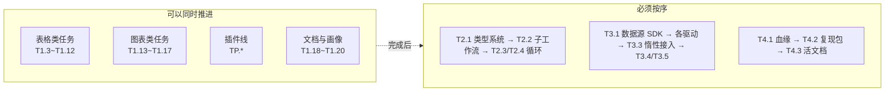

- **表格类、图表类、插件线之间没有耦合**，可以三个会话并行开工（注意每个任务一个工作树，合并时按 `AGENTS.md` 的实时状态规则走）。
- **数据源 SDK（T3.1）必须先于所有驱动任务**，否则每接一种库都要返工。
- **类型系统（T2.1）必须先于子工作流与循环**，否则端口映射会反复改。
- **血缘（T4.1）必须先于复现包与活文档**，否则后者拿不到引用关系。

**任务执行时的三个提醒**

1. **提示词需要"预热一次"**：第一次执行某类任务（比如第一个表格任务）后，把 Agent 踩到的坑与个人偏好补进 D.3 公共前缀，后续同类任务的成功率会明显提升。
2. **一个任务可以再拆**：比如 T3.7（多驱动接入）可以按驱动拆成 4 个子任务；T1.5（条件格式）可拆成「规则高亮」与「色阶/数据条」两个。拆的判据是：**能否在一次会话内完成并可独立验收**。
3. **每完成一个任务就更新本表状态**，并在 `docs/zh/reference/changelog.md` 里补一条版本记录，这样文档、代码、发布说明三者不会脱节。

**任务状态跟踪表（可复制到待办工具，或直接在本表上打勾）**

| 编号 | 任务 | 状态 | 分支 | 提交 | 备注 |
|------|------|------|------|------|------|
| T1.1 | 工作流执行 DAG 安全校验 | 未开始 | | | |
| T1.2 | 分支与汇聚语义修复 | 未开始 | | | |
| T1.3 | 表格：表头多列排序 | 已完成 | feat/table-sort-find-replace | 7e2deda0…03af698a | 列头点击排序（破坏式重排 + 置换撤销，无快照）、Shift/Ctrl 多列序号角标、拾取模式互斥、只读源守卫；样式键随 onRowsReordered 跟随、选区跟随、视口回顶；10 万行排序实测 ~15ms（≤300ms）；DATableDataTest 覆盖 |
| T1.4 | 表格：查找替换对话框 | 已完成 | feat/table-sort-find-replace | 65c20801…b0454f6e + cbb962f4 | 非模态浮动查找条（Ctrl+F/Ctrl+H/右键/Ribbon「编辑」面板）、三硬约束（去抖 350ms/请求序号丢弃过期/上限 10 万截断）、命中高亮 + 当前命中级 + 上下导航、全部替换=一个撤销单元（值记录，>100 万格降级为不可撤销 + 确认）、数值列保 dtype；同批收口删除插件 DataFrameSortDialog/DataFrameDataSearchDialog（refactor d8f2219b + docs cf457aea）；DATableDataTest 覆盖 |
| T1.5 | 表格：条件格式 | 已完成 | feat/table-conditional-format | 03574e4b…de252adb | 三类规则均按列绑定（单元格规则 7 操作符 / 双色三色色阶 / 数据条），列引用为位置键（R20，插删列重映射）；delegate 五层管线补齐②持久装饰+④数据条（求值只在 delegate 层、Qt::EditRole 取值、按列规则桶缓存、列统计走 da_column_stats 全表归约+惰性缓存、cellValueChanged 精确失效、排序不失效）；两栏编辑对话框（预览规则集实时叠加、确定按差异生成增/删/改/移/清命令入页栈、惰性/只读源色阶与数据条置灰）；<conditional-format> 段随元数据束进 table-metadata.xml（保存重开规则仍在）；入口 Ribbon Table Style「Conditional」面板 + 表体右键菜单（列头不放，R16）；5000 行 50 次跳滚+全视口重绘实测 ≤300ms 且统计零重算；DATableDataTest 新增 11 用例（另更新菜单构成等既有用例，含像素级绘制断言） |
| T1.22 | 表格：分组聚合（长表） | 未开始 | | | |
| T1.23 | 表格：计算列 / 列公式 | 未开始 | | | |
| T1.24 | 表格：填充 | 未开始 | | | |
| T1.25 | 表格：数据校验规则 | 未开始 | | | |
| T1.26 | 表格：单元格批注 | 未开始 | | | |
| T1.27 | 表格：转置 / melt 形状变换 | 未开始 | | | |
| … | （其余任务同上表逐一登记） | | | | |

> **💡 最后一句**
>
> 121 个任务听起来多，但它们每一个都是「一次会话能做完并验收」的大小。风险在**顺序**：先用第 1 期把基础补齐，后面的循环、数据接入与可复现才有稳定的地基，否则会一直在半成品上叠新概念。
