# DAWorkBench 功能全景与演进路线图

> 一份写给项目作者的功能规划参考：先把「现在有什么」画清楚，再谈「值得做什么」。

!!! note "文档定位"
    本文不是使用指南，也不是开发规范，而是一份**规划讨论稿**。它用功能分区图盘点了 DAWorkBench 当前的能力边界，从「类 Excel 数据处理」「工作流引擎」「科研级可视化」「AI 智能体」「插件生态」五个角度列出缺口，给出多期演进路线、插件候选清单和创新方向。
    文中所有「已实现 / 部分实现 / 未实现」的判断，均以当前 `dev` 分支代码与文档为准；带 ⬜ 标记的条目是**建议**，不代表已排期。

**阅读方式**：若只想看结论，直接跳到 [第四部分 演进路线](#第四部分-演进路线多期规划) 与 [第八部分 行动建议](#第八部分-行动建议)。若想评估插件方向，重点看 [第五部分 插件化机会地图](#第五部分-插件化机会地图)。

---

## 目录

- [第一部分 现状盘点：功能全景图](#第一部分-现状盘点功能全景图)
- [第二部分 缺口分析：四个对标视角](#第二部分-缺口分析四个对标视角)
- [第三部分 用户视角：谁在用、怎么用](#第三部分-用户视角谁在用怎么用)
- [第四部分 演进路线：多期规划](#第四部分-演进路线多期规划)
- [第五部分 插件化机会地图](#第五部分-插件化机会地图)
- [第六部分 创新方向畅想](#第六部分-创新方向畅想)
- [第七部分 平台架构完善建议](#第七部分-平台架构完善建议)
- [第八部分 行动建议](#第八部分-行动建议)
- [附录 A 能力成熟度评估表](#附录-a-能力成熟度评估表)
- [附录 B 竞品对照](#附录-b-竞品对照)
- [附录 C 术语表](#附录-c-术语表)

---

## 第一部分 现状盘点：功能全景图

### 1.1 这个软件到底是什么

从代码与文档出发，DAWorkBench 的定位可以这样一句话概括：

> **一个「工作流驱动 + AI 可操作」的桌面数据分析工作台**——底层是 pandas/DataFrame，中层是有向图工作流引擎，上层是交互式科研级图表，右侧常驻一个能直接操作上述一切的 AI 智能体，全部能力通过插件对外开放。

它同时是四个东西的叠加，这也是理解后续规划的关键：

| 身份 | 对标物 | 用户心智 |
|------|--------|----------|
| **DataFrame 编辑器** | Excel / WPS | "像操作表格一样操作 pandas" |
| **可视化编程环境** | KNIME / Alteryx / ComfyUI | "把重复的数据处理流程固化成图" |
| **科研绘图工具** | Origin / GraphPad / matplotlib | "鼠标拖动就能出论文级矢量图" |
| **AI 数据分析师** | ChatGPT Code Interpreter / Julius | "说人话就能分析数据、出图、写报告" |

大多数竞品只占其中一格。DAWorkBench 的独特性在于**四者可互相操作**：工作流能产出图表，Agent 能搭工作流，图表能反向驱动报告——这个「互通」本身就是最值得继续加固的护城河。

### 1.2 五大能力域全景图

下图是当前功能的区域划分。颜色语义：**绿 = 已实现且可用**、**黄 = 部分实现/有雏形**、**红 = 明显缺口**、**蓝 = 平台底座**。

各域当前完成度速览（满分 5 星，评分为「面向目标用户可用」而非「代码量」）：

| 能力域 | 完成度 | 一句话评价 |
|--------|--------|-----------|
| 插件系统与扩展点 | ⭐⭐⭐⭐⭐ | 接口成熟、热插拔、三种发现机制齐全，是本项目最扎实的部分 |
| AI Agent 平台 | ⭐⭐⭐⭐⭐ | 多会话、子 Agent、权限门、崩溃自愈都做了，深度超过多数同类软件 |
| 工作流引擎（骨架） | ⭐⭐⭐⭐ | DAG 模型、节点插件、执行回调完整；缺控制流与调试能力 |
| 可视化（绘制与交互） | ⭐⭐⭐⭐ | 22 种图型 + 拖动微调是强项；缺模板化与矢量导出 UI |
| 数据域（读写与清洗） | ⭐⭐⭐ | 算子齐全，但表格编辑器相比 Excel 仍缺一批高频操作 |
| 数据接入（外部数据源） | ⭐⭐ | 只有文件；数据库/接口/仪器接入尚未产品化 |
| 可复现与协同 | ⭐ | 工程文件可保存流程，但无血缘、无版本、无执行历史 |

### 1.3 数据域：像 Excel 一样操作 DataFrame

已实现的能力（均已可用）：

- ✅ **数据容器与管理**：`DAData` 值语义句柄 + `DADataManager` 统一注册、唯一命名、正则查找、描述文本
- ✅ **表格数据源抽象层**：`DATableDataSource` / `DATableDataBlock` 支持惰性取数与块级加载（默认 512 行），`DADataTableModel` 按滚动驱动取块 —— **这是通向数据库接入的关键地基**
- ✅ **引用式持久化**：`DADataFactory` 注册表 + 工程内 `<ref>` 存 payload，重开工程自动重建
- ✅ **导入**：csv / txt（chardet 自动探测编码，带参数对话框）/ xls / xlsx / parquet / pickle
- ✅ **导出**：csv / excel / pickle / parquet，支持多数据集合并导出到一个 Excel 工作簿
- ✅ **表格编辑**：单元格编辑、插入/删除行列、置 NaN、复制粘贴剪切、重命名列、设为 index、类型转换（数值/日期）
- ✅ **撤销重做**：十余条 `QUndoCommand`（iat/drop/rename/astype/setnan/paste/eval/cast…）+ 快照式数据撤销
- ✅ **显示样式**：行/列/单元格三级样式、列显示格式，可随工程序列化
- ✅ **清洗算子**：dropna / fillna / interpolate / drop_duplicates / 异常值剔除，以及排序、筛选、query、查找、表达式求值、透视表（含对应对话框与工作流节点）
- ✅ **Office 互通**：Windows 下 Excel / Word COM 封装（`DAAxOfficeWrapper`）

部分实现或明显缺口（详见 [2.1 节](#21-视角一当作-dataframe-编辑器还缺什么)）：条件格式仅有空扩展点、无表头点击排序、无冻结行列、无多表 join/merge、无表内查找替换对话框、无数据校验规则、无血缘。

### 1.4 工作流域：把流程固化成图

架构是**双层**的：逻辑层在 Python（`DAWorkFlowPy`：DAG 模型、Kahn 拓扑排序、执行器、信号管理器、`@NodeDef` 节点注册表），渲染层在 C++（`src/DAPyWorkFlow/`：节点图元、场景、工厂、执行桥接）。这个分工的好处是节点开发门槛极低——写个 Python 类就是节点，且能稳定兼容 Qt5/Qt6。

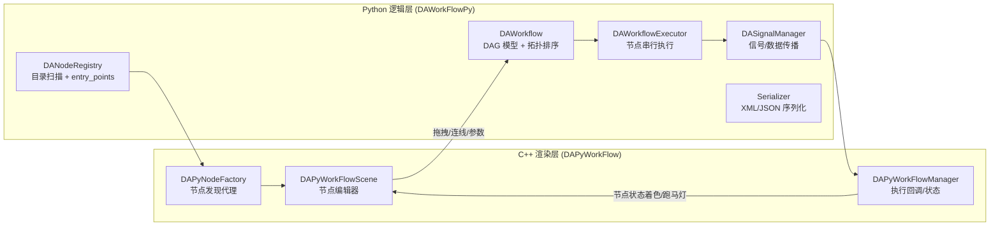

已实现：

- ✅ **节点生态**：系统节点 7 个（Start / End / If-Else / Delay / Constant / 输出到数据管理器 / 文本查看）+ 数据分析节点 21 个（数据源、导出、绘图、筛选、阈值过滤、query、查找、排序、表达式求值、透视表、描述统计、缺失值删除/填充、插值、去重、值替换、异常值剔除…）
- ✅ **编辑器**：拖拽建节点、端口连线、分组/解组、矩形与文本注释、复制粘贴（XML 剪贴板）、撤销重做、缩放、网格、执行状态着色、跑马灯连线、双击参数对话框
- ✅ **节点参数面板**：`DAFormSpec` + `DAPropertyFormWidget` 统一表单驱动，含 visible/enabled/required 声明式联动
- ✅ **执行控制**：整图后台线程执行、暂停/恢复/终止（节点边界生效）、节点级错误捕获后继续执行、执行完成信号

缺口（详见 [2.2 节](#22-视角二当作-workflow-引擎还缺什么)）：无循环/迭代、无子工作流、无运行时参数化、无执行缓存与增量重跑、无断点调试、无定时调度、无执行历史、端口无类型校验、执行路径未强制 DAG 校验（存在环路导致递归的隐患）。

### 1.5 可视化域：交互式科研绘图

这块是"手感"最强的部分：绘制能力与手工微调能力都做到了少见的水准。

- ✅ **容器**：`DAFigureWidget`（可滚动画布）内可放多个子图，2D 与 3D 混排、归一化网格布局、每个 Figure 独立 Undo 栈
- ✅ **22 种图型**：曲线、散点、柱状、多序列柱、箱线、直方、误差棒、谱图、谱曲线、交易曲线、向量场、等值线，统计类（KDE 1D/2D、ECDF、回归、热力图、箱线、散点、柱状），3D（曲面、柱状、折线）
- ✅ **交互编辑**：拖动/缩放/框选缩放、十字光标、文本原地编辑、数据探针（捕获/插值）、区域选择（矩形/椭圆/多边形）、箭头与标注、元素拖动与删除、剪贴板复制、全量撤销重做
- ✅ **属性面板**：21 类图元各有专属设置面板（曲线、标记、网格、图例、坐标轴、画布、3D 轴/色标…）
- ✅ **辅助系统**：29 种内置颜色主题 + 用户自定义、轴范围绑定 API、多子图探针联动、数据联动表（探针数据成表，可改名/隐藏/刷新）
- ✅ **脚本与 Agent 绘图**：`da_pyplot` / `da_figure` 提供 Python 侧绘图句柄；Agent 有 11 个绘图工具可直接操作真实图表

缺口（详见 [2.3 节](#23-视角三当作-科研绘图工具还缺什么)）：C++ 侧无矢量导出 UI（只有位图剪贴板；应用层未使用渲染器，PDF/SVG 目前只能走 Python `savefig` 与 Agent 工具——而所维护的 qwt 分支里 `QwtPlotRenderer` 本就支持 PDF/SVG 输出，所以这是"接线"问题而非"能力缺失"）、无图表模板/样式保存复用、无多图刷选联动、无实时/流式刷新、图表与数据源为一次性绑定（数据变更不自动更新）、无报告嵌入与批量出图。

### 1.6 Agent 域：AI 直接操作软件

这是近几轮迭代投入最重的部分，工程化程度相当高：

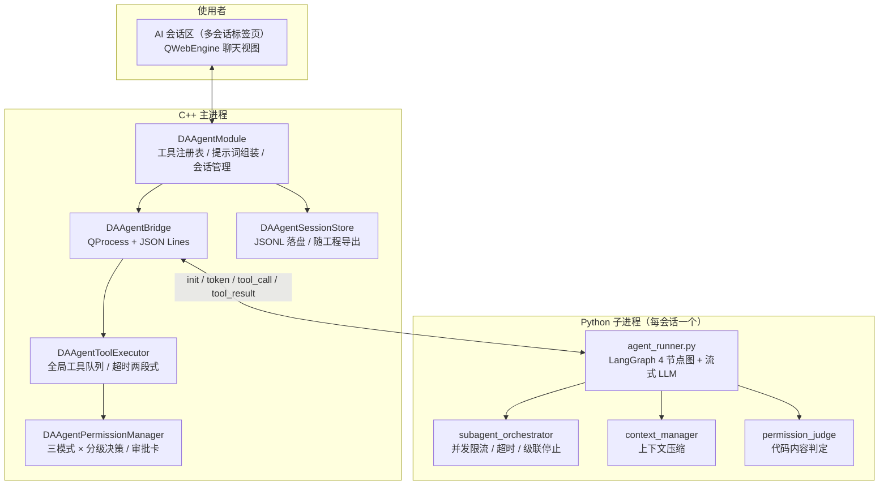

- ✅ **25 个内置工具**：数据 5 + 绘图 11 + 文件报告 3 + 代码执行 2（`DAAgentTools`、`DAPaperAgent`）+ 平台注入 2（`ask_user`、`dispatch_subagents`）
- ✅ **工具真实执行在主进程**：Agent 操作的是工作区里真实的数据集与图表部件，画完的图人能接着改
- ✅ **权限引擎**：yolo / auto / manual 三模式 × read / inapp_mutate / file_write / code_exec 分级，路径规则、审批卡、按会话记忆；代码内容静态判定由 Python 侧前置完成
- ✅ **子 Agent**：Markdown 定义库 + 结构化编辑对话框，主 Agent 可并行委派调研并汇总结论，进度可视化、任务终态自动撤卡
- ✅ **提示词库**：一个 agent 一个 Markdown 文件，管理/编辑对话框带语法高亮；插件可注入领域 agent（`DAPaperAgent` 是范例）
- ✅ **会话可靠性**：JSONL 落盘、随工程保存/恢复、token 统计、上下文自动压缩、指数退避重试、子进程崩溃自愈、看门狗防死循环、多会话后台并行运行
- ✅ **脚本工作区**：工程内 `workspace/` 目录随工程打包，脚本在持久命名空间执行并直接访问内存数据（类似 Jupyter kernel），`run_code` / `run_script` 共享变量
- ✅ **报告链路**：`save_report` 写 Markdown → 内置 Markdown 查看器（`DAGui/MarkdownView`）→ 统一导出引擎导出 HTML/PDF/Word（图片内嵌）

缺口（详见 [2.4 节](#24-视角四当作-ai-分析助手还缺什么)）：无 MCP 协议支持、无本地知识库/RAG、无跨会话长期记忆、Agent 不能生成新节点/新插件、无定时与事件触发、无工具市场。

!!! info "正在推进的方向"
    仓库内已有一份完整方案（`docs/方案/`）：把 Agent 运行时从 Python `langgraph` 替换为 C++ 原生图库 **NeoGraph**，消除每会话一个 Python 子进程的冷启动（当前 import langchain 约 16 秒），实现状态常驻内存与线程池并发推理。若落地，Agent 域的能力上限会显著提高——本路线图中「Agent 原生」相关设想都建立在这个前提之上。

### 1.7 平台域：插件、工程与底座

| 能力 | 现状 |
|------|------|
| 插件基类 | `DAAbstractPlugin`：IID/名称/版本/描述、`initialize`/`finalize` 热卸载、设置页、工程存取任务 |
| 节点插件 | `DAAbstractNodePlugin`：`createNodeFactory` / `afterLoadedNodes`，C++ 与 Python 节点统一 |
| 生命周期 | `DAPluginManager`：扫描/加载/卸载、`.pluginignore` 持久化启停 |
| Agent 扩展 | `DAAgentInterface`：`registerTool` / `registerSystemPrompt` / `registerBuiltinAgent` / `registerBuiltinSubagent` |
| UI 扩展 | `DAUIInterface`、`DARibbonAreaInterface`、`DADockingAreaInterface`、`DAActionsInterface`、`DACommandInterface`、`DADataManagerInterface`、`DAProjectInterface` |
| 发现机制 | C++ 动态库（`QPluginLoader`）× Python 包目录（`pyplugins/*`）× Python entry_points（`data_workbench.plugin`） |
| 工程文件 | `.dapro` = ZIP：工作流配置 + 数据文件 + 图表 XML + 脚本工作区 + Agent 会话 |
| 已有插件 | `DASystemNodes`、`DataAnalysis`、`DAAgentTools`、`DAPaperAgent`、`plugin-template`（脚手架） |
| 底座 | 日志（`da*` 进 UI / `q*` 只落盘）、i18n（C++ `.ts` + Python `.po`）、崩溃转储、XML 配置、颜色主题、表单引擎 |

一句话评价：**插件系统是这个项目最有杠杆的资产**。已有 5 个插件验证了「节点 / 工具 / 提示词 / 设置页 / Ribbon 按钮 / 停靠面板」这几条主要扩展路径，剩下的想象力空间在 [第五部分](#第五部分-插件化机会地图) 展开。

### 1.8 现有能力速查卡

把上面五节压缩成一张卡：看一眼就知道"今天这个软件能做什么"。

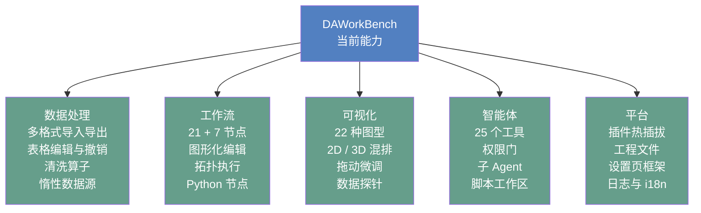

---

## 第二部分 缺口分析：四个对标视角

同一个软件，放在不同标尺下会量出不同缺口。下面四节分别把 DAWorkBench 放到 Excel、KNIME、Origin、通用 AI 助手的位置上做差集。优先级标记：**P0 = 影响现有闭环可用性**，**P1 = 明显提升竞争力**，**P2 = 锦上添花**。

### 2.1 视角一：当作 DataFrame 编辑器，还缺什么

一句话结论：**算子层已经够用，但"表格编辑器"这一层距离 Excel 的手感还差一截**——差距不在算法，而在"高频小操作"和"多表关系"上。

#### A. 查看与导航

| # | 缺口 | 现状 | 优先级 | 备注 |
|---|------|------|--------|------|
| 1 | 表头点击排序 / 多列排序 | 排序在插件对话框与工作流节点里，表头无交互 | **P0** | Excel 用户的第一反射动作 |
| 2 | 冻结行列 / 分屏 | 无 | P1 | 大表横向滚动必需的锚 |
| 3 | 列视图管理（列序、列宽、隐藏集合可保存） | 有单元格样式与列显示格式，无"视图"概念 | P1 | 与样式系统同源，可复用序列化 |
| 4 | 定位跳转 / 跳到最后一行、行号跳转 | 无 | P1 | 百万行表没有导航等于不可用 |
| 5 | 状态栏列统计（选中列显示求和/均值/计数） | 无 | P1 | Excel 用户最常用的"随手看一眼" |
| 6 | 表内快速图表预览（选中列一键迷你图） | 需走图表向导 | P2 | 与现有 `ChartAddItem` 可对接 |

#### B. 编辑与清洗

| # | 缺口 | 现状 | 优先级 | 备注 |
|---|------|------|--------|------|
| 7 | 查找 / 替换对话框（全表、支持正则） | 替换只作为工作流节点存在 | **P0** | 手动清洗的最高频操作 |
| 8 | 条件格式（色阶、数据条、规则高亮） | `DATableStyleItemDelegate` 仅有空扩展点 | **P0** | 空实现已埋好钩子，性价比极高 |
| 9 | 分组聚合 UI（groupby + 折叠显示） | 有透视表对话框，无分组视图 | P1 | 透视表的下沉形态 |
| 10 | 计算列 / 列公式（写表达式生成新列并记录依赖） | 有 `eval` 命令与表达式节点，但不是"列级公式"心智 | P1 | 是"活文档"设想的基础 |
| 11 | 文本分列 / 列拆分合并 | 无 | P1 | 原始实验数据常见 |
| 12 | 填充（向下填充、序列填充） | 无 | P2 | |
| 13 | 数据校验规则（取值范围、枚举下拉、唯一性） | 无 | P2 | 与"可复现"诉求相关 |
| 14 | 单元格批注 / 备注 | 无 | P2 | |
| 15 | 转置、melt/pivot 形状变换 | 有透视表，无 melt（宽转长） | P1 | 图表前的常见整理动作 |
| 16 | 撤销粒度与撤销列表可视化 | 有 Undo/Redo，快照式（pickle 临时文件） | P2 | 超大表下快照成本需关注 |

#### C. 多表关系（当前最大的结构性缺口）

| # | 缺口 | 现状 | 优先级 | 备注 |
|---|------|------|--------|------|
| 17 | 表关联 join / merge UI（内、左、外连接） | 全仓无 `pd.merge/join` | **P0** | 多源数据对齐的第一道门 |
| 18 | 跨表取值（类 VLOOKUP） | 无 | P1 | join 的轻量表亲版本 |
| 19 | 表间联动（选中行 → 过滤其它表 / 图表） | 无 | P1 | "交叉筛选"，是仪表盘式分析的地基 |
| 20 | 多表对比视图（两个 DataFrame 差异 diff） | 无 | P1 | 仿真-试验对比、版本对比都要用 |
| 21 | 表的血缘关系图（这张表从哪来、被谁用） | 无任何 lineage 代码 | P1 | 见 [第六部分](#第六部分-创新方向畅想) 「可复现研究单元」 |

#### D. 交付与互操作

| # | 缺口 | 现状 | 优先级 | 备注 |
|---|------|------|--------|------|
| 22 | 复制/导出为 Markdown、LaTeX、HTML 表格 | 无 | **P0** | 与已有 Markdown 导出引擎天然衔接 |
| 23 | 导出 Excel 保留样式（表头色、数字格式、列宽） | 仅导出数据 | P1 | 汇报场景刚需 |
| 24 | 表格 → 图 一步直达（选中列右键出图） | 需走 Ribbon/向导 | P2 | |
| 25 | 打印 / 页面设置 / 分页预览 | 无 | P2 | |

#### E. 数据理解（Excel 没有、但本软件该有）

| # | 缺口 | 现状 | 优先级 | 备注 |
|---|------|------|--------|------|
| 26 | 一键数据画像报告（分布、缺失、异常、类型推断） | 无 | P1 | 与 Agent 结合可做成"自动体检" |
| 27 | 缺失值可视化（缺失矩阵 / 热度条） | 只有清洗算子 | P1 | 科研数据质量第一眼 |
| 28 | 列类型推断与纠错建议 | 有类型转换，无建议 | P2 | 与 Agent 结合 |

### 2.2 视角二：当作 Workflow 引擎，还缺什么

一句话结论：**能把线性流程跑对，但"带分支、带循环、要调参、要重跑"的真实项目流程还撑不住**。

| 类别 | 缺口 | 现状与影响 | 优先级 |
|------|------|-----------|--------|
| **控制流** | 循环 / 迭代（For-Each 遍历多个数据集、列、文件） | 完全没有。批量处理 N 组数据只能手工复制 N 份流程 | **P0** |
| | While / 条件循环 | 无 | P1 |
| | 子工作流（流程封装复用、多输入多输出） | 无。复杂流程只能铺一张大图 | **P0** |
| | 分支汇聚语义 | If/Else 靠 `None` 不传播实现，未选中分支的下游会永久等待，多输入汇聚节点会挂起 | **P0**（正确性缺陷） |
| | 错误处理策略（失败继续/重试/错误端口） | 仅"记录错误继续跑"，无重试、无错误分支 | P1 |
| **参数与变量** | 运行时参数化（跑前填参数：文件路径、阈值） | 只有持久化参数，无运行时输入。这是"工作流交付给别人用"的前提 | **P0** |
| | 全局变量 / 流程变量跨节点传递 | 无 | P1 |
| **调试诊断** | 端口级结果窥视（连线上看中间数据） | 无。流程错了只能靠猜 | **P0** |
| | 断点 / 单步执行 / 只跑选中节点 | 无 | P1 |
| | 执行日志与历史记录（可回溯、可复现） | 有日志面板，无结构化执行历史 | P1 |
| **性能** | 节点级结果缓存 / 增量重跑 | 无。改一个参数要全图重算 | **P0**（大流程致命） |
| | 无依赖节点的并行调度 | 整图串行，且受 GIL 限制 | P1 |
| | 大数据集的内存与流式传输策略 | 节点间传 DataFrame 引用，缺显式的"落盘/直通"策略 | P2 |
| **运行时** | 定时调度 / 文件监听触发 | 无 | P1 |
| | 无头执行（CLI 批量跑工作流、CI 集成） | 无 | P1 |
| | 工作流级 DAG 校验强制化 | 执行路径未调用 `is_valid_dag()`，环路会递归 | **P0**（安全缺陷） |
| **编辑器** | 节点搜索框 / 对齐工具 / 缩略图 | 节点面板无搜索；有网格但吸附默认关闭且无 UI；无缩略图 | P1 |
| | 端口类型系统与连线合法性预检 | 仅查重 4 元组，无类型校验 | P1 |
| **生态** | 工作流模板 / 分享 / 市场 | 无 | P2 |
| | 工作流版本对比（diff 两张图） | 无 | P2 |

### 2.3 视角三：当作 科研绘图工具，还缺什么

一句话结论：**单张图的"画"和"调"已经很强，缺的是"批量"和"交付"**——科研用户不是画一张图，而是画 30 张同一模板的图，再拼成 6 个 panel 投稿。

| 缺口 | 现状与影响 | 优先级 |
|------|-----------|--------|
| 图表模板 / 样式主题（一次调好，批量套用） | 只有颜色主题，无"图表模板"（轴样式+线型+字体+尺寸整套） | **P0** |
| 批量出图（按分组变量一次生成 N 张图） | 无。这是科研出图最痛的点 | **P0** |
| 矢量导出 UI（PNG/PDF/SVG 一键） | C++ 侧只有位图剪贴板；PDF/SVG 走 Python `savefig` 或 Agent 工具。qwt 分支的 `QwtPlotRenderer` 已支持 PDF/SVG，应用层未使用 | **P0** |
| 多图拼版 / panel 合成（含 A/B/C 标号） | 无。投稿要求拼版 | **P0** |
| 图表模板 ↔ 数据映射（模板 + 新数据 = 新图） | 无 | P1 |
| 数据源活绑定（数据更新 → 图自动更新） | 图表创建时一次性取数，之后不联动 | P1 |
| 多图刷选联动（brush-and-link） | 区域选择器已有但 `finishSelection` 无消费者 | P1 |
| 曲线拟合 / 峰分析（线性/非线性拟合、多峰拟合、基线扣除） | 只有统计回归图（regplot 类），无交互式拟合工具 | P1 |
| 统计显著性标注（p 值条、星号） | 无 | P1 |
| 期刊预设（单栏 8.5cm、双栏 17cm、字号、DPI、字体） | 无 | P1 |
| 样式复制粘贴（Copy style / Paste style） | 无 | P2 |
| 实时 / 流式绘图（滚动窗口、动态刷新） | 无（无定时器驱动刷新） | P2 |
| 动画导出（GIF/MP4） | 无 | P2 |
| 图表与报告交叉引用（点报告里的图跳到图表区） | Agent 聊天里有链接（`da-figure:`），报告文档内没有 | P2 |
| 3D 交互增强（剖切、旋转动画、点选） | 3D 已有绘制与属性面板 | P2 |

### 2.4 视角四：当作 AI 分析助手，还缺什么

一句话结论：**Agent 的"手脚"（工具）已经很齐全，"记忆"和"外联"还是空白**。

| 缺口 | 现状与影响 | 优先级 |
|------|-----------|--------|
| MCP 协议（既作为 MCP Client 连外部工具，也作为 MCP Server 被 Claude/Cursor 调用） | 无任何相关代码。这是当前 Agent 生态的事实标准，缺失等于自绝于整个工具生态 | **P0** |
| 本地知识库 / RAG（文献、实验记录、历史报告） | 无。已有 `search_literature` 只连 CrossRef/OpenAlex 联网检索 | P1 |
| 跨会话长期记忆（用户偏好、项目常识、字段口径） | 会话内记忆有；跨会话无（权限记忆也不跨重启） | P1 |
| Agent 生成节点 / 生成插件（对话式扩展软件本体） | 无。`run_code` 只执行、不落盘成可复用资产 | P1（高创新度） |
| 会话 → 工作流 / 脚本的资产固化（把 Agent 干过的事变成可复跑流程） | 无 | **P0**（高创新度） |
| 定时 / 事件触发（"每周一早跑一遍流程并出报告"） | 无调度器 | P1 |
| 数据质量巡检 Agent（无人值守巡检 + 异常告警） | 无 | P1 |
| 多模态输入（贴一张论文图，让 Agent 反推数据/复刻样式） | 无（聊天区有图片能力未知，但无对应工具） | P2 |
| 工具 / 提示词 / 子 Agent 市场 | 无（插件文档里提过"便于构建插件市场"的愿景） | P2 |
| Agent 行为审计与成本看板（token/耗时/工具调用统计） | 有 token 累计与会话管理；无跨会话统计视图 | P2 |

### 2.5 小结：三块最短的木板

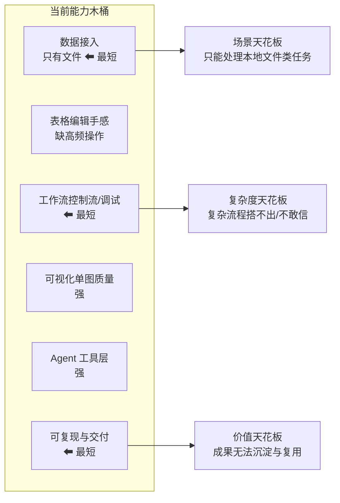

- **数据接入单一**：只能吃文件，且没有数据库/接口/仪器通道，决定了软件的场景天花板。
- **工作流缺控制流与调试**：决定了流程的复杂度天花板——超过 20 个节点的真实项目会很难维护。
- **可复现与交付缺环**：模板、批量、血缘、执行历史缺失，决定了成果能否沉淀的天花板——这正是科研/工业用户愿意付费的部分。

---

## 第三部分 用户视角：谁在用、怎么用

### 3.1 八类用户画像与诉求

| 用户 | 典型诉求 | 当前满足度 | 关键缺口 | 该给他什么 |
|------|---------|-----------|---------|-----------|
| **科研人员**（硕博、研究员） | 实验数据处理、论文级插图、可复现 | 🟡 中等 | 批量出图、模板、拟合、拼版、矢量导出 UI | 「论文一条龙」：模板化出图 + 拟合工具 + LaTeX 导出 |
| **实验/测试工程师** | 批次数据批量清洗、统一报告 | 🟡 中等 | 循环节点、调度、报告模板、通知 | 「批量产线」：For-Each + 参数化 + 定时报告 |
| **数据分析师 / 业务** | 类 Excel 操作、汇总、看板 | 🟡 中等 | 排序/替换/条件格式/join、仪表盘 | 「表格编辑器补完」+ 交叉筛选联动 |
| **工艺 / 质量工程师** | SPC、异常追溯、趋势预警 | 🔴 偏低 | SPC 工具、控制图、异常告警、台账 | SPC 插件 + 巡检 Agent + 台账 |
| **算法 / 建模工程师** | 特征工程、模型训练、预测 | 🔴 偏低 | ML 节点、模型管理、预测回写 | 机器学习插件 + 工作流化建模 |
| **插件开发者 / 生态伙伴** | SDK、文档、调试、分发 | 🟢 较高 | 插件市场、文档补全、示例库 | 开发者门户 + 插件市场基建 |
| **团队负责人 / 实验室管理者** | 资产沉淀、共享、权限、审计 | 🔴 偏低 | 工程版本化、模板库、审计日志、协作 | 团队资产库 + 版本化 + 权限 |
| **教师 / 学生** | 教学演示、学 pandas、复现实验 | 🟡 中等 | 步骤回放、讲解模式、示例工程集 | 教学包：示例工程 + 工作流回放 |

### 3.2 四个场景走查：现状能走到哪一步，卡在哪

#### 场景 A：从实验数据到论文插图

**卡点**：批量出图、拼版、导出 UI 三个断点都在最后交付段——单图质量已经够，交付效率不够。
**可复用资产**：`DAFigureWidget` 的 Undo 栈 + XML 序列化已经支持"图表即配置"，做模板化只需把"配置"抽象成模板并参数化数据映射。

#### 场景 B：工业质检日报（批次数据 → 报告）

现状：导入、清洗、统计、出图都能做；**卡在"每天自动跑一遍"和"结果自动送到人面前"**——无调度、无通知、无报告模板。用 Agent 可以人肉触发一次完整流程，但无法无人值守。
**最小可行路径**：`For-Each 节点（遍历目录）` + `工作流参数化（日期）` + `调度器` + `报告模板` + `通知插件`。

#### 场景 C：仿真数据与试验数据对比

现状：两个数据集可以各自导入、各自出图，但**"对齐比较"这一步缺工具**——无 join/merge、无插值对齐、无差异视图、无对比图模板。
**这个场景是本项目 README 明确提到的目标（一维仿真建模）**，建议单独做一组「对比分析节点」：时间轴对齐、误差指标（RMSE/相对误差）、Bland-Altman 图、残差图、包络图。

#### 场景 D：数据库取数分析（类 Navicat 设想）

现状：**完全空白**——但地基已经具备（见 [5.3 节](#53-重点畅想navicat-类数据库插件)）。这是本路线图中**投入产出比最高的新增方向之一**：接入数据库后，软件从"文件分析工具"升级为"数据平台前端"。

---

## 第四部分 演进路线：多期规划

### 4.1 路线总览

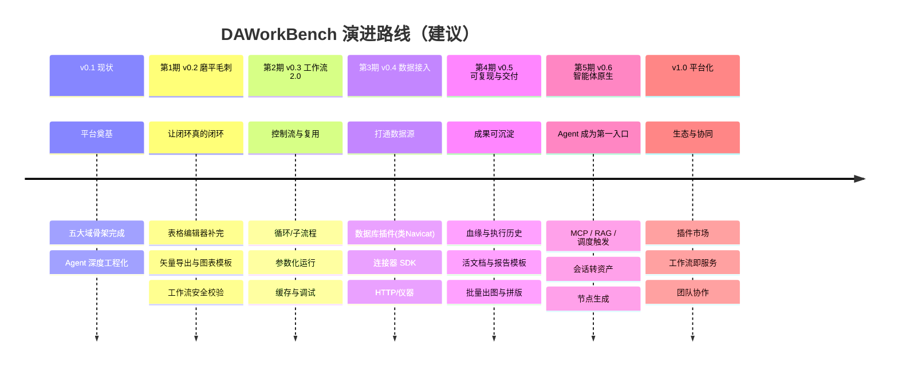

### 4.2 第 1 期（v0.2）「磨平毛刺」—— 让已有闭环真正闭环

!!! abstract "本期定位"
    不加新概念，只把现有四大板块里"差最后一步"的地方补齐。目标是让一个科研用户从导入数据到导出论文图，全程不需要离开软件、不需要写 Python、不需要猜测。

| 关键特性 | 为什么现在做 | 涉及模块 | 验收标准 |
|---------|-------------|---------|---------|
| 表头排序、查找替换、条件格式 | 表格编辑器的三个最高频动作，且条件格式已有空扩展点 | `DAData/`、`DAGui/Models`、`DATableStyleItemDelegate` | 无需开对话框即可完成排序/查找/高亮 |
| 矢量导出 UI（PNG/PDF/SVG 带 DPI/尺寸选项） | 现有能力只暴露给 Python/Agent，普通用户拿不到；渲染层可直接复用 qwt 的 `QwtPlotRenderer` | `DAFigure/`、`DAGui/Chart`、`src/3rdparty/qwt` | 图表区一键导出 300dpi PDF/SVG |
| 图表模板与批量套用 | 科研用户真正的出图方式 | `DAFigure/`（配置抽象）+ `DAGui/ChartSetting` | 存模板 → 换数据集一键出图 |
| 表格复制为 Markdown/LaTeX | 与已有 Markdown 导出引擎衔接，成本极低 | `DAGui/` + `DAMarkdownExporter` | 选中区域右键复制为 Markdown 表 |
| 工作流执行安全：强制 DAG 校验 + 汇聚语义修正 | 当前环路会递归、分支汇聚会挂起，属正确性缺陷 | `DAWorkFlowPy/executor.py`、`workflow.py` | 非法图拒绝执行并给出可读提示；分支汇聚不再挂起 |
| 文档与实现对齐（矢量导出、探针表导出等已存在的差异） | 文档承诺的功能找不到入口会伤害信任 | `docs/zh/use-guide/` | 文档所述功能均可在 UI 找到，或标注"仅脚本可用" |

**风险**：条件格式与样式系统耦合较深，需先确认 `DATableStyleManager` 的序列化扩展点。
**本期刻意不做**：控制流、数据库、MCP —— 先把地基夯实，避免半成品概念堆积。

### 4.3 第 2 期（v0.3）「工作流 2.0」—— 从"能跑"到"敢用"

!!! abstract "本期定位"
    把工作流从"线性脚本可视化"升级为"能表达真实项目流程"的引擎。这一期的成果会直接放大后续所有能力（批量出图、定时报告、数据接入）的价值。

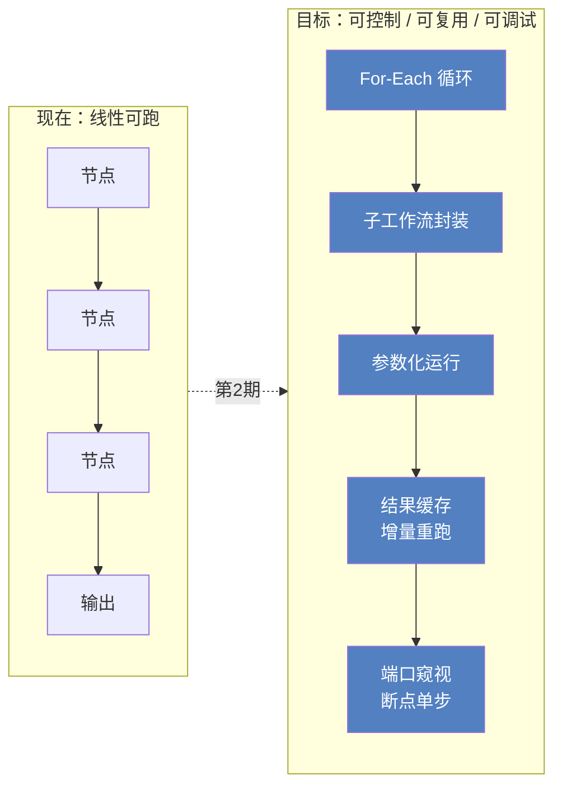

| 关键特性 | 设计要点 | 涉及模块 |
|---------|---------|---------|
| **For-Each / While 循环节点** | 循环体建议实现为"子工作流引用"，避免在单图内画循环体导致图形爆炸 | `DAWorkFlowPy`（执行器/模型）+ `DAPyWorkFlow`（图元渲染） |
| **子工作流节点（Meta Node）** | 工作流可被引用为节点，端口映射 + 参数映射；这是复用的核心 | `DAWorkFlowPy`、`DAPyNodeFactory` |
| **运行时参数化运行** | 跑前弹参数对话框（文件路径、阈值、日期…），支持"用上次值/存为预设" | `DAGui/NodeSetting` 表单引擎可复用 |
| **节点级缓存与增量重跑** | 以"节点内容哈希 + 上游哈希"为键缓存输出，改一个参数只重算受影响子图 | 新增缓存层（建议放 L2 功能层） |
| **调试能力** | 端口数据窥视浮窗、单步、只跑选中子图 | `DAWorkFlowPy` + `DAPyWorkFlow` |
| **错误策略** | 节点级 fail-fast / 继续 / 重试 N 次 / 错误端口输出 | `executor.py` |
| **编辑器体验** | 节点搜索、对齐吸附开关、缩略图、连线类型校验 | `DAGraphicsView`、`DAPyWorkFlow` |

**验收标准**：一个 50 节点的流程，改中间一个参数后只重算下游、并在 3 秒内看到端口数据。
**风险**：缓存键的正确性（哈希要覆盖参数、代码版本、上游数据），建议第一版只缓存显式标记的节点。

### 4.4 第 3 期（v0.4）「数据接入」—— 从文件工具到数据平台

!!! abstract "本期定位"
    数据接入是本项目最大的空白。表格数据源抽象层（惰性 + 块级取数 + 引用式持久化）已经把地基打好，且有 SQLite 惰性表的技术样板，缺的只是产品化。

| 关键特性 | 设计要点 |
|---------|---------|
| **数据库连接器插件**（SQLite / DuckDB / PostgreSQL / MySQL / SQL Server / ODBC） | 见 [5.3 节](#53-重点畅想navicat-类数据库插件) 完整设计 |
| **连接器 SDK 与数据源节点** | 把"数据源"抽象出插件接口：`listTables / schemaOf / query / lazyTable`，工作流节点与数据管理器共用 |
| **通用 HTTP / REST 数据源** | 支持 JSON/CSV 接口轮询拉取 |
| **仪器与实时数据通道** | 串口 / Modbus / OPC UA 采集卡接入（工业场景），落地为"流式数据源" |
| **SQL 节点** | 在工作流里写 SQL 取数 → DataFrame → 后续分析 |
| **凭据安全** | 复用已有 DPAPI 加密思路（参考 LLM API key 落盘方案） |

**验收标准**：用户在数据管理器里新增一个 PostgreSQL 连接，浏览表结构，把一张百万行表以惰性方式拖进工作区，绘图与工作流全部可用，且工程文件里只保存连接引用而不保存全量数据。
**风险**：数据库驱动分发与许可（部分驱动 GPL）、跨平台驱动可用性；建议优先 DuckDB（本地列式，零运维）+ SQLite，再扩 JDBC/ODBC 通用通道。

### 4.5 第 4 期（v0.5）「可复现与交付」—— 让成果可沉淀

!!! abstract "本期定位"
    这一期直接对应科研与工业用户付费意愿最强的部分：**可复现、可追溯、可交付**。

| 关键特性 | 说明 |
|---------|------|
| **数据血缘与影响分析** | 记录"表 ← 节点 ← 表 / 图 ← 数据"的引用图；改一列能告诉你哪些图与报告受影响 |
| **执行历史与复现** | 每次工作流运行记录：输入哈希、参数、节点耗时、产物指针；可一键复现历史某次结果 |
| **活文档 / 活报告** | 报告中的图表为动态引用而非静态截图，数据变化后报告可一键刷新（与 Markdown 导出引擎衔接） |
| **批量出图与拼版** | 模板 × 分组变量 → N 张图；多图拼版为多 panel 的 PDF |
| **工作流与应用打包导出** | 把工程导出为"可执行分析包"（含参数表单），交付给不会用软件的人也敢用 |
| **工程版本化** | 与 Git 集成或内置快照：流程 + 图表配置 + 报告可 diff |

**验收标准**：产出一份可交互的 HTML 报告，包含实时数据摘要与图表，数据更新后可一键重生成。

### 4.6 第 5 期（v0.6）「智能体原生」—— Agent 成为第一入口

!!! abstract "本期定位"
    现在 Agent 是"辅助功能"：用户从 Ribbon 找按钮，Agent 帮忙。目标是反转——**用户先说需求，Agent 搭好流程与图表，人再接管微调**。

| 关键特性 | 说明 |
|---------|------|
| **MCP 双向** | 作为 Client 连接外部 MCP 工具（文件系统、数据库、内部系统）；作为 Server 暴露本平台能力，让 Claude/Cursor 等直接操作工程 |
| **本地知识库 / RAG** | 索引文献、实验记录、历史报告与数据字典，让分析有"上下文" |
| **会话转资产** | 把一次成功的分析对话，一键转为可复跑的工作流或脚本节点（trace → workflow） |
| **Agent 生成节点** | 对话生成 Python 节点包并安装进工作区（含 i18n、NodeDef 声明、测试）。**这是"软件自我扩展"的起点** |
| **调度与事件触发** | 定时 / 文件落地 / 数据更新触发 Agent 任务；结合巡检 Agent 实现无人值守 |
| **跨会话长期记忆** | 项目偏好、字段口径、命名习惯沉淀到工程或用户级记忆 |
| **成本与审计看板** | token、耗时、工具调用分布、审批记录 |

### 4.7 v1.0「平台化与生态」

- **插件市场**：插件元数据、版本、依赖、签名、一键安装，配合评分与评论
- **工作流即服务**：把工作流发布为 REST/gRPC 端点或定时任务，供外部系统调用
- **团队协作**：工程共享、评论批注、审阅流程、权限分级
- **行业解决方案包**：把「提示词 + 工作流模板 + 插件 + 示例数据」打包成行业方案（材料、新能源、生物、汽车测试…）
- **云端/多端**：工程与资产云同步（可选自托管），移动端看报告

---

## 第五部分 插件化机会地图

### 5.1 一个插件能挂在哪里

插件系统是本项目**最有杠杆的资产**：它把"我该做什么功能"这个问题，变成了"别人能帮我做什么功能"。当前一个插件可以做的六件事，已经有对应范例验证：

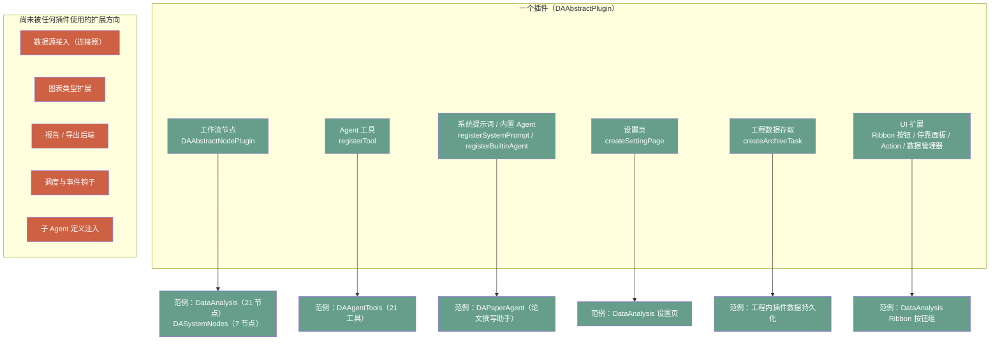

**结论**：M1～M5 这五个"尚无插件占用"的扩展方向，正是下一批插件最有价值的位置——尤其 **M1 数据源接入**，因为它同时补齐了[第二部分](#第二部分-缺口分析四个对标视角)里最短的一块木板。

### 5.2 插件候选清单

下表按主题分组，给出**目标用户 / 价值 / 依赖的底层能力 / 难度 / 优先级**。难度是相对值：★ = 一个插件模板改造即可，★★★★★ = 需要先补平台能力。

#### A. 数据接入类（价值最高、当前最空）

| 插件 | 目标用户 | 价值 | 依赖底层能力 | 难度 | 优先级 |
|------|---------|------|-------------|------|--------|
| **数据库连接器（类 Navicat）** | 全部 | ⭐⭐⭐⭐⭐ 打开企业数据场景 | 表格数据源抽象层（已有）+ 连接管理 UI | ★★★★ | **P0** |
| **DuckDB / 列式分析引擎** | 分析师、科研 | ⭐⭐⭐⭐⭐ 零运维本地 SQL，百万行秒级 | DuckDB 库 + 同上 | ★★ | **P0** |
| **通用 HTTP / REST 数据源** | 工程师 | ⭐⭐⭐⭐ 对接内部接口/云服务 | 网络请求 + JSON→DataFrame | ★★ | P1 |
| **仪器与实时通道**（串口 / Modbus / OPC UA） | 工业、实验 | ⭐⭐⭐⭐⭐ 打通数据源头 | 流式数据源抽象（需新增） | ★★★★ | P1 |
| **Excel 深度互通**（保留格式双向同步、多 sheet 映射） | 业务用户 | ⭐⭐⭐⭐ Excel 是现实世界的通用交换格式 | `DAAxOfficeWrapper`（已有） | ★★★ | P1 |
| **时序数据库**（InfluxDB / TDengine） | 工业 | ⭐⭐⭐ 时序数据专门优化 | 同数据库连接器 | ★★★ | P2 |
| **文件批量导入向导**（目录扫描 + 命名规则解析 + 合并） | 全部 | ⭐⭐⭐⭐ 实验数据常见形态 | 导入器 + For-Each 节点 | ★★ | P1 |

#### B. 分析与算法类

| 插件 | 目标用户 | 价值 | 依赖底层能力 | 难度 | 优先级 |
|------|---------|------|-------------|------|--------|
| **机器学习**（scikit-learn 节点：建模/训练/评估/预测回写） | 算法、科研 | ⭐⭐⭐⭐⭐ 从描述分析到预测分析 | Python 节点（已有）+ 模型存储 | ★★★ | **P0** |
| **信号处理**（FFT、滤波、小波、包络、阶次分析） | 工程、振动 | ⭐⭐⭐⭐⭐ 工程数据分析刚需 | scipy + 节点 | ★★ | P1 |
| **统计过程控制 SPC**（控制图、能力指数、MSA） | 质量工程师 | ⭐⭐⭐⭐⭐ 制造业付费意愿强 | 统计计算 + 图表 | ★★★ | P1 |
| **曲线拟合与峰分析**（非线性拟合、多峰、基线） | 科研 | ⭐⭐⭐⭐⭐ 与可视化域联动 | scipy.optimize + DAFigure 交互 | ★★★★ | P1 |
| **试验设计 DOE / 优化求解** | 研发 | ⭐⭐⭐⭐ 研发流程上游 | scipy + 统计 | ★★★★ | P2 |
| **图像分析**（OpenCV：尺寸测量、缺陷检测、批量图像特征） | 材料、制造 | ⭐⭐⭐⭐ 图像类实验数据 | opencv-python | ★★★ | P2 |
| **地理信息 / 地图可视化** | 地学、环境 | ⭐⭐⭐ 垂直场景 | 地图控件 + 渲染器 | ★★★★ | P2 |
| **生信 / 化学 / 材料领域包** | 垂直科研 | ⭐⭐⭐⭐ 垂直领域护城河 | 领域库（Biopython、RDKit…） | ★★★★ | P2 |

#### C. 可视化增强类

| 插件 | 价值 | 依赖底层能力 | 难度 | 优先级 |
|------|------|-------------|------|--------|
| **期刊出图套件**（模板库 + 尺寸/字体预设 + 拼版 + panel 标号） | ⭐⭐⭐⭐⭐ 论文交付闭环 | 图表模板系统（需先做） | ★★★ | **P0** |
| **图表模板商店**（配色 + 样式预设社区分享） | ⭐⭐⭐ | 模板序列化格式 | ★★ | P2 |
| **高级图型包**（桑基图、旭日图、小提琴图、树图、网络图） | ⭐⭐⭐ | 新图元渲染 | ★★★ | P2 |
| **动画与实时可视化**（动态曲线、批量 GIF/MP4） | ⭐⭐⭐ | 定时刷新 + 帧导出 | ★★★ | P2 |
| **报告级看板**（多图 + 指标卡，自动刷新） | ⭐⭐⭐⭐ | 报告引擎（第 4 期） | ★★★★ | P1 |

#### D. 报告与交付类

| 插件 | 价值 | 依赖底层能力 | 难度 | 优先级 |
|------|------|-------------|------|--------|
| **LaTeX / 论文导出**（图表编号、交叉引用、bib 支持） | ⭐⭐⭐⭐⭐ 科研刚需 | Markdown 导出引擎（已有）+ 模板 | ★★ | P1 |
| **PPT 汇报包**（一页一图 + 结论模板） | ⭐⭐⭐⭐ 企业汇报 | 已有导出引擎 + 模板 | ★★ | P1 |
| **通知与告警**（邮件 / 企业微信 / 钉钉 / Webhook） | ⭐⭐⭐⭐ 无人值守闭环 | 调度器（需先做） | ★★ | P1 |
| **数据脱敏与合规导出** | ⭐⭐⭐ 企业 | 列级规则 | ★★ | P2 |

#### E. 工程与协作类

| 插件 | 价值 | 依赖底层能力 | 难度 | 优先级 |
|------|------|-------------|------|--------|
| **工程版本化 / Git 集成**（流程、图表、报告 diff） | ⭐⭐⭐⭐ | 工程文件已 ZIP 化，易 diff | ★★★ | P1 |
| **任务中心与调度**（定时、依赖、重试、失败告警） | ⭐⭐⭐⭐⭐ 自动化闭环 | 需平台调度器 | ★★★★ | P1 |
| **团队资产库**（模板、提示词、工作流、插件包共享） | ⭐⭐⭐⭐ | 市场基建 | ★★★★ | P2 |
| **审计与操作日志**（谁改了哪个数据/流程） | ⭐⭐⭐⭐ 受监管行业 | 事件总线 | ★★★ | P2 |

#### F. Agent 能力类

| 插件 | 价值 | 依赖底层能力 | 难度 | 优先级 |
|------|------|-------------|------|--------|
| **MCP 桥**（Client + Server 双向） | ⭐⭐⭐⭐⭐ 接入整个 Agent 生态 | Agent 接口（已有） | ★★★ | **P0** |
| **本地知识库 / RAG**（文献、记录、口径文档） | ⭐⭐⭐⭐ 专业分析需要上下文 | 向量库 + 嵌入模型 | ★★★★ | P1 |
| **代码生成器**（对话生成 Python 节点包并安装） | ⭐⭐⭐⭐⭐ 软件自我扩展 | 脚本工作区 + 插件目录写入 | ★★★★ | P1 |
| **领域 Agent 包**（行业提示词 + 工具组合，如"电池测试分析助手"） | ⭐⭐⭐⭐⭐ 低成本高感知 | `registerBuiltinAgent`（已有） | ★★ | **P0** |
| **Agent 评测台**（提示词 A/B、工具调用回放评分） | ⭐⭐⭐ 质量保障 | 会话存储（已有） | ★★★ | P2 |

### 5.3 重点畅想：Navicat 类数据库插件

这是你提到的想法。我的判断是：**值得做，而且它比"做一个 Navicat"更有价值——因为你做的不是数据库管理软件，而是"数据库直连的数据分析软件"**。Navicat 管数据，DAWorkBench 用数据；两者结合处正是竞品的空白。

#### 5.3.1 为什么在这个项目里成立

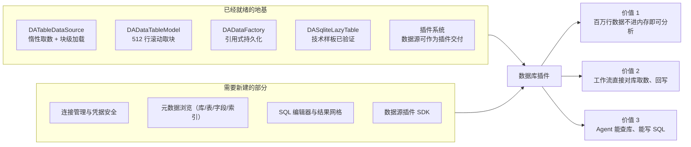

关键事实（来自代码调研）：
- ✅ 表格数据源抽象层**已完成并测试**：`DATableDataSource` / `DATableDataBlock` 支持惰性取数与块级加载，`DADataTableModel` 已按滚动驱动取块（默认 512 行）
- ✅ **引用式持久化已落地**：工程文件里只存引用 payload，重开工程自动重建（`DAAppProject.cpp` 的 `<ref>` 机制）
- ✅ **已有 SQLite 惰性表的技术样板**（测试模块中的 `DASqliteLazyTable`，用 QtSql 实现 `COUNT(*)` + `LIMIT/OFFSET` 只读惰性表）
- ⬜ 生产代码中**没有任何数据库连接、驱动、连接管理 UI** —— 产品化是从 0 到 1，但起点不是 0

#### 5.3.2 分四级功能（建议按级交付）

| 级别 | 能力 | 说明 | 难度 |
|------|------|------|------|
| **L1 只读接入** | 连接管理 + 表浏览 + 拖表进工作区（惰性）+ 建图 | 一上来就解决"百万行数据"的核心痛点；连接信息加密存储 | ★★★ |
| **L2 查询分析** | SQL 编辑器（语法高亮、补全、执行计划）+ 结果网格 + 结果送数据分析/工作流 | 补全可复用 `DAMarkdownHighlighter` 的同类思路；结果网格复用现有表格组件 | ★★★ |
| **L3 工作流集成** | SQL 查询节点、SQL 写入节点、库表作为工作流数据源 | 让"取数 → 清洗 → 出图 → 报告"成为一条可复用流程 | ★★ |
| **L4 管理能力** | 表结构设计、DDL 生成、索引、数据同步/迁移、ER 图 | 到这里才真正对标 Navicat 的管理面——建议作为远期，不做主线 | ★★★★ |

#### 5.3.3 与 Navicat 的差异化定位

| 维度 | Navicat | 本插件应走的路 |
|------|---------|---------------|
| 核心场景 | 库的日常管理（建表、改数据、权限） | **取数 → 分析 → 出图 → 报告** 的端到端 |
| 数据处理 | 简单过滤排序 | 完整 DataFrame 算子 + 工作流 + Agent |
| 输出 | 导出文件 | 论文级图表、可交互报告、可复跑流程 |
| 大数据 | 分页浏览 | 惰性块取数 + 列式引擎（DuckDB）下推计算 |
| AI | 少量 SQL 生成辅助 | **Agent 直接查库、解释数据、生成分析流程** |

#### 5.3.4 工程要点与风险

- **驱动选型**：优先 **DuckDB**（本地列式、零运维、Apache 许可）+ **SQLite**（QtSql 已内建）+ **PostgreSQL**（libpq，许可友好）+ **通用 ODBC**（一份代码覆盖 SQL Server / Oracle / 达梦等）。MySQL 驱动注意 GPL 传染性（可用 MariaDB Connector/C 规避）。
- **凭据安全**：复用已有的 Windows DPAPI 加密落盘方案（LLM API key 的先例），跨平台备用方案用系统密钥环。
- **工程文件策略**：数据库数据集**只存连接引用与查询语句**，绝不存数据副本；这与已有的引用式持久化设计完美契合。
- **计算下推**：筛选、聚合尽量下推到 SQL（`WHERE` / `GROUP BY`），只把结果拉进 DataFrame —— 这是"数据库直连分析"相对"导出 CSV 再分析"的根本优势。
- **不做什么**：不建议做数据库运维（备份、主从、用户授权）——那是 DBA 工具的领域，投入大且偏离主线。
- **与 Agent 的天然结合**：加 3 个工具（`list_db_connections` / `describe_table` / `run_query`）就能让 Agent 具备"自己取数分析"的能力，这是**插件系统、Agent 平台、数据源抽象层三者交汇的最佳演示**。

### 5.4 插件优先级矩阵

!!! note "关于下图的语言"
    mermaid 的 `quadrantChart` 词法分析器不接受中文出现在坐标轴标签、象限标题与数据点名称里（只有图标题可以中文），因此下图用英文标签，中文对照见其后表格。若将来 mermaid 修复该限制，可直接替换回中文。

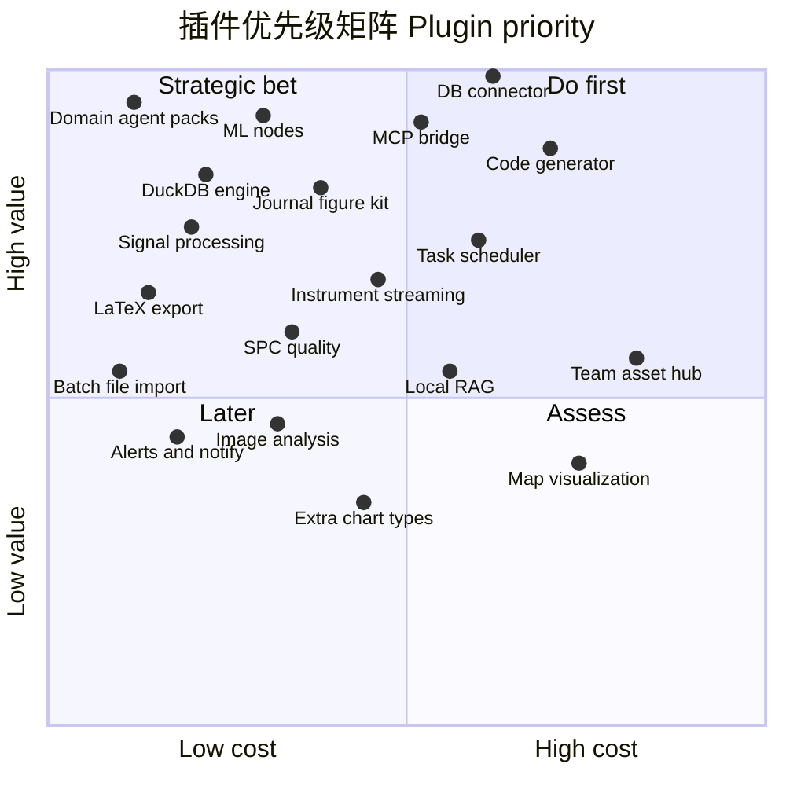

| 图中标签 | 对应插件 | 图中标签 | 对应插件 |
|---------|---------|---------|---------|
| Domain agent packs | 领域 Agent 包 | Instrument streaming | 仪器实时通道 |
| DuckDB engine | DuckDB 列式引擎 | Code generator | 代码生成器 |
| DB connector | 数据库连接器 | Local RAG | 本地知识库 |
| MCP bridge | MCP 桥 | Task scheduler | 任务中心与调度 |
| ML nodes | 机器学习节点 | Image analysis | 图像分析 |
| Journal figure kit | 期刊出图套件 | Map visualization | 地图可视化 |
| LaTeX export | LaTeX 导出 | Extra chart types | 高级图型包 |
| Signal processing | 信号处理 | Team asset hub | 团队资产库 |
| SPC quality | SPC 质量控制 | Alerts and notify | 通知与告警 |
| Batch file import | 文件批量导入 | | |

---

## 第六部分 创新方向畅想

前面是"补课"，这一部分是"超车"。以下 13 个方向，按**这个项目独有的优势**筛选过——只有那些"因为你有工作流 + 可视化 + Agent + 插件四件套才成立"的想法才列入。

### ① 可复现研究单元（Research Bundle） ★★★★☆ 创新度 · ★★★ 难度

**概念**：把「数据 + 工作流 + 图表配置 + 报告 + 运行环境指纹」打成一个可复现包，任何人打开都能一键重跑出同样结果，并可对比"我的结果 vs 你的结果"。

**为什么在本项目成立**：工程文件 `.dapro` 已经是 ZIP 且已包含数据、流程、图表、脚本工作区、Agent 会话——它是天然的复现包载体；缺的只是**执行记录与校验**（输入指纹、参数、代码版本、产物哈希）。

**最小可行**：工作流运行后写一条结构化记录（时间、参数、输入哈希、输出摘要、耗时），在工程里展示"运行履历"，并支持"用这份履历重跑"。

### ② 工作流即 API / 无头执行 ★★★★☆ 创新度 · ★★★ 难度

**概念**：一个工作流可以被"发布"为一组参数化入口：命令行、HTTP 端点、或定时任务。别人不需要打开软件，就能用你的分析流程。

**为什么成立**：工作流逻辑层本就在 Python，脱离 GUI 执行障碍很小；缺的是运行时参数化（第 2 期）与无头入口。

**最小可行**：`DAWorkBench --run-workflow project.dapro --workflow main --param date=2026-01-01 --out result/`，先支持 CLI，再考虑 HTTP。

### ③ 活文档 / 活报告 ★★★★★ 创新度 · ★★★★ 难度

**概念**：报告里的图和数字不是截图，而是**引用**。数据更新后，报告一键刷新；点击报告里的图，直接跳转到图表区对应的图并高亮。

**为什么成立**：已有 Markdown 查看器 + 统一导出引擎（HTML/PDF/Word，图片内嵌）+ Agent 聊天里的 `da-figure:` / `da-data:` 链接机制，把链接能力从聊天搬到报告是自然的延伸。

**最小可行**：报告 Markdown 支持 `` 语法，导出时实时渲染图表快照并建立双向跳转。

### ④ 对话即资产：把 Agent 的探索固化为流程 ★★★★★ 创新度 · ★★★★ 难度

**概念**：你让 Agent 做了一次成功的分析，**这次的步骤可以一键转成工作流或脚本节点**，下次换数据直接跑。这是"探索"到"生产"的关键一跃，也是通用 AI 助手做不到的事。

**为什么成立**：Agent 的工具调用已经结构化（`tool_call` / `tool_result` 成对落盘），把 tool 序列映射成节点序列在技术上完全可行；`run_code` 的代码也可提升为脚本节点。

**最小可行**：会话管理里加"从本次会话生成工作流"，做工具→节点的映射表，无法映射的步骤降级为一个 `run_code` 节点并保留代码。

### ⑤ 数据血缘与影响分析 ★★★★ 创新度 · ★★★ 难度

**概念**：改一列，先告诉你"会影响哪 3 张图、2 份报告、1 个工作流"；反过来，任何一张图都能追溯"我是从哪张表、哪次运行来的"。

**为什么成立**：数据、图表、工作流都已在同一进程内统一管理（`DADataManager` / `DAAgentTools` / 工作流模型），只需在数据引用处记录边。这也是"可复现"的必备基础设施。

### ⑥ AI 数据管家（常驻巡检） ★★★★★ 创新度 · ★★★★ 难度

**概念**：一个不打扰你、但会主动汇报的 Agent：每天巡检工作区数据（缺失率突增、异常值、分布漂移、文件更新），生成一份"数据健康简报"；发现异常时可自动跑一段诊断工作流。

**为什么成立**：已有子 Agent 编排、权限门、会话持久化、报告链路；缺的只是调度触发（第 5 期）。

### ⑦ 图表工厂 ★★★★☆ 创新度 · ★★★ 难度

**概念**：定义一次"图表配方"（模板 + 分组变量 + 命名规则），把 20 组数据一次性生成风格完全一致的 20 张图，并自动拼版成多 panel 图。

**为什么成立**：图表已是可序列化配置（XML 存进工程），把"配置"参数化成"模板 + 数据映射"即可；这是科研出图的真实工作方式。

### ⑧ 跨软件桥（MCP Server 模式） ★★★★☆ 创新度 · ★★ 难度

**概念**：让 Claude / Cursor / 公司内部 Agent 反过来调用本平台的工具——"帮我用 DAWorkBench 打开那个工程，画一张 X 对 Y 的图"。

**为什么成立**：`DAAgentInterface` 的工具注册表已经是中立的 JSON schema，暴露为 MCP Server 几乎是配置工作；MCP Client 方向则能瞬间获得海量外部工具。

### ⑨ 仿真-试验闭环 ★★★★ 创新度 · ★★★ 难度

**概念**：面向"一维仿真 vs 台架试验"的专用对比族：时间轴对齐、误差指标（RMSE/峰值误差/相位差）、Bland-Altman、残差趋势、包络图，并自动生成对比结论草稿。

**为什么成立**：README 明确的原始目标之一；`join`/对比视图缺口一旦补上，这组节点就是水到渠成的组合拳，且竞品少有覆盖。

### ⑩ 实时数据流分析 ★★★★ 创新度 · ★★★★ 难度

**概念**：串口/DAQ/OPC UA 的数据流实时进图：滚动窗口、实时指标、超限告警；同一张图既做实时监视，又能冻结下来做离线分析。

**为什么成立**：图表与数据处理都在同一进程，实时数据只是"多了一个持续追加的 DataFrame 源"；这是工业现场最愿意买单的形态。

### ⑪ 插件市场与节点生态 ★★★☆ 创新度 · ★★★★ 难度

**概念**：插件/节点/提示词/模板都是可分享资产，带元数据、版本、依赖与评分；用户能一键安装"某实验室出品的电池测试分析包"。

**为什么成立**：三种插件发现机制已经齐备（动态库、pyplugins、entry_points），市场只是分发层；难点在生态运营而非技术。

### ⑫ 教学与演示模式 ★★★★ 创新度 · ★★ 难度

**概念**：工作流可"回放"：按执行顺序逐步高亮节点、展示每个节点前后数据的变化，配文字讲解；适合课堂教学与团队内训。

**为什么成立**：节点状态着色与跑马灯连线已实现，回放只是把"已发生的事件序列"重演一遍；而"数据怎么一步步变干净"正是教学最难讲清的部分。

### ⑬ 实验室数字台账（ELN 融合） ★★★★ 创新度 · ★★★★ 难度

**概念**：把每次工作流运行登记为一条台账（谁、何时、用了哪批数据、参数、产物、结论），可检索、可追溯到原始数据文件，成为实验室的电子实验记录。

**为什么成立**：这是"运行履历 + 血缘 + 报告"三者合并后的产品形态，直接切入科研合规（原始记录可追溯）的刚性需求，也是把个人工具升级为团队工具的抓手。

---

## 第七部分 平台架构完善建议

### 7.1 八项需要补齐的平台底座

这些不是"功能"，而是让上面所有功能能低成本实现的地基。**建议的落位遵循项目五层架构铁律**（下层不得依赖上层）。

| # | 底座 | 解决什么 | 建议落位 | 最小接口 |
|---|------|---------|---------|---------|
| 1 | **任务与调度中心** | 定时运行、依赖编排、失败重试、进度与取消 | L2 功能层新建 `DATaskScheduler`（无 GUI 依赖）+ APP 层提供 UI | `schedule(task, cron \| trigger)`、`cancel(id)`、`stateChanged` 信号 |
| 2 | **节点结果缓存层** | 增量重跑、大流程可维护 | L2（DAPyWorkFlow 侧或独立缓存服务） | `key = hash(nodeDef + params + upstreamHashes)`、`get/put/invalidate` |
| 3 | **端口类型系统 / 数据契约** | 连线合法性校验、节点自描述、错误前置 | Python 逻辑层（`node_def.py`）声明 + C++ 渲染层消费 | `Input/Output(type=...)`、类型兼容表 |
| 4 | **事件总线与通知中心** | 插件解耦（谁都可以订阅"数据变更/流程完成"）、告警外发 | L1/L2（`DAMessageHandler` 旁） | `subscribe(topic)`、`publish(event)` |
| 5 | **血缘与元数据服务** | 影响分析、可复现、台账 | L2（与 `DADataManager` 同级） | `recordEdge(from, to, kind)`、`queryUpstream(id)` |
| 6 | **数据源插件 SDK** | 数据库/接口/仪器统一的接入抽象 | L2（扩展 `DATableDataSource`）+ 插件头文件 | `IDataSourcePlugin`：`listTables/schema/query/lazyTable` |
| 7 | **插件市场基建** | 分发、版本、依赖、签名、评分 | L4（DAPluginSupport）+ 远端服务 | 插件元数据 Schema、安装/更新 API |
| 8 | **测试与金标准数据** | 让重构敢做、让算法可信 | `src/tst/` 扩展 | 每个算子一组 golden case；工作流端到端用例工程 |

### 7.2 新增模块的落位图

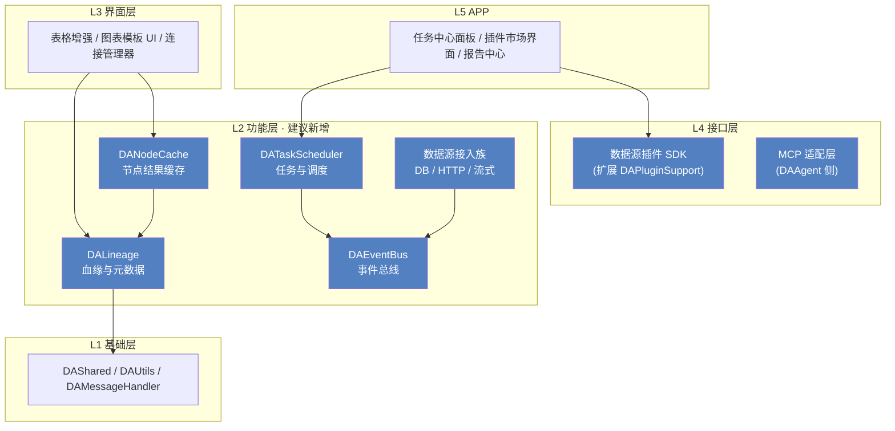

### 7.3 建议优先处理的技术债

| 债务 | 影响 | 建议 |
|------|------|------|
| 工作流执行未强制 DAG 校验（`is_valid_dag()` 未接入执行路径） | 环路会递归，可能挂死 | 第 1 期立刻做，成本极低 |
| If/Else 分支未选中时下游永久等待、多输入汇聚挂起 | 复杂流程图不可用 | 引入显式的"空值传播"语义或分支汇聚节点 |
| 图表与数据一次性绑定（创建后不联动） | 数据修正后图仍是旧值，易误导 | 引入数据源句柄 + 主动刷新；也是"活文档"的前置条件 |
| 矢量导出、探针表导出等能力只在 Python/Agent 侧，UI 无入口 | 文档与实现不符，用户找不到；导出渲染器其实已具备（qwt `QwtPlotRenderer` 支持 PDF/SVG） | 第 1 期补 UI，或文档明确标注"仅脚本可用" |
| 快照式撤销（pickle 全量）在大数据集下的成本 | 大表编辑可能变卡 | 评估增量撤销或分块快照；必要时限制快照粒度 |
| 文档中提到的 `CrewAIAdapter` 插件实际不存在 | 期望管理 | 文档修正或补实现 |
| 节点串行执行 + GIL | 大流程慢 | 第 2 期随缓存与并行调度一起解 |

---

## 第八部分 行动建议

### 8.1 价值 × 成本矩阵（平台级功能）

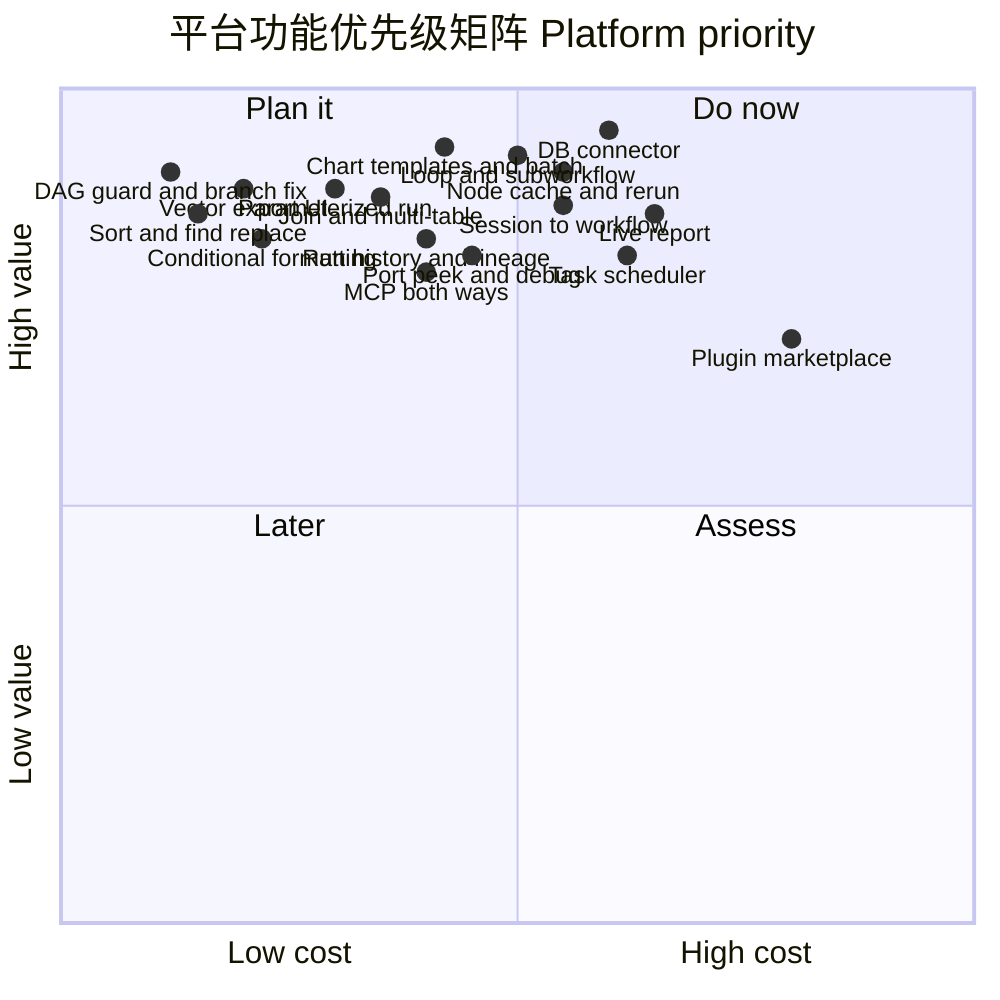

| 图中标签 | 对应功能 | 图中标签 | 对应功能 |
|---------|---------|---------|---------|
| Sort and find replace | 表头排序与表内查找替换 | DB connector | 数据库连接器 |
| Conditional formatting | 条件格式 | Run history and lineage | 运行履历与血缘 |
| DAG guard and branch fix | DAG 校验与分支语义修复 | Live report | 活报告 |
| Vector export UI | 矢量导出 UI | Session to workflow | 会话转工作流 |
| Chart templates and batch | 图表模板与批量出图 | Task scheduler | 任务中心与调度 |
| Join and multi-table | join 与多表关系 | MCP both ways | MCP 双向 |
| Loop and subworkflow | 循环与子工作流 | Plugin marketplace | 插件市场 |
| Parameterized run | 参数化运行 | Node cache and rerun | 节点缓存与增量重跑 |
| Port peek and debug | 端口窥视与断点 | | |

### 8.2 未来两周就能落地的 5 件事

1. **工作流安全兜底**：执行前调用 `is_valid_dag()`，非法图给出可读提示并拒绝执行（半天，消除一个会挂死的缺陷）。
2. **表头排序 + 表内查找替换**：表格编辑器的两个最高频动作（复用已有命令体系，2～3 天）。
3. **条件格式落地**：`paintConditionalFormat` 空钩子已存在，先做"大于/小于/区间高亮 + 色阶"（3～5 天）。
4. **矢量导出 UI**：把 qwt 的 `QwtPlotRenderer`（PDF/SVG）或 Python 侧 `savefig` 接到图表区导出按钮，带 DPI/尺寸选项（2 天，直接兑现已有文档承诺）。
5. **领域 Agent 包**：用 `registerBuiltinAgent`（`DAPaperAgent` 已验证）做一个面向你自己实验数据的 agent —— 成本最低、感知最强，且能立刻验证"提示词 → 工具 → 报告"这条链路。

### 8.3 需要你先拍板的五个问题

| 问题 | 选项与影响 |
|------|-----------|
| **① 主线定位** | A. 深耕科研（出图/拟合/可复现/论文交付） B. 转向工业数据分析（仪器接入/SPC/实时） C. 做通用平台（都做但都浅）。**影响**：第 3 期之后的路线分叉。建议 A 为基本盘，B 作为插件生态承接。 |
| **② 数据库插件是核心功能还是示例插件** | 核心 → 进主仓、跟随版本、享受首等公民待遇；示例插件 → 放到 `plugins/` 独立演进，也顺便验证插件 SDK 是否够用。**建议：先独立插件形态，验证后再考虑提升。** |
| **③ Agent 是否作为第一入口** | 若"是"，UI 与文档的重心要从"按钮菜单"转向"对话 + 模板"，第 5 期优先级提前。**建议：并行入口**——保留完整手动路径，因为专业用户对可控性要求高。 |
| **④ 生态策略** | 是否要做插件市场与社区？做则需先定插件元数据规范、版本兼容策略与签名机制。**建议：先内部模板库（团队资产库），市场留到 v1.0。** |
| **⑤ 开源与商业边界** | 核心 LGPL 开源 + 行业解决方案/插件包商业模式；或纯开源。**影响**：插件市场、云同步、协作功能的设计取向。 |

---

## 附录 A 能力成熟度评估表

评分口径：0 = 无，1 = 雏形，2 = 可用但有明显缺口，3 = 可用，4 = 完善，5 = 领先。

| 维度 | 得分 | 说明 |
|------|------|------|
| 插件架构 | 5 | 三种发现机制 + 六类扩展点 + 热插拔 |
| Agent 工程化 | 5 | 权限、会话、子 Agent、崩溃自愈、上下文压缩 |
| Agent 工具覆盖 | 4 | 25 个工具，缺 MCP 与知识库 |
| 图表绘制能力 | 4 | 22 种图型、2D/3D 混排 |
| 图表交互编辑 | 5 | 拖动微调、探针、撤销栈是同类少见 |
| 图表交付链路 | 1 | 模板/批量/拼版/矢量导出 UI 全缺 |
| 数据读写 | 4 | 格式覆盖广，含 Office COM |
| 表格编辑体验 | 2 | 缺排序/替换/条件格式/冻结/join |
| 数据接入广度 | 1 | 仅文件；数据库/接口/仪器全空 |
| 数据源抽象层 | 4 | 惰性 + 块取数 + 引用持久化已就绪 |
| 工作流编辑体验 | 4 | 分组、复制粘贴、撤销、参数表单完备 |
| 工作流控制流 | 1 | 无循环、无子流程、分支语义有缺陷 |
| 工作流运维能力 | 1 | 无调度、无历史、无缓存、无无头执行 |
| 可复现与血缘 | 1 | 仅工程文件保存流程 |
| 交付与报告 | 3 | Markdown 查看器 + HTML/PDF/Word 导出引擎 |
| 协作与共享 | 0 | 无 |
| 国际化与文档 | 4 | 中英双语 + 完整文档站（个别处与实现有偏差） |
| 测试基建 | 3 | 有 Qt Test 模块与 CI，覆盖率未系统化 |

**读法**：得分 ≤ 2 的维度就是"最快能带来体感提升"的投入方向 —— 交付链路、表格编辑、数据接入、控制流、运维能力、可复现。

## 附录 B 竞品对照

| 能力 | Excel | KNIME / Alteryx | Origin / GraphPad | Jupyter | 通用 AI 助手 | **DAWorkBench 现状** |
|------|-------|-----------------|-------------------|---------|-------------|---------------------|
| 表格编辑手感 | 标杆 | 弱 | 中 | 无 | 无 | 中（缺高频操作） |
| 大数据量 | 差 | 强 | 中 | 中 | 中 | 强（亿行级） |
| 工作流自动化 | 宏/VBA | 标杆 | 弱 | 需编程 | 无 | 中（缺控制流/调试） |
| 论文级出图 | 差 | 中 | 标杆 | 需编程（matplotlib） | 中 | 强（单图）/ 弱（批量交付） |
| 图表手工微调 | 中 | 弱 | 强 | 无 | 无 | 强 |
| AI 直接操作软件 | 中（Copilot） | 弱 | 弱 | 中 | 强（但只能产出文件） | **强（操作真实对象）** |
| 数据接入广度 | 中 | 强 | 中 | 强（靠库） | 中 | **弱（仅文件）** |
| 插件化扩展 | 中 | 强 | 中 | 强 | 弱 | 强 |
| 可复现性 | 弱 | 中 | 弱 | 中 | 弱 | **弱** |
| 数据库直连分析 | 弱 | 中 | 弱 | 中 | 弱 | **无** |

**差异化机会**：把"AI 直接操作软件对象"与"可交互微调"结合，是当前市场少有的组合；补上数据接入与可复现后，会形成竞品难以复制的完整体验。

## 附录 C 术语表

| 术语 | 含义 |
|------|------|
| **节点（Node）** | 工作流中的一个处理步骤，由 `@NodeDef` 声明端口与参数 |
| **端口（Port）** | 节点间的数据连接点，分输入/输出，当前无类型校验 |
| **For-Each / 子工作流** | 本文建议的新概念：循环节点与可被引用为节点的工作流（Meta Node） |
| **惰性表（Lazy Table）** | 只在可见区域取数的数据源，避免全部载入内存 |
| **引用式持久化** | 工程文件不存数据副本，只存引用，打开时重建 |
| **血缘（Lineage）** | 数据从哪来、被谁使用的引用图 |
| **活文档（Live Doc）** | 内嵌动态引用而非静态截图的报告 |
| **图表配方 / 模板** | 可参数化复用的图表样式配置 |
| **MCP** | Model Context Protocol，Agent 与外部工具互操作的事实标准 |
| **RAG** | 检索增强生成，给 Agent 提供本地知识上下文 |
| **Trace → Workflow** | 把 Agent 的工具调用轨迹固化为可复跑工作流 |

---

!!! tip "这份文档怎么用"
    建议把它当成**待办池**而不是**计划书**：每完成一项就在对应表格里改状态；每个版本发布前重读一遍「附录 A 成熟度表」，用得分变化检验方向是否正确。文档中的判断基于 2026-10 的 `dev` 分支状态，若实现有推进，请同步修订，避免规划与代码脱节。

