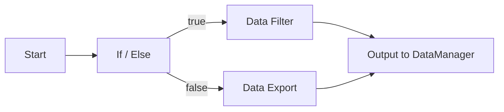

# 工作流基础

工作流把数据处理的过程画成一张图：每个节点负责一步处理，节点之间的连线表示数据从哪里来、到哪里去。参数改一处，整条流程就能重跑一遍。这一章讲从新建工作流开始到看见运行结果的完整过程：往画布上放节点、连接端口、在设置面板里填参数、点运行，以及数据在运行时怎样在节点之间流动、出错时停在哪一步。

每个节点有哪些参数、参数的取值范围是什么意思，在[系统节点手册](nodes-system.md)和[数据分析节点手册](nodes-analysis.md)里逐个说明，这一章不重复。画布上的复制、撤销、缩放、分组、背景和导出图片见[编辑器功能](editor.md)。

## 工作流是什么

一张工作流由节点和连接组成。连线有方向，从上游节点的输出端口连到下游节点的输入端口，按设计形成一张有向无环图。软件在运行前不检查图里有没有环，环的后果见下面的常见问题。

画布上的每个节点由几部分组成：左上角的图标和节点名称，主体上按行显示带默认值或当前值的参数名和值（最多十行，超出部分显示省略号），左右两侧各一排小方块就是端口的落点，每个端口旁边写着端口名（比如 `data`、`filtered`）。节点主体的形状随类型变化，条件分支画成菱形，多数节点是圆角矩形。

工作流显示在中央的「Workflow Operate / 工作流操作」停靠区里，一个工作流占一个标签页。多个工作流可以并排分屏摆在这个停靠区里，不能拖出去变成独立窗口。一个工程里可以放多个工作流，互相之间完全独立：节点、参数、连线、运行结果都不共享，每个工作流还有自己的撤销栈，在 A 标签页里按撤销不会影响 B 标签页。

参与编辑工作流的三个面板分别是：左侧的「Workflow Node / 节点」面板列出可拖进画布的节点，中间的「Workflow Operate / 工作流操作」区是画布本身，右侧的「Setting / 设置」面板显示选中对象的参数。这三个面板都可以被关掉，关掉以后在「View / 视图」标签页的「Display / 视图显示」面板里用「Show Workflow Area / 工作流操作视图」和「Show Workflow Manager / 工作流管理视图」找回前两个，设置面板用同一个面板里的「Show Setting Window / 设置窗口」找回。

## 新建工作流

新建入口在主页「Main / 主页」的「Create / 创建」面板里，按钮是「New Workflow / 新建工作流」，和 Add Data、Add Figure 放在一起。

点击后弹出命名对话框，标题是「Title of new workflow / 新工作流标题」，输入框前面的标签是「Title: / 标题:」。输入名称并确认，就多出一个工作流标签页，标签页标题就是刚输入的名称；点取消或者名称留空，都不会创建工作流。新建的工作流立即成为当前工作流。

这个名称同时写进工程：工作流的逻辑和画布数据分别记在工程的两份文件里，两份文件都带着这个名称，工作流数量多的时候靠它对应两份文件里的同一条记录。

软件启动时已经建好一个工作流，名称是「Untitled / 未命名」，可以直接在上面画流程。这个初始工作流是在节点全部登记完成后才建的，因此打开软件就能在节点面板里看到所有可用的节点。

## 放置节点

节点放在左侧的「Workflow Node / 节点」停靠面板里，从面板里把节点拖到画布上松开，节点就落在松手的位置。拖动时鼠标上会跟着节点的图标。

面板顶部有两个按钮切换节点的显示方式。工具箱方式把每个分组做成一个可折叠的页，点分组标题展开；树方式把分组做成顶层节点，展开后看到组内的节点。两种方式列出的节点完全相同，都按节点定义里的分组名分组，随软件发布的节点分成六个分组，名称是「系统 · 流程控制」「系统 · 数据」「系统 · 显示」「数据分析」「数据清洗」「数据操作」（源码里分别写作 `System / Flow Control`、`System / Data`、`System / Display`、`Data Analysis`、`Data Cleaning`、`Data Operations`，中文界面显示翻译后的名称）。鼠标停在节点上会弹出提示气泡，内容是节点名称和这个节点做什么。

面板里没有名称搜索框，找节点靠展开分组，或者把它加进收藏。收藏页在工具箱方式下排在所有分组页之后，在树方式下排在最前面。

- 在节点上点右键，选「Favorite / 收藏」把节点加进收藏；选「Remove Favorite / 移除收藏」把它移出收藏。
- 右键菜单只在工具箱显示方式下弹出。在收藏页里点右键，「Favorite」是灰的，「Remove Favorite」可用。
- 收藏是给节点做的快捷入口，收藏页里的节点和分组页里的节点相同，拖到画布上没有区别，也不随工程保存。

同一张画布上可以放多个节点，同一个节点也可以放多个副本。每放一个就多一个独立的节点实例，参数各自填写、各自保存，互不影响。节点落在画布上之后可以拖动改位置；选中后会显示一圈控制点，拖这些点可以改节点主体的大小。

## 节点列表里有哪些节点

节点在面板里显示英文名称，界面翻译不翻译节点名，中文界面上看到的名字同样是 Start、If / Else 这样的英文，分组名则跟着界面语言翻译；鼠标停在节点上时提示气泡里会给出一句这个节点做什么的说明。随软件发布的节点分成六个分组，每个节点的参数说明在两本手册里。

「系统 · 流程控制」是流程控制，四个节点：Start 向下游发送一个启动信号，End 接住上游数据表示流程结束，If / Else 按条件把数据送到 `true` 或 `false` 两个输出端口之一，Delay 等待指定的秒数之后把输入原样传给下游。

「系统 · 数据」是数据进出，两个节点：Constant 输出一个自己填的常量值，Output to DataManager 把收到的数据发布到数据管理面板。

「系统 · 显示」是显示，一个节点：Text Viewer 把收到的数据画在节点主体上，用来在画布上直接看中间结果。

「数据分析」「数据清洗」「数据操作」三个分组来自数据分析插件，共二十一个节点。「数据分析」组的五个是读文件（Data Source）、筛选（Data Filter）、变换（Data Transform）、导出（Data Export）和绘图（Data Plot）；「数据清洗」组的九个是 Drop Duplicates、Drop NA、Fill NA、Interpolate、Remove Outliers IQR、Remove Outliers Z-Score、Replace Values、Threshold Filter、Transform Skewed；「数据操作」组的七个是 Filter By Column、Query、Search、Describe、Pivot Table、Sort、Eval Expression。

分组里没有的节点不会出现在面板上。启用和停用插件会改变这份清单，改动是否需要重启软件分插件类型，见[插件管理](../plugin/manager.md)。

## 连接端口

节点两侧的小方块是端口，左侧是输入端口，右侧是输出端口，端口名写在方块的旁边。连接的做法是：先点一下上游节点的输出端口，再点一下目标节点的输入端口，两个端口之间就出现一条连线。连线默认是曲线，箭头画在接收端，顺着箭头读就是数据流动的方向。连接过程中按 Esc 取消。选中一条连线按 Delete 可以删掉它。

关于端口有几点需要注意，这些行为在源码里就是这样实现的：

- 端口不检查数据类型。输出端口标着 DataFrame 的节点，可以连到输入端口标着 any 的节点，也可以连到别的标签，连接本身不会被拒绝。数据能不能用，取决于下游节点拿到数据之后怎么处理。
- 一个输入端口可以接多条连线。上游有几个节点，下游节点就会收到几次数据。
- 一个输出端口也可以接多条连线。同一个结果发给两个下游时不必复制节点，从同一个输出端口再拉一条线即可，两个下游各自收到同一份数据。
- 同一对端口重复连线是唯一被拒绝的情况。再次点一遍已经连过的输出端口和输入端口，Python 侧会抛出 `ValueError("Connection already exists: ...")`，这条重复的连接不会进工作流的连接表，运行时不参与数据传递。

Ribbon 上下文标签「Workflow Edit / 编辑」页的「Item / 图元」面板里有一个「Link / 连线」开关，默认打开。关掉它以后，点端口不再拉出连线，适合在已经连好线的图上调整布局时避免误连。

重复连接同一对端口时不会弹出提示框，但画布上会照样画出第二条线，它没有接进工作流；「Log / 消息」面板里会出现一行「添加节点连接线失败」的警告。画布上看不出哪条线是多余的，连之前先核对一下更稳妥。

连线只能整体删除，不能把某一头改接到别的端口。连错目标时，先选中这条线按 Delete 删掉，再从正确的端口重新连一遍；删一条线不影响两端的节点。

## 设置节点参数

选中画布上的节点，右侧「Setting / 设置」停靠面板会切到这个节点的页面，页签依次是「Parameters / 参数」「Node / 节点」「Item / 图元」「Link / 连线」「Picture / 图片」，可用与否跟当前选中的对象有关：参数页一直可选（没有选中节点时显示占位文字），选中节点时节点页和图元页一起可用，选中连线时只有连线页可用，选中图片图元时图元页和图片页可用。节点自己的参数全部在第一个页签里，按名称一行一个，改完立即写进节点。

双击画布上的节点，可以直接把设置面板切到「Parameters」页，参数多的时候省去找页签的动作。没有选中任何节点时，参数页显示「No node selected / 未选中节点」。

每个参数用哪种控件输入，由节点定义里的参数类型决定。内置的编辑器类型有十一种：`str` 用单行输入框，`int` 用整数框，`float` 用小数框，`bool` 用复选框，`enum` 用下拉框，`list` 用列表加按钮，`file` 和 `folder` 用带浏览按钮的路径输入，`color` 用取色按钮，`font` 用字体设置面板，`code` 用可以换行的多行输入框。参数在节点主体上显示成「名称: 值」。

刚拖到画布上的节点，每个参数都是节点定义里写好的默认值，参数框里看到的就是当前值。默认值是多少在两本手册里逐个列出，比如 Data Filter 的 `condition` 默认是空的，Text Viewer 的 `max_text_length` 默认是 200。

`code` 类型是其中特殊的一种：填进去的内容按 Python 字面量理解。Constant 节点的 `value` 就是这种类型，填 `1` 得到数字，填 `'hello'` 得到字符串，填 `[1, 2, 3]` 得到列表；填成 `1+2` 这种算式时求值失败，`value` 就退化成字符串 `1+2` 本身，下游收到的是这四个字符。

参数值跟着工作流一起保存，重新打开工程后参数还在。参数只影响下一次运行，改完参数不会清掉画布上留下的运行状态颜色。参数改动不进撤销栈，按撤销不会把参数改回上一个值。改动参数之后，节点主体上显示的那一行文字立即刷新成新值；参与运行的仍是运行开始那一刻的参数。

参数在节点主体上只画十行，超出的参数不显示在画布上，要看完整的参数在设置面板里看。哪些参数画在节点主体上由节点定义决定，自定义节点时可以逐个选择，见[开发自定义节点](custom-node.md)。参数页旁边的「Node / 节点」页显示的是节点的身份信息：原型（节点的限定名，比如 `DASystemNodes.TextViewer`）、分组，以及这个节点实例的名称。原型和分组是只读的，名称一栏可以改，改完立即写进的是节点实例；名称用于区分同一种节点放在画布上的多个副本。

## 第一个工作流：读一个文件并留下结果

一个能跑通的最小流程是「读文件，筛一遍，把结果放进数据管理面板」。以下步骤里用到的参数，完整说明在两本节点手册里。

1. 从节点面板的「Data Analysis」分组里拖出 Data Source 节点（从文件读入数据的那一个），放在画布左侧。
2. 选中它，在设置面板的参数页里填 `file_path`，点浏览按钮选一个 CSV 或 Excel 文件；`file_type` 选 `csv` 或 `excel`，要和选中的文件类型一致。
3. 再拖出 Data Filter 节点（按条件筛选行），放在 Data Source 右侧。
4. 点 Data Source 的输出端口 `data`，再点 Data Filter 的输入端口 `data`，两个节点连上。
5. 选中 Data Filter，在参数页里填 `condition`，写法是 pandas 的查询表达式，比如 `age > 25`，列名用数据里真实存在的列。
6. 拖出 Output to DataManager 节点，放在最右侧，把 Data Filter 的输出端口 `filtered` 连到它的输入端口 `data`。
7. 选中它，把 `data_name` 改成想要的名字，默认值是 `workflow_output`。
8. 保存工程，然后点「Run Workflow / 运行工作流」。

跑完之后，三个节点都带上绿色边框，「Data Manager / 数据管理」面板里出现 `data_name` 指定的那个数据集，双击它可以打开表格视图。想换筛选条件，改 `condition` 再点一次运行，同名数据集会被重新写入。

## 运行工作流

运行入口在 Ribbon 右侧的「Workflow / 工作流」上下文标签里，切到「Workflow Run / 运行」页，「Run / 运行」面板上的大按钮是「Run Workflow / 运行工作流」。这个上下文标签只在工作流区获得焦点时出现，切到别的区域（数据表、绘图）会换成对应的标签页。

运行前必须先保存过工程。工程还没有保存过时点运行，会弹出一个标题为「Warning / 警告」的提示框，内容是「Before running the workflow, you need to save the project / 在运行工作流之前，需要先保存工程」，工作流不会启动。工程保存过一次（有了文件名）之后就能运行，之后再改节点参数不需要每次重新保存，运行时用的是内存里的当前状态。

点击运行后工作流立即开始，一直到跑完为止都在界面线程上执行。这段时间主窗口不响应鼠标和键盘，画布也不会刷新：节点颜色的变化要等运行结束后才一次性画出来，运行期间看不出卡在哪一步。流程越长、节点里读写的文件越大，界面卡住的时间越长。

运行会让节点按状态改颜色，所有变化都画成节点主体外面的一圈边框：

| 状态 | 边框颜色 | 含义 |
|------|----------|------|
| 等待 | 黄色半透明 | 本次运行会执行到它，但上游的数据还没有到齐 |
| 运行中 | 绿色半透明 | 正在执行这个节点 |
| 成功 | 绿色 | 已经执行完，且没有报错 |
| 出错 | 红色 | 执行时返回失败或者抛出异常 |
| 跳过 | 灰色 | 节点被跳过的状态 |

「跳过」这个颜色在界面上不会出现：执行器只会把节点标成等待、运行中、成功、出错四种状态，灰色是预留给跳过用的。这四种状态在运行过程中依次更新，但画布不重画，看到的是整张图跑完之后的最终结果：成功的节点留下绿框，失败的节点留下红框，没有执行到的节点还是等待的黄框。带自定义绘制的节点正常情况下不画这圈边框（文本显示节点就是），它的颜色变化看不到。画布上没有进度条，底部状态栏上的进度只用于工程的保存和读取。

「Terminate Workflow / 结束」按钮在当前版本里没有实现，而且是灰的、点不动：按钮背后那段代码只会写一行「Workflow termination has not been implemented yet / 工作流终止功能尚未实现」的提示，界面上没有能触发它的入口。界面上也没有暂停和恢复。

## 一次运行的完整过程

点击运行之后，软件按下面的顺序推进，中途不会停下来问任何问题：

1. 所有节点先在内部被标成等待状态；画布不重画，这一步的颜色变化看不到。
2. 从没有输入的节点开始执行：起点、数据源、常量，以及任何没有连上线的孤立节点。
3. 节点执行完，输出沿着连线送给下游；下游节点收齐它每条上游连线送来的数据后开始执行，如此一路往下推。
4. 每个节点执行完都记下自己的状态和执行结果；画布要等整张图跑完之后才统一重画，带自定义绘制的节点（文本显示节点）在主体上显示最后一次收到的数据。
5. 没有可以继续执行的节点之后，本次运行结束。成功结束没有额外提示，失败时「Log / 消息」面板里出现一行「Workflow execution failed / 工作流执行失败」。

运行前软件不做任何前置检查：不检查有没有没连线的节点、不检查参数有没有填全、不检查图里有没有环。参数填错、文件路径写错这类问题，都要等执行到那个节点时才暴露出来。

## 数据在运行时怎样流动

一个节点执行完之后，把它每个输出端口上的数据送出去。下游节点每收到一条从上游连接送来的数据就记一次数，当收到的次数等于连到它输入端口上的连线总数时，这个节点才开始执行。换成操作上的说法：想让一个节点跑起来，就把它每个输入端口上连着的上游节点都跑一遍并送出数据。一个节点的多个输出端口会分别送出各自的数据，下游按端口名各取所需。

输出端口上没有数据的连接不会唤醒下游。端口为空（Python 里是 `None`）时这一路什么都不发，下游节点的计数到不了总数，就停在那里不执行。条件分支节点（If / Else）就是靠这个机制选路的：它根据输入的条件往 `true` 和 `false` 两个输出端口中的一个写数据，另一个端口留空，于是只有被选中的那一路继续往下走。

数据在节点之间按对象传递，这条路上不做复制。几个下游节点从一个输出端口拿到的都是同一份数据，节点内部如果对传入的数据做了就地修改，改动会跟着这份数据走到其它下游节点。需要保留原样的地方，要在节点里自己产生一份新的数据。

下图是一个用条件分支分两路的例子，画的是节点和连接的方向，不是画布上的实际排布。Start 执行后向下游送出一个触发信号，条件分支按这个信号（非空为真）只填满 `true` 和 `false` 两个输出端口里的一个，另一个留空，只有被选中的那一路继续往下走。图里没有画 `data` 端口的来源：要传的数据得自己接到这个端口上，否则被选中的那一路输出的也是空值，下游同样不会执行，完整的接法见下面的第二个例子。

执行顺序由连接决定，与节点在画布上放在什么位置无关。画布左边的不一定先跑，右下的不一定后跑。按同样道理，一个节点如果什么都不输出（比如终点节点 End，它的作用只是接住上游数据），它的下游就没有数据可收，也就不会执行。

## 第二个例子：用条件分支选一条路

这个例子只用常量（Constant）、条件分支（If / Else）和文本显示（Text Viewer）三种节点，用来在画布上直接看到分支是怎么选的。

1. 拖两个 Constant 节点到画布左侧。一个的 `value` 填 `True`，另一个的 `value` 填 `'true-branch'`（带引号的写法表示字符串）。Constant 的 `value` 按 Python 字面量求值，所以 `True` 得到布尔值真，带引号的文本得到字符串。
2. 拖一个 If / Else 节点，把两个常量的输出端口 `value` 分别接到它的输入端口：填 `True` 的那个接 `condition`，填字符串的那个接 `data`。
3. 拖两个 Text Viewer 节点，把 If / Else 的 `true` 输出端口接到其中一个的输入端口 `value`，`false` 输出端口接到另一个。
4. 保存工程，点运行。结果是：接 `true` 的那个文本显示节点上出现 `true-branch`，接 `false` 的那个节点没有执行，主体上还是占位文字。
5. 把填 `True` 的常量改成 `False`，再运行一次。这次 `false` 那一路显示内容，`true` 那一路不执行，主体上留着上一轮执行时缓存的 `true-branch`。

条件端口按「非空为真」解释：填 `1`、非空字符串、非空列表都算真，只有空值、`0`、`False` 算假。另外，被选中的那一路输出的是 `data` 端口收到的数据，`data` 端口没接东西时匹配的分支输出空值，下游同样不执行，看起来和分支没生效一样。

刚拖到画布上还没有运行过的文本显示节点，主体上写着 `(no data)`（中文界面显示 `(无数据)`），运行之后才换成收到的数据。

## 出错时发生什么

某个节点执行失败时，这个节点变成出错的红色边框，它下游的节点不会被执行，因为从它这里没有数据送出去。

执行不会因此停下来。其余已经具备执行条件的节点照常跑完，整条流程结束后，运行结果算作失败，「Log / 消息」面板里会出现一行「Workflow execution failed / 工作流执行失败」。

失败的细节不会出现在画布上，也不在「Log / 消息」面板里。具体的错误文本（哪一个节点、抛了什么异常）由 C++ 侧的 `DAPyWorkFlowManager::executeWorkflow` 通过 `qCritical()` 写进日志文件，文件位置是 `%APPDATA%\DAWorkBench\log\da_log.log`；节点自己打印的 Python 输出（比如节点里写了 `print`）写在同目录的 `da_pyscript.log` 里，异常本身不进这个文件。自定义节点如果自己写了绘制回调并且在绘制时抛异常，节点主体上会额外出现一圈二像素的红色边框和一行红色的「Error」。

一次运行里的失败不会留下重试机制：失败的节点就是失败了，下游也永远不会被这次运行唤醒。修好参数或者数据之后重新点运行，整张图从头再跑一遍。

## 运行失败后怎么查

节点报错之后，画布上只有一个红色边框，具体原因要按下面的顺序找：

1. 看画布上哪个节点是红色的，那是出错的位置；它下游的节点还是等待的黄色边框，那些是这次没跑到的节点。
2. 打开「Log / 消息」面板，确认里面有「Workflow execution failed / 工作流执行失败」这一行。
3. 打开日志文件 `%APPDATA%\DAWorkBench\log\da_log.log`，在文件末尾附近搜 `Workflow error`，每条错误的格式是 `Node '<节点标识>' execution exception: <异常内容>`。节点标识是节点类型加序号，比如 `DASystemNodes.TextViewer_1`，用它可对回画布上的具体节点。这个标识和「Node / 节点」页里改的实例名称是两回事，实例名称不会出现在错误信息里。
4. 节点在执行时自己打印过内容的话（节点里写了 `print`），同一目录下的 `da_pyscript.log` 里有这些输出；异常文本本身不写进这个文件，看异常还是看 `da_log.log`。
5. 修好参数或者数据之后重新点运行，新的一轮按连接从头执行；上一轮留下的显示内容（文本显示节点上的文字这类）不会主动清掉，重新执行到该节点时才被覆盖。

常见的原因集中在参数上：文件路径不存在或者写错、条件表达式里的列名和数据里的列名不一致、数值参数填成了数字以外的东西、上一步的输出端口和这一步的预期不符。

## 结果去了哪里

工作流里的数据不会自动变成数据集。要让结果出现在「Data Manager / 数据管理」面板里，需要把上游的节点连到 Output to DataManager 节点，并在它的 `data_name` 参数里填一个名称，运行时这个名称的数据集就出现在数据管理面板里，双击可以打开表格视图查看。

同一名称的数据会被就地更新：再运行一次，数据管理面板里不会多出一个同名条目，原来的条目内容被新的替换掉，已经打开的表格视图会自动刷新。反复调参数、反复运行，用的始终是同一个数据集。一个工作流里可以放多个 Output to DataManager 节点，给它们填不同的 `data_name`，一次运行就发布出多份数据集。

反方向不通：没有任何节点会按名称从数据管理面板里读数据。工作流里的数据来源只能是 Data Source 节点读文件、Constant 节点给常量，或者上游节点的输出。想把数据管理面板里已经处理过的一份数据接进新工作流，需要先用导出功能把它写到文件，再用 Data Source 读进来。

数据集发布到面板里之后，后续的查看和导出走数据部分的常规流程：双击打开[表格视图](../data/table.md)翻看和修改，用[导出数据](../data/export.md)写成 CSV、Excel 等文件，也可以把它接到[统计绘图](../analysis/stats-plots.md)上直接看图。

## 跑一段看一段

流程跑到一半想确认数据对不对，有两种不改动主流程的做法。

一种是从想观察的输出端口再拉一条线到 Text Viewer 节点：一个输出端口可以接多条连线，原来的下游不受影响。运行之后，文本显示节点主体上直接出现收到的内容，数据类型和格式一目了然。内容太长时改两个参数：`max_text_length` 决定最多显示多少个字符，超出的部分被截断成省略号，默认 200；`wrap_text` 关掉之后不再按主体宽度换行，超出主体的部分被裁剪。`log_to_console` 这个参数在当前版本里看不到效果：它走 Python 标准库的日志接口，软件没有配置这个接口，内容不会写进日志文件，也不会出现在「Log / 消息」面板里。

另一种是把想留下来的数据接到 Output to DataManager 节点，运行后到数据管理面板里打开表格视图，可以翻页、排序、看每列的类型。

用完的观察节点可以直接删掉：删掉一个文本显示节点只会带走它自己的那条连线，主流程的连线不受影响。观察节点没有输出端口，因此它只能挂在一个输出端口的旁边，不能插在流程中间。

## 画布怎么摆

摆放方式不影响运行结果，只影响自己以后看图的效率。几种省事的摆法：

- 从左往右画：数据源放在最左边，结果发布放在最右边，中间按处理顺序排列，连线大体都从左向右走。
- 同一类处理竖着排成一列，比如几个清洗节点上下叠放，它们的输出都往右边同一列汇聚。
- 用「View Marker / 视图标记」里的水平标记线比对上下两个节点是否在同一水平位置，拖动时参考线跟着鼠标走。
- 一张图排到十几二十个节点、分成好几段时，考虑拆成两张工作流，中间用文件衔接，理由见多个工作流之间怎么传数据。

节点位置连同画布一起保存，摆放一次之后不用每次重排。

## 工作流会动到哪些文件

除了在画布上画图，工作流运行时还会读写磁盘，用之前先确认这一点：

- Data Source 读文件，只读不写，读取的对象由 `file_path` 指定。
- Data Export 写文件，路径由 `file_path` 指定，路径里的目录不存在时会自动创建；反复运行会写到同一个路径上。
- Data Plot 把图存到系统临时目录，文件名由图表类型决定（如 `data_plot_bar.png`），再次运行覆盖同名文件。
- Output to DataManager 不改磁盘文件，它把结果放进数据管理面板，也就是放进当前工程。

文件路径参数按填写的文本原样保存。填的是绝对路径时，工程换一台机器打开，这些路径要重新填；填相对路径时，路径按软件进程的工作目录解析，不是工程目录，工程换位置之后同样要重新确认。

## 多个工作流之间怎么传数据

一个工程里的多个工作流彼此独立：节点、参数和运行互不影响，也不能在工作流之间直接连线，一张工作流里没有引用另一张工作流的节点。

要在两个工作流之间传递数据，用文件做中转：前一个工作流用 Data Export 节点把结果写成 CSV 或 Excel 文件，后一个工作流用 Data Source 节点把这个文件读进来。发布到数据管理面板里的数据集同样接不回工作流，因为没有任何节点会按名称从面板里读数据。

组织上的常见做法是一张工作流负责一段相对完整的处理，比如「原始数据清洗」和「特征计算」各占一张，中间用文件衔接。这样每张图都比较短，运行出错时容易定位；代价是每次都要多一次写文件和读文件的动作。

## 当前版本做不到的事

规划流程时需要避开的几件事：

- 环。运行时不检测环，环上的节点永远等不到数据，见常见问题。
- 暂停和继续。运行一旦开始，只能等它自己结束。
- 中途停止。终止按钮没有实现，一直是灰的，点不动。
- 后台运行。运行占用界面线程，期间界面不响应。
- 两张工作流同时运行。一次只能从当前标签页点运行，等它跑完再切到另一张。
- 重复执行某一段。一张工作流从头到尾跑一遍就结束，没有循环。

## 保存与重新打开

工作流不能单独存成文件，它跟着工程（`.dapro` 文件）一起保存。一次保存把工作流分成两部分写进工程压缩包：

- `workflow-data.xml` 保存 Python 侧的逻辑：有哪些节点、节点有哪些参数、连接关系是什么，以及节点自己保存的运行期状态。
- `workflow.xml` 保存 C++ 侧的画布：每个节点的位置和尺寸、图元的视觉属性、工作流标签页的名称和排布。

加载时先读 `workflow-data.xml` 再读 `workflow.xml`，这个顺序是固定的：先把 Python 侧的节点和连线建出来，再按画布数据把它们包装成图元摆到位置上。工程压缩包里还有数据、绘图、脚本和界面布局等其他成员文件，工作流只占上面这两份。工程文件的整体结构和其余内容见[工程文件](../getting-started/project.md)。

重新打开工程后，节点的位置、参数、连线都回来了，运行留下的状态颜色也在：运行结束后保存过工程的话，重新打开时绿框、红框会跟着画布一起恢复。节点自己保存的运行期状态同样会恢复，比如文本显示节点会把最后一次显示的文字一起存下来，重新打开后节点上还是那段文字。

## 常见问题

**下游节点一直不执行。** 按顺序检查三处：上游节点的输出端口在这次运行里是不是真的送出了数据（条件分支只走一路，另一路是空的）；这条连接是不是连在了正确的输出端口和输入端口上；上游节点自己是不是执行失败了（红色边框的节点不会向下游送数据）。

**点运行没有反应，只弹了一个提示框。** 提示内容是「在运行工作流之前，需要先保存工程」，说明工程还没有保存过。先用保存工程命令给它一个文件名。

**图里连成了一个环，某些节点永远不运行。** 运行时不检测环，环只会让环上的节点互相等对方的输入。比如 A 的输出连到 B，B 的输出又连回 A，两个节点都在等对方先执行，收到数据的计数永远凑不满，于是都不会执行。用撤销拆掉环里的一条连线即可，拆掉之后环上的下游节点就能按正常顺序执行。

**一个工程里能放多少个工作流。** 没有数量上的限制，每个工作流占一个标签页，各自有独立的撤销栈。源码里有一个「只允许一个工作流」的开关，默认关闭，界面上没有打开它的入口。

**运行一次要等很久，界面都点不动。** 运行在界面线程上进行，节点里的等待和文件读写都会占住界面。Delay 节点填的秒数是真等，大文件读写也真的花时间，减少这类节点或者在数据量小的时候调试。

**同一节点的多个副本会互相影响吗。** 不会。每放一个副本就多一个独立的节点实例，收到的数据、算出的结果、参数都记在自己身上，把一个节点复制三份分别设置不同参数，三条支路各跑各的。

**上一轮运行留下的颜色什么时候消失。** 再点一次运行，所有节点先统一回到等待状态，然后按这一轮的执行结果重新上色；这一轮没执行到的节点就是等待的黄色边框，上一轮的颜色被覆盖掉。没有重跑的时候，上一轮的颜色会留在画布上，也会跟着工程保存。

**某个节点的输入端口干脆没连线，它会执行吗。** 会。执行只按连到输入端口上的连线计数：一条线都没连的节点被当成起点直接执行，连了线但上游没送数据来的节点才一直等。所以画布上一个孤立的节点在每次运行时都会被执行一遍。

**运行成功了为什么没有任何提示。** 成功结束本来就不弹提示。判断依据是节点颜色：跑到的节点是绿色，没跑到的是黄色；「Log / 消息」面板里没有「工作流执行失败」就说明这一轮没有失败。

**想在图上写一段说明文字。** 用「Draw Text / 绘制文本」在画布空白处拖出一个文本框，双击输入文字；要框出重点就用「Draw Rect / 绘制矩形」。这两样是普通图元，不参与运行，颜色和字体在「Item / 图元」面板上改。

**怎么在运行之前先自己检查一遍。** 软件在运行前不检查任何东西，需要手工核对：每个要执行的节点的输入端口都连上了上游；参数里的文件路径写对了并且文件存在；条件表达式和查询里的列名与数据里的列名一致；流程里没有环。核对不了的，跑一次看哪个节点变红，再到日志文件里查原因。

## 相关章节

- [编辑器功能](editor.md)：画布上的复制、撤销、缩放、分组、背景和导出图片。
- [系统节点手册](nodes-system.md)：起点、终点、条件分支、延迟、常量、文本显示、输出到数据管理的参数说明。
- [数据分析节点手册](nodes-analysis.md)：读取、清洗、筛选、汇总、导出、绘图节点的参数说明。
- [开发自定义节点](custom-node.md)：内置节点不够用时，用 Python 写一个自己的节点。
- [工程文件](../getting-started/project.md)：工程里装了哪些内容，保存和加载的流程。
- [数据管理面板](../data/manager.md)：数据集出现在面板里之后怎么查看、重命名和导出。
