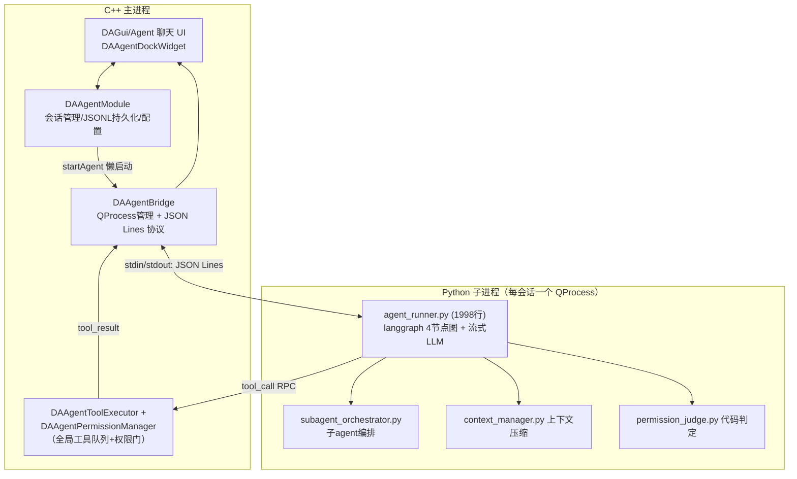
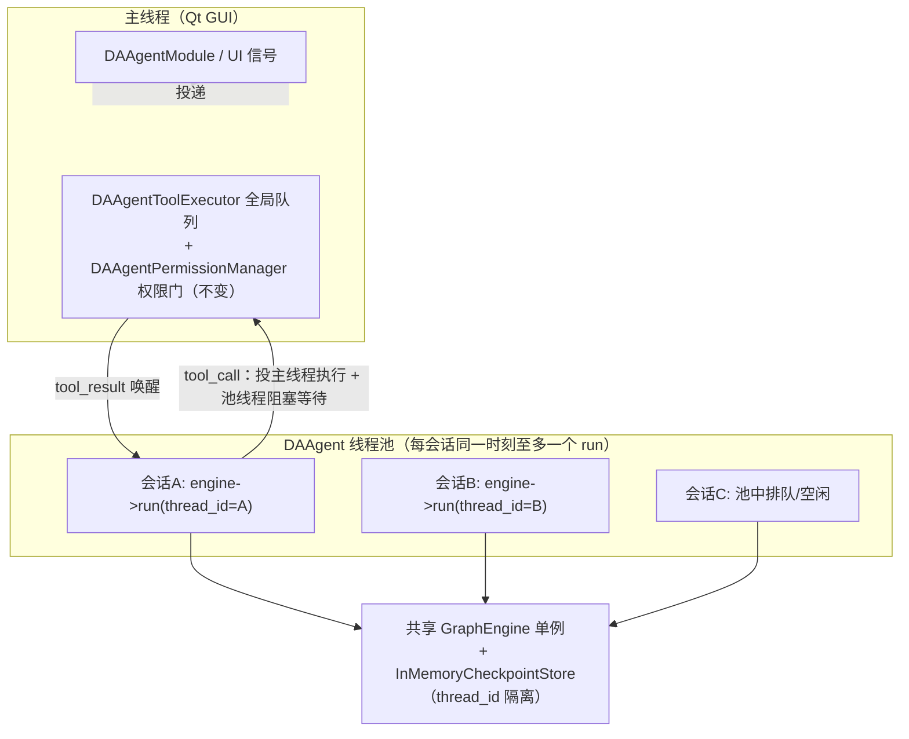
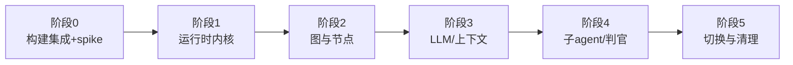

# Agent 运行时替换方案：Python langgraph → NeoGraph（C++ 原生）

本方案集的目标：**彻底移除 Agent 功能对 Python langgraph 的依赖，用 C++ 库 NeoGraph（`C:\src\Qt\3rdparty\NeoGraph`）在主进程内实现全部 Agent 推理**，消除多进程子进程模型，实现多会话线程池并发执行与即时切换。

本文件是全套方案的总纲：深度可行性分析 + 关键架构决策 + 阶段导航。**执行替换前必须完整阅读本文件**，再按 `01` ~ `06` 顺序逐步实施。

## 功能概述

- ✅ **可行性结论：可行**。NeoGraph 是官方声明 LangGraph parity 的 C++20 图运行时，当前项目对 langgraph 的依赖面（4 节点图 + interrupt/resume + 内存 checkpointer + 状态注入）被 NeoGraph 完整覆盖，且持久化、工具、权限、UI 等核心能力本就在 C++ 侧。
- ✅ **替换后收益**：无 Python 子进程冷启动（当前 import langchain ~16s）；会话状态常驻内存（当前切换会话要下发 `load_session` 全量重放重建 state）；多会话共享一个线程池并发推理；进程间 JSON Lines 协议层整体消解。
- ⚠️ **两个硬约束必须先解决**：① 项目根 CMake 是 **C++17**（`CMakeLists.txt:94`），NeoGraph 核心 target 强制 `cxx_std_20`；② NeoGraph 若干 CMake 选项默认值会引入 `find_package(PostgreSQL REQUIRED)` 等失败依赖，必须显式关闭（见 `01-阶段0`）。

## 现状深度分析

### 当前 Agent 架构（替换前）

### langgraph 依赖面（实际用到的 API 全集）

调研结论：`agent_runner.py` 对 langgraph 的使用**面很窄**，集中在以下五点（证据：`src/PyScripts/DAWorkbench/agent/agent_runner.py`）：

| # | langgraph 用法 | 代码位置 | 用途 |
|---|---------------|---------|------|
| 1 | `StateGraph` + `MessagesState` + 固定 4 节点图 | `:1070-1100` | `START → compact → agent → {ask_user \| tools \| END}`，`tools → compact`、`ask_user → compact` |
| 2 | `interrupt()` / `Command(resume=...)` | `:1035`、`:1726` | ask_user 人机交互暂停与恢复 |
| 3 | `MemorySaver` checkpointer | `:1099-1100` | **仅内存**，用于 interrupt/resume，不是持久化（事实源是 C++ 的 `<appData>/sessions/<id>.jsonl`） |
| 4 | `graph.aupdate_state(thread_config, {messages})` | `:1761-1783` | `load_session` 后注入历史重建 state |
| 5 | `recursion_limit` + `GraphRecursionError` | 配置注入 `:1228-1234`、异常捕获 `:1845/:1875`、导入 `:73-81` | 单回合推理步数上限 |

无动态图、无子图嵌套（子 agent 是独立图实例）、无持久 checkpointer、无 LangGraph Platform 依赖。**依赖的 langchain 部分**仅 `ChatOpenAI`（OpenAI 兼容协议，`:1127-1135`，流式 `astream`）与消息类型（`AIMessageChunk` 累加、`ToolMessage` 等）。

### 职责归属（决定工作量的关键事实）

| 能力 | 当前归属 | 替换影响 |
|------|---------|---------|
| 图状态机 / interrupt / 流式 LLM / 上下文压缩 / 子agent编排 / 权限判官 | **Python** | ★★★ 全部需 C++ 化（本方案主体工作） |
| 工具执行、权限门执法、审批卡、全局执行队列 | **C++**（`DAAgentBridge::executeTool` 前置） | 不变，仅调用入口从协议 RPC 变为函数调用 |
| 会话 JSONL 持久化 / 索引 / 清理（`DAAgentSessionStore`） | **C++** | 不变 |
| 子进程生命周期 / 看门狗 / 崩溃恢复（`DAAgentBridge`） | **C++** | **整体删除**（无进程可管） |
| 聊天 UI / 信号链 / 插件工具注册 / 提示词库 | **C++** | 不变（信号面保持兼容） |
| 嵌入式 Python（工作流节点、run_code/run_script 的 pandas 执行） | **C++ 调 Python** | **与本方案无关，保留**——只去 langgraph 子进程，不去 Python 解释器 |

!!! info "重要澄清"
    本方案移除的是 **Agent 子进程（langgraph/langchain-openai 依赖）**。项目仍需嵌入式 Python（`DAPyScripts`/`DAPyWorkFlow` 的工作流节点、`run_code`/`run_script` 工具内部执行 pandas），`requirements.txt` 中 numpy/pandas 等保留，仅删除 `langgraph`、`langchain-openai`、`langgraph-cli`、`pydantic`、`tiktoken` 5 行 agent 依赖。

### 当前多进程模型的问题（用户痛点对照）

| 痛点 | 根因 | 替换后 |
|------|------|--------|
| 启动慢 | 每会话冷启动 Python 子进程 + import langchain ~16s（需 `booting` 心跳 + 60s ready 看门狗，铁律 T2） | 主进程内 C++ 对象构造，毫秒级 |
| 多会话卡 | 每会话一个进程，N 个会话 = N 个进程 + N 套 Python 运行时内存；`load_session` 全量重放 | 单进程共享线程池，状态常驻 |
| 切换会话不够快 | 切换 <500ms 但 state 重建推迟到下次 `sendMessage`（`init→load_session→user_msg` 管道序，铁律 T15） | 状态在内存 checkpoint 中，切换即时、续聊无需重建 |
| 协议脆弱 | stdout=协议通道、`\r` 裁剪、10MB 缓冲、booting/ready/error 分阶段处置、崩溃自愈重启 ≤3 次 | 整层删除，直接信号槽 |

## NeoGraph 能力映射（langgraph → NeoGraph 对照表）

以下对照全部经过 `C:\src\Qt\3rdparty\NeoGraph` 头文件/文档核实，是可行性的核心证据：

| langgraph 概念 | 当前用法 | NeoGraph 对应物 | 证据 |
|---------------|---------|----------------|------|
| `StateGraph` + channel reducer | `MessagesState`（add_messages） | JSON 图定义 `channels: {messages: {reducer: "append"}}` + `GraphEngine::build` | `include/neograph/graph/compiler.h`（`TOPOLOGY_SCHEMA_VERSION=1`）、`graph_loader.cpp` |
| 节点 | compact/agent/ask_user/tools | 内置 `llm_call`、`tool_dispatch`、`intent_classifier`、`subgraph` + **自定义节点**（`NodeFactory::register_type`，节点类实现 `asio::awaitable<NodeOutput> run(NodeInput)`） | `include/neograph/graph/loader.h:219/232/251`、`graph/node.h` |
| 条件边 | `should_continue`（有 tool_calls→tools，否则 END） | `edges` 内 `condition: "has_tool_calls"` + `routes`（内置 condition），复杂条件用 `GraphRegistry::register_condition` | `graph_loader.cpp:114-142` |
| `interrupt()` / `Command(resume)` | ask_user 节点 interrupt，`resume` 恢复 | ① `interrupt_before`（JSON 图级）；② 节点内 `throw NodeInterrupt(reason, value)`；恢复 `engine->resume(thread_id, value)`，值进 `RunContext::resume_value` | `graph/types.h:164-201`、`graph_engine.cpp:1252` |
| `MemorySaver` | 内存 checkpointer | `InMemoryCheckpointStore`（interrupt 时自动保存 checkpoint，`checkpoint_store` 进 `EngineConfig`） | `include/neograph/graph/checkpoint.h`、`graph_engine.cpp:1402-1426` |
| `aupdate_state` 注入历史 | `load_session` 重建 state | `engine->update_state(thread_id, channel_writes)`；多轮续接 `RunConfig::resume_if_exists=true` | `include/neograph/graph/engine.h:762`、`:204` |
| `recursion_limit` | thread_config 注入 | `RunConfig` 步数限制 + 图级 `retry_policy`；自定义节点内计数兜底（见 `03-阶段2`） | `engine.h` RunConfig |
| `llm.astream()` 流式 token | `send_token` 推 C++ | `run_stream(config, GraphStreamCallback)` 事件 `GraphEvent{Type::LLM_TOKEN}`——**data 即 token 字符串**（`event.data.get<std::string>()`，不是 `{token}` 对象，见 `graph_node.cpp:164-165`）；或 provider 层 `complete_stream(params, StreamCallback)` | `graph/types.h:412-419`、`include/neograph/provider.h:52` |
| `usage_metadata` | 每 20 chunk 估算 + 权威回传 | `RunResult::usage`（`ChatCompletion::Usage`）+ `RunConfig::usage = UsageAccumulator` 跨 run 累加；流式自动 `stream_options.include_usage` | `neograph/types.h:82-88`、`openai_provider.cpp:270-388` |
| `ChatOpenAI(base_url, api_key, model, max_tokens, timeout)` | 仅 OpenAI 兼容协议 | `llm::OpenAIProvider::Config` 核心 4 字段 `{api_key, base_url, default_model, timeout_seconds}`（另有 `provider_routing`/`allow_insecure_loopback`/流大小上限等扩展字段；**无 max_tokens/retries**）；`max_tokens`/`temperature` 在 `CompletionParams` | `llm/openai_provider.h:53-82`、`include/neograph/provider.h:62` |
| 重试/退避（retry_wrapper.py） | 线性退避 | `RateLimitedProvider` 包装（429 退避）+ 自实现线性退避包装 provider | `llm/rate_limited_provider.h:47-60` |
| 工具调用（tool_node RPC 循环） | 发 `tool_call` → C++ `executeTool` → 回传 | **不直接使用内置 `tool_dispatch`**，用自定义 `tools` 节点复刻 RPC 模式（决策 A2，见下） | 见架构决策 |
| 子 agent 独立图实例 | 每任务 `build_agent_graph` | 同一 `GraphEngine` 不同 `thread_id` 并发 run，或独立 engine 实例 | `engine.h:390-397`（官方线程安全声明） |
| asyncio 事件循环 | Windows Selector 策略（铁律 T9） | 无需：同步 `run()` 阻塞在池线程，或 `run_async` 协程 | `graph_engine.cpp:618-636` |

### 运行模型核实（回答"一个线程还是线程池"）

NeoGraph 关键事实（`include/neograph/graph/engine.h`）：

1. `run()` / `run_stream()` / `resume()` **同步阻塞**，在**调用者线程**的栈上 io_context 驱动——即在哪个线程调用，事件回调就在哪个线程。
2. **官方线程安全声明**（`engine.h:390-397` 原话大意）：单个 `GraphEngine` 实例可安全地被多个用户线程以**不同 `thread_id`** 并发调用 `run/resume`；**相同 `thread_id` 并发不保证安全**（checkpoint 交错）。
3. `run_async/resume_async` 返回 `asio::awaitable`，由调用者 io_context 驱动，一个 io_context 线程可承载 N 个并发 agent（`docs/async*`）。
4. 自定义节点、Provider、CheckpointStore、Tool 必须线程安全或无状态（`engine.h:418-421`，节点实例由引擎共享）。

**结论：既不能也不需要"全部塞进一个线程"，正确模型是共享线程池 + 每会话串行**——见架构决策 A1。

## 可行性结论

**可行，且替换收益大于风险。** 逐项判定：

| 维度 | 判定 | 说明 |
|------|------|------|
| 功能覆盖 | ✅ 完全覆盖 | 4 节点图、interrupt/resume、内存 checkpointer、状态注入、流式 token、usage、OpenAI 兼容 provider 全部有对应物 |
| 运行模型 | ✅ 优于现状 | 线程池并发 + 内存态会话状态，直接解决"启动慢、多会话卡" |
| 工具/权限/UI 复用 | ✅ 零改动复用 | 权限门、全局队列、JSONL 持久化、信号链全在 C++，保持 AGENTS.md D2/T16/T17 铁律 |
| 构建集成 | ⚠️ 需专项处理 | C++20 vs C++17、NeoGraph CMake 默认选项（见阶段 0） |
| 工作量 | ⚠️ 大但可分步 | Python 侧 ~4000 行推理代码 C++ 化 + Bridge 协议层删除，分 6 阶段每阶段独立可验收 |
| 成熟度风险 | ⚠️ 0.x 版本 | v0.12.1、162 项 C++ 测试、MSVC CI 覆盖、MIT 协议；API 变动风险靠阶段 0 锁定 |
| Qt 集成先例 | ⚠️ 无官方先例 | NeoGraph 无 Qt 依赖（纯 asio/yyjson），作为普通 CMake 库引入即可；PIMPL 隔离避免污染 |

## 关键架构决策（后续阶段必须遵守）

### A1：共享线程池 + 每会话串行执行（回答用户核心问题）

- **一个共享 `GraphEngine` 单例**（进程级）+ **一个共享线程池**（`QThreadPool` 私有实例，容量可配置，默认值唯一定义在 `02-阶段1` §一 R6，此处不重复）。
- **每会话一个 `DAAgentSessionRunner`**：保证同一 `thread_id` 同时只有一个 `run`（官方约束）；会话 A 的 run 阻塞在池线程时，会话 B/C 独立并发。
- **不采用"单线程串行所有会话"**：一个 LLM 流式请求阻塞数秒~数分钟，串行会让其它会话饥饿，与"多会话快速切换"目标矛盾。
- **二期可选优化**（不在必做范围）：切换到 `run_async` + 单 io_context 线程，把池线程占用降为零；一期先用同步 run（实现简单、与 NeoGraph 同步 API 完全匹配）。
- **会话切换**：状态常驻 `InMemoryCheckpointStore`（`thread_id` 隔离），切换只做 UI 路由 + 内存状态已在位，**无需 `load_session` 重放**——优于当前"<500ms 但下次发消息才重建 state"。

### A2：自定义 `tools` 节点，不直接用内置 `tool_dispatch`（保护权限门）

- AGENTS.md 铁律 D2/T16：**工具执行在 C++ 主进程、`DAAgentBridge::executeTool` 是权限门唯一执法点、全局执行队列串行、两段式超时、审批卡挂起**。
- NeoGraph 内置 `tool_dispatch` 会直接在线程池线程调用 `Tool::execute`，绕过主线程权限门与 `DAAgentToolExecutor` 全局队列——**禁止使用**。
- 替代：自定义 `tools` 节点，复刻当前 Python `tool_node` 行为——节点内发 `tool_call`（经 `invokeMethod` 投递主线程走既有 `executeTool` 链路），池线程用等待原语阻塞收 `tool_result`，写回 `messages` channel。审批挂起期间等待不设时限（对齐当前 `approval_pending` 语义）。
- 现有 `DAAgentToolExecutor` 全局队列、`DAAgentPermissionManager::decide`、审批卡信号链**原样保留**。

### A3：信号面完全兼容，Module/UI 层最小改动

- 新运行时（`DAAgentEngine` + `DAAgentSessionRunner`）**逐字复刻 `DAAgentBridge` 的 19 个信号**（`DAAgentBridge.h:127-262`，含 `agentToken/agentMessageComplete/agentToolCall/agentToolQueued/agentToolResult/agentQuestion/agentError/agentRetrying/agentReady/agentStarting/agentBusy/agentUsage/agentSessionLoaded/agentDone/agentTurnPossiblyIncomplete/agentSubagentProgress/agentToolApprovalRequest/agentToolApprovalDismissed/processExited`——**保留信号名 `processExited`**，语义改为 runner 终止，见 `02-阶段1` §三）。
- **信号归属（防会话串台的关键）**：19 信号定义在**每会话的 `DAAgentSessionRunner` 实例**上，而非进程级 `DAAgentEngine` 单例——信号签名无 sessionId 首参，只有挂在 runner 上才能复用 Module 按会话的既有路由（后台会话 token 不会广播给其它会话的连接）。`DAAgentEngine` 单例只暴露管理接口（startSession/shutdown/reconfigure/全局工具集），`reconfigure` 完成时向全部 runner 广播 `agentReady`。
- `DAAgentModule::attachBridge`（`DAAgentModule.cpp:964-1310`，22 条 connect）的连接清单**逐条平移**到对应 runner（`attachRunner(runner, sessionId)`），持久化/UI 路由/后台缓存逻辑不重写。
- `DAAgentModule` 对 Bridge 的公开成员调用点（25 方法 + 构造析构共 27 项：`startAgent/sendMessage/sendToolResult/sendUserAnswer/sendLoadSession/reconfigureAgent/...`）映射为新运行时的等价方法（语义对照表在 `02-阶段1`）。
- **删除的协议概念**：`booting/ready 两段握手`、`\r` 裁剪、10MB 缓冲、`session_loaded` 门控（T15 管道序）、`processExited` 崩溃自愈——这些是进程模型的产物。

### A4：C++20 策略——仅 DAAgent 模块升级，PIMPL 隔离

- 根 `CMakeLists.txt` 保持 `CMAKE_CXX_STANDARD 17`；`src/DAAgent/CMakeLists.txt` 中 `target_compile_features(DAAgent PRIVATE cxx_std_20)`（链接 `neograph::core` 会被其 `PUBLIC cxx_std_20` 强制传播，显式声明使意图清晰）。
- **NeoGraph 头文件只允许出现在**：`DAAgent` 模块的 `.cpp` 与私有实现头（`DAAgentEnginePrivate.h` 等，不安装不导出）。
- **`DAAgentInterface.h` 等公共头零污染**：不 include 任何 `neograph/*`，不暴露 C++20 语法——APP/插件仍以 C++17 编译并正常 include DAAgent 公共头（项目使用 PIMPL，天然满足）。
- 验证：阶段 0 必须确认 Qt 5.15 + MSVC `/std:c++20` 编译 DAAgent 无警告/错误，APP 与插件保持 17 编译链接通过（详见 `01-阶段0`）。

### A5：功能映射与 Python 文件处置总表

| Python 文件 | 行数 | 去向 | 目标阶段 |
|-------------|------|------|---------|
| `agent_runner.py` 图构建/节点/路由 | ~1100 | NeoGraph JSON 图 + 自定义节点（`03`） | 阶段 2 |
| `agent_runner.py` 流式 LLM/usage/重试 | ~700 | NeoGraph provider + 事件回调（`04`） | 阶段 3 |
| `subagent_orchestrator.py` | 735 | C++ 子 agent 编排（线程池内并发子 run）（`05`） | 阶段 4 |
| `permission_judge.py` | 402 | C++ 静态规则 + 判官（provider 非流式调用）（`05`） | 阶段 4 |
| `context_manager.py` | 574 | C++ 上下文压缩/截断/token 估算（`04`） | 阶段 3 |
| `error_classifier.py`/`retry_wrapper.py` | 517 | C++ 错误分类 + 线性退避（`04`） | 阶段 3 |
| `DAAgentBridge` 协议层（C++） | 1533 | 删除，信号面由新运行时承接（`06`） | 阶段 5 |

## 阶段导航（按顺序执行，每阶段独立可验收）

| 阶段 | 文档 | 交付物 | 验收标准 |
|------|------|--------|---------|
| 阶段 0 | `01-阶段0-技术验证与构建集成.md` | NeoGraph 以 subdirectory 集成、C++20 策略落地、spike 验证（流式 + interrupt/resume + 多 thread_id 并发） | `scripts/build.ps1 -Target DAAgent` 通过；spike 可执行 |
| 阶段 1 | `02-阶段1-运行时内核.md` | `DAAgentEngine`/`DAAgentSessionRunner`/`DAAgentToolBridge`（工具 RPC 桥）、19 信号契约、线程池 | 新增单测通过；信号面契约测试通过 |
| 阶段 2 | `03-阶段2-图与节点移植.md` | JSON 图定义、`compact/agent/ask_user/tools` 四个自定义节点、interrupt/resume、递归限制 | 图级单测（Mock Provider）通过 |
| 阶段 3 | `04-阶段3-LLM流式与上下文管理.md` | Provider 封装、流式 token→信号、usage、错误分类/重试、上下文压缩移植 | 流式/压缩/重试单测通过 |
| 阶段 4 | `05-阶段4-子Agent与权限判官.md` | 子 agent 编排 C++ 化、permission_judge C++ 化 | 原 Python 37 用例的行为在 C++ 测试等价覆盖 |
| 阶段 5 | `06-阶段5-切换清理与验收.md` | Module 接线切换、删 Bridge 协议层/Python agent 目录、requirements/CI 清理、总验收 | 全量构建+测试+手测清单；`grep langgraph` 归零 |

!!! info "双轨开关（降低切换风险）"
    每阶段在 `DAAgentConfig` 增加构建宏 `DA_AGENT_NATIVE_RUNTIME`（CMake option `DA_AGENT_NATIVE`，阶段 0 引入，阶段 5 完成后删除开关）。开关开启时 `DAAgentModule` 走新运行时，关闭时走旧 Bridge——保证每阶段可回退、CI 可分步验证。**终态是删除开关与旧路径，不留长期双轨。**

## 通用实施约定（所有阶段遵守）

1. **模块归属**：全部新代码放 `src/DAAgent/`（L4 接口层，不依赖 DAGui/APP）；NeoGraph 头仅进 `.cpp`/私有头。
2. **命名**：新类 `DA` 前缀 + `DA` 命名空间，PIMPL（宏在 `src/DAGlobals.h`），`Q_OBJECT` + `Q_SIGNALS/Q_SLOTS`。
3. **线程铁律**：任何影响 GUI 的信号必须 `QMetaObject::invokeMethod(..., Qt::QueuedConnection)` 投回主线程后 emit；池线程禁止直接碰 QWidget。
4. **日志分流**：用户可见消息用 `da*` + `tr("English") //cn:中文`；技术诊断（节点执行、事件流转）用 `q*` 纯英文。
5. **继承的既有铁律**（出自 `src/DAAgent/AGENTS.md`；其决策编号 D*/铁律 T* 与本方案决策 A1-A5 是两套编号，勿混用）：AGENTS.md D2（工具执行在 C++）、D4（HITL interrupt）、D5（流式）与 T5（工具 try/catch）、T8（question 只发一次）、T16（权限 C++ 唯一执法）、T17（子 agent tool_call 不落盘不渲染）——**行为不变，仅实现载体从 Python 换到 C++**。
6. **验证命令**：Windows 用 `.\scripts\build.ps1 -Target DAAgent -Test`；Qt Test 输出必须 `-o result.txt`（stdout 不可见）。
7. **NeoGraph 是外部只读依赖**：位于 `C:\src\Qt\3rdparty\NeoGraph`（**不是**本仓库 `src/3rdparty`，本项目无权改动其源码；仅通过 CMake 选项与公开 API 使用）。

## 风险清单与对策

| 风险 | 等级 | 对策 |
|------|------|------|
| Qt5.15 + MSVC C++20 兼容性（moc/Q_OBJECT TU 以 20 编译） | 高 | 阶段 0 spike 首先验证；失败备选：全局升 20（Qt 5.15 支持）或 DAAgent 拆双 target |
| NeoGraph 0.x API 变动 | 中 | 阶段 0 锁定集成快照（记录 commit/版本）；公共 API 用法集中在少数 `.cpp`，变更影响面小 |
| interrupt resume value 自动追加 user 消息（`graph_engine.cpp:1299-1311`）与当前 ask_user 语义差异 | 中 | 阶段 2 专项验证点：ask_user 恢复后不产生重复 user 消息（对照铁律 T8/T15 行为） |
| 池线程阻塞等待工具结果 vs 主线程队列死锁 | 高 | 阶段 1 设计等待原语：等待必须可被 stop/超时中断，队列执行永远在主线程（无反向依赖） |
| `NeoGraph` CMake 默认选项拉取 PostgreSQL/SQLite | 中 | 阶段 0 显式 `NEOGRAPH_BUILD_POSTGRES=OFF` 等（具体清单见 01 文档） |
| 行为回归（流式截断续写、软引导防死循环、compaction 熔断等细节） | 中 | 阶段 2/3 把 Python 侧行为逐条列为移植 checklist；阶段 5 手测清单覆盖 |

## 参考资料

- 现状架构：`src/DAAgent/AGENTS.md`（铁律 T1-T17）、`docs/zh/dev-guide/agent/protocol.md`（待废弃的协议，阶段 5 按 `06-阶段5` §四处理）、`docs/zh/dev-guide/agent/agent-runtime-watchdog.md`（阶段 5 改写的看门狗）
- NeoGraph：`C:\src\Qt\3rdparty\NeoGraph\README.zh-CN.md`、`docs/concepts.md`（LangGraph parity 声明）、`docs/concurrency.zh-CN.md`、`docs/ASYNC_GUIDE.md`、`examples/01_react_agent.cpp`（高层 Agent 用法）、`examples/04_checkpoint_hitl.cpp`（interrupt/resume 用法）、`include/neograph/graph/engine.h`（线程安全声明与全部引擎 API）
- 现状 Python 实现（移植蓝本）：`src/PyScripts/DAWorkbench/agent/agent_runner.py`、`subagent_orchestrator.py`、`context_manager.py`、`permission_judge.py`、`error_classifier.py`、`retry_wrapper.py`
- 既有测试（行为回归基线）：`src/tst/DAAgentBridgeTest`、`DAAgentModuleTest`、`src/PyScripts/tests/test_subagent_orchestrator.py`、`test_permission_judge.py`