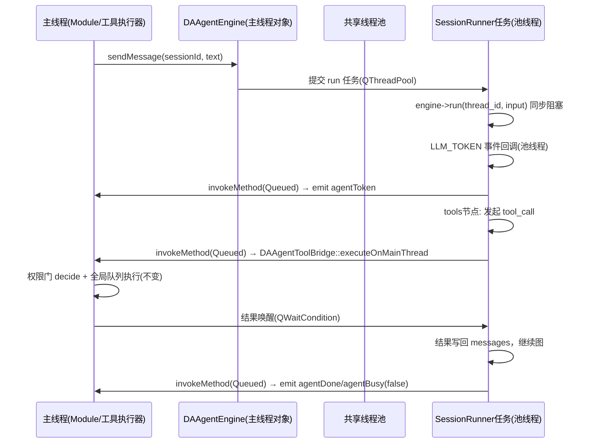
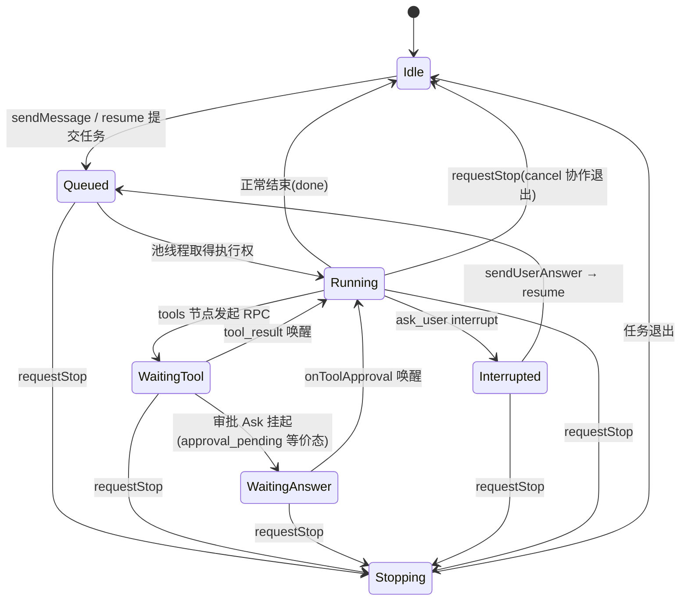

# 阶段 1：运行时内核（DAAgentEngine / SessionRunner / 工具 RPC 桥）

本阶段目标：在 `src/DAAgent/` 内新建**旁路运行时**，不改任何现有业务行为，交付三个新类 + 信号契约 + 线程模型 + 单元测试。它是后续阶段 2（图节点）、阶段 3（LLM）、阶段 4（子 agent）的宿主。

!!! info "旁路开发模式"
    阶段 1-4 期间新运行时**不接入 `DAAgentModule`**（旧 Bridge 路径照常工作）。`DA_AGENT_NATIVE_RUNTIME` 宏的消费点在阶段 5。每阶段用单元测试（Mock Provider）驱动，阶段 5 一次性接线切换。这样任一阶段失败都不影响现有功能。

## 交付物一览

| 类（均在 `DA` 命名空间、`src/DAAgent/`、PIMPL） | 职责 |
|---|---|
| `DAAgentEngine`（QObject，进程单例） | 持有 `GraphEngine` + `InMemoryCheckpointStore` + 共享线程池 + 管理接口（startSession/shutdown/reconfigure/setTools）；**19 信号定义在每会话 `DAAgentSessionRunner`，不在 Engine**（见 §三归属，决策 A3） |
| `DAAgentSessionRunner`（QObject，每会话一个） | 会话状态机；向线程池提交 run 任务；事件→信号翻译；stop 协作 |
| `DAAgentToolBridge`（非 QObject 辅助类） | 池线程 ↔ 主线程的工具 RPC：投递 `tool_call` 到主线程 `executeTool`、阻塞等待 `tool_result`、审批挂起、stop 中断 |
| `DAAgentEngineConfig`（值类型） | LLM 配置/上下文参数/权限参数的运行时快照（承接 `toRunnerConfigJson` 的字段语义） |

建议目录组织（新代码集中在子目录，公共头仍放模块根，PIMPL 私有实现进子目录）：

```text
src/DAAgent/
├── DAAgentEngine.h            # 公共头（无 neograph include）
├── DAAgentSessionRunner.h     # 公共头
├── runtime/                   # 私有实现（neograph 头只出现在这里与 .cpp）
│   ├── DAAgentEnginePrivate.h
│   ├── DAAgentToolBridge.h/.cpp
│   ├── DAAgentGraphDef.h/.cpp      # JSON 图定义构造（阶段2完善）
│   ├── DAAgentNodes.h/.cpp         # 自定义节点（阶段2完善）
│   └── DAAgentLLM.h/.cpp           # provider 封装（阶段3完善）
```

## 一、线程模型（决策 A1 落地细则）



**线程规则（实现与评审必须逐条核对）**：

| 规则 | 说明 |
|------|------|
| R1 `GraphEngine::run/run_stream/resume` 只在线程池线程调用 | 主线程**禁止**同步调用 run（会冻结 UI）。唯一例外：单元测试主线程直调 |
| R2 所有信号必须在主线程 emit | `SessionRunner`/`DAAgentEngine` 信号均遵守：池线程产生事件后 `QMetaObject::invokeMethod(runner, [...]{emit ...;}, Qt::QueuedConnection)`；`DAAgentEngine`/`SessionRunner` 构造在主线程（绑定亲和性） |
| R3 每个 `thread_id` 同一时刻至多一个 run | `SessionRunner` 内部串行化：新任务提交前检查状态机，Running 则排队（与当前"单进程内主循环串行消费"语义一致） |
| R4 工具执行永远在主线程 | `DAAgentToolBridge` 只做投递与等待，不执行工具（守住 AGENTS.md D2/T16） |
| R5 等待必须可中断 | 任何池线程阻塞点（工具结果、审批）都要响应 `stop`：`QWaitCondition::wait(mutex, deadline)` + stop 时 `wakeAll`，超时按既有两段式预算 |
| R6 线程池容量 | 默认 `qBound(2, QThread::idealThreadCount(), 8)`，可经 `DAAgentConfig.execution` 新键 `agent_pool_size` 配置；池线程 = 可并发会话数上限，超出的会话 run 在池内排队（R3 已保证会话内串行） |
| R7 shutdown | `DAAgentEngine::shutdown()`：置全局 stop 标志 → wakeAll 全部等待 → `pool.waitForDone(stopTimeoutMs)`（与原 `stop_timeout_sec`=5s 一致）→ 销毁 engine |

!!! note "为什么不采用单线程"
    单线程下任一会话的 LLM 流式请求（数秒~数分钟）会独占循环，其它会话完全饥饿，违背"多会话快速切换并同步执行"的目标。`run_async` + 单 io_context 是更优的二期形态，但同步 `run` + 池是一期最简可靠模型（阶段 0 V2/V3 已验证前提）。

## 二、DAAgentEngine 公共接口（对等 Bridge 的方法映射）

`DAAgentEngine.h` 设计为承接 `DAAgentBridge` 的全部入口（25 方法 + 构造析构共 27 项；阶段 5 时 `DAAgentModule` 的对应调用点逐一替换）。映射表：

| Bridge 方法（`DAAgentBridge.h:48-120`） | DAAgentEngine 等价物 | 语义变化 |
|---|---|---|
| `startAgent(llmConfig, toolSpecs, systemPrompt, subagents, pythonExe, scriptPath, readyTimeout, stopTimeout)` | `startSession(sessionId, config: DAAgentEngineConfig, systemPrompt, subagents)` | 无进程无 python 路径；**毫秒级**，同步完成初始化后 emit `agentStarting` → `agentReady(model)`（保留两信号以兼容 Module 状态机，但间隔≈0） |
| `stopAgent/beginStopAgent/awaitStopAgent/requestStop` | `shutdown()` / `requestStop(sessionId)` | 软停：置 cancel + wakeAll；`awaitStop` 变为 `waitForIdle(ms)` |
| `sendMessage(text)` | `sendMessage(sessionId, text)` | sessionId 显式化（桥随会话固定，引擎跨会话） |
| `sendToolResult(callId, json)` | **保留** `sendToolResult(callId, json)`（`DAAgentToolBridge` 内部唤醒） | 由 Module 在工具执行完成后调用（原路径同样如此） |
| `sendUserAnswer(answer)` | `sendUserAnswer(sessionId, answer)` | 内部转 `engine->resume(thread_id, answer)`（阶段 2 接入 ask_user） |
| `sendLoadSession(sessionId, messages)` | `sendLoadSession(sessionId, messages)` | 实现改为 `update_state`（同步），完成即 emit `agentSessionLoaded`，**无异步等待**，T15 管道序门控消失 |
| `reconfigureAgent(config)` | `reconfigure(config: DAAgentEngineConfig)` | 同步热替换 provider/压缩参数；运行中会话下次 run 生效（与现语义一致）；完成 emit `agentReady(model)`（Module 恢复路径依赖，保持） |
| `sendUpdateSubagents(json)` | `sendUpdateSubagents(json)` | 阶段 4 实现（重建 dispatch schema） |
| `sendUpdateTools(toolSpecs)` | `setTools(...)` + `sendUpdateTools(...)` | 更新工具集快照（见下文"工具集热更新"） |
| `setTools(QMap<name, DAAbstractAgentTool*>)` | `setTools(QMap)` | 存表供 `executeOnMainThread` 查询（工具本体不变） |
| `setPermissionManager(...)` / `setToolExecutor(...)` | `setPermissionManager(...)` / `setToolExecutor(...)` | 直接透传给 ToolBridge（执法链不变） |
| `setSessionId/sessionId` | 无需（sessionId 全方法显式传参） | Module 的 `mSessionId` 注入逻辑简化 |
| `isRunning/isStopRequested/isRecovering/setRecovering/lastSessionId/resendLastMessage` | `isRunning(sessionId)` / `isStopRequested(sessionId)` / 恢复字段由 Module 自持 | `resendLastMessage` 逻辑本在 Module（重发用户消息），保持由 Module 驱动 |
| `runQueuedTool/onToolApproval` | **保留同名**（ToolBridge 执行队列出队与审批回调入口） | 审批唤醒等待中的池线程 |
| `startAgent` 中 ready/stop 超时参数 | 删除 | 无进程冷启动（原 16s import 痛点） |

**工具集热更新注意点**：NeoGraph 拓扑在 `build` 后不可变，`EngineResources.tools` 为 build 时注入。**最终选型以阶段 0 V7 结论为准**（两种选型如下），结论确定后回填本节：

   1. 工具集经 `NodeContext`/`RunConfig` 的可变引用在 run 前注入 → `sendUpdateTools` 仅更新快照；
   2. 若必须 build 时固定 → `sendUpdateTools` 标记引擎"脏"，**空闲会话立即惰性重建 GraphEngine（编译开销 ~ms 级）、运行中会话延迟到当前 run 结束后重建**。会话状态存 `CheckpointStore`，重建引擎不丢状态。

## 三、19 个信号契约（逐字复刻 + 线程规则）

**信号归属（决策 A3，防会话串台）**：下列 19 信号定义在**每会话的 `DAAgentSessionRunner`**（不在进程级 Engine 单例）：签名无 sessionId 首参，挂 runner 才能复用 Module 按会话路由；`DAAgentEngine` 单例仅提供管理接口，`reconfigure` 完成时向全部 runner 广播 `agentReady`。信号签名**以 `DAAgentBridge.h:127-262` 为准逐字复刻**（注意下表第 1-2 列中"现状签名"来自头文件核查，参数名与直觉可能不同，如 `agentToolCall` 无 callId；保证 `DAAgentModule::attachBridge`（定义起于 `DAAgentModule.cpp:964`，连接区至 `:1310`，共 22 条 connect，19 个唯一信号 + 3 处重复连接）的既有连接可以近乎原样迁移，`attachRunner(runner, sessionId)` 连接 runner 对象）：

| 信号 | 触发时机（新语义） | 发射线程 |
|------|------------------|---------|
| `agentStarting()` | `startSession` 被调用 | 主线程（同步 emit） |
| `agentReady(QString model)` | 引擎初始化完成 / `reconfigure` 完成 | 主线程 |
| `agentBusy(bool)` | run 提交→true；run 结束/中断/错误→false（与原语义一致："true 于 sendMessage/tool_call，false 于 done/退出"） | 主线程（池线程投递） |
| `agentToken(QString)` | `GraphEvent::LLM_TOKEN` | 投递后主线程 |
| `agentMessageComplete(QString)` | 本轮最终回复（无 tool_calls 时），**另三种"中间 message_end"时机必须一并保留**：① tool_calls 伴随的思考文本落盘（`agent_runner.py:893-898`）② 截断分段的部分文本+分段 usage（`:827-838`）③ 防死循环硬终止的提示文本（`:879-880`） | 投递后主线程 |
| `agentToolCall(toolName, QJsonObject)`（`DAAgentBridge.h:138`，**首参是工具名非 callId**） | ToolBridge 发起工具请求（含 `safety`/`_subagent` 字段透传，阶段 4 填充） | 投递后主线程 |
| `agentToolQueued(toolName, int position)`（`:148`） | 全局队列排队（`DAAgentToolExecutor` 现有回调，桥接即可） | 主线程 |
| `agentToolResult(toolName, QJsonObject, QString subagentId)`（`:154`，**无 callId 参数**） | `sendToolResult` 后回声（原 Bridge 在执行完成后 emit，ToolBridge 与之一致） | 主线程 |
| `agentQuestion(text, options, bool multiSelect)`（`:169`，第三参是**多选标志**非 interrupted） | run 返回 `interrupted` 且 interrupt 来自 ask_user（阶段 2 判定） | 投递后主线程 |
| `agentError(msg, type, detail)` | run 抛异常 / provider 错误分类结果（阶段 3 接入分类器）。**保留两条现协议约定**：① **run 期间**的 error 后必须成对补发 `agentDone`（Module 据此清配对 FIFO/挂起问题、Bridge 原清 `mLastUserMessage`；reconfigure 失败等非 run 语境的 error 不补发 done，见 `04-阶段3` §1.2）；② 分阶段语义消解为：初始化失败 → runner 进 `Idle` 不自动重试（等下次 sendMessage），运行期错误 → 会话存活可续聊（原"写通道保持开放"的进程语义不再需要） | 投递后主线程 |
| `agentRetrying(int attempt, int maxAttempts, int delayMs, QString errorType, QString errorMessage)`（`:185`，**毫秒单位、末两参为错误分类**） | 重试包装器（阶段 3） | 投递后主线程 |
| `agentUsage(in, out, total, source)` | `RunResult.usage` / UsageAccumulator（阶段 3） | 投递后主线程 |
| `agentSessionLoaded(sid)` | `sendLoadSession` 完成（同步，立即 emit） | 主线程 |
| `agentDone()` | run 终态（含中断挂起？**否**，与原协议一致：暂停于 interrupt 不发 done，由 `agentBusy(false)` 承担） | 投递后主线程 |
| `agentTurnPossiblyIncomplete(int)` | **参数 = tool_rounds**：截断续写耗尽（P1）**或**回合完成度启发式命中（P2，`_build_turn_summary` 判定，见 04 §4.3） | 投递后主线程 |
| `agentSubagentProgress(QJsonObject)` | 子 agent 编排（阶段 4） | 投递后主线程 |
| `agentToolApprovalRequest/Dismissed(...)` | ToolBridge 审批路径（唤醒/终态撤卡 Q18） | 主线程 |
| `processExited()` | **语义变更**：runner 终止（stop/错误退役），Module 依赖它清权限记忆+撤卡（`DAAgentModule.cpp:1310`），保留信号名以复用连接，阶段 5 注释标明语义 | 主线程 |

!!! warning "信号语义回归点"
    `agentDone` 与 `agentBusy(false)` 的**时序差**是 Module 退休桥/清缓存的触发条件（`:1191`）。移植时必须保持原 `done`（本轮结束、非 interrupt 挂起）与 `busy(false)`（任何终态）的差别，用阶段 5 手测"提问挂起后 UI 状态仍可回答"验证 T8。

## 四、DAAgentSessionRunner 状态机



实现要点：

1. **任务入口统一**：`enqueue(Action{UserMsg|Resume|LoadSession})`，`QThreadPool::tryStart` 包装的 `Runnable` 捕获 `this + action`；`Running` 时动作入 FIFO（等价原 stdin 管道序消费，T15 自动满足）。
2. **状态读写在池线程**（动作执行者），主线程读 `isBusy()` 需 `QAtomicInt` 或互斥（跨线程查询用于 UI）。
3. **interrupt 挂起 ≠ 结束**：`RunResult.interrupted` 时状态停 `Interrupted`、发 `agentQuestion`、**不发 `done`**（T8）；看门狗"等用户回答暂停计时"语义由状态机天然满足（阶段 5 移植 inactivity 看门狗时按状态判活）。
4. **stop 协作三件套**：`QAtomicInt stopFlag` + provider `cancel_token`（阶段 0 确认其类型后接入，阶段 3 实现）+ ToolBridge `wakeAll`。`requestStop` 后 runner 保证在 `stopTimeout` 内进 `Idle`，等价原 `stop → waitForFinished → kill` 的前两级（原第三级 kill 不存在了）。

## 五、DAAgentToolBridge：工具 RPC 桥（决策 A2 核心）

池线程 tools 节点内的等待循环（伪代码即实现骨架）：

```cpp
// 池线程调用（tools 节点内部）
ToolRequest req{callId, tool, arguments, sessionId, subagentId, safety};
// 1. 投主线程：复用既有 executeTool 链路（权限门+全局队列+审批）
QMetaObject::invokeMethod(engine, [engine, req]{ engine->deliverToolRequest(req); },
                           Qt::QueuedConnection);
// 2. 池线程阻塞等待（两段式超时对齐现状）
//    - 排队段宽松预算(600s) / tool_exec_start 后本体超时 / 审批挂起不计时
//    - stop 时 wakeAll 立即返回 canceled
ToolResult r = toolBridge.waitForResult(callId, policy);  // QMutex+QWaitCondition
if (r.canceled) throw ToolNodeStop{};                     // 节点协作退出
return r.json;                                             // 写回 messages channel
```

要点：

- `deliverToolRequest`（主线程）执行顺序 = 现状：`DAAgentPermissionManager::decide` → 审批则 emit `agentToolApprovalRequest` 并挂起 → 放行入 `DAAgentToolExecutor` 队列（emit `agentToolQueued`）→ 出队 emit `tool_exec_start` 等价计时点 → `executeTool` 查表 try/catch → `sendToolResult` 唤醒。
- **审批挂起跨阶段**：`onToolApproval(callId, approved, remember)` 进入 `deliverToolRequest` 已挂起的槽位（保留 Bridge 原 `mPendingToolCalls` 表结构）。
- **每会话一个等待表**，callId 碰撞告警沿用（审计问题 24 语义）。
- **两段式超时的精确预算**（`DAAgentEngineConfig` 必须含 `gated_tools` 工具名清单与 `tool_approval_timeout_sec`）：① 排队段统一宽松 600s（跨会话队头等待）；② `tool_exec_start` 后本体超时：`gated_tools`（file_write/code_exec 等，按配置的工具名清单选择）用 `tool_approval_timeout_sec`=600s，**其余工具 60s**；③ 审批挂起段不计时。与原 `agent_runner.py:1376-1380` 的按名单选择语义一致。
- 迟到结果（等待槽已弹出）→ 记 `qWarning`（原 `tool_result_rejected` 协议消解为日志）。
- 停止后已排队的调用在 `deliverToolRequest` 入口做 `isStopRequested` 双重存活检查（原审计决策"副作用不为死进程发生"在新模型变为"不为已停止的会话发生"）。

## 六、生命周期与 Module 对接准备（阶段 5 的接线预告，本阶段不实施）

| Module 现逻辑（`DAAgentModule.cpp`） | 阶段 5 替换为 |
|---|---|
| `createBridgeForSession`（`:728-785`，python/script 路径校验删除） | `engine->startSession(...)`（`DA_AGENT_NATIVE_RUNTIME` 分支） |
| `prestartAgent`（`:874-937`，auto_prestart 保留但仅预热配置） | 预热 = 预创建 runner + 预载配置（几乎零成本，可保留开关语义） |
| `attachBridge`（`:964-1310` 22 条连接） | `attachRunner(runner, sessionId)`：连接面完全同构（对象是 runner 实例，见 §三归属），逐行迁移 |
| `retireBridge`（`:1338`） | `engine->retireSession(sessionId)`（状态回 Idle，保留内存 checkpoint） |
| `shutdown` 两阶段停（`:655-692`） | `engine->shutdown()`（R7） |
| 崩溃自愈 `recoverFromCrash`（Bridge `:1483`） | **删除**（无进程可崩溃；引擎错误走 `agentError` + 会话级状态复位） |
| inactivity 看门狗 240s（Bridge `:1444`） | 移植到 Module/Engine：按 runner 状态判活（Running 无事件 240s 报错；WaitingAnswer/WaitingTool 不计时） |
| ready 60s 看门狗 | **删除**（无冷启动） |

本阶段仅完成**等价物存在性**（类与方法签名就位），接线在阶段 5。

## 七、实施步骤

| # | 步骤 | 产出 | 验证 |
|---|------|------|------|
| 1 | 建 `runtime/` 子目录与四个类骨架（全部 `DA_AGENT_NATIVE_RUNTIME` 下编译，空实现可先 `Q_UNREACHABLE`）；**同时改 `src/DAAgent/CMakeLists.txt`**：现有 `file(GLOB ...)` **既不递归也无 `CONFIGURE_DEPENDS`**（`src/DAAgent/CMakeLists.txt:7-8`、`src/tst/CMakeLists.txt:14` 均如此，而 `build.ps1` 仅在无 CMakeCache 时才 configure），必须：① 补 `file(GLOB DA_RUNTIME_FILES CONFIGURE_DEPENDS "runtime/*.h" "runtime/*.cpp")` 并追加进 target SOURCES；② 给两个已有 GLOB 补 `CONFIGURE_DEPENDS`；否则新文件不参与编译、只报 unresolved external（若已漏配，用 `.\scripts\build.ps1 -Clean` 重新配置） | 头文件+空 cpp+CMake | `-Target DAAgent` 编译过 |
| 2 | 实现引擎单例 + 线程池 + `startSession/shutdown/requestStop` | 生命周期 | 单测：start/stop 幂等、shutdown 后拒绝新任务 |
| 3 | 实现 SessionRunner 状态机 + R1-R7 | 状态机 | 单测：状态迁移表全覆盖（Mock 空 run） |
| 4 | 实现 ToolBridge 投递/等待/审批/stop | RPC 桥 | 单测：V5 场景扩展，覆盖正常返回/超时/审批挂起/stop 中断/迟到结果 5 分支 |
| 5 | 信号契约测试 | `DAAgentEngineSignalTest` | 用 `QSignalSpy` 断言 19 信号在主线程发射（`QThread::currentThread()==qApp->thread()`） |
| 6 | 复刻 Bridge 公开成员映射表（25 方法 + 构造析构共 27 项）中的无依赖项 | 方法实现 | 编译期签名审查 + 单测 |
| 7 | 测试登记 + AGENTS.md 状态注记 | 新建 `src/tst/<TestName>/` 目录与自身 CMakeLists（按 `src/tst/CMakeLists.txt` 既有子目录的登记方式加入，Qt Test 输出用 `-o result.txt`）；**在 `src/DAAgent/AGENTS.md` 顶部加迁移状态注记**："NeoGraph 迁移中（方案 docs/方案/）：进程协议铁律 T1/T2/T9/T10/T13/T15 仅旧路径（DA_AGENT_NATIVE=OFF）有效，新路径以 02 §三信号契约为准" | 新测试目标出现在构建中 |

## 八、验收标准

- [ ] `.\scripts\build.ps1 -Target DAAgent -Test` 全绿（新增 `DAAgentEngineTest`/`DAAgentToolBridgeTest`/`DAAgentEngineSignalTest` 至少 15 用例；每个测试为独立 `src/tst/<名>/` 子目录并已登记）
- [ ] 19 信号签名与 `DAAgentBridge.h` diff 为零（评审核对）
- [ ] 线程规则 R1-R7 在代码注释与评审中逐条确认；`QSignalSpy` 断言全部信号主线程发射
- [ ] 现有 `DAAgentBridgeTest`/`DAAgentModuleTest` 仍全绿（旧路径未动）
- [ ] `grep -r neograph src/DAAgent/*.h` 公共头零命中

## 风险与回退

| 风险 | 对策 |
|------|------|
| 工具集是否可 run 前注入不确定 | 阶段 1 补 spike；备选"惰性重建引擎"方案已给（状态在 CheckpointStore 不丢） |
| `QThreadPool` 默认全局池污染 | 用私有 `QThreadPool` 实例（`new QThreadPool` 挂 Engine），**不要**用 `QThreadPool::globalInstance` |
| 等待原语死锁 | ToolBridge 等待必须带 deadline 轮询 + stop 唤醒；单测 5 分支覆盖 |

## 参考资料

- `src/DAAgent/DAAgentBridge.h/.cpp`（信号/方法/两段式超时的移植蓝本；契约以本文 §二/§三为准）
- `src/DAAgent/DAAgentModule.cpp:655-1400`（attach/retire/shutdown 语义）
- `C:\src\Qt\3rdparty\NeoGraph\include\neograph\graph\engine.h:390-421`（线程安全边界）
- `src/DAAgent/AGENTS.md` 铁律 D1/D2/T5/T8/T15/T16