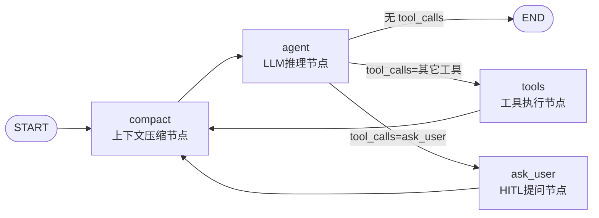

# 阶段 2：图定义与节点移植（compact / agent / ask_user / tools）

本阶段目标：把 `agent_runner.py` 的 langgraph 4 节点图完整移植为 NeoGraph JSON 图 + 4 个 C++ 节点，实现 interrupt/resume（ask_user）、状态注入（load_session）、防死循环三重保护。**LLM 调用细节（流式/重试/usage）在阶段 3 完善**，本阶段 agent 节点先以同步 `provider->complete` 跑通全流程（Mock Provider 可测）。

## 一、目标图结构（与现状逐节点对照）

当前图（`agent_runner.py:1070-1100`）：



NeoGraph 目标 JSON 图（`DAAgentGraphDef.cpp` 构造，骨架如下）：

```cpp
// 说明：图定义由代码构造（system prompt/参数可变，不落文件）
// channels: messages 用 append reducer —— 对应 MessagesState/add_messages
neograph::json DAAgentGraphDef::buildMainGraph()
{
    return {
        {"schema_version", neograph::graph::TOPOLOGY_SCHEMA_VERSION},
        {"name", "da_agent_main"},
        {"channels", {
            {"messages", {{"reducer", "append"}}},      // 对话消息（含 tool 消息）
            {"agent_step", {{"reducer", "overwrite"},   // 递归计数/软引导状态（阶段细节见 §四）
                            {"initial", 0}}}
        }},
        {"nodes", {
            {"compact", {{"type", "da_compact"}}},      // 自定义（本阶段 §三.1）
            {"agent",   {{"type", "da_agent"}}},        // 自定义（本阶段 §三.2）
            {"tools",   {{"type", "da_tools"}}},        // 自定义（本阶段 §三.3）
            {"ask_user",{{"type", "da_ask_user"}}}      // 自定义（本阶段 §三.4）
        }},
        {"edges", neograph::json::array({
            {{"from", "__start__"}, {"to", "compact"}},
            {{"from", "compact"},   {"to", "agent"}},
            // 多分支条件：无工具→END / ask_user→ask_user节点 / 其它→tools
            // 内置 has_tool_calls 只有 true/false 两分支，此处需注册自定义 condition
            {{"from", "agent"}, {"condition", "da_route"},
             {"routes", {{"none", "__end__"},
                         {"ask_user", "ask_user"},
                         {"tools", "tools"}}}},
            {{"from", "tools"},    {"to", "compact"}},
            {{"from", "ask_user"}, {"to", "compact"}}
        })}
    };
}
```

**节点类型注册**（引擎级隔离注册，经 `EngineResources.registry`，见 `include/neograph/graph/registry.h`）：

```cpp
// 阶段2 实施：每个自定义节点类 + condition 注册一次（进程级 NodeFactory 或引擎级 GraphRegistry 均可，
// 优先引擎级 registry 避免全局污染；注册 API 以 loader.h/registry.h 实际签名为准）
registry.register_type("da_compact",
    [](const std::string& name, const neograph::json&, const NodeContext& ctx)
        -> std::unique_ptr<neograph::GraphNode> { ... });
registry.register_condition("da_route", &routeAfterAgent);  // 返回 "none"|"ask_user"|"tools"
```

自定义节点类实现 `graph/node.h` 接口：`asio::awaitable<NodeOutput> run(NodeInput in)`（或继承 `SyncGraphNode` 用 `run_sync`，四个节点一期全部用同步形态即可——节点内阻塞语义与现状 Python 一致）。**节点实例由引擎共享、必须无状态**（`node.h:81-92`），所有会话态放 channels / `RunContext` / runner 私有结构。

## 二、条件路由 `da_route`（含 ask_user 特判）

判定顺序（对齐现 `agent_node`→条件路由逻辑）：

1. 最后一条 AIMessage 无 `tool_calls` → `"none"`；
2. `tool_calls` 名称 == `"ask_user"`（注入工具，见 §五）→ `"ask_user"`；
3. 否则 → `"tools"`（多工具并行时 tools 节点内逐个执行，与现状一致）。

防死循环三重保护的**硬终止**也在此处兜底：连续 3 次相同工具签名 → 直接 `"none"` 终止（现 `agent_runner.py:1176` 语义）；签名历史放 `agent_step` channel（overwrite reducer）。

## 三、四个自定义节点

### 3.1 `da_compact`（上下文压缩，先占位后接入）

本阶段交付：读 state → 若 `should_compact`（阈值 0.85，token 估算器阶段 3 提供，先用字符估算占位）返回压缩指令，否则返回空写（零开销，T14）。压缩执行体在阶段 3 实现（`DAAgentCompactor`），本阶段接口就位：

```cpp
// NodeOutput 写 messages channel：overwrite 模式实现"删除中间消息+插入摘要"
// （等价 langgraph RemoveMessage + summary 消息；写模式见 types.h ChannelWrite::Mode）
```

!!! warning "T14 移植要点（阶段 3 完成全部）"
    ① compact 必须在 agent 之前且 `tools/ask_user → compact` 回环；② 系统提示词不进 state（agent 节点运行时 prepend，compact 的 head/tail 选择不含 system）；③ 摘要失败熔断（连续 3 次失败停止尝试，成功一次重置）；④ 溢出恢复是局部的（仅本次 LLM 重试用，不写回 state，下轮 compact 才持久化）；⑤ 工具结果截断在 tools 节点写回前执行（`tool_result_max_chars`/`preview_chars`）。

### 3.2 `da_agent`（LLM 推理节点 —— 核心）

**决策：不用内置 `llm_call`，用自定义节点**。原因（对照 `agent_runner.py` 的 `agent_node`）：

| 现状行为 | 代码 | 内置 llm_call 是否覆盖 |
|---------|------|----------------------|
| 每轮 prepend SystemMessage（不进 state） | T14 | 否（`NodeContext::instructions` 是 build 时静态） |
| 流式 chunk 累积后读 `tool_calls`（T7） | `:1170` | 需验证，默认假设否 |
| 首 token 前才允许重试（D3 铁律） | `:660-663` | 否 |
| 截断续写 P1（`finish_reason=="length"` 喂回重试 ≤2 次）+ P2（possibly_incomplete） | AGENTS §3.3 | 否 |
| 软引导（重复签名 deque 注入提示） | `:1169` | 否 |
| usage 每 20 chunk 估算 + 权威回传 | `:596-650` | 部分（RunResult.usage 有权威值） |

节点骨架（阶段 3 完善流式与重试；本阶段先同步 complete 跑通）：

```cpp
asio::awaitable<NodeOutput> DaAgentNode::run(NodeInput in)
{
    // 1. 组装 CompletionParams.messages = [system_prompt] + in.state.messages
    //    （system 来自 NodeContext/EngineConfig 注入的当前系统提示词，不写回 state）
    // 2. 调 provider->complete_stream(params, tokenCb)：
    //    tokenCb（池线程）→ 经 SessionRunner 翻译为 agentToken 信号（R2 投递）
    // 3. T7：累积完整 AIMessage 后读 tool_calls
    // 4. 写 messages channel（append 完整 AI 消息）
    // 5. 截断续写/软引导/重试逻辑（阶段3），错误抛出 → executor → agentError
    co_return nodeOutput;
}
```

### 3.3 `da_tools`（工具执行节点 —— 决策 D2）

**不使用内置 `tool_dispatch`**（它会在线程池线程直接执行 `Tool::execute`，绕过权限门与全局队列）。本节点逻辑：

1. 取最后 AIMessage 的全部 `tool_calls`；
2. 逐个调 `DAAgentToolBridge`（阶段 1 已交付）：投主线程 `executeTool` → 池线程等待（两段式超时/审批挂起/stop 中断）；
3. 结果按 T6 组装 tool 消息：`content` **必须是 JSON 字符串**（`json.dumps` 等价），带 `role:"tool"`、`tool_call_id`、`tool_name`——**写入前做截断**（T14 ⑤）；
4. `safety`/`_subagent` 字段注入（阶段 4 接判官，接口本阶段留参）；
5. 全部结果 append 进 `messages` channel → 回环 compact。

### 3.4 `da_ask_user`（HITL 提问节点 —— interrupt 核心）

对齐现状（`ask_user_node` 只构造 interrupt 值、不发 question；`_send_question_if_paused` 只发一次，T8）：

```cpp
asio::awaitable<NodeOutput> DaAskUserNode::run(NodeInput in)
{
    if (in.ctx.resume_value.is_null()) {
        // 首次进入：从 state 取 ask_user 工具调用的参数 {text, options}
        // throw NodeInterrupt("ask_user", /*value=*/questionJson);
        // → executor 保存 checkpoint 后 rethrow → run 返回 interrupted
    }
    // resume 后重进：读 in.ctx.resume_value 作为用户答案
    // 组装 answer 消息写回 state；不得重复发送 question（T8）
    // 注意：阶段0 V1 已确认 NeoGraph 会把 resume value 额外追加一条 user 消息，
    //       必须实测该行为：若重复，则 ask_user 参数提取需容忍两条 user，
    //       或改用不带 messages 自动追加的 resume 方式（以 engine.h 实测为准）
    co_return nodeOutput;
}
```

`SessionRunner` 侧的事件翻译：`RunResult.interrupted && interrupt_node=="ask_user"` → emit `agentQuestion(text, options, true)`（**不发 `agentDone`**，T8）→ 状态机进 `Interrupted`。checkpoint 由引擎自动保存（配置了 `InMemoryCheckpointStore` 即可）。

`sendUserAnswer(sessionId, answer)` → `engine->resume(thread_id, json(answer), streamCb)`（状态机 `Interrupted → Queued → Running`）。

## 四、状态注入、多轮续接与递归限制

| 现状机制 | NeoGraph 实现 | 要点 |
|---------|--------------|------|
| `load_session` → `aupdate_state` 注入历史 | `engine->update_state(thread_id, {{"messages", jsonArray}})` | 同步完成即 emit `agentSessionLoaded`；消息 JSON 形状沿用现 `message_to_json` 输出（role/content/tool_calls/tool_call_id/additional_kwargs），**直接映射 `ChatMessage`**（`types.h:41` 字段对齐） |
| 多轮续接（同会话第二轮） | `RunConfig.resume_if_exists=true` + checkpoint 播种 | 每轮 `run` 的 input 只带增量（新 user 消息），reducer 合并——**必须设 `resume_if_exists`，否则状态重置**（阶段0 V4 已验证） |
| `recursion_limit`（`DAAgentConfig.execution.recursion_limit`，默认 -1 不限） | 首选：`RunConfig`/图级步数限制字段（阶段 0 补验 `engine.h`）；无内建则节点内计数：`agent_step` channel 每次进 `da_agent` +1，超限抛异常 → runner 映射 `agentError("GraphRecursionError", ...)` | 单回合内计数、run 结束复位（对齐"单回合内计数"语义） |
| thread_id | `thread_id = sessionId` | 与 checkpoint/状态查询统一 |
| 切换会话 | **无需任何 run 级操作**（状态常驻 store）；仅 `attachRunner` 路由切换 + UI 重放 JSONL | 优于现状（无 load_session 往返） |

## 五、ask_user 注入工具与工具集组装

- 现状：Python `ToolFactory` 把 `ask_user` 工具注入 LLM 工具列表（`agent_runner.py:494-517`），LLM 调用后路由到 `ask_user` 节点而非执行。
- C++：`DAAgentEngine` 组装 `CompletionParams.tools = [21个DAAgentToolSpec的OpenAI schema（DA::toJson 不变） + ask_user schema]`。`ask_user` schema 与现状同构（`text` + `options[]`），定义常量放 `DAAgentGraphDef`。
- `sendUpdateTools` 后重新组装（工具集快照策略见 `02-阶段1` §二）。

## 六、行为移植 Checklist（阶段 2 逐项打勾，回归依据）

移植自 `agent_runner.py`/AGENTS.md 铁律的行为清单，**每项必须在单测或手测中出现证据**：

- [ ] 图拓扑：`START→compact→agent→{none→END, ask_user, tools}`、`tools→compact`、`ask_user→compact`
- [ ] T7：流式 tool_calls 累积后读取（阶段 3 联调时验证）
- [ ] T8：question 只发一次；interrupt 挂起期间不发 `done`
- [ ] T6：tool 消息 content 为 JSON 字符串
- [ ] 系统提示词每轮注入且不进 state；插件 `registerSystemPrompt` 拼接段生效（`DAAgentModule::assembleSystemPrompt` 不变）
- [ ] `load_session` 注入历史后续聊上下文完整；快照不含末尾待重发 user 记录（问题 10 约定由 Module 保持）
- [ ] recursion_limit：超限报 `agentError`；默认 -1 不限
- [ ] 防死循环：软引导 + 连续 3 次相同签名硬终止
- [ ] ask_user 恢复：答案进入后续上下文、不产生重复 question、不产生重复 user 消息（V1 结论）
- [ ] stop：流式中/工具等待中/排队中三个位置发起 stop 均能在 stopTimeout 内终态

## 七、实施步骤

| # | 步骤 | 产出文件 | 验证 |
|---|------|---------|------|
| 1 | `DAAgentGraphDef` JSON 构造 + condition 注册 | `runtime/DAAgentGraphDef.*` | 单测：图 build 成功、拓扑节点/边齐全 |
| 2 | `DaAskUserNode` + interrupt/resume 链 | `runtime/DAAgentNodes.*` | 单测（Mock）：interrupt→question→resume→answer 进上下文，T8 |
| 3 | `DaToolsNode` + ToolBridge 接线 | 同上 | 单测：工具调用闭环（Mock 工具）、多工具、stop 中断 |
| 4 | `DaAgentNode` 同步 complete 版 | 同上 | 单测：无工具→END、tool_calls 路由三分支 |
| 5 | `DaCompactNode` 占位 + `agent_step` 递归计数 | 同上 | 单测：recursion_limit 触发、硬终止 |
| 6 | `update_state`/`resume_if_exists` 多轮 | `DAAgentEngine::sendLoadSession` | 单测：注入历史→续聊→断言 provider 收到完整 messages |
| 7 | 行为 Checklist 评审 | 本文 §六 | 逐项证据 |

## 八、验收标准

- [ ] `DAAgentGraphTest`（Mock Provider）≥ 20 用例全绿：路由三分支、interrupt/resume 往返、多轮续接、注入历史、递归限制、stop 各阶段
- [ ] §六 Checklist 全部打勾
- [ ] 现有 Python 路径回归不受影响（旧测试仍绿）
- [ ] 图级测试不依赖网络、不依赖 Python

## 风险与回退

| 风险 | 对策 |
|------|------|
| resume value 自动追加 user 消息导致重复 | 阶段0 V1 结论落地；若重复不可避免，ask_user 节点消费 resume_value 后按序去重（以实测为准写死策略并加回归用例） |
| 自定义 condition 注册 API 与假设不符 | 以 `registry.h`/`loader.h` 实际签名为准；退路：把三分支拆成两个内置 `has_tool_calls` + 一个自定义判断节点 |
| `run` 默认重置 state（忘设 `resume_if_exists`） | 封装 `DAAgentEngine::submitRun()` 统一注入该 flag，禁止散落构造 RunConfig |
| 节点共享实例的会话态污染 | 评审红线：节点类禁止成员可变状态（编译期用 const 成员+线程局部上下文约束） |

## 参考资料

- 移植蓝本：`src/PyScripts/DAWorkbench/agent/agent_runner.py:494-1176`（ToolFactory/图构建/agent_node/防死循环）、`:1035,1607-1618,1726`（interrupt/question/resume）
- NeoGraph：`examples/04_checkpoint_hitl.cpp`、`graph/node.h`、`graph/registry.h`、`graph/types.h:164-201`（NodeInterrupt）、`engine.h:762`（update_state）、`:204`（resume_if_exists）
- 铁律：`src/DAAgent/AGENTS.md` T6/T7/T8/T15 + `00-总览` §通用实施约定 5