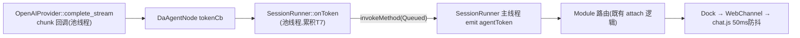
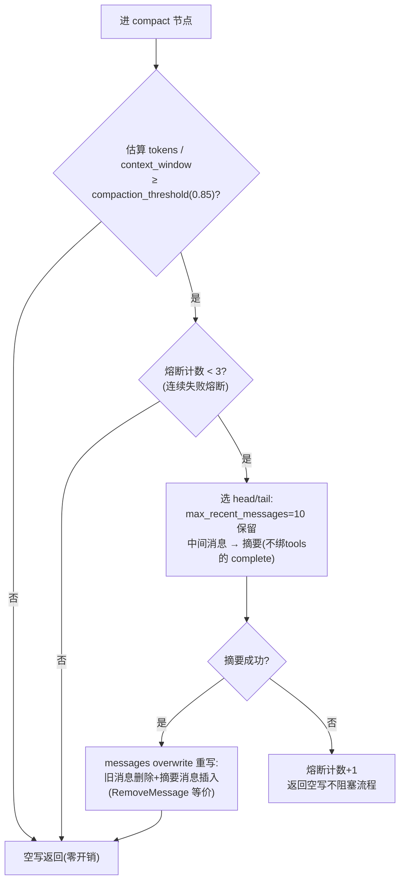

# 阶段 3：LLM 流式、重试错误分类与上下文管理

本阶段目标：把 Python 侧的 LLM 访问层完整 C++ 化：Provider 封装与热替换、流式 token/usage 信号链、线性退避重试与错误分类、上下文压缩/截断/溢出恢复/截断续写。完成后 `da_agent`/`da_compact`/`da_tools` 节点达到与 `agent_runner.py` 等价的行为能力。

移植蓝本（删除对象）：`agent_runner.py` 的 `_stream_llm`（`:596-685`）、`compact_node`/`ContextCompactor`（`:687-725` + `context_manager.py` 574 行）、`error_classifier.py`（345 行）、`retry_wrapper.py`（172 行）。

## 一、Provider 封装（`runtime/DAAgentLLM.*`）

### 1.1 配置映射（`DAAgentEngineConfig` → NeoGraph）

| 现配置（`DAAgentConfig`，`toRunnerConfigJson` 投影） | NeoGraph 落点 |
|---|---|
| `base_url` / `api_key` / `model` | `llm::OpenAIProvider::Config{base_url, api_key, default_model}`（`openai_provider.h:53-82`） |
| `max_output_tokens`（默认 131072） | `CompletionParams::max_tokens`（`provider.h:62`，注意**不在** Provider Config） |
| `request_timeout_sec`（默认 120） | `Config::timeout_seconds` 或请求级 `CompletionParams::timeout_seconds`（-1 用全局） |
| `context_window`（262144）、`compaction_threshold`、`max_recent_messages`、`tool_result_max_chars/preview_chars` | `DAAgentEngineConfig` 成员，节点/压缩器消费（不进 provider） |
| `temperature` | **现状不发送该字段**（`agent_runner.py` ChatOpenAI 未传 → langchain 不发 → 服务端用自身默认）；NeoGraph 却**恒发** `temperature`（`openai_provider.cpp:82`，`provider.h:61` 默认 0.7），直接换默认会静默改变采样行为 | **二选一定案**：① 显式 `params.temperature = 1.0`（与 OpenAI 服务端默认一致，推荐、无侵入）；② 扩展 provider 支持"不发送"（侵入第三方库，不推荐）。**禁止**放任 0.7 默认 |

`api_key` 获取路径不变：`DAAgentConfig`（DPAPI 解密在 load 边界）→ Module → `DAAgentEngineConfig`（内存态明文，**日志禁止打印**，铁律继承）。

### 1.2 共享与热替换（reconfigure）

- `DAAgentEngine` 持 `std::shared_ptr<OpenAIProvider>` 的**原子快照**（`std::atomic_load/store` 或互斥保护的 `shared_ptr`）：`reconfigure(config)` 同步重建 provider 并替换快照。
- 正在 run 的任务持有旧 `shared_ptr` 快照 → 旧请求自然完成（与现状一致："当前轮跑完后主循环处理，下一轮用新模型"）。
- 无进程无状态丢失，原 `reconfigure` 协议消息、`ready` 确认、"图与 state 不动"注释全部简化为一次函数调用 + 立即 `emit agentReady(model)`（Module 恢复路径依赖，`DAAgentModule.cpp:1149`）。
- **热替换对象全清单**（与现状 Python 端 `reconfigure` 处理 `agent_runner.py:1321-1354` 一致）：provider、compactor、truncator、token_estimator、权限层字段（permission 分组，`pushPermissionMode` 链经此生效）、递归上限、重试三参（max_retries/retry_interval_sec/retry_interval_increment_sec），全部随 `DAAgentEngineConfig` 热替换，图与 checkpoint 不动、call-time 读取生效。
- **失败回滚**：新 provider 构造失败时**不替换**旧快照，发 `agentError(error_type="reconfigure_failed")` 并保留旧配置（与 `agent_runner.py:1304-1320` 一致），此时**不发** `agentReady`。

### 1.3 取消（stop 中断 LLM 流）

`CompletionParams::cancel_token`（`provider.h:76`，类型与语义由**阶段 0 V8 结案**）是 NeoGraph 的取消入口，接入方式：

```cpp
// SessionRunner::requestStop 时：
// 1. 置 runner stopFlag（节点边界检查）
// 2. 对当前 params 的 cancel_token 置位 → OpenAIProvider 中断流读取
// 3. ToolBridge::wakeAll（打断工具等待）
// 退避睡眠（§三）也必须可被 stop 打断（wait_for + stopFlag）
```

## 二、流式 token 与 usage 信号链

### 2.1 token 传递（铁律 D5 保留）



- **累积在池线程完成**（T7：`tool_calls` 必须从累积后的完整消息读），emit 的是单条 token 文本（现状即如此）。
- `message_end` 等价：run 正常结束且无 tool_calls 时 emit `agentMessageComplete(finalText)`（阶段 1 契约已定）。

### 2.2 usage 三条通道（与现状语义一致）

| 现状来源 | 语义 | C++ 实现 |
|---------|------|---------|
| 流式估算（每 20 chunk） | `source="streaming_estimate"`，**不累加**会话累计 | 池线程每 20 chunk 用估算器算一次 → `agentUsage(in,out,total,"streaming_estimate")` |
| 权威值（`usage_metadata`） | `source="agent"`，累加 | `RunResult.usage`（`types.h:82-88`，流式已自动 `include_usage`）→ run 结束发 `agentUsage(...,"agent")` |
| 压缩摘要调用 | `source="summary"`，累加 | Compactor 摘要 complete 后发 `agentUsage(...,"summary")` |

跨 run 累计：用 `RunConfig::usage = std::make_shared<UsageAccumulator>`（`engine.h:169`）或沿用 Module 现有"会话累计成员"（`attachBridge` lambda `:1021` 已做累加），**优先沿用 Module 侧累加**，引擎只供每轮权威值，改动最小。

估算器（无 tiktoken）：`DAAgentTokenEstimator`，按 ASCII 字符 ÷4 与 CJK 字符 ×2 加权（现状 `context_manager.py` 已有 char-based fallback 逻辑，翻译即可）。仅用于估算显示与压缩提前触发，**不用于精确判定**。

## 三、重试与错误分类（`error_classifier` + `retry_wrapper` C++ 化）

### 3.1 错误分类（`DAAgentErrorClassifier`）

把 provider 抛出的异常（`llm/error.h` 层次：`RateLimitError` 等 + httplib 错误 + `std::exception`）映射为现状 `error_classifier.py` 的类别：

| 类别 | 现状行为 | NeoGraph 信号源 |
|------|---------|----------------|
| 可重试（400 参数类部分/429/5xx/网络波动） | 重试 m 次 | `RateLimitError(retry_after_seconds)`、HTTP 状态码异常、连接错误 |
| 快速失败（认证失败/配额耗尽） | 直接 `error` 终止 | 401/403/无余额类状态 |
| 上下文超限 | `ContextWindowExceededError` → 局部压缩重试 | 400 + context 相关文案（分类器规则） |
| 截断（length） | P1 续写 | **`stop_reason=="max_tokens"`（已核实结案）**：`ChatCompletion` 无 `finish_reason`，归一化字段是 `stop_reason`（`neograph/types.h:79`），provider 把 `"length"` 映射为 `"max_tokens"`（`openai_provider.cpp:183-187`）；备用判据 `completion_tokens>=max_tokens` |

分类规则是纯字符串/状态码逻辑，直译 `error_classifier.py` 的映射表（含中文文案匹配规则）。

### 3.2 重试包装器（`DAAgentRetryProvider`，装饰器模式）

**不用 NeoGraph 的 `RateLimitedProvider`**（仅 429 退避，语义不满足现状线性退避）。自实现包装：

```cpp
// 装饰 neograph::Provider：完整复刻 retry_wrapper.py
// 配置（DAAgentConfig.llm 分组既有字段）：
//   max_retries=m(5) / retry_interval_sec=n(5) / retry_interval_increment_sec=p(1)
// 第 k 次重试前等待 n+(k-1)*p 秒（线性退避），等待中响应 stop 打断
// 首 token 约束：流式已吐出首个 chunk 后不再重试（源码约束，包装器记录 firstChunk 标志）
// 每次重试 emit agentRetrying(attempt, maxAttempts, delayMs, errorType, errorMessage)（签名见 02 §三）
// 分类为"快速失败"的错误直接抛出（不消耗重试预算）
```

节点侧捕获最终异常 → `agentError(message, error_type, detail)`（Module 落盘 JSONL 的行为不变，`attachBridge :1220`）。

## 四、上下文管理（`DAAgentCompactor` + `DAAgentTruncator`）

### 4.1 组成与对应关系

| Python（`context_manager.py`） | C++ 落点 | 消费节点 |
|---|---|---|
| `TokenEstimator`（tiktoken → char fallback） | `DAAgentTokenEstimator`（纯字符加权） | Compactor |
| `ContextCompactor.compact()`（触发判断/head-tail 选择/摘要生成/RemoveMessage 删除） | `DAAgentCompactor::compact(messages, params)` | `da_compact` 节点 |
| `ToolResultTruncator.truncate()`（max 20000 / preview 2000） | `DAAgentTruncator` | `da_tools` 写回前 |
| 溢出恢复 `force_compact`（**结果写回 state**，见 §4.3） | `DAAgentCompactor::forceCompact()` | `da_agent` 错误处理分支 |

### 4.2 `da_compact` 节点完整逻辑（T14 逐条对照实现）



要点：

1. **摘要调用发 `agentUsage(...,"summary")`** 并走同一 RetryProvider（但压缩失败必须熔断不阻塞，重试耗尽即算失败）；
2. **系统提示词不参与 head/tail**（不进 state，天然满足）；
3. **写回方式**：`messages` channel 用 `ChannelWrite::Mode::Overwrite`（`types.h:121-136`）整体重写（等价 langchain 删除+插入）；实施时确认自定义节点支持 overwrite 写模式，否则退路 `engine->update_state` 由节点异步调用（避免则在节点内直接构造 overwrite 写）；
4. `should_compact` 用 `context_window` 配置（`DAAgentConfig.llm.context_window`）。

### 4.3 溢出恢复与截断续写（`da_agent` 节点内）

- **溢出恢复**：`complete` 抛"上下文超限"类错误 → `forceCompact()` → 用压缩列表重试；**压缩结果随节点返回写回 state**（RemoveMessage+summary，`agent_runner.py:763-796` 实测，这是打破 400 循环的关键；成功后熔断计数复位 `:799`；AGENTS.md T14"不写回"为旧表述），摘要 usage 照发 `source="summary"`（`:771-777`）；forceCompact 连续 3 次失败熔断抛错。
- **截断续写 P1**：响应 `stop_reason=="max_tokens"`（截断，见 §3.1）时，把"截断消息 + 引导补全的 user 消息"喂回输入重试，上限 `_MAX_TRUNCATION_RETRIES=2`；**P1 耗尽本身不直接发信号**，其残留（空回复）交由 P2 判定。
- **回合完成度提示 P2**：run 正常结束时实现 `_build_turn_summary` 等价逻辑（`agent_runner.py:1620-1680`）：`tool_rounds ≥ 2` 且（**最终回复为空** 或（**<400 字符且含将然意图措辞** intent_markers 中英清单，如"接下来/then/will "等））→ `possibly_incomplete=true` → emit `agentTurnPossiblyIncomplete(tool_rounds)`。**P2 与截断是两回事**：判定只看最终回复形态，不看 finish 状态，宁漏勿滥（tool_rounds<2 的纯问答不检测）。

## 五、实施步骤

| # | 步骤 | 产出 | 验证（单测，Mock/本地 httplib stub） |
|---|------|------|------|
| 1 | `DAAgentEngineConfig` 完整字段 + provider 快照与 reconfigure | `DAAgentEngine.*` 扩展 | 配置热替换：旧 run 完成用旧配置、新 run 用新配置 |
| 2 | `DAAgentTokenEstimator` + usage 三通道 | `runtime/DAAgentLLM.*` | 估算误差范围断言；`agentUsage` source 分类断言 |
| 3 | `DAAgentErrorClassifier` | `runtime/DAAgentErrorClassifier.*` | 分类表逐行用例（直译 Python 测试数据） |
| 4 | `DAAgentRetryProvider`（线性退避 + 首 token 后不重试 + stop 打断） | `runtime/DAAgentRetryProvider.*` | 退避时序、快速失败不耗预算、stop 中断 <100ms |
| 5 | `DAAgentCompactor`/`DAAgentTruncator` + `da_compact` 完整实现 | `runtime/DAAgentContext.*` | 触发阈值、head/tail、熔断计数、overwrite 写回 |
| 6 | `da_agent` 接流式+重试+溢出恢复+截断续写 | `DAAgentNodes.*` 扩展 | 流式 token 序列、T7、P1/P2、溢出恢复**写回 state** 验证 |
| 7 | stop 全路径接入 cancel_token | `DAAgentSessionRunner.*` | 流式中/退避中/压缩调用中 stop 均及时返回 |

## 六、验收标准

- [ ] `DAAgentLLMTest`/`DAAgentContextTest` ≥ 25 用例全绿（含错误分类表、退避时序、压缩熔断；测试按 `02-阶段1` §七步骤 7 的登记方式建立，需 cxx_std_20 + link neograph::core）
- [ ] 用真实 OpenAI 兼容端点（本地 stub 或可用网关）跑通：流式 token 顺序、`agentUsage` 权威值、重试触发与 `agentRetrying`
- [ ] 上下文超限 → 局部恢复 → 续跑成功路径可复现（stub 返回 400 超限一次再成功）
- [ ] `tiktoken`/`langchain` 字样不再出现在新代码（最终阶段归零检查的一部分）

## 风险与回退

| 风险 | 对策 |
|------|------|
| 截断判定字段 | **已核实结案**：用 `stop_reason=="max_tokens"`（§3.1），无需依赖 usage 判断 |
| provider 抛出的异常类型不含 HTTP 状态细节，分类器退化 | 捕获 httplib 响应包装类型；必要时包装 provider 在 `complete` 外层截获响应码重抛自定义 `DAAgentLLMError{category,...}` |
| compact overwrite 写模式与节点输出接口不匹配 | 退路：节点返回特殊标记，runner 在 run 结束后调 `engine->update_state`（需验证对 checkpoint 链的影响） |
| 中文 CJK 估算偏差导致压缩过早/过晚 | 估算宁早勿晚（现策略）；`context_window` 可配做人工校准 |

## 参考资料

- 蓝本：`agent_runner.py:596-724`、`context_manager.py`、`error_classifier.py`、`retry_wrapper.py`
- NeoGraph：`llm/openai_provider.h`、`include/neograph/provider.h:52/57/62/76`（StreamCallback/CompletionParams/max_tokens/cancel_token）、`llm/rate_limited_provider.h`（参考不采用）、`neograph/types.h:82-88`（Usage）、`engine.h:169`（UsageAccumulator）
- 配置字段：`src/DAAgent/DAAgentConfig.cpp` `toRunnerConfigJson`（键名不变，直接映射）