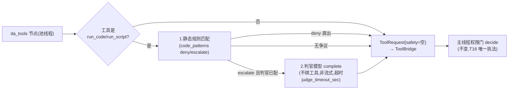
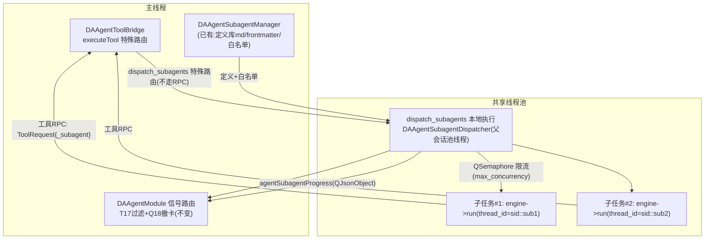

# 阶段 4：子 Agent 编排与权限判官（permission_judge）C++ 化

本阶段目标：把 `subagent_orchestrator.py`（735 行）与 `permission_judge.py`（402 行）移植为 C++，完成 Python 推理侧最后一块能力。铁律 T16（权限 C++ 唯一执法、判定前置、不落盘）与 T17（子 agent tool_call 不落盘不渲染、终态撤卡 Q18）**行为完全不变**，仅执行载体迁移。

## 一、权限判官 `DAAgentJudge`（permission_judge.py 移植）

### 1.1 职责与在新架构中的位置

现状：Python 在 `tool_node` 发起 `tool_call` **之前**跑判定，把 `safety{verdict, reason, source}` 附在协议消息上，C++ 权限门消费（T16：Python 是咨询方）。

新架构：**判定仍在"发起工具请求之前"，但整体在 C++ 池线程内完成**——不再有协议字段，`safety` 直接进 `DAAgentToolBridge::ToolRequest` 结构体，主线程 `DAAgentPermissionManager::decide(sessionId, tool, params, safety)` 签名不变。

### 1.2 实现要点（直译 `permission_judge.py` 管线）

| 现状组件 | C++ 落点 | 说明 |
|---------|---------|------|
| 静态危险模式匹配（deny/escalate 清单由 `init.config.code_patterns` 注入） | `DAAgentJudge::staticCheck(code, DAAgentCodePatterns)` | 纯正则/子串匹配，`DAAgentPermissionConfig.codePatterns` 已在 C++ 配置模型中（不再需要协议下发） |
| 判官模型调用（复用当前供应商凭据） | `judgeModel->complete(prompt, params)`（阶段 3 的 provider 快照 + 独立判官配置——**`permission` 分组**的 `judge_model`/`judge_timeout_sec=30`，非 llm 分组） | 提示词模板直译 Python（输入代码片段 + 分类指引，输出 verdict JSON）；**结果解析要容错**（JSON 提取失败 → `uncertain`） |
| 产出 `{verdict, reason, source}` | `DAAgentSafetyVerdict{Allow, Deny, Uncertain; reason; source(rules/model/none); contentHash}` | `source` 取值与现状一致（`rules`/`model`/`none`） |
| run_script 判定时读文件原始字节产 sha256（审计问题 26 TOCTOU） | `QCryptographicHash` 读入口文件字节 → `safety.contentHash`，`ToolRequest` 注入内部键 `_expected_content_hash`（内部键不进持久化/UI，同 `_tier`/`_subagent` 先例） | 执行前校验逻辑在 RunScript 工具内**已存在**，零改动 |
| `workspace_root` 解析入口文件 | 判定边界=入口文件不递归（语义保持），路径取 `setSessionContext` 的会话级 workspace | T16 会话上下文隔离不变 |

!!! warning "禁止反向 RPC"
    现状铁律：禁止实现成"C++→Python 判定 RPC"。新架构判定天然在 C++——但要保持**判定时机**：必须在 `ToolRequest` 构造前（工具排队/审批之前）完成，这样权限门拿到的 `safety` 与现状时序语义一致，auto 模式的 allow 降级 ask 逻辑（判官未配置时）不受影响。

### 1.3 判定成本控制

- 仅 `code_exec` 分级工具（`run_code`/`run_script`）触发——与现状一致（`agent_runner.py:967-988` 的调用条件）。
- 静态 deny 命中**不调模型**直接出 `Deny`；`yolo` 模式跳过判定（Python 侧"按模式决定是否判定"→ C++ 判定器读权限模式，`reconfigure`/`pushPermissionMode` 后即时生效）。

## 二、子 Agent 编排 `DAAgentSubagentDispatcher`（subagent_orchestrator.py 移植）

### 2.1 架构总览

- `dispatch_subagents` 是**本地执行工具**：**`da_tools` 节点在投递前按工具名识别**——命中 `dispatch_subagents` 直接转 `DAAgentSubagentDispatcher` 本地执行（复用等待/超时/stop 机制），**不经 `deliverToolRequest`、不进主线程 `executeTool` 队列**（对齐现状"编排器本地执行"；`deliverToolRequest` 只服务走权限门的常规工具）。
- **子任务不得与父任务争 R6 池槽**：父任务本身占一个池线程阻塞等待子任务汇总，若子任务再投同一 `QThreadPool`（容量 2-8），两个会话同时派发即池饥饿 → 600s 假超时。子任务必须使用**独立嵌套池**（Dispatcher 自持小池，容量=concurrency）或 `run_async` + 独立 io_context。
- 子任务 = 共享 `GraphEngine` 的**不同 `thread_id`**（`"<sessionId>::sub-<n>"`，官方并发安全边界内），跑同一 JSON 图定义的**变体**。

### 2.2 子 agent 图变体（对照 Python `build_agent_graph(enable_ask_user=False, tools=子集)`）

| 维度 | 主 agent | 子 agent |
|------|---------|---------|
| ask_user 工具 | 注入 | **不注入**（`enable_ask_user=False`），图路由中 ask_user 分支不可达 |
| 工具集 | 全量（含 dispatch_subagents？现状主 agent 才有） | 定义 `tools` 白名单 ∩ 已注册工具（白名单求交直译 orchestrator `:解析/求交`） |
| 系统提示词 | 平台基础+插件拼接 | 子 agent 定义的 `system_prompt`（`DAAgentSubagentDef` 字段，来源 md frontmatter/`registerBuiltinSubagent`） |
| recursion_limit | 配置默认 -1 | `subagent.recursion_limit=60` |
| 权限 | 当前激活模式+分级 | **继承父当前模式与分级**（Q5 现状，权限门在主线程天然继承，无需特殊处理） |
| 进度上报 | 无 | 每任务状态 → `agentSubagentProgress`（`call_id`=dispatch 工具调用 id、`task_id`、state=spawned/running/done/error/timeout/stopped、30s 心跳） |
| 落盘/渲染 | 正常 | `subagent_id` 标记 → Module 现有过滤 lambda（T17）自动生效——**信号面复刻保证零改动** |
| **子图静默（Q8）** | — | 子 agent 运行**不发** token/message_end/usage/retrying（现由任务级静默实现，`subagent_orchestrator.py:609`）——C++ 落点：子 runner 的流式/收尾事件**不转发**到主会话信号（按 role=sub 过滤），仅 `subagent_progress` 与聚合 usage 出栈，否则子 agent 流式 token 会污染主聊天流 |

### 2.3 编排语义逐条对照（orchestrator 行为移植表）

| Python 行为 | 代码位置 | C++ 实现 |
|------------|---------|---------|
| 定义解析/校验（批派发上限 batch_limit=**2**，现状默认值 `subagent_orchestrator.py:413-414`） | `:派发校验` | Dispatcher 入口校验，超出批次拆批（同语义） |
| `asyncio.Semaphore(max_concurrency=2)` 限流 | `:453` | `QSemaphore`（PerKey 或全局限流，取 `subagent.max_concurrency`，上限 2） |
| `wait_for` 墙钟超时（`subagent.timeout_sec=600`，审批等待计入） | `:529-531` | 任务 deadline：`waitForResult` 带绝对期限；到期 → 停该任务 runner（stop 级联）→ state=timeout |
| 停止级联（共享 stop_event） | `:停止级联` | 父 runner stop → Dispatcher 遍历子 runner `requestStop` → state=stopped |
| 进度心跳 30s（无 task_id 的 running，保活看门狗） | `:689` | `QTimer`（Dispatcher 线程内可用 `QDeadlineTimer` 轮询 + 发射投递）→ `agentSubagentProgress`；UI 忽略无 task_id 心跳的行为在 Dock 侧已存在 |
| 派发聚合 done（`results.tasks[]`） | `:聚合` | 终态汇总 JSON → 同结构 `agentSubagentProgress`（Q18 撤卡触发点） |
| usage 聚合 `source="subagents"` | `:usage聚合` | 各子 run 的 `RunResult.usage` 求和 → 一条 `agentUsage(..., "subagents")` |
| 子任务结果回填父上下文（聚合态 results 进父 messages） | dispatch 工具返回值 | Dispatcher 返回 JSON 结果串（走普通 ToolBridge 结果路径回父 `da_tools` 节点） |
| RPC 多路复用（子任务工具调用与父交织，乱序/迟到/stop 分发） | `agent_runner.py:1486-1528` | **天然消解**：每个子 runner 是独立 wait 表，按 `callId→runner` 路由即可；`dispatch_subagents` 的 callId 与子任务 callId 命名空间隔离（沿用 `callId 碰撞检测告警`） |
| `update_subagents` 热更新（重建 dispatch schema 与 bind_tools） | orchestrator `update_definitions` | `DAAgentEngine::sendUpdateSubagents`：更新工具快照中 `dispatch_subagents` 的 JSON schema（任务定义数组→schema properties），运行中任务用派发时快照不受影响 |

### 2.4 全局 LLM 并发预算（可选优化，审计问题 27 的"中期方向"）

新模型下 N 会话 × M 子任务都在单进程内——现状"无跨进程全局配额"问题**反而更好解决**。本阶段默认不做（保持现状保守默认 concurrency=**1**/batch=**2**，上限 concurrency≤2、batch≤4，见 `subagent_orchestrator.py:413-414`），但预留：`DAAgentEngine` 级 `QSemaphore llmBudget`（容量可配），`da_agent` 节点请求前 acquire。若实施顺利，作为加分项落地；不阻塞验收。

## 三、实施步骤

| # | 步骤 | 产出 | 验证 |
|---|------|------|------|
| 1 | `DAAgentSafetyVerdict` + `DAAgentJudge` 静态规则部分 | `runtime/DAAgentJudge.*` | 单测：deny/escalate/无命中 三类 + `code_patterns` 配置注入 |
| 2 | 判官模型调用（provider 快照 + 超时 + 解析容错） | 同上 | 单测：Mock provider 返回 verdict JSON / 坏 JSON→uncertain / 超时→uncertain |
| 3 | `da_tools` 节点接入判定时机 + `ToolRequest.safety`/`_expected_content_hash` 注入 | `DAAgentNodes.*`/`DAAgentToolBridge.*` | 单测：auto 模式 allow/ask 降级路径（权限门既有测试复用） |
| 4 | `DAAgentSubagentDispatcher`：批派发/限流/超时/级联/心跳/聚合 | `runtime/DAAgentSubagentDispatcher.*` | 单测：状态机映射（spawned→running→done/error/timeout/stopped） |
| 5 | 子 agent 图变体构造 + thread_id 规则 + usage 聚合 | `DAAgentGraphDef` 扩展 | 单测：白名单求交、recursion_limit=60、独立状态隔离 |
| 6 | `sendUpdateSubagents` schema 重建 | `DAAgentEngine.*` | 单测：定义增删后 dispatch schema 变化、运行中任务快照不变 |
| 7 | Q18 撤卡/心跳/T17 过滤回归 | 既有 Module 测试扩展 | 信号面驱动的既有连接逻辑直接验证 |

## 四、原 Python 测试的 C++ 等价覆盖（行为回归清单）

`src/PyScripts/tests/test_subagent_orchestrator.py`（8 类 37 用例）逐类迁移为 `DAAgentSubagentTest` + `DAAgentJudgeTest`：

| 原 Python 用例类 | C++ 对应 | 备注 |
|------------------|---------|------|
| 定义解析/白名单/schema 注入 | ✅ 必迁 | frontmatter 解析已有 `DAAgentSubagentManagerTest`，补白名单交集与 schema 生成 |
| 派发校验（批上限/非法定义） | ✅ 必迁 | Dispatcher 入口 |
| 执行状态映射+停止级联+并发限流 | ✅ 必迁 | QSemaphore + stop 级联单测 |
| 截断与 usage 聚合 | ✅ 必迁 | 阶段 3 Truncator 复用 |
| 系统提示词组装（子 agent） | ✅ 必迁 | |
| RPC 分发器（乱序/迟到/stop/审批计时/EOF） | ⚠️ 部分消解 | EOF/分发器概念消失；保留：迟到结果拒绝、审批计时挂起、stop 中断（进 ToolBridge 测试） |
| 权限集成（judge→safety→decide） | ✅ 必迁 | `DAAgentJudgeTest` + 权限门既有用例串联 |
| 主图回归（对话/单工具/ask_user/停止/reconfigure） | ✅ 必迁 | 阶段 2/3 已覆盖，此处汇总为端到端用例 |

`test_permission_judge.py`（7 类）→ `DAAgentJudgeTest` 逐类迁移（静态规则表、判官提示词解析、run_script 边界）。

## 五、验收标准

- [ ] `DAAgentJudgeTest`/`DAAgentSubagentTest` ≥ 37 用例（对齐原 Python 用例数）全绿（测试按 `02-阶段1` §七步骤 7 的登记方式建立，需 cxx_std_20 + link neograph::core）
- [ ] 铁律回归：T16（判定前置/唯一执法/不落盘）、T17（子 agent 消息不进 JSONL 不渲染、终态撤卡 Q18）在 C++ 测试中有显式断言
- [ ] 手测：`dispatch_subagents` 派发 2 个 explore 子任务 → 进度卡片渲染、父对话不出现子转录、超时任务撤卡
- [ ] `yolo/auto/manual` 三模式下 run_code 判定行为与现状一致

## 风险与回退

| 风险 | 对策 |
|------|------|
| 子任务并发共享 engine 的 checkpoint 交错（同 session 派生命名空间） | thread_id 用 `<sessionId>::sub-<n>` 全局唯一（阶段 0 V3 已验多 thread_id 并发）；禁止子任务与父任务同 thread_id |
| 判官提示词输出格式漂移导致解析失败 | 解析容错（提取首个 JSON 块/正则），失败一律 `uncertain`（现状降级 ask，安全侧保守） |
| 心跳/进度时序与 Dock 现有幂等键（call_id/task_id）不匹配 | 复刻现 `subagent_progress` JSON 载荷字段（`src/DAAgent/AGENTS.md` §5.2 字段表即契约），先写载荷快照测试再实现 |
| 全局并发预算引入死锁 | 默认不做（可选项），做时只包 LLM 请求不包工具等待 |

## 参考资料

- 蓝本：`src/PyScripts/DAWorkbench/agent/subagent_orchestrator.py`、`permission_judge.py`、`agent_runner.py:967-988`（判定调用条件）、`:1415-1528`（RPC 分发）
- 载荷契约：`src/DAAgent/AGENTS.md` §5.2 `subagent_progress`/`tool_call.safety` 字段（保留为内部结构体字段名对照）
- 既有实现：`src/DAAgent/DAAgentSubagentManager.*`（定义库）、`DAAgentPermissionManager::decide`（执法入口）、铁律 T16/T17 + `DAAgentModule.cpp:1008,1117,1291`（T17 过滤与 Q18 撤卡连接点）